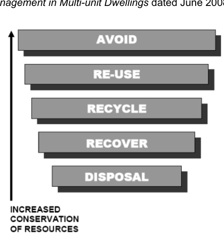

## 1 INTRODUCTION

1\. This Chapter provides Council’s general requirements for waste minimisation, management and recycling for all developments within the city.

2\. This Chapter incorporates the waste minimisation, recycling requirements and assessment criteria / development controls contained in the NSW Department of Environment and Climate Change’s publication titled Model Waste Not DCP Chapter dated July 2008. This Chapter also reflects the waste minimisation and management / recycling strategies and guidelines contained in the NSW Department of Environment and Climate Change’s publication titled Better Practice

> [Picture on page 3: a picture, saved as a picture (images/chapter-e7-waste-management-page-3-9.gif, 150 dpi).]

Guide for Waste Management in Multi-unit Dwellings dated June 2008.

#### Figure 1: Waste Minimisation Hierarchy
