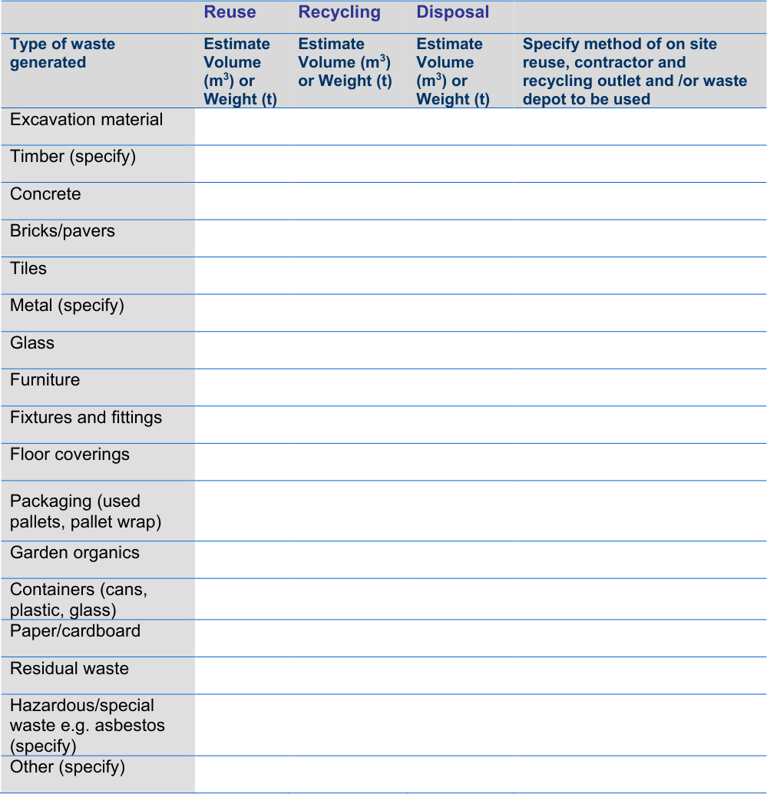
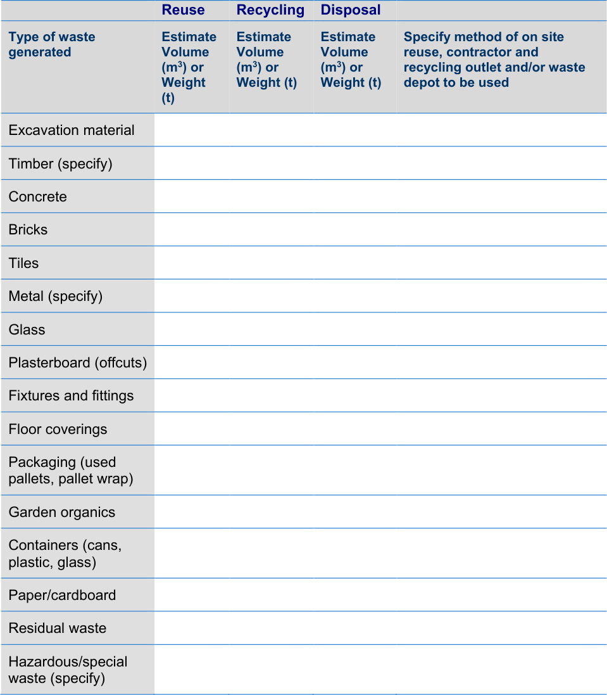

## 5 PLANNING REQUIREMENTS / ASSESSMENT CRITERIA

### 5.1 Demolition

1\. A completed Site Waste Minimisation and Management Plan (SWMMP) shall accompany any Development Application proposing the demolition of a building or other ancillary structures.

2\. Pursue adaptive reuse opportunities of buildings/structures.

3\. Identify all waste likely to result from the demolition and opportunities for reuse of materials. Refer to Figure 1.

4\. Facilitate reuse/recycling by using the process of 'deconstruction', where various materials are carefully dismantled and sorted.

5\. Reuse or recycle salvaged materials onsite where possible.

6\. Allocate an area for the storage of materials for use, recycling and disposal (giving consideration to slope, drainage, location of waterways, stormwater outlets, vegetation, and access and handling requirements).

7\. Provide separate collection bins or areas for the storage of residual waste.

8\. Clearly ‘signpost’ the purpose and content of the bins and storage areas.

9\. Implement measures to prevent damage by the elements, odour and health risks and windborne litter.

10\. Minimise site disturbance, limiting unnecessary excavation.

11\. When implementing the SWMMP the developer must ensure:

(a) Footpaths, public reserves, street gutters are not used as places to store demolition waste or materials of any kind without Council approval.

(b) Any material moved offsite is transported in accordance with the requirements of the Protection of the Environment Operations Act 1997 and any other relevant legislation.

(c) Waste is only transported to a place that can lawfully be used as a waste facility.

(d) Generation, storage, treatment and disposal of hazardous waste and special waste (including asbestos) is conducted in accordance with relevant waste legislation administered by the EPA and relevant Occupational Health and Safety legislation administered by WorkCover NSW.

(e) Evidence such as weighbridge dockets and invoices for waste disposal or recycling services is retained. This shall include a log book with associated receipt/invoices, waste classification, and site validation certificate. All entries must include: time and date, description and size of waste, waste facility used, vehicle registration and company name. The log book and associated receipts must be made available for inspection by Council Officer’s at any time during site works.

12\. Table 1 provides a list of some potential reuse/recycling options. Reuse and recycling opportunities are decreased when asbestos is not carefully removed and segregated from other waste streams.

Table 1: Examples of Demolition Materials and Potential Reuse/ Recycling Options

| Material | Reuse/Recycling Potential |
|---|---|
| Concrete | Reused for filling, levelling or road base |
| Bricks and Pavers | Can be cleaned for reuse or rendered over or crushed for use in landscaping and driveways |
| Roof Tiles | Can be cleaned and reused or crushed for use in landscaping and driveways |
| Untreated Timber | Reused as floorboards, fencing, furniture, mulched or sent to second hand timber suppliers |
| Treated Timber | Reused as formwork, bridging, blocking and propping, or sent to second hand timber suppliers |
| Doors, Windows, Fittings | Sent to second hand suppliers |
| Glass | Reused as glazing or aggregate for concrete production |
| Metals (fittings, appliances and wiring) | Removal for recycling |
| Synthetic Rubber (carpet underlay) | Reprocessed for use in safety devices and speed humps |
| Significant Trees | Relocated either onsite or offsite |
| Overburden | Power screened and used as topsoil |
| Garden Waste | Mulched, composted |
| Carpet | Can be sent to recyclers or reused in landscaping |
| Plasterboard | Removal for recycling, return to supplier |

(Source: NSW Department of Environment and Climate Change Waste Not DCP Chapter 2008)

### 5.2 Construction of Buildings or Structures

1\. A completed Site Waste Minimisation and Management Plan (SWMMP) shall accompany the application.

2\. Estimate volumes of materials to be used and incorporate these volumes into a purchasing policy so that the correct quantities are purchased. For small-scale building projects see the rates in Appendix 2 Waste/Recycling Generation Rates for a guide.

3\. Identify potential reuse/recycling opportunities for excess construction materials.

4\. Incorporate the use of prefabricated components and recycled materials.

5\. Arrange for the delivery of materials so that materials are delivered ‘as needed’ to prevent the degradation of materials through weathering and moisture damage.

6\. Consider organising the return of excess materials to the supplier or manufacturer.

7\. Allocate an area for the storage of materials for use, recycling and disposal (considering slope, drainage, location of waterways, stormwater outlets and vegetation).

8\. Arrange contractors for the transport, processing and disposal of waste and recycling. Ensure that all contractors are aware of the legal requirements for disposing of waste.

9\. Promote separate collection bins or areas for the storage of residual waste.

10\. Clearly signpost the purpose and content of the bins and storage areas.

11\. Implement measures to prevent damage by the elements, odour and health risks, and windborne litter.

12\. Minimise site disturbance and limit unnecessary excavation.

13\. Ensure that all waste is transported to a place that can lawfully be used as a waste facility.

14\. Retain all records demonstrating lawful disposal of waste and keep them readily accessible for inspection by regulatory authorities such as council, DECC or NSW WorkCover Authority.

### 5.3 Dwelling Houses, Dual Occupancies, Secondary Dwellings and Integrated Housing

1\. A completed Site Waste Minimisation and Management Plan (SWMMP) shall accompany a Development Application for a dwelling-house, dual occupancy development, secondary dwelling or for each dwelling in an integrated housing/ lot development.

2\. Where waste collection services are available, single dwellings are to be provided with:

(a) 1 x 240L or 120L general waste bin collected weekly;

(b) 1 x 240L recyclable material bin collected fortnightly; and

(c) 1 x 240L green waste bin collected fortnightly.

3\. Bins are to be stored behind the building line and screened from view from the public domain at all times not associated with waste collection.

4\. Waste containers are to be stored in a suitable location so as to avoid vandalism, nuisance and adverse visual impacts.

5\. A designated area shall be provided for composting that should not impact on adjoining properties.

6\. Where possible, the waste/recycling storage area should be located in the rear yard and minimise the distance of travel to the collection point.

7\. The waste storage area is to be easily accessible and have unobstructed access to Council’s usual collection point.

8\. There should be sufficient space within the kitchen (or an alternate location) for the interim

storage of waste and recyclables.

9\. The placement of bins for collection at the nominated collection point should ensure adequate traffic and pedestrian safety is maintained.

Note: It is the responsibility of dwelling occupants to move bins to the identified collection point no earlier than the evening before collection day and to then return the bins to their storage area no later than the evening of collection day. Bins are to remain in their on-site storage area at all other times.

10\. The site plan and floor layout plans submitted with the application must show:

(a) The location of an indoor waste/recycling cupboard (or other appropriate storage space) for each dwelling.

(b) The location of an onsite waste/recycling storage area for each dwelling, that is of sufficient size to accommodate Council’s waste, recycling and garden waste bins. (Indicative bin sizes are shown in Appendix 3)

(c) An identified on-site location for a compost container.

(d) An identified kerbside collection point for the collection and emptying of Council’s waste, recycling and garden waste bins.

### 5.4 Multi-Dwelling Housing (Villas and Townhouses)

#### 5.4.1 General Requirements

1\. A completed Site Waste Minimisation and Management Plan (SWMMP) shall accompany the Development Application for a proposed multi-dwelling housing development.

2\. The site plan and floor layout plans submitted with a Development Application must show:

(a) The location of an indoor waste/recycling cupboard (or other appropriate storage space) for each dwelling;

(b) The location of individual waste/recycling storage areas (such as for townhouses and villas) or a communal waste/recycling storage room(s) able to accommodate Council’s waste, recycling and garden waste bins;

(c) An identified location for individual compost containers or communal compost container;

(d) An identified collection point for the collection and emptying of Council’s waste, recycling and garden waste bins;

(e) The path of travel for moving bins from the storage area to the identified collection point (if collection is to occur away from the storage area);

(f) The on-site path of travel for collection vehicles (if collection is to occur on-site), taking into account accessibility, width, height and grade.

3\. Waste storage for multi dwelling housing developments may be located within the rear yard area of each dwelling, in a position from which bins may be readily wheeled to the street for collection. Alternatively a communal waste storage area may be provided.

The following storage provision shall be made per dwelling:

• Waste: 120 litres per week per dwelling;

• Recycling: 120 litres per week; and

• Green waste: 120 litres per fortnight per dwelling.

#### 5.4.2 Requirements for Waste Storage Areas:

1\. Any communal waste storage area shall be located in a position which is accessible by all residents for the depositing of waste and for the relocation of bins to the collection position.

2\. The storage facility must be well lit and easily accessible from the main pedestrian access points within the development, in order to improve safety for residents.

3\. Each bin and bin type must be readily accessible and manoeuvrable in and out of the proposed storage area.

4\. The storage area shall be free of all obstructions so as not to restrict movement and servicing of the bins or containers.

5\. All storage areas must have bump rails to prevent bins from making contact with walls for the purposes of noise reduction.

6\. There shall be no lip or step between access point to the storage area and the collection point.

7\. The ground surface of the storage area shall be of a smooth finish to enable easy movement of the bins/containers and minimise noise impacts.

#### 5.4.3 Requirements for Communal Waste Storage Areas:

1\. A communal waste facility must be provided for:

• Developments incorporating more than six (6) dwellings; or

• Multi-dwelling housing developments where the number of bins proposed cannot be accommodated within 50% of the developments frontage on collection day; or

• Developments where site constraints make access to the street difficult for individual occupants; or

• Developments with frontage to a major road, where on-site garbage collection is required.

2\. Communal waste storage areas must be designed to accommodate bins with the minimum dimensions specified in Appendix 3:

3\. The size of waste bins shall be determined having regard to the ability of the bins to be wheeled to the street for collection by a contractor. The body corporate or a caretaker is responsible for the movement of bins to their collection point.

4\. Council may consider the location of the storage facility within the front building line setback area of the development site. Any such storage facility must be architecturally designed to reflect the design style of the proposed building and not detract from the visual amenity and streetscape character in the immediate vicinity. In this respect, the storage facility must be screened from the street frontage via a minimum 1.5 metre high brick or masonry wall and feature landscaping and an open pergola or other similar roofline feature, in order to improve the streetscape appearance of the facility.

Applicants should refer to the Department of Environment and Climate Change’s ‘Better Practice Guide for Waste Management in Multi-Unit Dwellings’ for additional guidance.

5\. There must be an unobstructed and Continuous Accessible Path of Travel (as per Australian Standard 1428 Design for Access and Mobility - 2001) from the waste/recycling storage area(s) or room(s) to:

− The entry to any Adaptable Housing (as per Australian Standard 4299 Adaptable Housing - 1995) − The principal entrance to each residential flat building − The point at which bins are collected/emptied. − In instances where a proposal does not comply with these requirements, Council will consider alternative proposals that seek to achieve a reasonable level of access to waste/recycling storage area(s) or room(s).

### 5.5 Residential Flat Buildings

#### 5.5.1 General Requirements

1\. A completed Site Waste Minimisation and Management Plan (SWMMP) shall accompany the Development Application for a proposed residential flat building.

2\. The site plan and floor layout plans for the proposed residential flat building must show:

(a) The location of an indoor waste/recycling cupboard (or other appropriate storage space) for each dwelling;

(b) The location of the proposed communal waste/recycling storage room(s) able to accommodate all waste, recycling and garden waste bins required for the total development;

(c) The location of any garbage chute(s) and interim storage facilities for recyclable materials;

(d) The location of any service rooms (for accessing a garbage chute) on each floor of the building;

(e) The location of any waste compaction equipment;

(f) An identified location for individual compost containers or communal compost container;

(g) An identified collection point for the collection and emptying of Council’s waste, recycling and garden waste bins;

(h) The path of travel for moving bins from the storage area to the identified collection point (if collection is to occur away from the storage area); and

(i) The on-site path of travel for collection vehicles, taking into account accessibility, width, height and grade.

#### 5.5.2 Requirements for a Communal Waste Storage Facility

1\. Residential flat buildings must include communal waste/recycling storage facilities in the form of a waste/recycling storage room (or rooms) designed in accordance with Appendix 4 and the Better Practice Guide for Waste Management in Multi-Unit Dwellings.

2\. The waste/recycling storage room must be designed to accommodate bins with the minimum dimensions specified in Appendix 3, based on the number of bins required to service the total development

3\. The waste/recycling storage room must be located in a position which is accessible by all residents

for the depositing of waste and for the relocation of bins to the collection position.

4\. Council may in exceptional circumstances consider the location of the storage facility within the front building line setback area of the development site, in instances where a waste/recycling storage room is not possible within the basement due to access impediments or excessive slope constraints, and subject to appropriate collection arrangements being provided.

Any such storage facility must be architecturally designed to reflect the design style of the proposed building and not detract from the visual amenity and streetscape character in the immediate vicinity. In this respect, the storage facility must be screened from the street frontage via a minimum 1.5 metre high brick or masonry wall and feature landscaping and an open pergola or other similar roofline feature, in order to improve the streetscape appearance of the facility.

In this circumstance, it must be satisfactorily demonstrated why a basement waste and recycling storage facility cannot be achieved. However, for the majority of cases, a basement waste and recycling storage facility will be required and hence, sufficient clearance height must be incorporated into the development upfront.

Applicants should refer to the Department of Environment and Climate Change’s ‘Better Practice Guide for Waste Management in Multi-Unit Dwellings’ for design guidelines.

5\. Each bin and bin type must be readily accessible and manoeuvrable in and out of the proposed waste/recycling storage room.

6\. For residential flat buildings involving ten (10) or more dwellings, a dedicated room or caged area must be provided for the temporary storage of discarded bulky items which are awaiting removal. The storage area must be readily accessible to all residents and must be located adjacent to or in close proximity to the main waste/recycling storage room or area.

7\. The storage facility must be well lit and easily accessible from the main pedestrian access points within the development, in order to improve safety for residents.

8\. The storage area shall be free of all obstructions so as not to restrict movement and servicing of the bins or containers.

9\. All storage areas must have buffers or wheel stops to prevent bins from making contact with walls for the purposes of noise reduction.

10\. There shall be no lip or step between access point to the storage area and the collection point.

11\. The ground surface of the storage area shall be of a smooth finish to enable easy movement of the bins/containers and minimise noise impacts.

12\. There must be an unobstructed and Continuous Accessible Path of Travel (as per Australian Standard 1428 Design for Access and Mobility - 2001) from the waste/recycling storage room(s) or area(s) to: − The entry to any Adaptable Housing (as per Australian Standard 4299 Adaptable Housing - 1995); − The principal entrance to each residential flat building; and − The point at which bins are collected/emptied. In instances where a proposal does not comply with these requirements, Council will consider alternative proposals that seek to achieve a reasonable level of access to waste/recycling storage room(s) or area(s).

13\. Where the number of bins proposed can be accommodated within 50% of the developments frontage on collection day, bins may be collected from a kerbside location. In instances where kerbside bin collection can not be accommodated or is not appropriate due to safety or functional constraints, bins must be collected onsite.

14\. Where bins cannot be collected from a kerbside location, the development must be designed to allow for on-site access by garbage collection vehicles of dimensions detailed in Appendix 7. The proposed collection vehicle must be nominated in the development application documentation and must be supported by evidence demonstrating that such a collection service is readily available.

The site must be configured so as to allow collection vehicles to enter and exit the site in a forward direction and so that collection vehicles do not impede general access to, from or within the site. Access driveways to be used by collection vehicles must be of sufficient strength to support such vehicles.

Note: As a minimum requirement for collection vehicle access, Council will require indemnity against claims for loss or damage to the pavement or other driving surface. Council may also require indemnity against liabilities, losses, damages and any other demands arising from any on-site collection service. In all cases, a hazard assessment will need to be conducted prior to Council agreeing to undertake the service.

15\. Should a collection vehicle be required to enter a property, access driveways and internal roads must be designed in accordance with Australian Standard 2890.2 Parking Facilities – Off-Street Commercial Vehicle Facilities – 2002.

16\. If bins need to be moved from normal storage areas to a different location for collection purposes, it is the responsibility of agents of the owners’ corporation to move the bins to the collection point no earlier than the evening before collection day and to then return the bins to their storage areas no later than the evening of collection day. Bins are to remain in their on-site storage areas at all other times.

17\. Residents should have access to a cold water supply for the cleaning of bins and the waste storage areas. Storage areas should be constructed and designed to be weather proof and easy to clean, with wastewater discharged to sewer.

18\. Garbage chutes must be designed in accordance with Appendix 5, the Building Code of Australia and the guidelines contained in Better Practice Guide for Waste Management in Multi-Unit Dwellings. Garbage chutes are not suitable for recyclable materials and must be clearly labelled to discourage improper use. Alternative interim disposal facilities for recyclables should be provided at each point of access to the garbage chute system. No garbage chutes are permitted on balcony areas.

19\. A communal green waste bin must be provided of sufficient capacity to accept waste from the landscaped areas.

20\. Each dwelling unit should be provided with an indoor waste/recycling cupboard (or other appropriate storage space) for the interim storage of a minimum one day’s garbage and recycling generation.

### 5.6 Mixed Use Development

#### 5.6.1 General

1\. Where residential and commercial land uses occur within the one building or development, waste management will necessitate a balancing of variable demands, including preservation of residential amenity.

#### 5.6.2 Controls / Requirements

1\. A completed Site Waste Minimisation and Management Plan (SWMMP) shall accompany the Development Application.

2\. The controls for Residential Flat Buildings apply to the residential component of mixed-use development.

3\. The controls for Commercial Developments apply to the non-residential component of mixed-use development.

4\. Mixed Use development must incorporate separate and self-contained waste management systems for the residential component and the non-residential component. In particular, the development must incorporate separate waste/recycling storage rooms/areas for the residential and non-residential components. Commercial tenants must be prevented (via signage and other means), from using the residential waste/recycling bins and vice versa.

5\. The residential waste management system and the non-residential waste management system must be designed so that they can efficiently operate without conflict. Conflict may potentially occur between residential and non-residential storage, collection and removal systems, and between these systems and the surrounding land uses. For example, collection vehicles disrupting peak residential and commercial traffic flows or causing noise issues when residents are sleeping.

6\. A garbage storage room at the basement level must be provided for mixed use developments.

7\. A bin collection layout must be submitted with a Development Application.

8\. A communal green waste bin must be provided of sufficient capacity to accept waste from any landscaped areas located on the site.

9\. Waste storage for the commercial component of the building must be calculated having regard to the anticipated waste generation rates of the intended occupants (Refer to Appendix 2).

10\. The garbage storage room must be designed to accommodate the number of bins required for the development. The storage room must be located in a position which is accessible by all residents for the depositing of waste and for the relocation of bins to the collection position.

11\. The garbage storage room must be designed to accommodate bins with the following minimum dimensions as indicated in Appendix 6

### 5.7 Commercial Development and Change of Use (Shops, Offices,

Food Premises, Hotels, Motels, Licensed Clubs, Education Establishments, Entertainment Facilities and Hospitals)

#### 5.7.1 General Requirements

1\. A completed Site Waste Minimisation and Management Plan (SWMMP) shall accompany the Development Application.

2\. The plans submitted with the application must show:

(a) The location of the designated waste and recycling storage room(s) or areas, sized to meet the waste and recycling needs of all tenants;

(b) The location of temporary waste and recycling storage areas within each tenancy. These are

to be of sufficient size to store a minimum of one day’s worth of waste;

(c) An identified collection point for the collection and emptying of waste, recycling and garden waste bins;

(d) The path of travel for moving bins from the storage area to the identified collection point (if collection is to occur away from the storage area); and

(e) The on-site path of travel for collection vehicles (if collection is to occur on-site).

3\. There must be convenient access from each tenancy and / or larger waste producing area of the development to the waste / recycling storage room(s) or area(s). There must be step-free access between the point at which bins are collected / emptied and the waste / recycling storage room(s) or area(s).

4\. Every development must include a designated general waste / recycling storage area or room(s) designed in accordance with Appendix 6 Commercial/Industrial Waste and Recycling Storage Areas.

5\. Depending upon the size and type of the development, it may be necessary to include a separate waste / recycling storage room or area for each tenancy.

6\. Arrangements must be in all parts of the development for the separation of recyclable materials from general waste. Arrangements must be in all parts of the development for the movement of recyclable materials and general waste to the main waste / recycling storage room / area. For multiple storey buildings, this may require the provision of a goods lift.

7\. The waste / recycling storage room or area must be able to accommodate bins that are of sufficient volume to contain the quantity of waste generated at the rate described in Appendix 4, Waste / Recycling Generation Rates between collections.

8\. A waste / recycling cupboard must be provided for each and every kitchen area in a development, including kitchen areas in hotel rooms, motel rooms and staff food preparation areas. Each waste / recycling cupboard must be of sufficient size to hold a minimum of a single days waste and to hold separate containers for general waste and recyclable materials.

9\. For sites containing road frontages, the development should be designed to make provision for adequate access arrangements for servicing of the waste and recycling storage bin area from the rear or secondary access road.

10\. Any garbage chutes must be designed in accordance with the requirements of the Building Code of Australia and Appendix 5 to this part of the DCP.

#### 5.7.2 Operational Requirements

1\. All commercial tenants must keep written evidence on site of a valid contract with a licensed waste contractor for the regular collection and disposal of the waste and recyclables that are generated on the site.

2\. Between collection periods, all waste / recyclable materials generated on site must be kept in enclosed bins with securely fitting lids so the contents are not able to leak or overflow. Bins must stored in the designated waste / recycling storage room(s) or area(s).

3\. The waste / recycling storage room or area must provide separate containers for the separation of recyclable materials from general waste. Standard and consistent signage on how to use the waste management facilities should be clearly displayed.

4\. Waste management facilities must be suitably enclosed, covered and maintained so as to prevent polluted wastewater run-off entering the stormwater system.

5\. Premises which generate at least 50 litres per day of meat, seafood or poultry waste must have that waste collected on a daily basis or must store that waste in a dedicated and refrigerated waste storage area until collection.

6\. Arrangements must be in place regarding the regular maintenance and cleaning of waste management facilities. Tenants and cleaners must be aware of their obligations in regards to these matters.

7\. Premises that discharge trade wastewater must do so only in accordance with a written agreement from the local sewer authority. In the Sydney Metropolitan Area this is Sydney Water. Sydney Water defines trade wastewater as 'any liquid, and any substance contained in it, which may be produced at the premises in an industrial and commercial activity, but does not include domestic wastewater (e.g. from hand-basins, showers and toilets).'

### 5.8 Industrial Development

#### 5.8.1 Requirements

1\. A completed Site Waste Minimisation and Management Plan (SWMMP) shall accompany the Development Application.

2\. The plans submitted with the application must show:

(a) The proposed location of the waste and recycling storage area to meet the requirements of the industrial development; and

(b) The proposed on-site path of travel and manoeuvring of waste collection trucks servicing the development.

3\. The industrial development must include a designated general waste and recycling storage area in accordance with Appendix 5 to this chapter.

4\. All industrial organisations must keep written evidence on-site of a valid contract with a licensed waste contractor.

5\. The type and number of containers used to hold waste and recyclable materials must be compatible with the collection practices of the nominated waste contractor.

6\. Arrangements must be in place regarding the regular maintenance and cleaning of waste management facilities.

7\. Premises that discharge trade wastewater must do so only in accordance with a written agreement from the local sewer authority. In the Sydney Metropolitan Area this is Sydney Water. Sydney Water defines trade wastewater as 'any liquid, and any substance contained in it, which may be produced at the premises in an industrial and commercial activity, but does not include domestic wastewater (e.g. from hand-basins, showers and toilets).'

### Appendix: 1 Site Waste Minimisation and Management Plan Template

| Applicant and Project Details (All Developments) |
|---|
| Applicant Details |
| Application No. |
| Name |
| Address |
| Phone number(s) |
| Email |
| Project Details |
| Address of development |
| Existing buildings and other structures currently on the site |
| Description of proposed development |

This development achieves the waste objectives set out in the DCP. The details on this form are the provisions and intentions for minimising waste relating to this project. All records demonstrating lawful disposal of waste will be retained and kept readily accessible for inspection by regulatory authorities such as Wollongong City Council, NSW DECC or NSW WorkCover..

Name

Signature

Date

(Source: NSW Department of Environment and Climate Change. Model Waste Not DCP Chapter 2008)

#### Demolition (All Types of Development)

#### Address of development: ____________________________________________________

> [Picture on page 17: a map, saved as a picture (images/chapter-e7-waste-management-page-17-3.gif, 150 dpi); the street names and other small labels are on the picture.]
> Words printed on the picture (title and legend, copied from the PDF):
> Fixtures and fittings
> pallets, pallet wrap)
> waste e.g. asbestos

#### Reuse Recycling Disposal

#### Type of waste generated

#### Estimate Volume (m3) or Weight (t)

Estimate Volume (m3) or

#### Weight (t)

Estimate Volume (m3) or

#### Weight (t)

Specify method of on site reuse, contractor and recycling outlet and /or waste depot to be used

(Source: NSW Department of Environment and Climate Change. Waste Not DCP Chapter 2008)

#### Construction (All Types of Development)

#### Address of development: ____________________________________________________

> [Picture on page 18: a map, saved as a picture (images/chapter-e7-waste-management-page-18-3.gif, 150 dpi); the street names and other small labels are on the picture.]
> Words printed on the picture (title and legend, copied from the PDF):
> Fixtures and fittings
> pallets, pallet wrap)

#### Reuse Recycling Disposal

#### Type of waste generated

Estimate Volume (m3) or

#### Weight (t)

Estimate Volume (m3) or

#### Weight (t)

Specify method of on site reuse, contractor and recycling outlet and/or waste depot to be used

Estimate Volume (m3) or

#### Weight

(Source: NSW Department of Environment and Climate Change Model Waste Not DCP Chapter 2008)

Ongoing Operation (Residential, Multi Unit, Commercial, Mixed Use and

#### Industrial)

#### Address of development: ____________________________________________________

Show the total volume of waste expected to be generated by the development and the associated waste storage requirements.

| RECYCLABLES | COMPOSTABLES | RESIDUAL WASTE* | OTHER |
|---|---|---|---|
| Paper/ cardboard | Metals/ plastics/glass |  |  |
| Amount generated (L per unit per day) |  |  |  |
| Amount generated (L per development per week) |  |  |  |
| Any reduction due to compacting equipment |  |  |  |
| Frequency of collections (per week) |  |  |  |
| Number and size of storage bins required7 |  |  |  |
| Floor area required for storage bins (m2) |  |  |  |
| Floor area required for manoeuvrability (m2) |  |  |  |
| Height required for manoeuvrability (m) |  |  |  |

\*  Current “non-recyclables” waste generation rates typically include food waste that might be further separated for composting.

#### Construction Design   (All Types of  Developments)

Outline how measures for waste avoidance have been incorporated into the design, material purchasing and construction techniques of the development:

#### Materials

#### Lifecycle

Detail the arrangements that would be appropriate for the ongoing use of waste facilities as provided in the development. Identify each stage of waste transfer between residents’ units/commercial tenancies and loading into the collection vehicle, detailing the responsibility for and location and frequency of, transfer and collection.

#### Plans and Drawings (All Developments)

The following checklists are designed to help ensure SWMMPs are accompanied by sufficient information to allow assessment of the application.

Drawings are to be submitted to scale, clearly indicating the location of and provisions for the storage and collection of waste and recyclables during:

• Demolition

• Construction

• Ongoing operation.

#### DEMOLITION

Do the site plans detail/indicate:

#### Tick Yes

Size and location(s) of waste storage area(s)

Access for waste collection vehicles

Areas to be excavated

Types and numbers of storage bins likely to be required

Signage required to facilitate correct use of storage facilities

#### CONSTRUCTION

Do the site plans detail/indicate:\

#### Tick Yes

Size and location(s) of waste storage area(s)

Access for waste collection vehicles

Areas to be excavated

Types and numbers of storage bins likely to be required

Signage required to facilitate correct use of storage facilities

#### On-Going Operational Phases of The Development

Do the site plans detail/indicate:

#### Tick Yes

#### Space

Size and location(s) of waste storage areas

Recycling bins placed next to residual waste bins

Space provided for access to and the manoeuvring of bins/equipment

Any additional facilities

#### Access

Access route(s) to deposit waste in storage room/area

Access route(s) to collect waste from storage room/area

Bin carting grade

Location of final collection point

Clearance, geometric design and strength of internal access driveways and roads

Direction of traffic flow for internal access driveways and roads

#### Amenity

Aesthetic design of waste storage areas

Signage – type and location

Construction details of storage rooms/areas (including floor, walls, doors, ceiling design, sewer connection, lighting, ventilation, security, wash down provisions etc)

### Appendix: 2 Waste / Recycling Generation Rates

#### Construction Waste Generation

‘Rule of Thumb’ for renovations and small home building

• Timber 5-7% of material ordered

• Plasterboard 5-20% of material ordered

• Concrete 3-5% of material ordered

• Bricks 5-10% of material ordered

• Tiles 2-5% of material ordered

(Source: Waste Planning Guide for Development Application, Inner Sydney Waste Board, 1998)

#### Ongoing Operation Waste Generation

| Premises type | Waste generation | Recyclable material generation |
|---|---|---|
| Backpackers’ Hostel | 40L/occupant space/week | 20L/occupant space/week |
| Boarding House, Guest House | 60L/occupant space/week | 20L/occupant space/week |
| Food premises: |  |  |
| • Butcher | 80L/100m2 floor area/day | Variable |
| • Delicatessen | 80L/100m2 floor area/day | Variable |
| • Fish Shop | 80L/100m2 floor area/day | Variable |
| • Greengrocer | 240L/100m2 floor area/day | 120L/100m2 floor area/day |
| • Restaurant, Café | 10L/1.5m2 floor area/day | 2L/1.5m2 floor area/day |
| • Supermarket | 240L/100m2 floor area/day | 240L/100m2 floor area/day |
| • Takeaway food shop | 80L/100m2 floor area/day | Variable |
| Hairdresser, Beauty Salon | 60L/100m2 floor area/week | Variable |
| Hotel, Licensed Club, Motel | 5L/bed space/day 50L/100m2 bar area/day 10L/1.5m2 dining area/day | 1L/bed space/day 50L/100m2 bar area/day 50L/100m2 dining area/day |
| Offices | 10L/100m2 floor area/day | 10L/100m2 floor area/day |
| Shop less than 100m2 floor area Shop greater than 100m2 floor | 50L/100m2 floor area/day 50L/100m2 floor area/day | 25L/100m2 floor area/day 50L/100m2 floor area/day |
| area |  |  |

| Premises type | Waste generation | Recyclable material generation |
|---|---|---|
| Showroom | 40L/100m2 floor area/day | 10L/100m2 floor area/day |
| Multi-Unit Dwellings1 | 80L/unit/week | 40L/unit/week |

(Sources: Department of Environment and Climate Change Model Waste Not DCP Chapter 2008 which was adapted from Waverley Council Code for the Storage and Handling of Waste.1 Appendix A, Better Practice Guide For Waste Management In Multi-Unit Dwellings 2007)

### Appendix: 3 Indicative Bin Sizes

| Bin type | Height | Depth | Width |
|---|---|---|---|
| 80 Litre Bin | 870mm | 530mm | 450mm |
| 120 Litre Bin | 940mm | 560mm | 485mm |
| 140 Litre Bin | 1065mm | 540mm | 500mm |
| 240 Litre Bin | 1080mm | 735mm | 580mm |
| 660 Litre Bin | 1250mm | 850mm | 1370mm |
| 2m3 Skip Bin | 865mm | 1400mm | 1830mm |
| 3m3 Skip Bin | 1225mm | 1505mm | 1805mm |
| 4.5m3 Skip Bin | 1570mm | 1605mm | 1805mm |

These dimensions are only a guide and differ slightly according to manufacturer, if bins have flat or dome lids and are used with different lifting devices.

Additional bin dimensions are available in Better Practice Guide for Waste Management In Multi-Unit Dwellings 2007.

### Appendix: 4 Waste Recycling/Storage Rooms in Multi–Unit Dwellings
