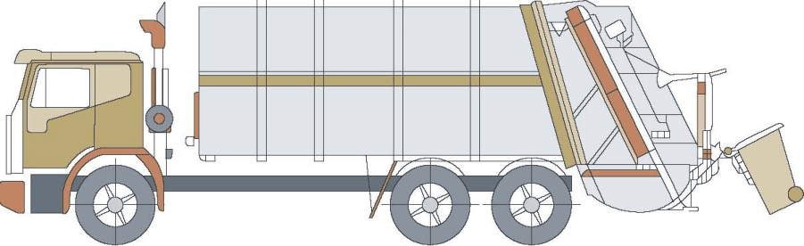
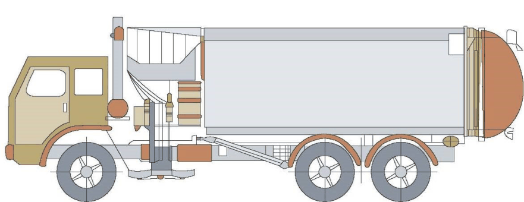
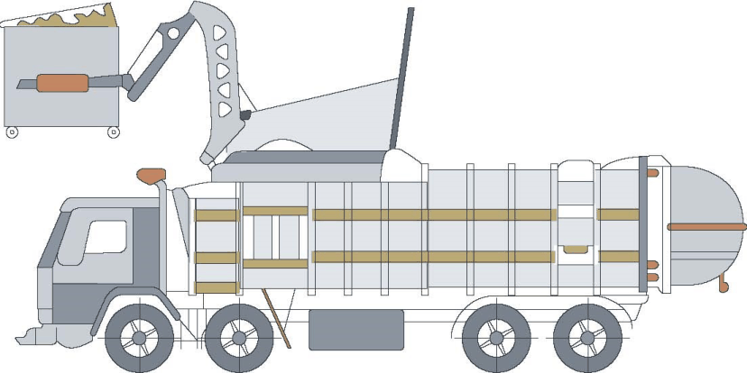

## 6. Management

(a) Arrangements must be in place for the regular maintenance and cleaning of waste and recycling storage areas. Waste and recycling containers must only be washed in an area which drains to a sewer authority approved drainage connection.

### Appendix: 7  Collection Vehicles

Waste collection vehicles may be side loading, rear-end loading, front-end loading or crane trucks. The size of vehicle varies according to the collection service. The following characteristics represent the typical collection vehicle, however, these are only for guidance. It may be possible to engage a collection service provider to use smaller collection vehicles to service developments with narrow roadways and laneways, or for on-site collections. However, as the availability of smaller vehicles to make services is limited, developments should be designed to accommodate vehicles of a similar size to that reported below.

#### Rear loading collection vehicle

This is commonly used for domestic garbage and recycling collections from Multiple Dwellings and Residential Flat Buildings. It can be used to collect waste stored in MGBs or bulk bins, particularly where bins are not presented on the kerbside.

> [Picture on page 31: a picture, saved as a picture (images/chapter-e7-waste-management-page-31-13.gif, 150 dpi).]

#### Rear loading collection vehicle

Length overall

10.24m

Width overall

2.5m

Operational height

3.5m

Travel height

3.5m

Weight (vehicle only) 12.4 tonnes

Weight (payload)

9.5 tonnes

Turning circle

18.0m

#### Side loading collection vehicle

This is the most commonly used vehicle for domestic garbage and recycling collections. It is only suitable for collecting MGBs up to 360 litres in size.

> [Picture on page 32: a picture, saved as a picture (images/chapter-e7-waste-management-page-32-4.gif, 150 dpi).]

| Side-loading collection vehicle |  |
|---|---|
| Length overall | 9.64m |
| Front overhang | 1.51m |
| Wheelbase | 5.20m |
| Rear overhang | 2.93m |
| Turning circle kerb to kerb | 17.86m |
| Turning circle wall to wall | 20.56m |
| Front of vehicle to collection | 3.8m |
| arm |  |
| Maximum reach of side arm | 3.0m |
| Travel height | 3.63m |
| Clearance height for loading | 3.9m |

#### Front lift-loading collection vehcicle

This is mainly used for collecting commercial and industrial waste, and is only suitable for bulk bins with front lift pockets (not MGBs).

> [Picture on page 33: a picture, saved as a picture (images/chapter-e7-waste-management-page-33-4.gif, 150 dpi).]

| Front-lift loading collection vehicle |  |
|---|---|
| Length overall | 10.52m |
| Front overhang | 1.51m |
| Wheelbase | 5.84m |
| Rear overhang | 3.17m |
| Turning circle kerb to kerb | 22.10m |
| Turning circle wall to wall | 23.66m |
| Travel height | 3.82m |
| Clearance height for loading | 6.1m |
