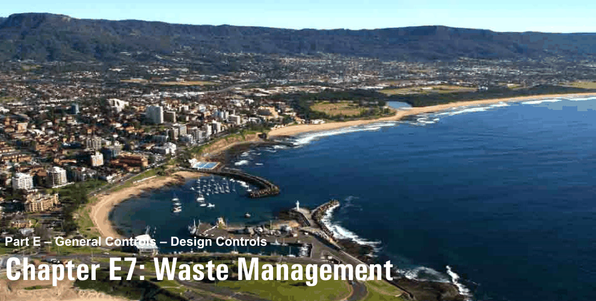

# Wollongong Development Control Plan 2009 - Chapter E7 Waste Management

> This chapter is split into 17 section file(s), one per numbered heading, in the order they appear in the PDF.

Source PDF: [Wollongong-DCP-2009-Chapter-E07-Waste-Management.pdf](https://planfortomorrow.sharepoint.com/sites/Planfortomorrow/Shared%20Documents/00%20NSW-Planning-Resources/dcp/wollongong-development-control-plan-2009/chapter-e7-waste-management/Wollongong-DCP-2009-Chapter-E07-Waste-Management.pdf)

> [Picture on page 1: a picture, saved as a picture (images/chapter-e7-waste-management-page-1-1.gif, 150 dpi).]

#### Part E – General Controls – Design Controls

### Chapter E7: Waste Management

> The PDF's contents list (page numbers of the printed document) is not repeated here - see Sections below.

i

<!-- sections -->
## Sections

1. [1 INTRODUCTION](01-introduction.md)
2. [2 OBJECTIVES](02-objectives.md)
3. [3 RELEVANT LEGISLATION AND OTHER PUBLICATIONS](03-relevant-legislation-and-other.md)
4. [4 SUBMISSION / APPLICATION REQUIREMENTS](04-submission-application-requirements.md)
5. [5 PLANNING REQUIREMENTS / ASSESSMENT CRITERIA](05-planning-requirements-assessment.md)
6. [1 Building Code of Australia](06-1-building-code-of-australia.md)
7. [3 Size](07-3-size.md)
8. [4 Layout](08-4-layout.md)
9. [1 Garbage Chute Design](09-1-garbage-chute-design.md)
10. [2 Garbage Chute Service Room Design](10-2-garbage-chute-service-room-design.md)
11. [3 Management](11-3-management.md)
12. [1 Compliance with the Building Code of Australia](12-1-compliance-with-the-building-code-of.md)
13. [2 Location and Appearance of Storage Areas](13-2-location-and-appearance-of-storage-areas.md)
14. [3 Size and Layout of the Storage Areas](14-3-size-and-layout-of-the-storage-areas.md)
15. [4 Servicing Access Requirements](15-4-servicing-access-requirements.md)
16. [5 Signage](16-5-signage.md)
17. [6 Management](17-6-management.md)
