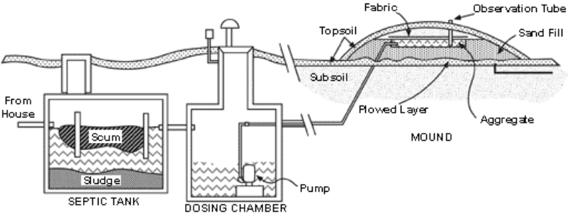

## 6 TYPES OF ON-SITE SEWAGE MANAGEMENT SYSTEMS

1\. The main types of on-site sewage management (OSSM) systems include:

(a) Conventional Septic tank system with pump out;

(b) Septic tanks with absorption trenches or evapotranspiration beds /areas;

(c) Aerated wastewater treatment systems (AWTS) and Land Application Areas (LAA’s);

(d) Composting toilets;

(e) Greywater diversion devices and Greywater Treatment systems;

(f) Mound systems;

(g) Recirculating aerobic sand filter devices;

(h) Amended Soil Systems; and

(i) Organic separation and treatment systems.

#### (i) Conventional Septic Tank system with Pump Out

1\. A septic tank is a waterproof tank usually located below ground level and provides treatment of sewage by allowing solids to settle to the bottom of the tank and oils and fats to float to the top to form a scum layer. Anaerobic (in the absence of air) bacterial digestion of the stored solids

produces a sludge which accumulates at the bottom of the tank. The partly treated effluent flows from the septic tank to a holding tank for regular pump out.

2\. Pump out systems do not require a site and soil assessment to be performed.  Consideration should be given to whether any structural or stability problems exist to installing tanks on the site, siting tanks outside tree drip zones and the amount of room available for the system.  The septic tank and collection well must be sized according to the potential number of occupants in the building.  A minimum of five (5) people is used for the purpose of calculation.  The minimum capacity for a septic tank that is receiving all septic wastes is 2300 litres, while the minimum size for collection wells is 5250 litres.  The maximum number of persons for calculations is ten (10) (see Appendix 2).

3\. Council may consider the possibility of a split system, where a pumpout system is combined with a greywater diversion device (GDD) or a domestic greywater treatment system (DGTS) provided that when rain is anticipated, during wet weather or when the ground is sufficiently irrigated, the greywater is directed back to the septic tank.  With a reduced amount of wastewater, care must be taken in the plumbing design to ensure that solids are carried to the septic tank, preventing drain blockages.

4\. The provision of a septic tank with a pump out system will be required for the majority of unsewered lands in Austinmer, Coledale, Wombarra, Scarborough and Coalcliff, given inherent topographical and geological constraints in these suburbs. An alternative on-site sewage management system will only be considered where appropriate detailed evidence proves that the alternative system provides a higher or more appropriate wastewater treatment option, than a pump out system.

5\. The use of a septic tank and pump out system will generally not be supported upon land within any rural or environmental protection zone where sufficient land is available on-site for alternative on-site sewage management systems.

#### (ii) Septic Tank with Soil Absorption System

1\. There are two types of soil absorption system commonly used for the disposal of effluent from a septic tank, namely: absorption trenches and evapotranspiration areas.

(a) Absorption trenches

The absorption or sullage trench receives primary treated effluent from a septic tank. The role of the trench is to evenly discharge the effluent into the subsoil which then filters the effluent as it percolates through the soil strata.

The sizing and construction of an absorption trench shall be undertaken in accordance with the Rapid Evaluation Procedure for On-site Wastewater Management at Appendix 2 to this policy as well as AS /NZ 1547:2000 On-site Domestic Wastewater Management and / or the Environment and Health Protection Guidelines – Onsite Sewage Management for Single Households 1998.

(b) Evapotranspiration Bed (ET Bed)

The Evapotranspiration bed is an area made of sand and gravel which is not sealed at the base and sides. The hydraulic load of ET beds is taken up by evaporation and transpiration by vegetation as well as disposal of some of the effluent through the permeable base of the bed. The beds are required to be designed so that they are well vegetated and mounded to prevent the ETA filling with rainwater during rainwater events.

The sizing and construction of the ET bed shall be undertaken in accordance with the Rapid Evaluation Procedure for On-site Wastewater Management at Appendix 2 to this policy as well as AS /NZ 1547:2000

On-site Domestic Wastewater Management and / or the Environment and Health Protection Guidelines – Onsite Sewage Management for Single Households 1998.

#### (iii) Aerated Wastewater Treatment Systems (AWTS) and Land Application Area / Irrigation Systems

1\. The aerated wastewater treatment system (AWTS) is an alternative to the conventional septic system which uses the processes of aeration, clarification and disinfection to treat the wastewater to a level which is suitable for above ground irrigation to Land Application Areas (LAA’s) or sub-surface disposal (SSD).

2\. Aerated wastewater treatment systems (AWTS) use aeration of wastewater as an integral part of the treatment process. A typical AWTS treats wastewater through the following process:

• Settling of solids and flotation of scum in an anaerobic primary chamber (septic tank);

• Oxidation and consumption of organic matter through aerobic biological processes;

• Clarification - secondary settling of solids;

• Disinfection using chlorine or other approved means if surface land application of treated wastewater is to occur; and

• Regular removal of sludge to maintain the process.

3\. All AWTS are required to have NSW Department of Health accreditation. The majority of AWTS have a 10 person capacity (ie expressed as a 10 EP system).

4\. All AWTS must be regularly serviced every quarter by a qualified service technician to ensure the proper functioning of the AWTS and records of servicing must be forwarded to Council for its record keeping purposes.

#### Irrigation Systems associated with an AWTS

(a) Surface Irrigation – Land Application Areas

The irrigation of wastewater is applied to the designated Land Application Area (LAA) from the AWTS. The most common method of application for surface irrigation is by sprayers or sprinklers with low pressure devices. The spray head plume radius should be restricted to not more than 2 metres with a maximum plume height of not more than 400millimetres. Drip and trickle systems may also be used to allow water to drip to the soil, below at least a 100mm layer of bark, woodchip or mulch. The effluent which is applied to the area of irrigation is absorbed by the soil and is taken up by vegetation or evaporated.

However, surface irrigation systems will only be permitted upon sites with suitable geology / soil depth (ie with no waterlogging) and flat to gently sloping land. The minimum area for surface irrigation must be calculated in accordance with AS /NZ 1547:2000 or the Environment and Health Protection Guidelines – Onsite Sewage Management for Single Households 1998.

(b) Sub-Surface Disposal

Sub-surface disposal is the method of discharging treated effluent below the ground to deal with on-site wastewater. Sub-surface or drip irrigation is the only acceptable method of reclaimed effluent disposal from an AWTS located within a high risk classification area.

The principle of AWTS subsurface disposal is similar to an evapotranspiration area in that the effluent is evaporated from the ground and transpired by the vegetation on the surface area. The sub-surface

system involves the use of a series of drainage irrigation pipes to discharge effluent evenly along the length of the pipeline (ie pressure compensating line).

#### (iv) Composting Toilets

1\. There are two msain types of composting toilets generally available in New South Wales, namely: dry composting toilets and wet composting toilets.

2\. Composting toilets function with no flush toilet pedestal or with moisture from a cistern. Toilet waste passes from the pan down the chute and into a chamber similar in size to a conventional septic tank. All faecal matter and other compostable matter produced such as toilet paper is broken down into compost by natural decomposing organisms. When fully broken down, the compost may be used in gardens but must be buried and covered.

3\. Composting toilets have a fan connected to a vent pipe which produces negative air pressure within the composting chamber. The fan aims to draw odours away from the toilet pan and evaporate excess liquid from the composting chamber in dry composting toilets.

4\. However, these systems only treat toilet wastes and all other liquid wastes from the shower, kitchen and laundry must be disposed of via a separate grey water system. These systems discharge to subsurface absorption trenches or evapotranspiration areas.

#### (v) Greywater Diversion Devices (GDD) and Domestic Greywater Treatment Systems (DGTS)

1\. The Local Government (General) Regulation 2005 defines “greywater” as waste water from washing machines, laundry tubs, showers, hand basins and baths, but does not include waste water from a kitchen, toilet, urinal or bidet.

2\. A greywater diversion device (GDD) is designed to allow greywater from the shower, bath, basin or laundry to be diverted to an alternative disposal site rather than through the effluent management system. Gravity fed diversion devices incorporate a hand activated value, switch or tap and is fitted to the outlet of the waste pipe of the plumbing fixture directly to the disposal area. Pump diversion devices incorporate a surge tank to cope with sudden influxes of greywater for distribution to a disposal area. The surge tank does not operate as a storage tank.

3\. Domestic greywater treatment systems (DGTS) treat greywater to a tertiary level which is satisfactory for above ground land application (excluding high risk areas). The greywater treatment system involves a cycle of aeration and inactivity to achieve biological breakdown of the water through oxidation. The inactive period in the cycle results in a reduction in nitrogen levels in the water. Filtration of the wastewater removes any suspended solids and the water is then disinfected by a UV disinfection unit.

4\. Greywater collected, treated and disinfected (to a standard of 20 mg/L BOD5, 20 mg/L suspended solids and 10 colony forming units/100mL thermotolerant coliforms) in a DGTS can be re-used for toilet and urinal flushing, cold water supply to washing machines or used in surface irrigation in dedicated non-trafficable areas or other land application systems.

5\. Greywater diversion devices do not treat the greywater and hence, greywater must be disposed of by subsurface methods using the calculations for subsurface irrigation.

6\. Greywater disposal shall be restricted to a portion of site which is not used for either the growing of fruit or vegetables or as a recreational area.

7\. Further guidance about greywater reuse can be found in the Department of Energy, Utilities and Sustainability’s NSW Guidelines for Greywater Reuse in Sewered, Single Household Residential

Premises (2007) and Interim Guidance for Greywater and Sewage Recycling in Multi-Unit Dwellings and Commercial Premises (2004).

8\. Land application areas associated with DGTSs or GDDs must be designed in accordance with AS/NZS 1547:2000 and in consideration of the REP and Section 3.4 of this policy.

#### (vi) Mound Systems

1\. Mound systems are elevated absorption beds and utilise suitable sand fills to partially treat wastewater before it reaches natural soil. Mound systems are used to augment natural soil for complete treatment and disposal.

2\. A mound system generally consists of a septic tank, a dosing tank, distribution pipes, and a mound, as shown in Figure 1. The septic tank allows the solids in wastewater to settle and degrade. The septic tank effluent is filtered by an effluent filter and discharged to a dosing tank. The dosing tank is equipped with a pump to deliver the septic tank effluent through the distribution system to the mound. The distribution system normally consists of small diameter pipes and allows for even wastewater application under low pressure on the mound.

> [Picture on page 11: a picture, saved as a picture (images/chapter-e8-on-site-sewage-management-systems-page-11-15.gif, 150 dpi).]

#### Figure 1: Schematic of a Mound System

(Source: Ohio State University. 2004. Mound Systems for On-site Wastewater Treatment)

#### (vii) Recirculating Aerobic Sand Filter Devices

1\. A recirculating aerobic sand filter device further treats the effluent from a septic tank. The treatment process involves the collection of effluent from a holding well or sump which is then pumped intermittently for distribution through a bed of coarse sand. The treated effluent is then redirected back to the sump for further recirculation. The effluent is then directed to a land application system. The effluent may also be disinfected for above ground spray irrigation.

#### (viii) Amended Soil Systems

1\. Amended soil systems are designed to provide further treatment to effluent which has previously undergone primary or secondary treatment such as a septic tank or AWTS, prior to land application.

2\. The amended soil systems involve an impermeable membrane with the effluent from the septic tank flowing through the amended soil medium. Such systems may promote evapotranspiration from the amended soil with any remaining water directed to a separate land application system.

3\. Amended soil systems can achieve high removal efficiencies for biochemical oxygen demand (BOD), suspended solids (SS), nutrients and pathogens.

#### (ix) Organic Separation and Treatment System

1\. This system involves the treatment of both household wastewater and food waste using a passive aerobic process. The technology is based on a layered, flexible modular filter element which is contained within a tank or may be retrofitted to an existing septic tank. The system treats sewage, wastewater, food wastes and scrap paper and cardboard. The filter is an organic soil ecosystem which is not only fed by the organic wastes that are filtered out of the wastewater but is actually structured from the fine humus produced, cleverly turning the problem into the solution. The system includes millions of worms and beetles & microscopic organisms which continually renew the organic material so that its drainage and air porosity are continually renewed and maintained indefinitely.

2\. The system normally includes a single pass filter where wastewater enters at the top of the bed and clear organically filtered water, is pumped out from the bottom. The treated wastewater can then be directed to a land application system.
