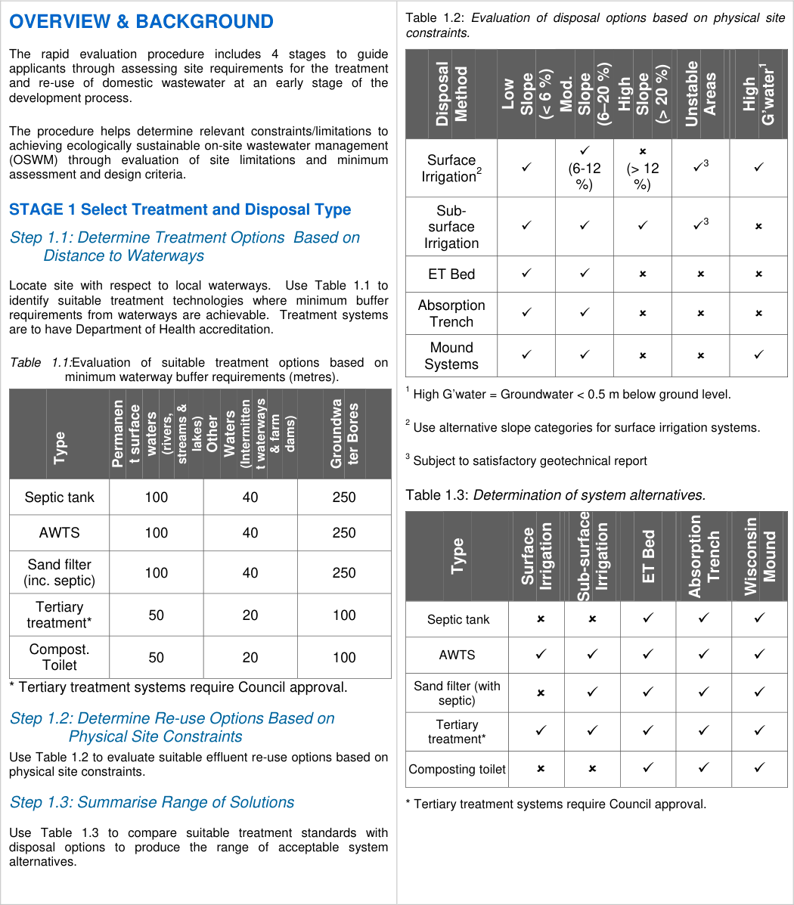

## 12 OPERATIONAL REQUIREMENTS – APPROVAL TO OPERATE

### AN ON-SITE SEWAGE MANAGEMENT SYSTEM

1\. All existing on-site sewage management systems (including septic tank and pumpout systems) in the LGA require a current Section 68 Approval to Operate an On-Site Sewage Management System, except for exempt domestic greywater diversion devices (GDD).

2\. For any new technology, the initial Approval to Operate an On-Site Sewage Management System will be restricted to 12 months only, in which case Council will review the performance of the system to determine whether the system requires alteration or another system is required to be installed.

3\. Most newly installed on-site sewage management systems are likely to be a “low risk” and hence, Council may issue an Approval to Operate an On-Site Sewage Management System for up to three (3) years.

4\. Applications for renewal to operate an on-site sewage management system should be submitted to Council at least one (1) month before the expiry date of the current approval.

5\. All on-site sewage management systems will be inspected by Council before any Approval to Operate an On-Site Sewage Management System is issued.

6\. Prior to the issue of an Approval to Operate an On-Site Sewage Management System, Council will consider whether possible strategies to comply with the objectives of this policy.  A risk classification will be given to each property, which will depend on the system type, ease of maintenance, location and effluent treatment level.

7\. The on-site sewage management system should not be used until such time as the applicant receives an Approval to Operate an On-Site Sewage Management System in writing.  This approval indicates that Council is satisfied the installation of the system is substantially in accordance with the initial Approval to Install an On-Site Sewage Management System and / or any previous Approval to Operate an On-Site Sewage Management System conditions imposed on the system.

8\. The results of any groundwater monitoring from the piezometers installed within the land application area may also be reviewed as part of the assessment of the Section 68 Application for Approval to Operate an On-Site Sewage Management System. Upgrading of an existing system may be necessary where a pollution problem is evident before any Approval to Operate an On- Site Sewage Management System is reissued.

9\. An Approval to Operate an On-Site Sewage Management System may also impose requirements to renew or repair defective systems or components of systems, upgrade system types  and better maintenance and monitoring requirements. For example, a septic tank and absorption trench system may be required to be converted into a septic tank with pumpout system.

10\. In certain cases, Council may issue an Order under Section 124 of the Local Government Act 1993 to the property owner or occupier of premises to seek connection to Sydney Water’s sewerage system by a specified date, if the site is located within 75 metres of a sewer.

### Appendix: 1 RELEVANT AUSTRALIAN STANDARDS AND GUIDELINES FOR ON- SITE WASTEWATER MANAGEMENT SYSTEMS

The following Australian Standards and guideline documents are recommended to be reviewed and considered for the selection of an appropriate on-site sewage management system for a specific site:

AS/NZS 1547:2000: On-site domestic wastewater management - This Standard specifies requirements for on-site domestic wastewater systems including both primary and secondary wastewater treatment units and associated land application systems.

AS/NZS 3500.5:2000 : National plumbing and drainage - Domestic installations - This Standard sets out the requirements for the installation of sanitary plumbing and drainage within buildings.

AS 2698.2-2000: Plastics pipes and fittings for irrigation and rural applications - Polyethylene rural pipe - This Standard specifies the requirements for black polyethylene pipe for use in rural applications below and above ground.

AS 2698.3-1990: Plastics pipes and fittings for irrigation and rural applications - Mechanical joint fittings for use with polyethylene micro-irrigation pipes - This Standard specifies the requirements for mechanical jointing fittings suitable for use as fixed joints with polyethylene pipes.

Australian Standard AS/NZS 3500:2003, Plumbing and Drainage - The Australian Standard AS/NZS 3500:2003, Plumbing and Drainage (the Standard) specifies uniform requirements for the installation of water services and takes account of regulations stipulated by the authorities responsible for the administration of water supply legislation in each State and Territory of Australia. The requirements of the Standard apply to the cold water service from the point of connection to the water main up to the outlet points within the property. This Standard applies to new installations as well as alterations, additions and repairs to existing installations.

The standards are enforceable when called up by the Building Code of Australia or the NSW Code of Practice.

Environment & Health Protection Guidelines - On-site Sewage Management for Single Households January 1998 prepared by the NSW Department of Local Government, NSW Environment Protection Authority, NSW Department of Health, NSW Department of Land and Water Conservation and NSW Department of Urban Affairs and Planning - This document provides information and guidelines on the selection, design, installation, operation and maintenance of single household on-site sewage management systems.

NSW Guidelines for Greywater Reuse in Sewered, Single Household Residential Premises (2007) prepared by the NSW Department of Energy, Utilities and Sustainability - This guideline provides direction on the use of grey water diversion devices in single households and additional advisory information to the owners and/or occupiers of sewered residential premises on grey water treatment systems and manual bucketing of grey water.

Greywater and Sewage Recycling in Multi-Unit Dwellings and Commercial Premises - Interim Guidance

(2004) prepared by the NSW Department of Health - This document provides interim guidance on grey water and sewage recycling in multi-unit and commercial buildings.  The guidance is intended for use by the building industry, system designers, operators, local councils and other regulators and aims to ensure that grey water and sewage recycling systems are operated to consistently produce water of the required quality and that there is adequate management to avoid cross-connections or inappropriate use of water.

NSW Code of Practice, Plumbing and Drainage (3rd Edition) 2006 - The NSW Code of Practice, Plumbing and Drainage (3rd Edition) 2006 (the Code) provides cost-effective, efficient and safe plumbing and drainage solutions that protect public health and the environment. The Code details the administrative requirements for plumbing and drainage works in NSW, and adopts and varies the Australian Standard AS/NZS 3500:2003 to meet the requirements of the major urban and regional water supply authorities.

Schedule 1 of the Local Government (General) Regulation 2005 states that water supply work, sewerage work and stormwater drainage work must comply with the Plumbing and Drainage Code of Practice.

The Code provides requirements for recycled water reuse, including greywater reuse. It also provides the technical plumbing and drainage support to the compliance options for meeting the water efficiency requirements of BASIX4.

Australian Guidelines for Water Recycling: Managing Health and Environmental Risks (Phase 1) 2006 - The Australian Guidelines for Water Recycling: Managing Health and Environmental Risks (Phase 1) 2006 (subsequently referred to as “The Australian Guidelines for Water Recycling”) has been produced by the Environment Protection and Heritage Council, Natural Resources Management Ministerial Council and the Australian Health Ministers Conference to provide guidance on best practices for water recycling.

The guidelines provide a risk assessment framework that is applicable to the recycling of water from stormwater, greywater and treated sewage sources. The guidelines are not mandatory but are designed to provide an authoritative reference that can be used to support beneficial and sustainable recycling. The guidelines are intended to be used by anyone involved in the supply, use and regulation of recycled water schemes.

The guidelines are available to download from the Environment Protection and Heritage Council website.

ANZECC Guidelines for Fresh and Marine Water Quality (2000) - The Australian and New Zealand Guidelines for Fresh and Marine Water Quality do not apply directly to recycled water; however, they provide an outline for setting water quality criteria. Specifically they provide guidance on designing and implementing water quality monitoring and assessment programs for irrigation that may be useful in the development of recycled water schemes.

The ANZECC guidelines are available to download from the federal Department of the Environment and Water Resources website at:

NSW DECC Environmental Guidelines: Use of Effluent by Irrigation (2004) - The Environmental Guidelines: Use of Effluent by Irrigation (2004) produced by the former NSW Department of Environment and Conservation (now the NSW Department of Environment and Climate Change (DECC)) has been adopted in NSW for the use of effluent for irrigation in non-domestic applications.

The document covers the broad framework, principles, objectives and best management practices that should be considered when establishing an irrigation system that uses effluent. This information can be used in the design and operation of effluent irrigation systems and can also be relevant and useful for meeting environmental requirements under the POEO Act and in negotiations for premises-specific environment protection licences.

The NSW DECC guidelines are available to download from the Department of Environment and Climate Change website at: www.environment.nsw.gov.au .

### Appendix: 2

### Rapid Evaluation Procedure for On-Site Wastewater Management Fact Sheet

[Source On-Site Wastewater Management Approvals Criteria: Support Document (2002) Martens & Associates]

#### Rapid Evaluation Procedure for On-Site Wastewater Management

#### Wollongong City Council

> [Picture on page 26: a picture, saved as a picture (images/chapter-e8-on-site-sewage-management-systems-page-26-3.gif, 150 dpi).]
> Words printed on the picture (title and legend, copied from the PDF):
> constraints.
> The rapid evaluation procedure includes 4 stages to guide
> applicants through assessing site requirements for the treatment
> and re-use of domestic wastewater at an early stage of the
> development process.
> The procedure helps determine relevant constraints/limitations to
> achieving ecologically sustainable on-site wastewater management
> (OSWM) through evaluation of site limitations and minimum
> assessment and design criteria.
> Distance to Waterways
> Locate site with respect to local waterways.  Use Table 1.1 to
> identify suitable treatment technologies where minimum buffer
> requirements from waterways are achievable.  Treatment systems
> are to have Department of Health accreditation.
> minimum waterway buffer requirements (metres).
> 1 High G’water = Groundwater < 0.5 m below ground level.
> 2 Use alternative slope categories for surface irrigation systems.
> 2 Use alternative slope categories for surface 3 Subject to satisfactory geotechnical report
> \* Tertiary treatment systems require Council approval.
> Physical Site Constraints
> Use Table 1.2 to evaluate suitable effluent re-use options based on
> physical site constraints.
> \* Tertiary treatment systems require Council approval.
> Use Table 1.3 to compare suitable treatment standards with
> disposal options to produce the range of acceptable system
> alternatives.

Table 1.2: Evaluation of disposal options based on physical site

Table 1.1:Evaluation of suitable treatment options based on

Table 1.3: Determination of system alternatives.

| Disposal Method | Slope %) Low 6 (< | %) Mod. Slope (6–20 | Slope %) High 20 (> | Unstable Areas | High G’water1 |
|---|---|---|---|---|---|
| Surface Irrigation2 | 9 | 9 (6-12 %) | 8 (> 12 %) | 93 | 9 |
| Sub- surface Irrigation | 9 | 9 | 9 | 93 | 8 |
| ET Bed | 9 | 9 | 8 | 8 | 8 |
| Absorption Trench | 9 | 9 | 8 | 8 | 8 |
| Mound Systems | 9 | 9 | 8 | 8 | 9 |

| Type | Surface | Irrigation | Sub-surface | Irrigation | Bed ET | Absorption | Trench | Wisconsin | Mound |
|---|---|---|---|---|---|---|---|---|---|
| Septic tank | 8 |  | 8 | 9 |  | 9 |  | 9 |  |
| AWTS | 9 |  | 9 | 9 |  | 9 |  | 9 |  |
| Sand filter (with septic) | 8 |  | 9 | 9 |  | 9 |  | 9 |  |
| Tertiary treatment* | 9 |  | 9 | 9 |  | 9 |  | 9 |  |
| Composting toilet | 8 |  | 8 | 9 |  | 9 |  | 9 |  |

#### OVERVIEW & BACKGROUND

#### STAGE 1 Select Treatment and Disposal Type

Step 1.1: Determine Treatment Options  Based on

| Type | Permanen surface t waters (rivers, & streams lakes) | Other Waters (Intermitten waterways farm & dams) t | Groundwa Bores ter |
|---|---|---|---|
| Septic | tank 100 | 40 | 250 |
| AWTS | 100 | 40 | 250 |
| Sand filter (inc. septic) | 100 | 40 | 250 |
| Tertiary treatment* | 50 | 20 | 100 |
| Compost. Toilet | 50 | 20 | 100 |

Step 1.2: Determine Re-use Options Based on

Step 1.3: Summarise Range of Solutions

STAGE 2 Determine Effluent Re-use Field Size Areas are selected based on location zone and the topography /

landform upon which the site is located.

Step 2.2: Adjusting Area for House Size

Effluent disposal field size requirements vary according to geographic zones and a site’s topographic placement within that

zone.  Effluent disposal field requirements are described in terms of two area requirements: 1) ESD area; and 2) EAF area.

Minimum disposal areas shown in Table 2.1 require adjustment if the proposed dwelling has more than 3-bedrooms and/or equivalent persons (EP) > 5.

The ESD (Ecological Sustainable Development) area is the total required area to be designated to effluent re-use on-site and refers to the amount of land required to minimise cumulative environmental impact from effluent disposal.

i) Using Table 2.2 select the equivalent household population (EPreq) based on proposed bedroom number.

ii) Adjust both the ESD areamin and the EAF areamin (derived from

Stepi2.1) by utilising the following equations:

#### ESD area = (ESD areamin/5) x EPreq

#### EAF area = (EAF areamin/5) x EPreq

The EAF (Effluent Application Field) area is the minimum required disposal field size (i.e. directly wetted area) that is to be constructed in the upper slope sections of the ESD area and has been derived in accordance with AS/NZS 1547 (2000), based on the ability of the site’s soils to receive effluent without creating health risks or hydraulic failure.

Table 2.2: Bedroom V’s Equivalent Persons (EP).

Employing both areas will result in a minimum of required re-use field infrastructure whilst maintaining an area down slope of the irrigation field to assimilate nutrients and hence ensure ecological

|  | Proposed Bedroom | Equivalent |
|---|---|---|
| Step 2.1: Minimum Disposal Area | Number | Population |
| (i) Use Table 2.1 to select minimum ESD areamin | 3 | 5 |
| (ii) Use Table 2.1 to select EAF areamin requirement - | 4 5 | 6 7 |
| EAFmin (Septic) : if applying septic tank effluent | 6 | 8 |

sustainable development

EAFmin (AWTS) : if applying AWTS effluent

Table 2.1:Minimum disposal area selection (ESDmin & EAFmin).

| Geographic Zone | Topography | ESDmin (m2) | EAFmin (Septic) (m2) |
|---|---|---|---|
| Areas surrounding West Dapto, below the Illawarra Escarpment. Communities include: West Dapto, Yallah, Unanderra, Cordeaux Heights, Mt Kembla. | Upper floodplains & terraces Valley Flats | 800 700 | 45 180 |
| Escarpment footslope areas: Thirroul to Wombarra. | Ridges, upper slopes & midslopes Lower slopes | 600 700 | NA NA |
| Escarpment footslope areas: Scarborough to Stanwell Park. | Crests Slopes & drainage lines | 800 700 | NA 120 |
| Areas on top of escarpment: Otford, Stanwell Tops. | Crests Slopes & drainage lines | 800 700 | NA 120 |
| Darkes Forest area. | Crests & plateaux Wet areas (i.e. poorly drained) Valley flats & slopes on sandy sites | 700 900 900 | 120 120 120 |

Minimum disposal areas have been determined based on a household population of 5 equivalent persons (EP)(equivalent to 3-bedrooms)

Step 2.3: Adjusting Area for Water Supply

i) Site Plan Requirements

The applicant is to provide a 1:200 scale plan to Council that should include the following details:

The areas that have been derived to this stage are acceptable for houses with reticulated town supply.  If no town water is available to the site then the required areas can be reduced by multiplying each area by the following multiplication factor.

‰ Property boundaries, buildings and other infrastructure (paths, decking, retaining walls, pools etc.);

#### Tank Water Supply Multiplication Factor = 0.8

‰ Location of existing and proposed effluent management infrastructure including existing tanks and disposal areas, proposed tank sites, EAF and ESD areas (dimensions and locations).

#### STAGE 3 OSWM Application Requirements

Step 3.1: Application Area Placement

‰ Site physical attributes including rock outcrops, vegetation, watercourses (incl. drainage lines and dams), and slope (magnitude and direction).

‰ Disposal field layout within the EAF area showing buffer distances to pertinent site features (Table 3.1).

The EAF should be placed within the upper slope section of the ESD area.  Buffer distances between the ESD area and other site features should also be provided.  Buffer distances are outlined below in Table 3.1.

‰ Location of test pits within the EAF area.

Table 3.1: Recommended buffer distances for on-site systems.

| System | Recommended Buffer Distances |
|---|---|
| All application systems | ƒ In accordance with waterway buffer requirements (Table 1.1) |
| Surface spray irrigation | ƒ 6m if area up-gradient and 3m if area down-gradient of driveways and property boundaries ƒ 15m to dwellings ƒ 3m to paths and walkways ƒ 6m to swimming pools |
| Surface drip/trickle and Sub- surface irrigation | ƒ 6m if area up-gradient and 3m if area down-gradient of swimming pools, driveways, buildings and property boundaries |
| Absorption system | ƒ 12m if area up-gradient and 6m if area down-gradient of property boundaries ƒ 6m if area up-gradient and 3m if area down-gradient of swimming pools, driveways and buildings |

ii) OSWM Report Requirements

‰ Completed Application to Install & Operate form. ‰ Copy of manufacturers specifications for the sewage treatment system.

‰ A description of the depth and type of soil profile (noting soil texture such as sands and clays and presence of rock floaters) and other constraints to OSWM (as referred to in table 3.2).

‰ Results from stages 1 & 2 of the Rapid Evaluation Procedure including selections for treatment and re-use systems, selection of minimum ESD and EAF areas and relevant adjustments according to house size and water supply.

In some instances, a more detailed assessment is required to support an application.  If one or more limiting attributes as listed in Table 3.2 apply to the site, a detailed assessment is required.  A detailed assessment (including AS/NZS 1547 (2000) design) is to be conducted by a suitable qualified industry professional in accordance with the Environmental & Health Protection Guidelines “On-site Sewage Management for Single Households” (Department of Local Government et al, 1998). Report is to be submitted with the on-site sewage treatment application form and plans.

Table sourced from DLG et al. (1998) Table 5.

Step 3.2: Application Requirements

#### STAGE 4 Disposal Field Design Requirements

All OSWM applications are to include

#### Overview

‰ A site plan in accordance with the requirements detailed in Section 3.2 i);

‰ An OSWM report in accordance with the requirements detailed in Section 3.2 ii).

Plan and report can be completed by either the applicant or a suitable qualified industry professional.

Generally, primary treated effluent (i.e. septic tank discharge) is conveyed to sub-surface application systems such as trenches, beds or mounds.  The main mechanism for effluent disposal using these systems is through deep infiltration and lateral seepage.  A smaller EAF area is required in comparison to irrigation systems but the risk of failure (i.e. effluent resurfacing) is far greater and the level of additional treatment received in the disposal process is less. Achievement of ESD is unlikely with a primary quality based

system.

In addition, applicants need to prepare three soil test pits within the proposed EAF area.  Test pits will be inspected by a Council officer prior to approval of the OWSM application to ensure compliance with the reported site conditions and site plan.  Test pit locations should be evenly spaced in the EAF area to provide a representative indication of soil conditions throughout the entire

area.  Test pits should be dug with a shovel or suitable machinery, and be a minimum of 400 mm in diameter and 1000 mm deep or to bedrock (whatever occurs first).

• Only products designed specifically for sub-surface effluent application to be used within sub-surface irrigation systems.

• The use of drilled poly pipe for effluent distribution is considered inappropriate.  Such a system may result in uneven effluent distribution and possible root intrusion and subsequent clogging.

Secondary treated effluent (e.g. AWTS effluent) can be applied to land by irrigation where evapo-transpiration and percolation are the main mechanisms for re-use.  Irrigation allows for a superior, more uniform method of distributing the effluent over the EAF

area.  Failure of irrigation systems is less likely and in many cases the irrigation process provides a valuable water re-use opportunity.

Table 3.2: Requirement for detailed site assessment.

| Limiting Site Attribute | Detailed Assessment Required |
|---|---|
| Insufficient land area for ESD and buffer requirements | 9 |
| Average land slope > 20 % | 9 |
| Land within 1 in 100 year flooding level | 9 |
| Poorly drained sites | 9 |
| > 20 % of EAF covered in rocks / outcrops larger than 0.2 m. | 9 |
| Soil depth to bedrock or hardpan < 0.5 m | 9 |
| Depth of soil to watertable < 0.5 m | 9 |
| Site within a recognised land slip area | 9 |
| Site within a recognised acid sulphate soil area | 9 |
| Subdivision or multi-lot developments | 9 |
| Commercial or Industrial sites | 9 |
| Environmentally sensitive areas 1 1 | 9 |

• Edible vegetables (eg. lettuce) should not be grown in areas where effluent disposal is undertaken. Sub-surface (Micro-trench) Irrigation Field Requirements

This approach provides for an efficient means of further treating and re-using secondary treated effluent.  Health risks (human contact) are minimised and the disposal field area can be utilised for other activities.  Minimal maintenance is required for such systems and the chance of hydraulic failure of the field is very low compared to absorption systems.

The sub-surface (micro-trench) system should be constructed in accordance with AS/NZS 1547 (2000) to meet the following minimum specifications:

• A series of micro-trenches spaced at 1.0 m intervals (maximum) are to be constructed across the field parallel to site contours.

• Micro trenches are to be filled with course durable aggregate [10 - 20 mm], 200 mm wide and 300 mm deep. Of this, the lower 200 mm is to be aggregate and the remaining 100 mm topsoil [see Attachment C].  These layers are to be separated with a layer of geotextile fabric.

• Topsoil (sandy loam) should be used for backfilling the top 100 mm of microtrenches.

as determined by Council

#### Irrigation Systems (Secondary Treated Effluent)

• Sub-surface effluent irrigation line such as “Wasteflow 16 mm” or “Netafim 13imm” should be used for effluent distribution within the micro-trenches and should be placed towards the top of the aggregate zone. Shallow Sub-surface Drip/Trickle Irrigation Field Requirements

Irrigation disposal systems are only suitable for disposing of secondary treated and disinfected effluent (ie. effluent from an AWTS or similar system).  They provide an efficient, uniform method of re-using the effluent with minimal health risk.

All systems should be constructed / installed by a suitably qualified individual in accordance with AS/NZS 1547 (2000) to meet the following minimum specifications:

This approach is suitable for use in substitution of or in addition to standard sub-surface (micro-trench) irrigation when: minimal disturbance to existing site vegetation is required or sufficient landscaped garden areas are available.  No casual access to the application area by humans and animals should be permitted.

• Minimum application field area as determined for the site in Table 2.1 and positioned in accordance with buffers as indicated in Table 3.1.

The shallow sub-surface drip/trickle system should be constructed in accordance with AS/NZS 1547 (2000) to meet the following minimum specifications:

• It is recommended that a cartridge filtration system be included following the treatment system in any effluent irrigation system.

• Shallow sub-surface drip irrigation laterals should be laid at a depth of 50 mm within sandy loam topsoil (clayey soils not suitable) and covered with 50 - 100 mm of mulch.

• Sub-surface irrigation laterals be installed parallel to site contours.  Maximum distance between laterals should be 1 m.

• Effluent to be pumped from the treatment tanks to the top of the disposal field through a 25 mm [minimum diameter] poly main line.  A larger main may be required if the there is a large height difference (> 10 m) between the tanks and the field or if the field is further than 20 m from the tanks.

• Sub-surface effluent distribution line (eg. 16 mm Wasteflow, 13 mm NetaFim) should be used to disperse treated effluent.

• A 25 mm [minimum] manifold is to be installed along the side of each irrigation field with distribution lateral line(s) running from it into the relevant disposal structure.

• The effluent distribution main and distribution manifolds are to be fixed in place through burial to a depth of no less than 100 mm.

Surface Irrigation Field Requirements

Absorption Trench Requirements

Absorption trench systems to be constructed in accordance with AS/NZS 1547 (2000) to meet the following minimum specifications:

This method provides an efficient method of re-using secondary treated effluent.  Stricter management practices are required as the risk of human contact with effluent is higher than sub-surface irrigation.

The surface irrigation system should be constructed in accordance with AS/NZS 1547 (2000) to meet the following minimum specifications:

• Total required trench length calculated by dividing the total base area required by the standard trench width of 0.6 m (e.g. a base area of 45 m divided by 0.6 = total required trench length of 75 m).

• Spray irrigation systems to be designed to limit pooling or run-off of effluent within or from the surface of EAF area (i.e. site to be evenly graded).

• A series of trenches (to satisfy total trench length) requirement) 0.6 m wide and spaced a minimum of 1.0 m apart are to be constructed on low slope ground (< 6 % slope).

• Self-supporting arch (typically 230 mm minimum height for domestic sites) placed at bottom of trench.

• Casual access to the field by humans or animals is to be restricted by vegetation (500 mm hedges) or fencing. Ensure that effluent does not come into contact with people, domestic or farm animals or crops intended for human consumption.

• Trench depth to be 400 – 600 mm with lower 250 mm (surrounding arch) filled with course durable aggregate [10 - 20 mm], and the remaining 150 mm topsoil.  Layers to be separated with a layer of geotextile fabric.

• Only sprinkler systems (spray heads) suitable for use with effluent should be used.

• Topsoil (loamy sand) backfilled over aggregate and geotextile to fill trench with an allowance made for settling. Evapotranspiration (ET) Bed Requirements

• Spray heads to emit course droplets, with throw and plume controlled so that the risk of aerosol dispersion and wind drift of effluent beyond the designated area is negligible.

ET bed systems to be constructed in accordance with AS/NZS 1547 (2000) to meet the following minimum specifications:

• Field to have warning signs, complying with AS 1319, at the boundaries of the designated area in at least two places, clearly visible to property users, with wording such as, “Recycled Water - Avoid Contact - DO NOT DRINK”.

• Total required bed length calculated by dividing the total base area required by the selected bed width (typically 1 to 4 m) (e.g. a base area of 45 m divided by a bed width of 3 m = total required bed length = 15 m)

• Pipe laterals connecting the spray heads are to be buried to a depth of at least 150 mm.

• Irrigation system to be permanently installed and cover the entire designated EAF area.

• A series of beds to satisfy the total required area and spaced a minimum of 1.0 m apart are to be constructed on low slope ground (< 6 % recommended, < 12 % max. allowable).

#### Infiltration Systems (Primary Treated Effluent)

• Acceptable bed depth ranges from 500 - 700 mm, with upper 100 - 150 mm filled with topsoil and lower section (400 – 600 mm) filled with course durable aggregate [10 - 20 mm stone size].  Layers to be separated with geotextile fabric.

The following general disposal field requirements apply to all of the infiltration disposal system types discussed below.  All systems should be constructed / installed by a suitably qualified individual in accordance with AS/NZS 1547 (2000) to meet the following minimum specifications:

• Topsoil (loamy sand) backfilled over aggregate and geotextile to fill trench with an allowance made for settling. Mound Systems

• Minimum trench base area as determined from Table 2.1, positioned in accordance with buffer requirements (Table 3.1).

• Total required trench or bed length calculated by dividing the total base area requirement by the trench or bed width (see relevant section below for details).

• Surface water interceptor trenches / banks to be installed above all trench and bed areas to divert upslope runoff.

• Effluent is usually supplied to each trench or bed by gravity from the septic tank.

Mound systems are a possible solution for use in areas with poor soil depth and characteristics and areas of shallow groundwater.  Further site evaluation including appropriate system selection is required for such sites.  In addition, the design and construction of mound systems is not a straightforward exercise and should be conducted or supervisedby appropriately qualified industry professional in accordance with AS/NZS 1547 (2000).  For these reasons, detailed design requirements are not included here.

#### Management of ESD Field

• Where pump application is used, designer to determine trench or bed lengths and pipe details appropriate to the system layout and pump duties.  Alternatively, effluent is

pumped from septic tank to a 1m 3 brick or concrete chamber and allowed to gravity feed to beds or trenches.

• For gravity loading systems, individual trench or bed lengths should be limited to around 20 m.

• Trenches/beds to be installed on low slope areas (< 6 %).

Vegetation within ESD fields is to be maintained and adequately managed to encourage continued vigorous plant growth.  Grass clippings and tree prunings from the ESD area contain rich nutrient organic matter beneficial for use as garden mulch and should be used in other areas of the site but excluded from runoff areas such as localised drainage depressions.  Planting of water loving trees down-slope of effluent application areas is

encouraged.

#### Notes

1\. In Step 1.1 use a buffer distance of 50 metres for intermittent Category 1 watercourses (refer to the Department of Infrastructure, Planning and Natural Resources’ Riparian Corridor Management Study prepared for Wollongong City Council March 2004).

2\. For the suburbs of Yallah, Unanderra, Cordeaux Heights and Mt Kembla use the Geographic Zone “Areas Surrounding West Dapto” (Table 2.1).
