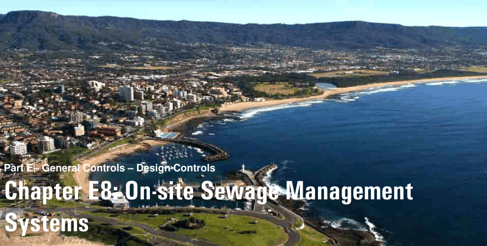

# Wollongong Development Control Plan 2009 - Chapter E8 On-site Sewage Management Systems

> This chapter is split into 21 section file(s), one per numbered heading, in the order they appear in the PDF.

Source PDF: [Wollongong-DCP-2009-Chapter-E08-On-site-Sewage-Management.pdf](https://planfortomorrow.sharepoint.com/sites/Planfortomorrow/Shared%20Documents/00%20NSW-Planning-Resources/dcp/wollongong-development-control-plan-2009/chapter-e8-on-site-sewage-management-systems/Wollongong-DCP-2009-Chapter-E08-On-site-Sewage-Management.pdf)

> [Picture on page 1: a picture, saved as a picture (images/chapter-e8-on-site-sewage-management-systems-page-1-1.gif, 150 dpi).]

#### Part E– General Controls – Design Controls

### Chapter E8: On-site Sewage Management Systems

### Contents

<!-- sections -->
## Sections

1. [3 DEFINITIONS](01-3-definitions.md)
2. [12 OPERATIONAL REQUIREMENTS – APPROVAL TO](02-12-operational-requirements-approval-to.md)
3. [4 LEGISLATIVE FRAMEWORK](03-4-legislative-framework.md)
4. [5 RELEVANT AUSTRALIAN STANDARDS / GUIDELINES](04-5-relevant-australian-standards-guidelines.md)
5. [6 TYPES OF ON-SITE SEWAGE MANAGEMENT](05-6-types-of-on-site-sewage-management.md)
6. [7 RAPID EVALUATION PROCESS –SELECTION OF AN](06-7-rapid-evaluation-process-selection-of-an.md)
7. [13 REFERENCES](07-13-references.md)
8. [11 MINIMUM INFORMATION REQUIRED FOR A](08-11-minimum-information-required-for-a.md)
9. [1 INTRODUCTION](09-1-introduction.md)
10. [2 OBJECTIVES](10-2-objectives.md)
11. [3 DEFINITIONS](11-3-definitions.md)
12. [4 LEGISLATIVE FRAMEWORK](12-4-legislative-framework.md)
13. [5 RELEVANT AUSTRALIAN STANDARDS / GUIDELINES FOR ON-](13-5-relevant-australian-standards-guidelines.md)
14. [6 TYPES OF ON-SITE SEWAGE MANAGEMENT SYSTEMS](14-6-types-of-on-site-sewage-management.md)
15. [7 RAPID EVALUATION PROCESS –SELECTION OF AN](15-7-rapid-evaluation-process-selection-of-an.md)
16. [8 DETAILED ASSESSMENT OF ON-SITE SEWAGE MANAGEMENT](16-8-detailed-assessment-of-on-site-sewage.md)
17. [9 PRELODGEMENT DISCUSSIONS WITH COUNCIL STAFF](17-9-prelodgement-discussions-with-council.md)
18. [10 APPLICATION LODGEMENT REQUIREMENTS](18-10-application-lodgement-requirements.md)
19. [11 MINIMUM INFORMATION REQUIRED FOR A DEVELOPMENT](19-11-minimum-information-required-for-a.md)
20. [12 OPERATIONAL REQUIREMENTS – APPROVAL TO OPERATE](20-12-operational-requirements-approval-to.md)
21. [13 REFERENCES](21-13-references.md)
