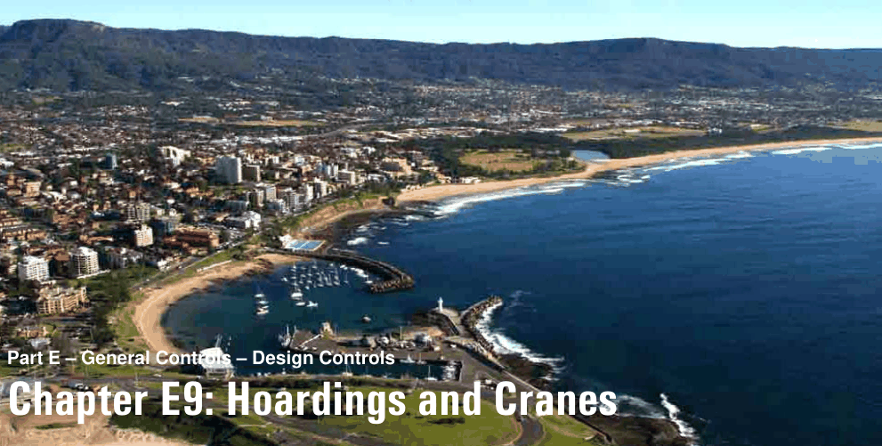

# Wollongong Development Control Plan 2009 - Chapter E9 Hoardings and Cranes

> This chapter is split into 10 section file(s), one per numbered heading, in the order they appear in the PDF.

Source PDF: [Wollongong-DCP-2009-Chapter-E09-Hoardings-Policy.pdf](https://planfortomorrow.sharepoint.com/sites/Planfortomorrow/Shared%20Documents/00%20NSW-Planning-Resources/dcp/wollongong-development-control-plan-2009/chapter-e9-hoardings-and-cranes/Wollongong-DCP-2009-Chapter-E09-Hoardings-Policy.pdf)

> [Picture on page 1: a picture, saved as a picture (images/chapter-e9-hoardings-and-cranes-page-1-1.gif, 150 dpi).]

#### Part E – General Controls – Design Controls

### Chapter E9: Hoardings and Cranes

### Contents

<!-- sections -->
## Sections

1. [3 RELATIONSHIP WITH EXISTING LEGISLATION &](01-3-relationship-with-existing-legislation.md)
2. [6 SPECIFIC REQUIREMENTS FOR THE CONSTRUCTION](02-6-specific-requirements-for-the.md)
3. [7 MAINTENANCE OF HOARDINGS](03-7-maintenance-of-hoardings.md)
4. [1 INTRODUCTION](04-1-introduction.md)
5. [2 OBJECTIVES](05-2-objectives.md)
6. [3 RELATIONSHIP WITH EXISTING LEGISLATION & AUSTRALIAN](06-3-relationship-with-existing-legislation.md)
7. [4 DEFINITIONS](07-4-definitions.md)
8. [5 APPLICATION PROCESS](08-5-application-process.md)
9. [6 SPECIFIC REQUIREMENTS FOR THE CONSTRUCTION OF](09-6-specific-requirements-for-the.md)
10. [7 MAINTENANCE OF HOARDINGS](10-7-maintenance-of-hoardings.md)
