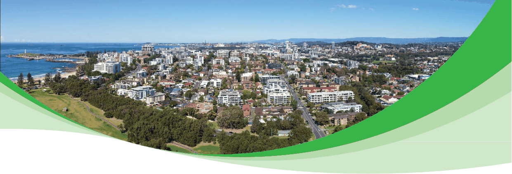

# Wollongong Development Control Plan 2009 - Contents

Source PDF: [WDCP-2009-Contents-Page-28-November-2025.pdf](https://planfortomorrow.sharepoint.com/sites/Planfortomorrow/Shared%20Documents/00%20NSW-Planning-Resources/dcp/wollongong-development-control-plan-2009/contents/WDCP-2009-Contents-Page-28-November-2025.pdf)

> [Picture on page 1: a picture, saved as a picture (images/contents-page-1-1.gif, 150 dpi).]

### •

.

### Contents

Wollongong DCP 2009 was adopted on 15/12/2009 and commenced on 01/03/2010. The dates

of Chapters included after 01/03/2010 are noted with an asterisk (*).

|  | Chapter | Amendment date/s |
|---|---|---|
| PART A - INTRODUCTION |  |  |
| A1 | Introduction | 03/08/11; 14/12/16; 05/03/25 |
| A2 | Ecologically Sustainable Development | *14/12/16; 13/05/2025 |
| PART B – LAND USE PLANNING CONTROLS |  |  |
| B1 | Residential Development | 03/08/11;14/12/16 |
| B2 | Residential Subdivision | 18/12/19 |
| B3 | Mixed Use Development | 14/12/16 |
| B4 | Development in Centres and Peripheral Sales Precincts | 06/07/23; 18/12/24 |
| B5 | Industrial Development | 14/12/16 |
| B6 | Development in the Illawarra Escarpment | 01/07/23 |
| B7 | Development in Rural Zones |  |
| PART C – SPECIFIC LAND USE CONTROLS |  |  |
| C1 | Advertising Signage and Structures | 10/06/22 |
| C2 | Bed and Breakfast Accommodation |  |
| C3 | Boarding Houses | 23/03/16; 22/08/22 |
| C4 | Caravan Parks, Camping Grounds and Manufactured Home Estates |  |
| C5 | Child Care Centres |  |
| C6 | Events Management | *1/10/2010; 28/7/2025 |
| C7 | Exhibition Villages and Exhibition Homes |  |
| C8 | Extractive Industries |  |
| C9 | Health Consulting Rooms |  |
| C10 | Home Businesses and Industry | 03/08/11 |
| C12 | Outdoor Restaurants and Footpath Trading (Street Vending) Activities |  |

Wollongong Development Control Plan 2009

Contents

#### Chapter

#### Amendment date/s

C13 Places of Public Worship

C14 Firearms and Weaponry Stores

C15 Retail Markets Sex Services Premises and Restricted Premises (Sex Shops)

#### C16

07/09/13

C17 Telecommunications and Radiocommunications Facilities

02/08/21; 05/12/23

#### PART D – LOCALITY BASED DCPS / PRECINCT PLANS

D1 Suburb Character Statements

D2 Berkeley (Berkeley Road Industrial Estate)

D3 Bellambi (Brompton Road)

D4 Bulli (Franklin Avenue)

D5 Griffins Bay

D6 Kanahooka (Northern side of Kanahooka Road)

D7 Mount Kembla (Cordeaux Road)

D8 Mount Kembla (William James Drive)

D9 Mount Kembla and Kembla Heights Village

D10 Mount Keira (Valley Drive)

D11 Port Kembla (Gloucester Boulevard)

D12 Thirroul Village Centre

D13 Wollongong City Centre

D14 Wollongong Innovation Campus

D15 Woonona Edgewood Estate

D16 West Dapto

14/12/16

24/05/17

\*17/12/10; 03/08/11; 08/12/12;

01/06/13; 14/12/13; 02/04/14;

12/08/15; 09/09/15; 24/10/15;

18/12/19; 20/04/20; 12/11/21,

19/08//24; 23/06/25

| D17 | Bulli Brickworks | *12/10/11 |
|---|---|---|
| D18 | Brickyard Point, Austinmer | *04/03/15 |
| D19 | Former Corrimal Cokeworks Site | *09/08/22 |
| D20 | Former Port Kembla Public School Site | *26/04/23 |
| D21 | Tallawarra Lands | *27/05/24 |
| PART | E – GENERAL (CITY WIDE) CONTROLS |  |
| E1 | Access for People with Disability | 23/05/22 |
| E2 | Crime Prevention through Environmental Design | 02/04/12 |
| E3 | Car Parking, Access, Servicing/Loading Facilities and Traffic Management | 02/04/12; 14/12/16; 22/08/22, 26/05/25 |

Wollongong Development Control Plan 2009 Updated:  28 November 2025

Contents

|  | Chapter | Amendment date/s |
|---|---|---|
| E6 | Landscaping | 02/04/12; 14/12/16 |
| E7 | Waste Management | 12/01/18 |
| E8 | Onsite Sewage Management Systems |  |
| E9 | Hoardings and Cranes |  |
| E10 | Aboriginal Heritage |  |
| E11 | Heritage Conservation |  |
| E12 | Geotechnical Assessment of Slope Instability | 03/08/11; 19/07/21 |
| E13 | Floodplain Management | 25/03/20 |
| E14 | Stormwater Management | 26/03/20 |
| E15 | Water Sensitive Urban Design | 28/11/25 |
| E16 | Bush Fire Management | 07/09/13; 19/08/24 |
| E17 | Preservation and Management of Trees and Vegetation | 07/09/13; 01/07/23 |
| E18 | Native Biodiversity Impact Assessment | 01/07/23 |
| E19 | Earthworks (Land Reshaping Works) | 01/07/23 |
| E20 | Contaminated Land Management | 03/08/11; 12/01/18 |
| E21 | Demolition and Hazardous Building Materials Management | 03/08/11; 12/01/18 |
| E22 | Soil Erosion and Sediment Control | 12//01/18 |
| E23 | Riparian Land Management | 22/08/22 |
| APPENDICIES |  |  |
| AP4 | Definitions | 14/12/16; 04/08/25 |

#### REPEALED CHAPTERS

|  | Chapter | Repealed Date |
|---|---|---|
| C11 | Home Industry | 03/08/11 |
| E4 | Development near Railway Corridors and Major (Busy) Roads | 03/11/11 |
| E5 | BASIX | 03/11/11 |
| AP1 | Public Notification and Advertising Procedures | 27/11/19 |
| AP2 | Wollongong City Centre Public Domain Technical Manual | 02/04/12 |
| AP3 | Business Centres Public Domain Technical Manual | 02/04/12 |

#### DOCUMENT CONTROL

This document was last updated on 28 November 2025.

Wollongong Development Control Plan 2009 Updated:  28 November 2025
