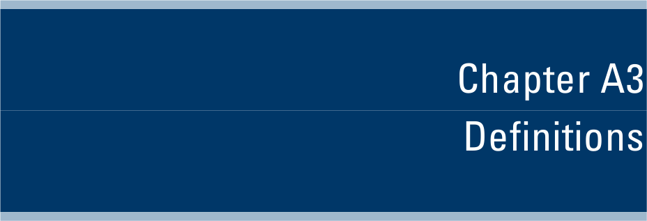
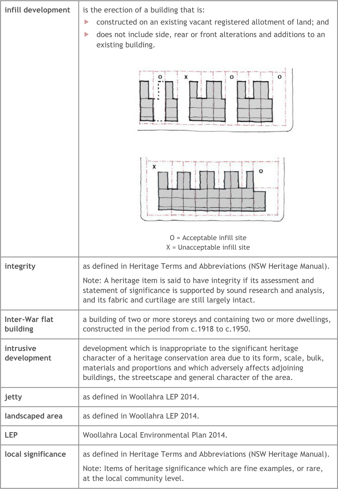

# Woollahra Development Control Plan 2015 - Chapter A3 Definitions

Source PDF: [chapter-a3-definitions-23may2025.pdf](https://planfortomorrow.sharepoint.com/sites/Planfortomorrow/Shared%20Documents/00%20NSW-Planning-Resources/dcp/woollahra-development-control-plan-2015/chapter-a3-definitions/chapter-a3-definitions-23may2025.pdf)

> [Picture on page 1: a picture, saved as a picture (images/chapter-a3-definitions-page-1-1.gif, 150 dpi).]

### Chapter A3 Definitions

### Part A  Introduction and Administration

### CHAPTER A3 APPROVED ON 27 APRIL 2015 AND COMMENCED ON 23 MAY 2015

### Last amended on 23 May 2025

#### A3.1 Definitions

| adaptation | as defined in the Burra Charter. Note: Means changing a place to suit the existing use or a proposed use. |
|---|---|
| aesthetic significance | as defined in NSW Heritage Manual, Heritage Office & Department of Urban Affairs and Planning, Sydney, 1996 (NSW Heritage Manual) – Assessing Heritage Significance. Note: Important in demonstrating aesthetic characteristics and/or a high degree of creative or technical achievement. |
| alter | in relation to a heritage item or to a building or work within a heritage conservation area means: make structural changes to the outside of the heritage item, building or work, or Inter-War flat building, or make non-structural changes to the detail, fabric, finish or appearance of the outside of the heritage item, building or work, but not changes that involve the maintenance of the existing detail, fabric, finish and appearance of the outside of the heritage item, building or work. |
| amenity | as defined in Heritage Terms and Abbreviations (NSW Heritage Manual). Note: Refers to qualities of usefulness, comfort and pleasure in items and areas of the environment. Heritage arguments are often used incorrectly to defend items or areas when amenity considerations are more relevant and appropriate. |
| attached dwelling | as defined in Woollahra LEP 2014. Note: Within the Paddington, Woollahra and Watsons Bay HCA contexts, this commonly takes the form of a building known as a terrace, where the terrace is part of a group of three or more dwellings. |
| attic | as defined in Woollahra LEP 2014. |
| boat shed | as defined in Woollahra LEP 2014. |
| Building Code of Australia (BCA) | the Building Code of Australia (BCA) is Volumes One and Two of the National Construction Code (NCC). The BCA has been given the status of building regulation by all States and Territories. The BCA contains technical provisions for the design and construction of buildings and other structures, covering such matters as structure, fire resistance, access and egress, services and equipment, and energy efficiency as well as certain aspects of health and amenity. |
| building envelope | the three-dimensional space within which a building is to be confined. |

| building height | as defined in Woollahra LEP 2014. |
|---|---|
| building line | as defined in Woollahra LEP 2014. |
| Burra Charter (and its guidelines) | the charter adopted by Australia International Council on Monuments and Sites (ICOMOS), which establishes the nationally accepted principles for the conservation of places of cultural significance. |
| character | the combination of features and qualities of a place. |
| coastal inundation | the storm-related flooding of coastal lands by ocean waters due to elevated still water levels (storm surge) and wave run-up. |
| Commercial premises | as defined in Woollahra LEP 2014. |
| compatible use | as defined in Heritage Terms and Abbreviations (NSW Heritage Manual). Note: A use for a heritage item which involves no change to its culturally significant fabric, changes which are substantially reversible or changes which make a minimal impact. |
| conservation | as defined in Heritage Terms and Abbreviations (NSW Heritage Manual). Note: All the processes of looking after an item so as to retain its cultural significance. It includes maintenance and may, according to circumstances, include preservation, restoration, reconstruction and adaptation and will be commonly a combination of more than one of these. |
| conservation policy | as defined in Heritage Terms and Abbreviations (NSW Heritage Manual). Note: A proposal to conserve a heritage item arising out of the opportunities and constraints presented by the statement of heritage significance and other considerations. |
| context | the particular built, natural, historical and/or social characteristics of a building or place’s setting. |
| contributory building | a building that makes an important and significant contribution to the character and significance of the heritage conservation area. It has a reasonable to high degree of integrity and dates from a key development period of significance of a heritage conservation area. A building which: due to its materials, detailing, finishes, scale, form, siting and landscaping makes a positive impact and contribution to the streetscape character and to the cultural significance of the heritage conservation area; and is from a significant historical period and is altered yet recognisable and reversible. |

| contributory item | a building, work, archaeological site, tree or place and its setting, which contributes to the heritage significance of a conservation area. |
|---|---|
| courtyard | an area that is open to the sky and of sufficient size to be used as private open space. A courtyard does not include a lightwell or a breezeway. |
| courtyard housing | a structure which: must be wholly located at the rear of the existing principal building, must be separated from the principal building by a courtyard must be separated by a narrow, non-habitable lightweight linking structure, and must be subsidiary in form and scale to the principal building. Courtyard housing is not infill development, or a garage, or a loft over a garage, or studio. |
| cultural landscape | as defined in Heritage Terms and Abbreviations (NSW Heritage Manual). Note: Those areas of the landscape which have been significantly modified by human activity. They include rural lands such as farms, villages and mining sites, as well as country towns. |
| cultural plantings | plants including native plants that were planted for a deliberate purpose (see also ‘significant cultural plantings’). |
| curtilage | as defined in Woollahra LEP 2014. |
| deep soil landscaped area | the area of the site that contains landscaped area which has no above ground, ground level or subterranean development. Note: ‘landscaped area’ is defined in Woollahra LEP 2014. |
| demolish | as defined in Woollahra LEP 2014. |
| dormer | a structure comprising a window, roof and side walls projecting from a sloping roof. |
| dual occupancy | as defined in Woollahra LEP 2014. |
| dwelling | as defined in Woollahra LEP 2014. |
| dwelling house | as defined in Woollahra LEP 2014. |
| Eastern suburbs banksia scrub | vegetation within the Watsons Bay, Camp Cove and Sydney Harbour National Park areas, which is endemic to these areas. |
| ecologically sustainable development | has the same meaning as in the Environmental Planning and Assessment Act 1979. |

| educational establishment | as defined in Woollahra LEP 2014. |
|---|---|
| excavation permit | as defined in Heritage Terms and Abbreviations (NSW Heritage Manual). Note: A permit issued by the Heritage Council of New South Wales under section 60 or section 140 of the Heritage Act 1977 to disturb or excavate a relic. |
| fabric | physical material or substances. In the case of a building, fabric would include materials such as brick, stone, timber, mortar, glazing, iron, steel, terracotta and slate. |
| façade | the elevation of a building facing the street/s. |
| floor space ratio | as defined in Woollahra LEP 2014. |
| form | in relation to a building, means its overall shape and configuration of components. |
| freeboard | a factor of safety typically used in relation to the setting of flood planning levels. It compensates for uncertainties in the estimation of flood levels across the floodplain, such as wave action, localised hydraulic behaviour and impacts that are specific event related, such as levee and embankment settlement, and other effects such as sea level rise. |
| gross floor area | as defined in Woollahra LEP 2014. |
| ground level (existing) | as defined in Woollahra LEP 2014. |
| group | a number of related buildings that form a group, that may include pairs of buildings and terrace groups. Groups of related buildings display shared characteristics such as an original builder, architectural style, form, scale and details. In some instances, terrace groups can include sub-groups where a group comprises a range of buildings, e.g. corner commercial buildings integrated into terrace house groups. |

| habitable room | as defined in the Building Code of Australia (BCA). Note: Habitable room means a room used for normal domestic activities, and: a) includes a bedroom, living room, lounge room, music room, television room, kitchen, dining room, sewing room, study, playroom, family room and sunroom; but b) excludes a bathroom, laundry, water closet, pantry, walk-in wardrobe, corridor, hallway, lobby, photographic darkroom, clothes-drying room, and other spaces of a specialised nature occupied neither frequently nor for extended periods. |
|---|---|
| heritage conservation area | as defined in Woollahra LEP 2014. |
| heritage conservation management plan | as defined in Woollahra LEP 2014. |
| heritage impact statement | as defined in Woollahra LEP 2014. |
| heritage item | as defined in Woollahra LEP 2014. |
| heritage significance | as defined in Woollahra LEP 2014. |

> [Picture on page 8: a picture, saved as a picture (images/chapter-a3-definitions-page-8-1.gif, 150 dpi).]
> [Picture text on page 8 is stored in the PDF without readable letters (no character map), so it could not be copied; see the original PDF.]

infill development is the erection of a building that is:

constructed on an existing vacant registered allotment of land; and does not include side, rear or front alterations and additions to an existing building.

|  | O = Acceptable infill site |
|---|---|
|  | X = Unacceptable infill site |
| integrity | as defined in Heritage Terms and Abbreviations (NSW Heritage Manual). Note: A heritage item is said to have integrity if its assessment and statement of significance is supported by sound research and analysis, and its fabric and curtilage are still largely intact. |
| Inter-War flat | a building of two or more storeys and containing two or more dwellings, |
| building | constructed in the period from c.1918 to c.1950. |
| intrusive | development which is inappropriate to the significant heritage |
| development | character of a heritage conservation area due to its form, scale, bulk, materials and proportions and which adversely affects adjoining buildings, the streetscape and general character of the area. |
| jetty | as defined in Woollahra LEP 2014. |
| landscaped area | as defined in Woollahra LEP 2014. |
| LEP | Woollahra Local Environmental Plan 2014. |
| local significance | as defined in Heritage Terms and Abbreviations (NSW Heritage Manual). Note: Items of heritage significance which are fine examples, or rare, at the local community level. |

| loggia | an open sided, roofed space attached to the side of a building. |
|---|---|
| maintenance | as defined in Woollahra LEP 2014. |
| manor house | as defined in State Environmental Planning Policy (Exempt and Complying Development Codes) 2008. |
| mixed use development | as defined in Woollahra LEP 2014. |
| movable heritage | as defined in Heritage Terms and Abbreviations (NSW Heritage Manual). Note: Heritage items not fixed to a site or place (for example, furniture, locomotives and archives). |
| multi dwelling housing | as defined in Woollahra LEP 2014. |
| multi dwelling housing (terraces) | as defined in Woollahra LEP 2014. |
| native vegetation | has the same meaning as in the Native Vegetation Act 2003. |
| natural ventilation | ventilation by natural airflow, unassisted by mechanical means, through doors, operable windows and louvres. |
| neutral buildings | a building that does not contribute or does not detract from the significant character of the heritage conservation area. A neutral building is: from a significant historical period, but altered in form, in an irreversible way; or a sympathetic contemporary infill. |
| non-habitable room | refer ‘habitable room’ in the Building Code of Australia (BCA). Note: A non-habitable room is a bathroom, laundry, water closet, pantry, walk-in wardrobe, corridor, hallway, lobby, photographic darkroom, clothes-drying room, and other spaces of a specialised nature occupied neither frequently nor for extended periods. |
| north facing | the orientation range within 20° west and 30° east of true solar north. |
| NSW Heritage Manual | a document prepared by the NSW Heritage Office which comprises a series of publications explaining the three steps of the NSW Heritage Management System and how they can be applied. |
| objectives | define the intention of each control element and/or indicate the desired outcomes to be achieved in the completed development. |

| original significant fabric | the physical materials and substances belonging to the initial construction phase of a place that contribute to heritage significance. In the case of a building, original significant fabric would include all the original materials of the principal building form and extant external materials of the secondary wing, if the form is intact and the external materials are substantially intact. |
|---|---|
| parapet | an upstanding wall or barrier placed at the edge of a platform, balcony or roof. |
| passive solar design | design principles that aim to prevent unwanted heat, in the form of sunlight, entering the building during summer and to maximise solar access into the building during winter. Building orientation, the location and treatment of glazing, thermal mass, insulation, and ventilation all work to exclude and dissipate heat in summer and retain and capitalise on heat in winter. |
| place | as defined in Heritage Terms and Abbreviations (NSW Heritage Manual). Note: A site, area or landscape or group of works, together with associated structures, contents and surrounds. |
| preservation | as defined in Heritage Terms and Abbreviations (NSW Heritage Manual). Note: Maintaining the fabric of a place in its existing state and retarding deterioration. |
| principal elevation | the elevation of a building that faces a public space. Buildings may contain more than one principal presenting elevation such as an A- typical triangular shaped lot. |
| principal roof form | the principal roof plane/s located over the principal building form (predominantly the front building section). |
| private domain | all land which is privately owned and which is not included in the public domain. |
| private open space | as defined in Woollahra LEP 2014. |
| public domain | all land which is owned by a public authority and includes roads, footpaths, laneways and parks. |
| rarity | as defined in Assessing Heritage Significance (NSW Heritage Manual). Note: Possesses uncommon, rare or endangered aspects of the area cultural or natural history. |
| reconstruction | as defined in Heritage Terms and Abbreviations (NSW Heritage Manual). Note: Returning a place as nearly as possible to a known earlier state by the introduction of new or old materials into the fabric (not to be confused with conjectural reconstruction). |

| representativeness | as defined in Assessing Heritage Significance (NSW Heritage Manual). Note: It is important in demonstrating the principal characteristics of a class of the area’s cultural or natural places or cultural or natural environments. |
|---|---|
| residential flat building | as defined in Woollahra LEP 2014. |
| restoration | as defined in Heritage Terms and Abbreviations (NSW Heritage Manual). Note: Returning the existing fabric of a place to a known earlier state by removing accretions or by reassembling existing components without the introduction of new material. |
| reverse skillion | where the presenting outer edge of an attached skillion roof form is located at a height above the point of attachment or in the case of a single unattached roof plane where the highest presenting end of the roof plane contains an eave overhang. |
| reviewable condition | as defined in the Environmental Planning and Assessment Act 1979 (s80A) Note: means any of the following: a) a condition that permits extended hours of operation (in addition to other specified hours of operation), b) a condition that increases the maximum number of persons permitted in a building (in addition to the maximum number otherwise permitted). |
| roof terrace | a trafficable roof of a building (or part thereof) (including a garage or carport) which has the potential to be used for the purpose of private open space, storage or roof garden and which is either open to the sky or partly covered by a non-continuous shade device. |
| roofscape | a view or expanse of roofs including their pitch and form, and elements such as chimneys, parapets, party walls, guttering and roof materials. |
| row | a continuous line of buildings. Attached housing or terrace style housing is predominantly constructed in rows. |
| sandstone heath | heath and scrub which is found on shallow exposed sandstone-derived soils which border the sea coast, and extend to varying distances inland, or where drainage is impeded by rock shelves or shale lenses. |
| scale | the size of a building and its relationship with surrounding buildings and landscape. |
| seawall | a structure placed partially or wholly along the land/water interface to protect the land from the sea or to stop accelerated erosion of the shoreline, but does not include a breakwater. |

| secondary elevation | those elevations behind the principal building form. |
|---|---|
| semi-detached dwelling | as defined in Woollahra LEP 2014. Note: Within the Paddington and Woollahra HCA contexts, this commonly takes the form of a building known as a terrace, where the terrace is attached to only one other dwelling. |
| sensitive marine environment | the environment in which any of the following ecological communities exist along the harbour foreshore within the Woollahra Municipality, as identified in the Development Control Plan for Sydney Regional Environmental Plan (Sydney Harbour Catchment) 2005: rocky intertidal; sandy intertidal; grassland; seagrass beds; mixed sandy intertidal and rock shelf; and mixed rocky intertidal and sand. |
| setback | as defined in Woollahra LEP 2014 (refer to building line or setback). |
| shopfront elevation | the elevation to the street including the areas above and below an awning. |
| side boundary fence | a fence separating allotments or on a side street, in the case of a corner site, but does not include a fence within the street front zone. |
| significant cultural plantings | plants including native plants that were planted for a deliberate purpose and which reflect the taste or fashion of a particular period or were associated with a person or event of historical significance. |
| significant tree | a tree identified on Council’s significant tree register. |
| significant views | views and vistas from streets and public reserves which strongly contribute to a sense of place and cultural identity. |
| site area | as defined in Woollahra LEP 2014. |
| soffit | the lower face or visible surface of a ceiling, eave, projecting slab or the like. |
| solar access | the amount of direct access to sunlight enjoyed by a building, room or open space. |

| solar energy system | solar energy system means any of the following systems— a) a photovoltaic electricity generating system used for the primary purpose of generating electricity for a land use— i) carried out on the land on which the system is located, or ii) carried out by the owner of the system on adjoining land, b) a solar hot water system, c) a solar air heating system. |
|---|---|
| spa pool | as defined in the Swimming Pools Act 1992. |
| State heritage significance | as defined in the Heritage Act 1977. |
| storey | as defined in Woollahra LEP 2014. |
| street alignment | the horizontal shape of the street reserve boundary. |
| street front zone | comprises the front building elevation and visible roof, front yard, the side boundary fences in the front yard and the street boundary fence. |
| street name inlays | the (usually) red lettering insert in footpaths, kerbs or gutters found at many intersections to indicate the name of the respective street. |
| streetscape | encompasses both the public and private domain and includes the street design, its landscaping, traffic management treatments, surfaces, utility installations, all buildings abutting the street and their facades, associated landscaping, fences, paths, driveways and the like. The arrangement and integration of these components and their visual appearance determine the streetscape character. |
| swimming pool | as defined in the Swimming Pools Act 1992. |
| terrace | is a style of housing. The buildings share a similar design and form and are linked by common party walls. In Woollahra LEP 2014, a terrace is defined as: a semi-detached dwelling (where the terrace is only attached to only one other dwelling); or an attached dwelling (where the terrace is part of a building that containing 3 or more dwellings). |
| unaltered | in relation to a building or group of buildings means that the building or group of buildings has retained its original form and character but may have minor changes including changes to windows and doors and some loss of detail that may be reversible. |

unbuilt upon area the area of the site not covered by the building footprint and any roofed

structures, but excludes uncovered parking areas and driveways. Uncovered parking areas and driveways are not to be calculated as unbuilt upon area.
