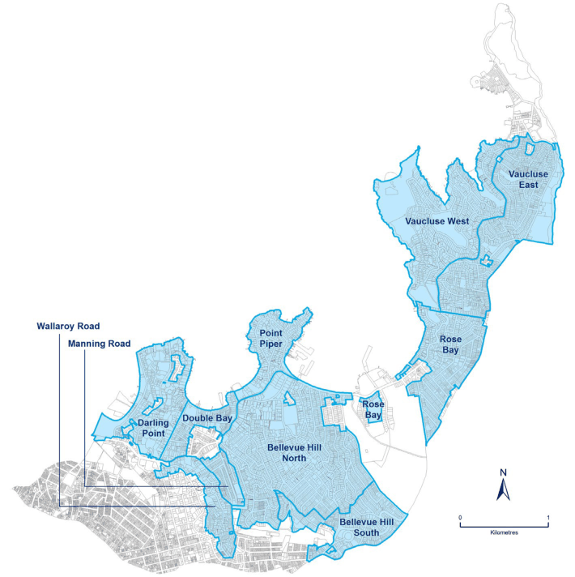

#### B1.1 Introduction

This is Chapter B1 of the General Residential (Part B) of the Woollahra Development Control Plan 2015 (DCP).  It contains the precinct controls for 10 residential precincts.

This chapter seeks to ensure that development has regard to its context and is compatible with the desired future character for each precinct as described in this chapter.

#### B1.1.1 Land where this chapter applies

This chapter applies to the following residential precincts: Darling

Bellevue Hill South Bellevue Hill North

Point

Rose Bay

Double Bay

Vaucluse West

Wallaroy

Vaucluse East

Manning Road Point Piper

These precincts are identified on the map below. A separate map of each precinct is also provided in the relevant sections of this chapter.

> [Picture on page 8: a picture, saved as a picture (images/chapter-b1-residential-precincts-page-8-1.gif, 150 dpi).]

#### B1.1.2 Development to which this chapter applies

This chapter applies to development that requires development consent.

Generally this will be residential development, but may include other permitted uses such as child care centres, community facilities, educational establishments, neighbourhood shops and places of public worship, and other uses permitted in Woollahra LEP 2014.

#### B1.1.3 Objectives

The objectives of this chapter are:

O1 To ensure development reflects the desired future character of the precinct.

O2 To preserve the significant features of individual precincts which contribute to their unique character.

O3 To ensure that the design and siting of development suitably responds to the surrounding built form and natural features.

O4 To limit impacts on the amenity of adjoining and adjacent development.

O5 To ensure the preservation of significant view corridors and ridgelines.

O6 To retain and reinforce tree canopies and landscape qualities.

O7 To ensure that streetscape and scenic quality is preserved.

#### B1.1.4 Relationship to other parts of the DCP

This chapter is to be read in conjunction with the other parts of the DCP that are relevant to the development proposal, including: Part B: Chapter B2 Neighbourhood HCAs – this chapter contains objectives and controls that apply to development in a neighbourhood HCA. Part B: Chapter B3 General Development Controls. Part E: General Controls for All Development – this part contains chapters on Parking and Access, Stormwater and Flood Risk Management, Tree Management, Contaminated Land, Waste Management, Sustainability, Signage and Adaptable Housing. Part F: Land Use Specific Controls – this part contains chapters on Child Care Centres, Educational Establishments, Licensed Premises and Telecommunications.

#### B1.1.5 How to use this chapter

> [Picture text on page 10 is stored in the PDF without readable letters (no character map), so it could not be copied; see the original PDF.]

The primary planning considerations for the residential precincts are set out in two chapters: Chapter B1 Residential Precincts; and Chapter B3 General Development Controls.
