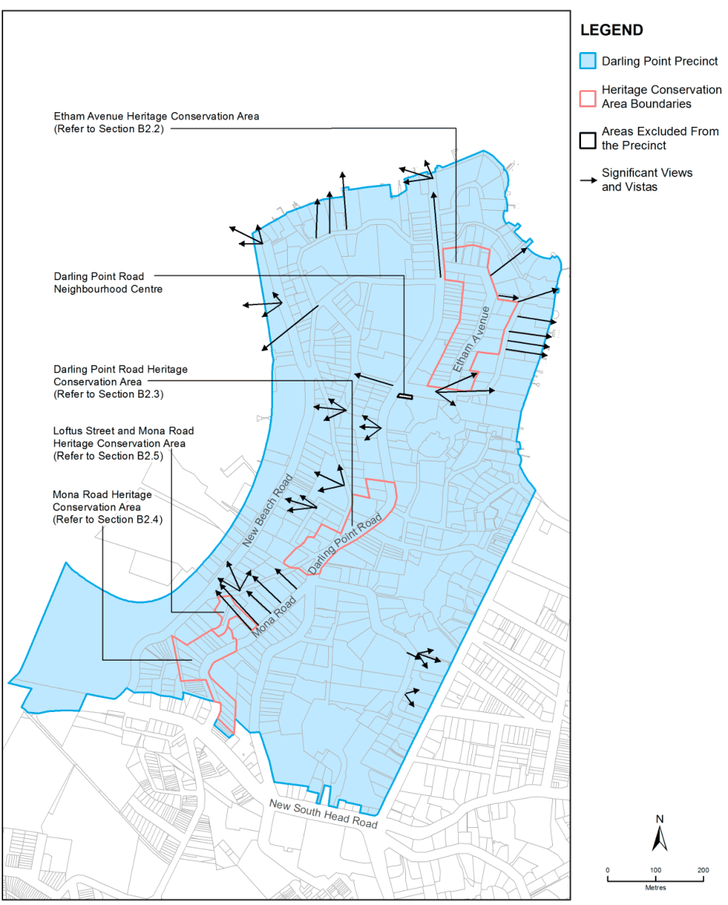

#### B1.2 Darling Point Precinct

MAP 2  Darling Point Precinct

> [Picture on page 11: a picture, saved as a picture (images/chapter-b1-residential-precincts-page-11-3.gif, 150 dpi).]

#### B1.2.1 Precinct character statement

The Darling Point precinct is located on a highly prominent peninsula on Sydney Harbour sited between Rushcutters Bay and Double Bay. Darling Point provides spectacular views to the harbour from both private houses and public spaces. The street trees and trees in private yards provide the peninsula with a soft landscape quality.

Significant landmarks within the precinct include: St Mark’s church, Ascham School, the heritage properties of Babworth House and Bishopscourt, harbourside reserves at McKell Park and Yarranabbe Park, and the heritage listed Sir David Martin Reserve which contains the Drill Hall, former HMAS Rushcutter and HMAS Rushcutter slipway.

The built environment is notable for the wide variety of architectural styles and housing types. The precinct also contains a significant number of heritage items (refer to Woollahra LEP 2014) and encompasses the heritage conservation areas at Etham Avenue, Darling Point Road,  Mona Road and Loftus Road /Mona Road.

A significant element of the heritage items and heritage conservation areas is the siting of buildings within a landscaped setting.  Additional planning provisions for the four neighbourhood heritage conservation areas within the Darling Point precinct are set out in Chapter B2 in this Part of the DCP.

Streets surrounding the ridgeline of Darling Point Road include residential flat buildings up to eight storeys, dwelling houses, semi-detached dwellings and groups of terraces (attached dwellings).

Existing groups of relatively intact period terraces that are not heritage items but contribute to the architectural diversity of the precinct, such as those along New Beach Road (11-14, 48-52 and 70-71), Ocean Avenue (71-73 and 77-81) and Darling Point Road (125-127).

In the post-war period, high rise residential towers of up to 20 storeys were developed along the ridgeline of Darling Point.  Significantly, many of the towers contain extensive landscaped grounds and gardens which provide an openness and allow for distant views.  Some of these towers are located along the waterfront and represent intrusive development when viewed from the Sydney Harbour.

Similarly other residential flat buildings that have not been designed to step down and follow the slope of the land, also present to the harbour as a sheer façade.

The Rushcutters Bay foreshore area comprises a mix of buildings, including heritage listed semi-detached dwellings on the south-eastern side of New Beach Road, as well as commercial uses relating to the marinas at Rushcutters Bay.  These include the Cruising Yacht Club of Australia, Ship Chandlers, and d’Albora Marina.

#### B1.2.2 Desired future character

The Darling Point precinct is an established residential area with a rich mixture of architectural styles and forms.  Development is to retain the visual prominence of the tree canopy, particularly along the ridgeline of Darling Point Road.

Most development is in the form of alterations and additions to the existing housing stock.

Where a building comprises historic or aesthetic values, it is important that development reflects the scale of the existing built form and retains the character of the original building particularly in regard to the roof form, massing, details, materials and finishes.  For example, the groups of period terraces at New Beach Road, Ocean Avenue and Darling Point Road should be retained and enhanced.

Development adjoining a contributory item or heritage conservation area is to have regard to the architectural values of the building and establish a sympathetic interface.

Where an existing building does not comprise historic or aesthetic value, sympathetic contemporary design is permitted.

Where new development occurs, the buildings are to provide a height, bulk, and scale compatible with those buildings that are predominantly two to four storeys in height, and have regard to the visual impact of the development from the harbour.

Existing intrusive high rise and tower developments are not to be reproduced.

On the low side of streets where existing development predominantly presents as single or two storey, the height and scale of this built form to the street should be retained and the development designed to step down and follow the slope of the land.  This will minimise cut and fill and also limit overshadowing and privacy impacts to neighbouring properties.

Attention must also be given to retaining views from the public domain and providing for view sharing from private properties; these can be achieved by providing suitable side boundary setbacks, roof forms and thoughtful distribution of building form across the site.

#### Streetscape character and key elements of the precinct

Development respects and enhances the existing elements of the character that contribute to the precinct including:

a) the rich mixture of architectural styles;

b) the stepping of development on the hillside to minimise visual impact and follow the landform;

c) the significance of heritage items and the adjacent heritage conservation areas of Darling Point Road, Etham Avenue, Mona Road and Loftus Road/Mona Road and individual heritage items;

d) well established gardens and trees;

e) remnant estate gardens;

f) historic stonewalls on private and public land;

g) historic stairway and streetscape elements;

h) pedestrian links through the precinct;

i) mature street trees especially along the ridgeline;

j) the highly visible tree canopy providing a dense green backdrop to views from Sydney Harbour and surrounding lands;

k) extensive views afforded from the public spaces including corridors between buildings and the preservation of important iconic and harbour views; and

l) waterfront reserves and parks.

#### Desired future character objectives

O1 To respect and enhance the streetscape character and key elements of the precinct.

O2 To maintain the sense of the historic grand estates.

O3 To maintain the evolution of residential building styles through the introduction of well designed contemporary buildings incorporating modulation and a varied palette of materials.

O4 To maintain the heritage significance of heritage items and buildings in adjacent heritage conservation areas.

O5 To ensure that development does not reproduce or match existing intrusive buildings.

O6 To ensure that alterations and additions to period buildings, such as semi-detached dwellings and attached dwellings, do not detract from the character of these buildings and their presentation to the street.

O7 To ensure roof forms are articulated to provide attractive roofscapes and designed to minimise view loss.

O8 To design and site buildings to respond to the topography and minimise cut and fill.

O9 To ensure that development is subservient to the tree line along the ridge of Darling Point Road when viewed from the harbour.

O10  To retain and reinforce the setting of mature street trees and garden plantings especially along the ridgeline by retaining existing trees and providing appropriate replacement planting.

O11 To retain the landscape setting of the locality by maintaining landscaped areas around buildings and minimising hard stand areas.

O12 To retain and reinforce the stone and brick retaining walls that characterise the sloping streets of the precinct.

O13  To protect important iconic and harbour views from public spaces and to provide additional important views from public spaces when possible.
