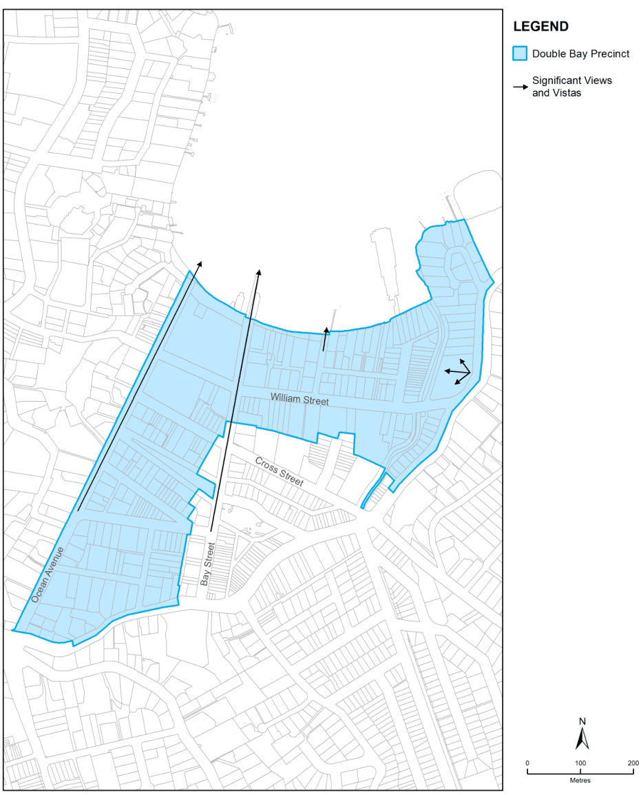

#### B1.3 Double Bay Precinct

MAP 3  Double Bay Precinct

> [Picture on page 15: a picture, saved as a picture (images/chapter-b1-residential-precincts-page-15-3.gif, 150 dpi).]

#### B1.3.1 Precinct character statement

The Double Bay residential precinct is located to the north and west of the Double Bay centre and includes the Double Bay Public School and ‘Steyne Park’ between the school and the waterfront. It also includes Council’s local history library within Foster Park and a child care centre.

The Double Bay precinct has a strong feeling of community and convenience due to the facilities located within the precinct and the proximity of the adjacent town centre.

The precinct sits within a low lying basin, framing the Double Bay foreshore. The precinct is notable for both the density of its built form and its green landscape character. The tree canopy, formed by both street trees and private plantings, is a prominent element in the municipality's presentation from Sydney Harbour and should be maintained.

The street pattern allows for long views to the harbour, and distant views to surrounding hillsides. Three major streets dominate the precinct: the curvilinear New South Head Road which forms an edge to the precinct to the south; Ocean Avenue, the north-south oriented boulevard that divides Double Bay from the hillside of Darling Point; and the east-west oriented William Street.  Due to the topography and location, each of these major streets presents unique settings within the broader common elements of the precinct.

The precinct contains dwelling houses, terraces (attached dwellings) and residential flat buildings, including a number of Inter-War flat buildings that make a significant contribution to the precinct character.  The quality of buildings within the precinct represents an evolution and mix of building styles that often maintain a consistent scale across both sides of the street.

#### B1.3.2 Desired future character

The precinct is an established area comprising many residential flat buildings.  Development will generally be in the form of improvements to the existing residential flat buildings.

There are a significant number of Inter-War flat buildings that contribute to the precinct character and are worthy of retention, especially around William Street, New South Head Road and Gladswood Gardens.  Alterations and additions to the Inter-War flat buildings are to retain the character of the original building through appropriate use of materials, and should not significantly alter significant and traditional building elements visible from the street.

New development on sites in the R2 Low Density Residential zones along Guilfoyle Street, Cooper Street and the southern side of William Street are to be well-designed and address the street so that development make a positive contribution to the public domain.

On sloping land, new development should step down the site to reinforce the topography and minimise cut and fill.  Attention must also be given to protecting views, particularly views from public spaces down Ocean Avenue, Bay and Beach Streets to the harbour, and views from New South Head Road to the harbour.

#### Streetscape character and key elements of the precinct

Development respects and enhances the existing elements of the neighbourhood character that contribute to the precinct including:

a) the rich mixture of architectural styles and building forms;

b) the topography and the siting of development on New South Head Road, which descends into (and ascends out of) the Double Bay centre;

c) well established gardens and trees including the avenue plantings in Ocean, Guilfoyle and South Avenues, Bay Street and William Street;

d) the established tree canopy;

e) the harbour views and view corridors from public places;

f) the character of Inter-War flat buildings; and

g) the heritage significance of the adjoining Transvaal Avenue Heritage Conservation Area.

#### Desired future character objectives

O1 To respect and enhance the streetscape character and key elements of the precinct.

O2 To reinforce a consistent building scale within streets.

O3 To design and site buildings to respond to the topography and minimise cut and fill.

O4 To maintain the evolution of residential building styles through the introduction of well designed contemporary buildings, incorporating modulation and a varied palette of materials.

O5 To ensure that rooflines sit within the predominant street tree canopy.

O6 To maintain the significance of heritage items within the precinct, and the character of the adjoining Transvaal Avenue Heritage Conservation Area.

O7 To retain Inter-War flat buildings, particularly significant and traditional building elements visible from the street.

O8 To provide a transition between the higher density buildings of the Double Bay centre and the lower density buildings of the residential area.

O9 To retain and reinforce the green setting of mature street trees, private trees and garden plantings.

O10 To protect important iconic and harbour views from the public spaces.

O11 To maintain on-street parking and minimise kerb crossings, particularly on Bay Street and Ocean Avenue.
