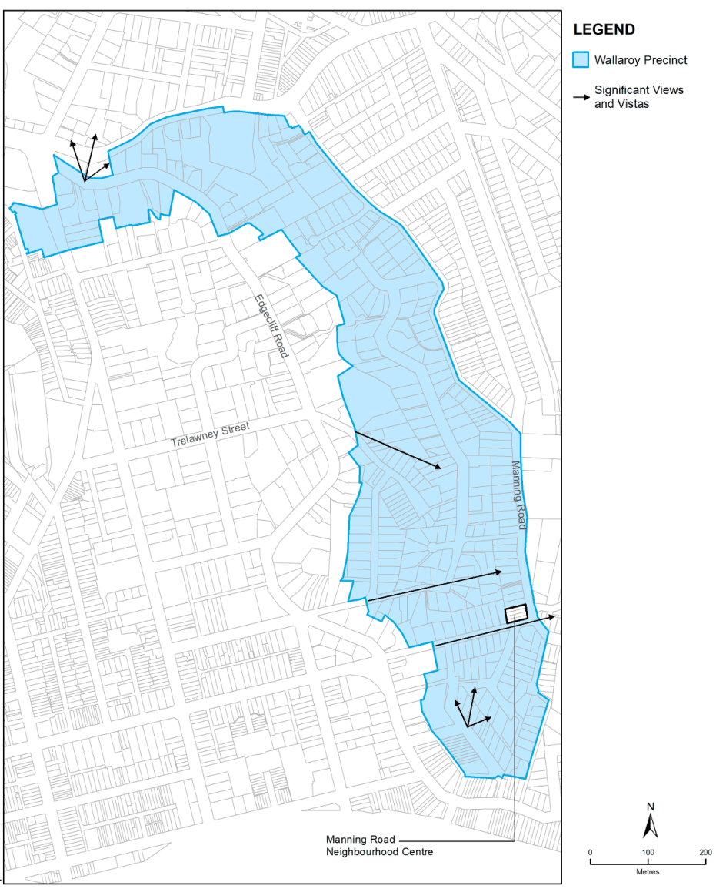

#### B1.4 Wallaroy Precinct

MAP 4  Wallaroy Precinct

> [Picture on page 18: a picture, saved as a picture (images/chapter-b1-residential-precincts-page-18-3.gif, 150 dpi).]

#### B1.4.1 Precinct character statement

The Wallaroy precinct is sited along a ridgeline and hillside overlooking Double Bay and Sydney Harbour.  The precinct extends from the valley floor at Manning Road to the main arterial road at New South Head Road and the Woollahra Heritage Conservation Area adjacent to Edgecliff Road.

The steeply sloping topography allows for expansive views from the streets as they wind down the hill from Edgecliff Road.

This is a predominantly low density residential precinct.  It contains a mix of mainly one and two storey dwelling houses along Wallaroy Road, the eastern part of Attunga Street, Milton Avenue and the western side of Manning Road.  There are some two storey houses with garaging underneath in Manning Road and Linden Avenue, establishing a three storey presentation to the street.

Residential flat buildings are located in the northern part of the precinct towards New South Head Road, and in the western and southern parts of the precinct towards Edgecliff Road and Bondi Junction.

#### B1.4.2 Desired future character

Development is to establish a transition from the large subdivisions and residential flat buildings at New South Head Road and Edgecliff Road to the dwelling houses situated on the slopes.

There is a mix of old and new buildings within this precinct.  Alterations and additions to the period houses should retain key elements of the original buildings, including sense of the spacious grounds, setbacks and traditional roof forms, as viewed from the street.

New dwellings may have contemporary designs, but should not to detract from adjoining period housing or the predominant character of the streetscape immediately surrounding the site. Particular consideration should be given to establishing consistent front and side setbacks, and providing compatible materials, roof forms and street walls.

On sloping sites, development should step down the site to maintain views, protect the privacy and solar access of adjoining and adjacent properties, and minimise cut and fill.

Residential flat buildings are permitted in the northern part of the precinct up to a height of six storeys.  Where these sites adjoin properties with a lower height limit, development is to establish a sympathetic transition to the boundaries; this may be through a graduation of building bulk and height, increased setbacks, or both.

Development adjacent to the Woollahra Heritage Conservation Area must suitably respond to the significance of the HCA.

#### Streetscape character and key elements of the precinct

Development respects and enhances the existing elements of the neighbourhood character that contribute to the precinct including:

a) the period housing, including large Federation and Inter-War houses set within spacious grounds;

b) pitched roof or articulated roof forms;

c) the stepping of development on the hillside;

d) well established private gardens and trees;

e) grassed verges and mature street trees;

f) sandstone garden walls at the street;

g) the highly visible tree canopy providing a dense green backdrop to views from Sydney Harbour and surrounding lands;

h) the preservation of view corridors from public places, including view corridors between buildings; and

i) Inter-War flat buildings.

#### Desired future character objectives

O1 To respect and enhance the streetscape character and key elements of the precinct.

O2 To establish a development transition from the large residential flat buildings and lots at New South Head Road and Edgecliff Road to the smaller dwelling houses situated on the slopes.

O3 To design and site buildings to respond to the topography and minimise cut and fill.

O4 To maintain the evolution of residential building styles through the introduction of well designed contemporary buildings, incorporating modulation and a varied palette of materials.

O5 To protect iconic, harbour and other significant views from the public spaces of the precinct.

O6 To promote view corridors between buildings to significant views, particularly harbour views.

O7 To ensure that development on the western boundary of the precinct does not have an adverse impact on the heritage significance of the adjoining Woollahra Heritage Conservation Area.

O8 To retain and reinforce the green setting of mature street trees, private trees and garden plantings.

O9 To retain Inter-War flat buildings, particularly significant and traditional building elements visible from the street.
