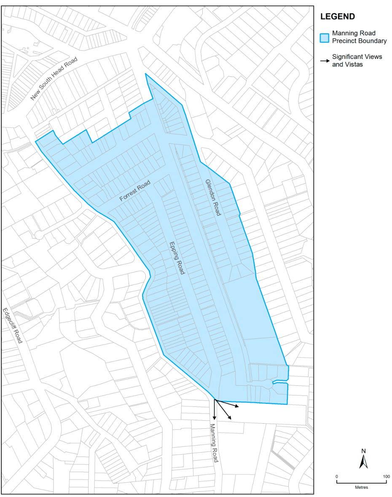

#### B1.5 Manning Road Precinct

MAP 5  Manning Road Precinct

> [Picture on page 21: a picture, saved as a picture (images/chapter-b1-residential-precincts-page-21-3.gif, 150 dpi).]

#### B1.5.1 Precinct character description

The Manning Road precinct lies at the base of the Double Bay valley. To the south, east and west are residential areas situated on the hillside, and to the north is the Double Bay centre.  The planning controls establish a transition area by graduating the intensity of residential development from the Double Bay Centre to the residential areas.

Although the precinct is zoned R3 Medium Density Residential, the historic subdivision pattern of small single lots provides for the dominant building form of dwelling houses and semi-detached dwellings.  The exception is Court Road and parts of Manning Road where lot sizes are relatively larger and some residential flat buildings have been developed.

Forrest Road, Glendon Road and parts of Manning Road are characterised by single storey bungalows and semi-detached dwellings, interspersed with two storey contemporary dwellings.

A significant amount of redevelopment has occurred in Epping Road.  The development has predominantly taken the form of two storey semi-detached dwellings or dwellings houses with reduced side setbacks, reflecting the narrow frontages of lots along that street.

#### B1.5.2 Desired future character

The precinct's exceptional characteristic is its landscape quality provided by its location at the base of the valley, the highly visible private gardens and the prominent street tree plantings and grassed verges.  Development is to reinforce the landscape character by maintaining a landscape setting.

There is a mix of old and new buildings within this precinct.  Development for residential flat buildings is generally occurring in the transition area around Court Road close to the Double Bay Centre.   However, this precinct is zoned R3 Medium Density Residential and is identified for change.

Development is to recognise the character of the existing built fabric and other prevailing characteristics in the street, such as front gardens, side setbacks and roof forms.  Contemporary designs should respond to the streetscape character or adjoining period housing.

Carports and other parking structures must not to dominate the streetscape, and for development on the eastern side of Epping Road vehicle access will only be allowed from the rear lane.

#### Streetscape character and key elements of the precinct

Development respects and enhances the existing elements of the neighbourhood character that contributes to the precinct including:

a) the period housing, including modest Federation and Inter-War bungalows in landscape settings;

b) buildings and roof forms sited beneath the highly visible tree canopy;

c) regular separation and rhythm of spaces between buildings;

d) uniform street and rear setbacks incorporating highly visible soft landscaping;

e) mature street trees and grassed verges; and

f) the highly visible tree canopy as it appears from the surrounding lands.

#### Desired future character objectives

O1 To respect and enhance the streetscape character and key elements of the precinct.

O2 To establish a transition between the urban quality of the Double Bay centre and the landscape setting and built form character of the residential precinct.

O3 To reinforce the landscape character and low scale residential character of the Double Bay valley floor.

O4 To retain and reinforce the green setting of mature street trees, private trees and garden plantings.

O5 To ensure on-site parking does not dominate the streetscape.

O6 To ensure that contemporary housing designs do not detract from the streetscape character or adjoining period housing.
