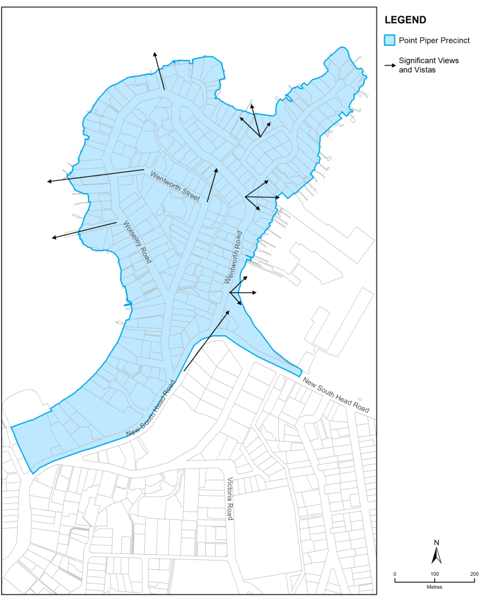

#### B1.6 Point Piper Precinct

MAP 6  Point Piper Precinct

> [Picture on page 24: a picture, saved as a picture (images/chapter-b1-residential-precincts-page-24-3.gif, 150 dpi).]

#### B1.6.1 Precinct character statement

The Point Piper precinct is a prominent peninsula on Sydney Harbour between Double Bay and Rose Bay.  The location provides extensive views across the harbour and surrounding harbourside suburbs.

The precinct contains a range of housing types and styles including an excellent group of Inter-War flat buildings at Longworth Avenue (substantially retained in their garden settings), large post World War II flat buildings at Wolseley Road, and more recent substantial harbourside houses on large lots (including battle-axe lots).

However, the streetscapes within the precinct vary in quality, and often front fences, walls and garages fronting the street block harbour views from the footpath.

#### B1.6.2 Desired future character

The Point Piper precinct is an established residential area with a mixture of architectural styles and forms.  It contains both R2 Low Density and R3 Medium Density Residential zoned land.

In the areas zoned R2, development will generally take the form of dwelling houses set within landscaped garden settings.  Development must provide opportunities for view sharing from both public spaces and private properties.  In particular, buildings should step down the site, also minimising cut and fill.  The design of roofs, garages and fences should also facilitate view sharing opportunities and must not dominate the streetscape.

Development on the low side of the street should also contribute to maintaining a consistent front setback, generally set as a 4 metre setback.

Properties at 10, 12 and 14 Longworth Avenue must establish a single storey presentation to the street and provide for view sharing to surrounding properties.

The western side of the peninsula is predominantly zoned R3 zoning, and development for residential flat buildings and multi dwelling housing is encouraged.

The area between Longworth Avenue and Wunulla Road comprises a number of well maintained Inter-War flat buildings.  These buildings make a significant contribution to the streetscape. Alterations and additions to these Inter-War flat buildings are to retain the character of the original building through appropriate use of materials, and should not significantly alter significant and traditional building elements visible from the street.

#### Streetscape character and key elements of the precinct

Development respects and enhances the existing elements of the neighbourhood character that contribute to the precinct including:

a) the rich mixture of architectural styles and forms;

b) views and glimpses of the harbour between buildings from public spaces;

c) the stepping of development down the hillside;

d) well established private gardens and trees;

e) mature street trees;

f) stone and brick retaining walls on public and private land;  and

g) Inter-War flat buildings.

#### Desired future character objectives

O1 To respect and enhance the streetscape character and key elements of the precinct.

O2 To maintain the evolution of residential building styles through the introduction of well designed contemporary buildings, incorporating modulation and a varied palette of materials.

O3 To ensure that development on the low side of the street maintains a consistent front setback.

O4 To design and site buildings to respond to the topography and minimise cut and fill.

O5 To protect iconic and harbour views from the street and other public spaces in the precinct, including views between buildings and over or though front fences.

O6 To ensure that development facilitates view sharing to adjoining and adjacent private properties.

O7 To maintain the sense of the historic grand estates by retaining the garden settings and streetscape elements.

O8 To retain Inter-War flat buildings, particularly significant and traditional building elements visible from the street.

O9 To retain and reinforce the stone and brick retaining walls that characterise the sloping streets of the precinct.
