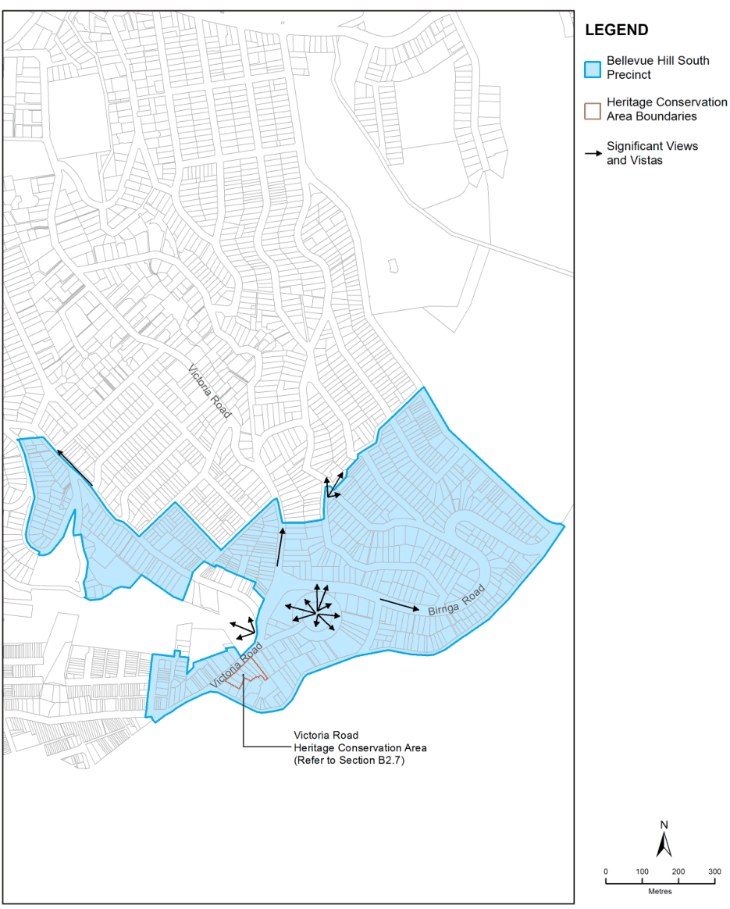

#### B1.7 Bellevue Hill South Precinct

MAP 7  Bellevue Hill South Precinct

> [Picture on page 27: a picture, saved as a picture (images/chapter-b1-residential-precincts-page-27-3.gif, 150 dpi).]

#### B1.7.1 Precinct character statement

The Bellevue Hill South precinct is sited along the ridgeline and plateau of Bellevue Hill. The precinct contains a wide range of housing types and styles. As with many of the residential areas across the municipality, the built fabric is set within a landscaped setting.

Land within this precinct is zoned R3 Medium Density Residential, but the form and scale of buildings vary from the Inter-War flat buildings and more recent flat buildings to low density dwelling houses and semi-detached dwellings.

The street pattern in this part of Bellevue Hill responds to the nature of the landform, curvilinear in hillside areas, and rectilinear in flat areas. Distant views to the city skyline and the harbour are available from some parts of the precinct.

The precinct contains a number of street types in an identifiable hierarchy, and the precinct is generally divided into two sections based on the road hierarchy.

The main roads include Birriga Road, Old South Head Road, Victoria Road and Bellevue Road. Development along these roads is characterised by Inter-War and contemporary residential flat buildings, interspersed with semi-detached and detached dwelling houses. The housing stock includes original dwellings from the early 20th century and Inter-War period with more substantial contemporary dwelling houses.

Development along the local roads contains a mix of dwelling houses, semi-detached houses, multi-dwelling housing and residential flat buildings.  Development on the sloping sites steps down the hillside.  The precinct contains a diverse mix of building styles from early 20th century buildings to well-designed contemporary buildings.

The precinct also incorporates, or is adjacent to, significant public parklands and open spaces. The upper part of Cooper Park, the Woollahra Golf Course and Bellevue Park all contribute to the identity of the precinct.

#### B1.7.2 Desired future character

New development on the major streets of Birriga Road, Victoria Road and Old South Head Road will generally take the form of residential flat buildings and multi dwelling housing, and maintenance of existing Inter-War flat buildings.  New development should be designed to step down sloping sites and provide side boundary setbacks that allow for views between buildings. Development should not detract from the amenity of adjoining and adjacent lower density forms of residential development.

Development along the local roads will provide a mix of housing densities and styles in well designed contemporary buildings, which reinforce the natural topography and provide opportunities for view sharing.  This may include multi-dwelling housing, attached dwellings and dwelling houses in the transition area at Boronia Street, Blaxland Road and the northern side of Bundarra Road, and semi-detached dwellings, as well as dwelling houses, in Pringle Place and Buller Street.

Development must provide opportunities for view sharing from both public spaces and private properties.  In particular, buildings should step down the site, also minimising cut and fill.

#### Streetscape character and key elements of the precinct

Development respects and enhances the existing elements of the neighbourhood character that contribute to the precinct including:

a) the rich mixture of architectural styles and forms;

b) the stepping of development down the hillside;

c) interconnected streets following the contours of the land;

d) deep soil landscaping within the front and rear setbacks;

e) mature street trees and grassed verges;

f) the highly visible tree canopy providing a dense green backdrop to views from Sydney Harbour and surrounding lands;

g) the preservation of views from public places, including view corridors between buildings; and

h) Inter-War flat buildings.

#### Desired future character objectives

O1 To respect and enhance the streetscape character and key elements of the precinct.

O2 To maintain the evolution of residential building styles through the introduction of well designed contemporary buildings, incorporating modulation and a varied palette of materials.

O3 To establish a transition of development scale from the detached dwelling houses at the northern end of Bellevue Hill to the residential flat buildings that address the major streets

- Birriga Road, Old South Head Road and Victoria Road – situated along the precinct ridgeline.

O4 To retain Inter-War flat buildings and ensure that alterations and additions do not detract from the character of these buildings and their presentation to the street.

O5 To design and site buildings to respond to the topography and minimise cut and fill.

O6 To preserve significant views and vistas to surrounding areas from the streets and parks.

O7 To reinforce the landscape setting and maintain the existing tree canopy.
