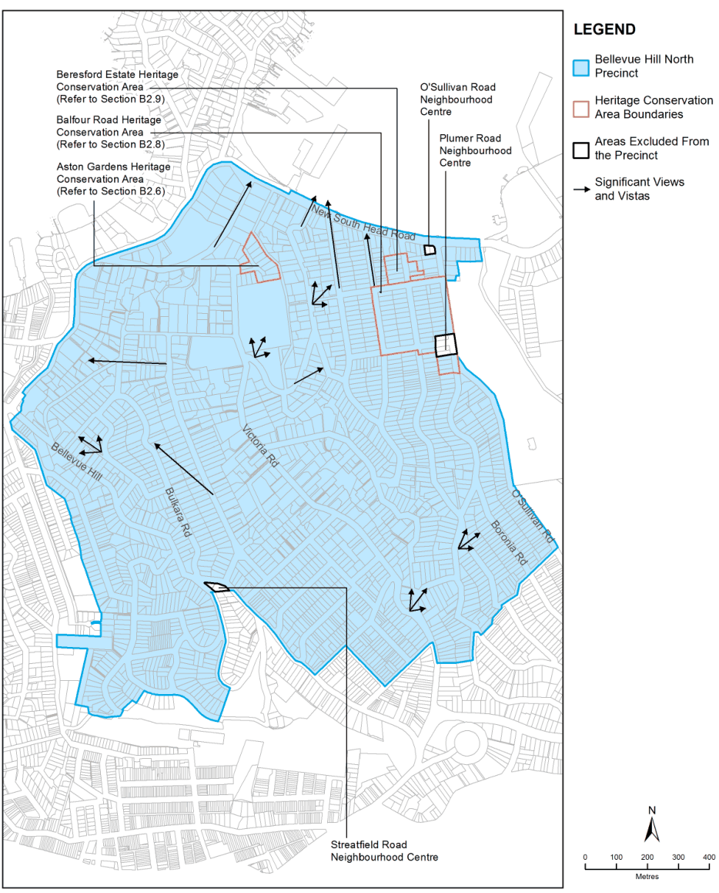

#### B1.8 Bellevue Hill North Precinct

MAP 8  Bellevue Hill North Precinct

> [Picture on page 30: a picture, saved as a picture (images/chapter-b1-residential-precincts-page-30-3.gif, 150 dpi).]

#### B1.8.1 Precinct character statement

The Bellevue Hill North precinct is sited on the slopes and plateau of Bellevue Hill.  New South Head Road, the main arterial road, forms the northern edge of the precinct.

The precinct contains three distinct settings: the edge development fronting New South Head Road (between Bellevue Road and Victoria Road) which contains predominantly substantial residential flat buildings set behind sandstone walls, garages and steps; development opposite the Rose Bay promenade on New South Head Road, typically large detached buildings within a landscape setting; and the one to three storey dwelling houses and residential flat buildings set in the winding streets that follow the contours of Bellevue Hill.

As with many of the higher parts of the municipality, significant views and vistas are available from many of the public spaces. This precinct also contains two large private school campuses: Cranbrook School and Scots College.

#### B1.8.2 Desired future character

The Bellevue Hill North precinct is an established residential area with a rich mixture of architectural styles and forms.  Development is to be compatible with the existing built fabric, subdivision pattern and other prevailing characteristics in the street, such as setbacks and roof forms.

On sloping sites, development should step down the site to maintain views, protect the privacy and solar access of adjoining and adjacent properties, and minimise cut and fill. The design of roofs and fences should also facilitate view sharing opportunities, and carports and other parking structures must not to dominate the streetscape.

There are pockets of Inter-War flat buildings along Drumalbyn Road that contribute to the precinct character, and the retention of these buildings is encouraged.  Alterations and additions to the Inter-War flat buildings are to retain the character of the original building through appropriate use of materials, and should not significantly alter significant and traditional building elements visible from the street.

Development is to retain views of the harbour from public spaces and provide for view sharing from private properties.   Development adjacent to the heritage conservation areas must also suitably respond to the significance of the HCA.

#### Streetscape character and key elements of the precinct

Development respects and enhances the existing elements of the neighbourhood character that contribute to the precinct including:

a) the rich mixture of residential architectural styles and forms, including dwelling houses and residential flat buildings;

b) the relationship of development along New South Head Road to the promenade and the harbour;

c) buildings set within highly visible gardens;

d) the tree canopy formed by both street and private yard plantings;

e) mature street trees, grassed verges and sandstone walls;

f) harbour views available from the streets within the precinct;

g) the heritage significance of the adjoining  Aston Gardens, Beresford Estate and Balfour Road Heritage Conservation Areas; and

h) Inter-War flat buildings.

#### Desired future character objectives

O1 To respect and enhance the streetscape character and key elements of the precinct.

O2 To maintain the evolution of residential building styles through the introduction of well designed contemporary buildings incorporating modulation and a varied palette of materials.

O3 To maintain a transition of development scale from the residential flat buildings that address New South Head Road, to the dwelling houses that dominate the majority of the precinct.

O4 To reinforce a consistent building scale with streets.

O5 To ensure that development responds in form and siting to the street and subdivision pattern.

O6 To design and site buildings to respond to the topography and minimise cut and fill.

O7 To reinforce the landscape setting and maintain the existing tree canopy which forms a green backdrop when viewed from the harbour and the surrounding districts.

O8 To retain and reinforce the green setting of mature street trees, private trees and garden plantings and minimise hard stand areas.

O9 To protect important views from the public spaces of the precinct to the harbour and city skyline, including view corridors between buildings.

O10 To ensure that development facilitates view sharing to adjoining and adjacent private properties.

O11 To ensure on-site parking does not dominate the streetscape.

O12 To retain Inter-War flat buildings, particularly significant and traditional building elements visible from the street.
