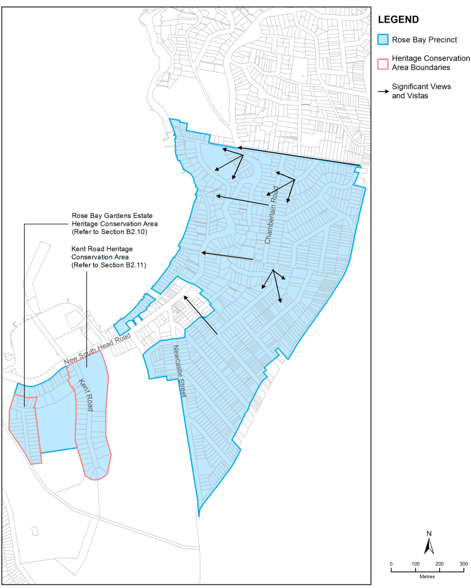

#### B1.9 Rose Bay Precinct

MAP 9  Rose Bay Precinct

> [Picture on page 34: a picture, saved as a picture (images/chapter-b1-residential-precincts-page-34-3.gif, 150 dpi).]

#### B1.9.1 Precinct character statement

The Rose Bay residential precinct incorporates the hillside at the neck of the eastern suburbs peninsula and the lowest part of the Rose Bay basin (adjacent to the large park and recreational area). The street block system in the low lying areas is generally rectilinear, allowing for regular building lots. On the hillsides, irregular street and block patterns occur reflecting the topography.

Prominent building types within the precinct include Inter-War detached housing and Art Deco flat buildings. More recent development, particularly in Spencer and Carlisle Streets, has seen the subdivision pattern altered to create larger lots for residential flat buildings.

The Rose Bay residential precinct is sited between the two main urban connectors of Old South Head Road and New South Head Road.  The Rose Bay Centre is located on New South Head Road in the western part of the precinct.  The mixed use centres of Rose Bay North and Rose Bay South are located on Old South Head Road.  These centres frame the precinct and serve the daily and weekly shopping needs of the local community.

This precinct also includes the Kambala School, Lyne Park and the Royal Sydney Golf Club.

#### B1.9.2 Desired future character

This precinct includes land zoned R2 Low Density Residential and R3 Medium Density Residential. Most of the R3 Medium Density Residential land is located near the business centres and the main connector roads.  Although much of this R3 zoned land currently contains many dwelling houses, this area is identified for change and will be redeveloped for medium density residential uses such as residential flat buildings, manor houses, multi dwelling housing, multi dwelling housing (terraces) and attached dwellings.

In particular, there is opportunity for redevelopment along Old South Head Road, with a view to providing a greater intensity of development adjacent to this classified road.

The residential areas zoned R2 Low Density Residential will continue to experience an evolution of residential building styles through the introduction of well-designed contemporary dwelling houses, which reinforce the natural topography and provide opportunities for view sharing.

On the hillsides and steeply sloping sites, the built form should step with the land to ensure development reflects the existing topography and minimises the need for excavation.

#### Streetscape character and key elements of the precinct

Development respects and enhances the existing elements of the neighbourhood character that contribute to the precinct including:

a) the rich mixture of residential architectural styles and forms, including dwelling houses and residential flat buildings;

b) the pattern of rectilinear residential streets within the valley basin, and curvilinear streets in the steeper areas;

c) dwelling houses set within highly visible gardens;

d) the visual relief within streetscapes provided by the separation of buildings, the articulation of facades and building forms;

e) the tree canopy formed by both street and private yard plantings;

f) sandstone garden walls at the street;

g) the relationship of residential development to the open spaces (including Lyne Park and the Royal Sydney Golf Club) and the harbour;

h) the iconic and harbour views available from the streets and other public spaces, including view corridors between buildings; and

i) Inter-War flat buildings.

#### Desired future character objectives

O1 To respect and enhance the streetscape character and key elements of the precinct.

O2 To encourage development at a scale which relates to the function and role of the streets they address, i.e. larger scale development on the major streets (Old South Head Road and New South Head Road adjacent to the commercial centre) and a range of housing types on the minor streets.

O3 To provide for an evolution of building stock from dwelling houses to medium density development in the R3 zoned areas.

O4 To maintain the evolution of residential building styles through the introduction of well designed contemporary buildings incorporating modulation and a varied palette of materials.

O5 To reinforce a consistent building scale within streets.

O6 To design and site buildings to respond to the topography and minimise cut and fill.

O7 To protect important iconic and harbour views from the public spaces of the precinct.

O8 To reinforce the landscape setting and maintain the existing tree canopy.

O9 To retain Inter-War flat buildings, particularly significant and traditional building elements visible from the street.
