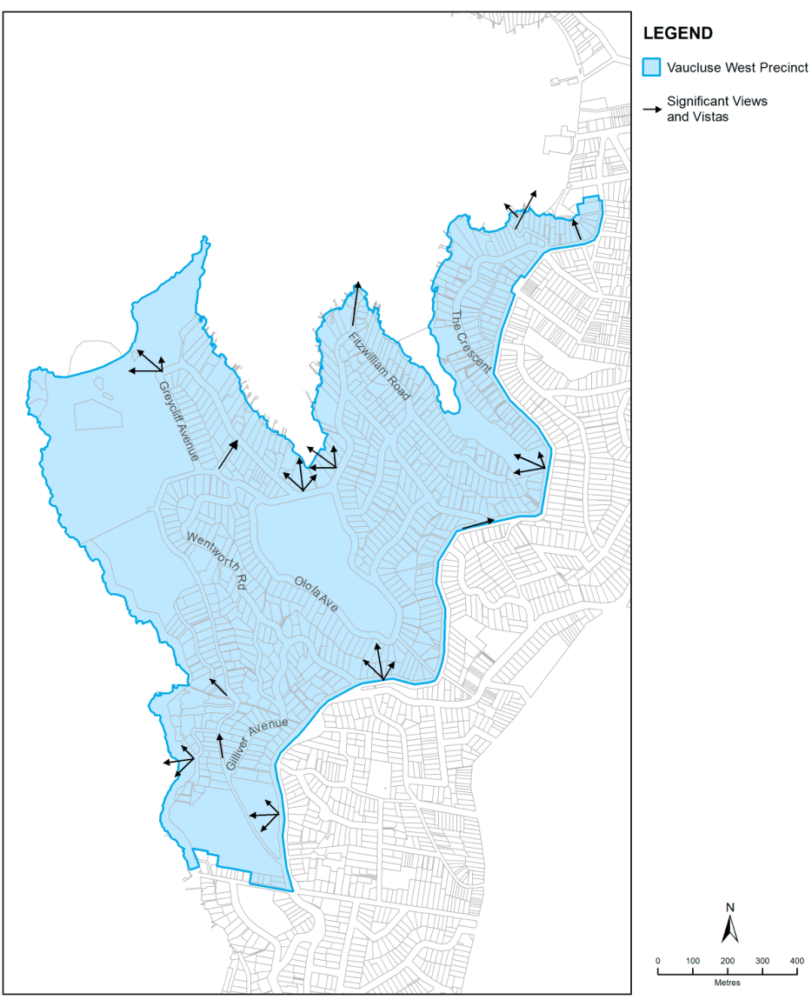

#### B1.10 Vaucluse West Precinct

MAP 10  Vaucluse West Precinct

> [Picture on page 37: a picture, saved as a picture (images/chapter-b1-residential-precincts-page-37-3.gif, 150 dpi).]

#### B1.10.1 Precinct character statement

The Vaucluse West precinct is sited along the foothills of the harbour foreshore between Rose Bay and Watsons Bay.  The precinct is one of outstanding natural beauty and includes foreshore waterfront reserves and waterfront parks, including Nielson Park and Parsley Bay, as well as two large park-like estates: Strickland House and Vaucluse House.  The precinct also contains the heritage listed Kincoppal School.

It is a low density residential precinct characterised by large dwelling houses.  Though the architectural styles and forms vary, these dwelling houses are generally located within a garden setting and have common street setbacks and side setbacks that allow for views between buildings.  Recent development has tended to take the form of three storey dwelling houses with flat roof designs.

The landform, street trees, domestic gardens and substantial foreshore parklands create a dominant visual impression of a well treed landscape.  The location adjacent to the harbour also provides for water and parkland views from the streets.

#### Streetscape character and key elements of the precinct

Development respects and enhances the existing elements of the neighbourhood character that contribute to the precinct including:

a) the relationship of the precinct to the harbour;

b) the rich mixture of architectural styles, and the emphasis on their connection to the landform;

c) buildings set within highly visible gardens;

d) buildings addressing the street; and

e) the harbour and iconic views available from the streets of the precinct, including view corridors between buildings.

#### B1.10.2 Desired future character

The Vaucluse West precinct is to maintain the evolution of low density residential development through the introduction of well-designed contemporary dwelling houses that retain views of the harbour from public spaces and provide for view sharing from private properties.

Development may be three storeys, but should establish a two storey presentation to the street with a reduced scale on the third floor, which will help reduce building bulk and scale.

On sloping sites, development should step down the site to maintain views, protect the privacy and solar access of adjoining and adjacent properties, and minimise cut and fill.

In particular, development is to retain views of the harbour from public spaces and provide for view sharing from private properties; these can be achieved by providing suitable side boundary setbacks and fencing, roof forms and thoughtful distribution of building form across the site.

The built form should not detract from the unique features of the natural landscape, or be of such a scale that it dominates adjoining development, or is visually intrusive when viewed from the streetscape or the harbour.

#### Desired future character objectives

O1 To respect and enhance the streetscape character and key elements of the precinct.

O2 To retain the scenic qualities provided by the dramatic topography and natural vegetation that provide an attractive setting on Sydney Harbour.

O3 To maintain the evolution of residential building styles through the introduction of good contemporary buildings incorporating modulation and a varied palette of materials.

O4 To minimise building bulk and scale of three storey development by designing development to generally present as a two storey form to the street.

O5 To design and site buildings to respond to the topography and minimise cut and fill.

O6 To protect important views from the public spaces of the precinct to the harbour and the city skyline including view corridors between buildings.

O7 To reinforce the landscape setting and maintain the existing tree canopy.

O8 To retain and reinforce the green setting of mature street trees, private trees and garden plantings.
