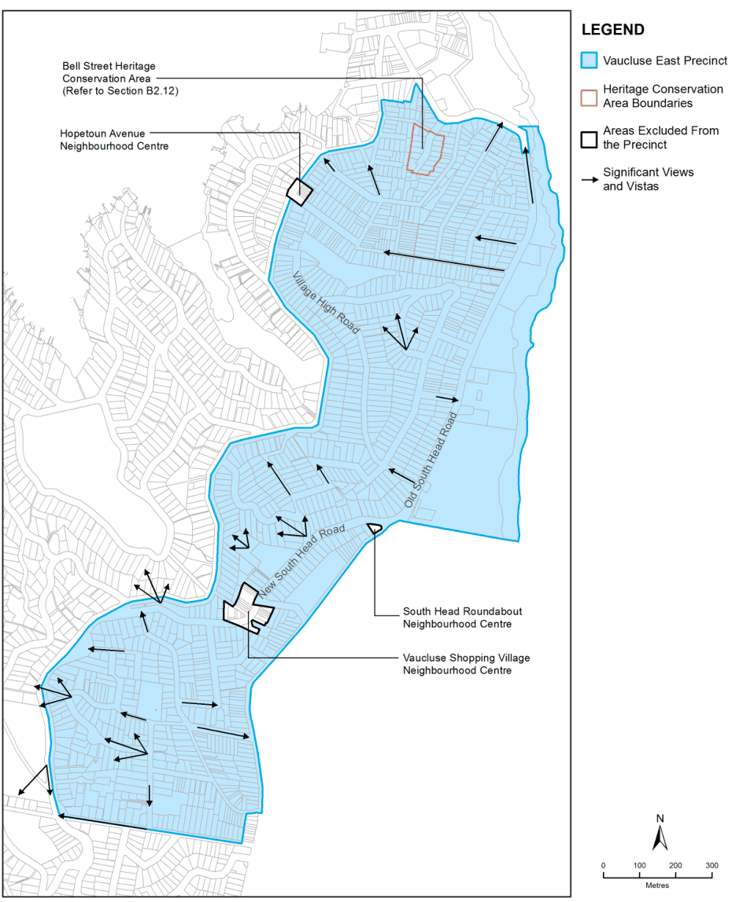

#### B1.11 Vaucluse East Precinct

MAP 11  Vaucluse East Precinct

> [Picture on page 40: a picture, saved as a picture (images/chapter-b1-residential-precincts-page-40-3.gif, 150 dpi).]

#### B1.11.1 Precinct character statement

The Vaucluse East Precinct comprises an elevated plateau which provides an extensive backdrop and significant scenic presentation to Sydney Harbour along its eastern foreshore.

A spectacular feature of the precinct is the public foreshore land on the eastern side of Old South Head Road which contains the Macquarie Lighthouse, a prominent harbour landmark and parkland.  The highest parts of the precinct afford 360° views of both the harbour and ocean. Vantage points include Johnsons Lookout, Samuel Park, Gap Park, Christison Park and Lighthouse Reserve.

The precinct contains a wide range of housing types and styles reflecting important stages in its development.  Large areas are characterised by Federation and Inter-War bungalows. Inter-War residential flat buildings are also important contributors to the local character. However, the dominant development type is the dwelling house, located within a garden setting and highlighted by consistent street setbacks and side setbacks that allow for views between buildings.

The precinct’s exposed location at the plateau of the peninsula has resulted in a sparser foliage and tree canopy compared with the more protected streets of the Vaucluse West precinct.

#### B1.11.2 Desired future character

The Vaucluse East precinct is to maintain the evolution of low density residential development, generally through the introduction of well-designed contemporary dwelling houses.

Development may be three storeys, but should establish a two storey presentation to the street with a reduced scale on the third floor, which will help reduce building bulk and scale.

On sloping sites, development should step down the site to maintain views, protect the privacy and solar access of adjoining and adjacent properties, and minimise cut and fill.

The built form should not detract from the unique features of the natural landscape, or be of such a scale that it dominates adjoining development, or is visually intrusive when viewed from the streetscape or the harbour.

In particular development is to retain views of the harbour from public spaces and provide for view sharing from private properties; these can be achieved by providing suitable side boundary setbacks and fencing, roof forms and thoughtful distribution of building form across the site.

Within this precinct, some land fronting Old South Head Road is zoned R3 Medium Density Residential, and may provide opportunities for renewal of existing building stock.

#### Streetscape character and key elements of the precinct

Development respects and enhances the existing elements of the neighbourhood character that contribute to the precinct including:

a) the relationship of the precinct to the coastal parklands;

b) the rich mixture of architectural styles, and their emphasis on their connection to the landform;

c) buildings set within highly visible gardens;

d) buildings addressing the street;

e) the iconic and harbour views available from the streets of the precinct, including view corridors between buildings; and

f) Inter-War flat buildings.

#### Desired future character objectives

O1 To respect and enhance the streetscape character and key elements of the precinct.

O2 To retain the scenic qualities provided by the dramatic topography and natural vegetation within the precinct.

O3 To maintain the evolution of low rise residential building styles through the introduction of good contemporary buildings incorporating modulation and a varied palette of materials.

O4 To minimise building bulk and scale of three storey development by designing development to generally present as a two storey form to the street.

O5 To design and site buildings to respond to the topography and minimise cut and fill.

O6 To protect important views from the public spaces of the precinct to the harbour and the city skyline, including view corridors between buildings.

O7 To reinforce the landscape setting and maintain the existing tree canopy.

O8 To retain and reinforce the green setting of mature street trees, private trees and garden plantings.

O9 To retain Inter-War flat buildings, particularly significant and traditional building elements visible from the street.
