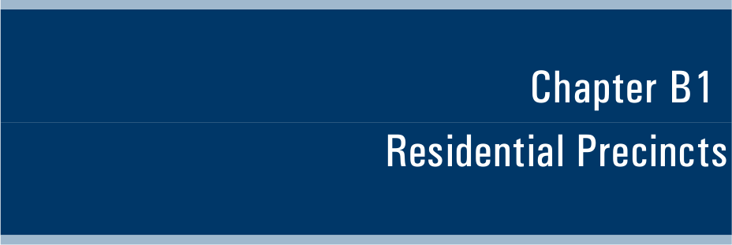

# Woollahra Development Control Plan 2015 - Chapter B1 Residential Precincts

> This chapter is split into 14 section file(s), one per numbered heading, in the order they appear in the PDF.

Source PDF: [chapter-b1-residential-precincts.pdf](chapter-b1-residential-precincts.pdf)

> [Picture on page 1: a picture, saved as a picture (images/chapter-b1-residential-precincts-page-1-1.gif, 150 dpi).]

> [Picture on page 1: a picture, saved as a picture (images/chapter-b1-residential-precincts-page-1-2.gif, 150 dpi).]
> [Picture text on page 1 is stored in the PDF without readable letters (no character map), so it could not be copied; see the original PDF.]

### Part B  General Residential

### WOOLLAHRA DEVELOPMENT CONTROL PLAN 2015

> [Picture on page 3: a picture, saved as a picture (images/chapter-b1-residential-precincts-page-3-1.gif, 150 dpi).]

### Chapter B1

### Residential Precincts

### Part B  General Residential

### CHAPTE R B1 APPROVED ON 27 APRI L 2015 AND COMMENCED ON 23 MAY 2015

### Last amended on 30 August 2021

<!-- sections -->
## Sections

1. [B1 Residential Precincts](01-b1-residential-precincts.md)
2. [B1.1 Introduction](02-b1-1-introduction.md)
3. [B1 Residential Precincts](03-b1-residential-precincts.md)
4. [B3 General Development Controls](04-b3-general-development-controls.md)
5. [B1.2 Darling Point Precinct](05-b1-2-darling-point-precinct.md)
6. [B1.3 Double Bay Precinct](06-b1-3-double-bay-precinct.md)
7. [B1.4 Wallaroy Precinct](07-b1-4-wallaroy-precinct.md)
8. [B1.5 Manning Road Precinct](08-b1-5-manning-road-precinct.md)
9. [B1.6 Point Piper Precinct](09-b1-6-point-piper-precinct.md)
10. [B1.7 Bellevue Hill South Precinct](10-b1-7-bellevue-hill-south-precinct.md)
11. [B1.8 Bellevue Hill North Precinct](11-b1-8-bellevue-hill-north-precinct.md)
12. [B1.9 Rose Bay Precinct](12-b1-9-rose-bay-precinct.md)
13. [B1.10 Vaucluse West Precinct](13-b1-10-vaucluse-west-precinct.md)
14. [B1.11 Vaucluse East Precinct](14-b1-11-vaucluse-east-precinct.md)
