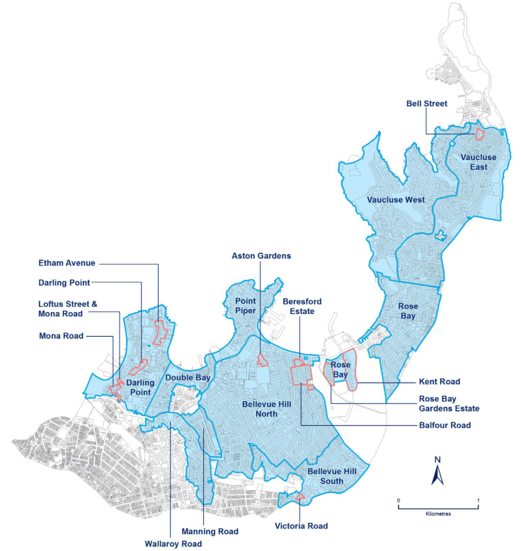

#### B3.1 Introduction

This is Chapter B3 of the Woollahra Development Control Plan 2015 (DCP), Part B General Residential.  The controls in this chapter must be read in conjunction with the controls in Chapter

B1 Residential Precincts and Chapter D2 Neighbourhood Heritage Conservation Areas (HCAs).

The Woollahra Local Environmental Plan 2014 (Woollahra LEP 2014) includes building height controls, floor space ratios for dwelling houses, semi-detached dwellings and dual occupancies outside HCAs, floor space ratios in the R3 Medium Density Residential Zone and the minimum lot size required for subdividing or developing land.

The controls in this chapter guide the scale and bulk of development so that is compatible with site conditions and the desired future character of the location where the development is proposed.

#### Land where this chapter applies

This chapter applies to land identified on Map 1 below.

MAP 1 The land where this chapter applies

> [Picture on page 5: a picture, saved as a picture (images/chapter-b3-general-development-controls-page-5-14.gif, 150 dpi).]

The area comprises:
