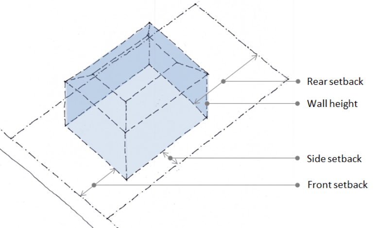
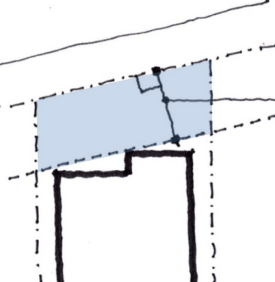
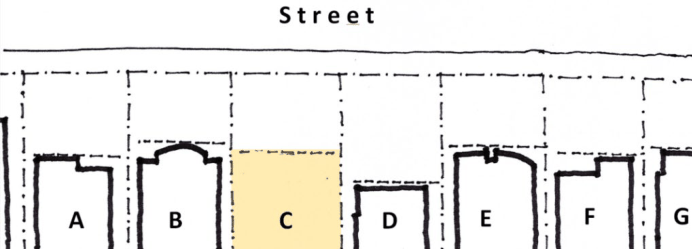
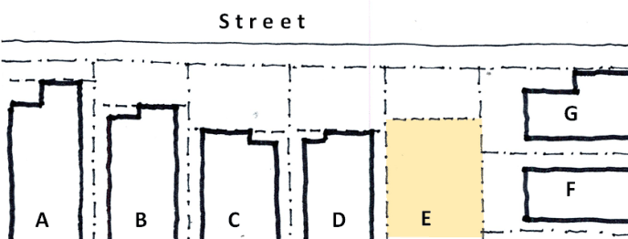
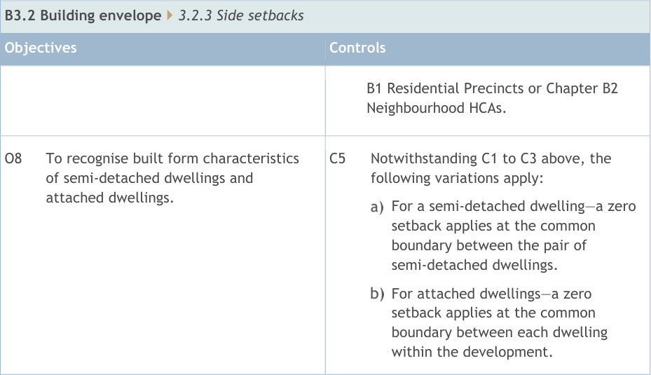
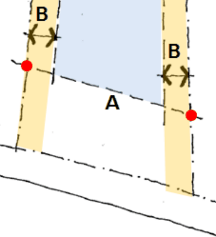
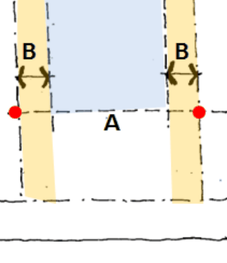
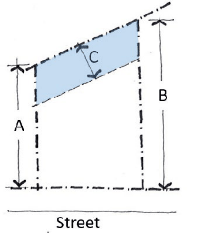
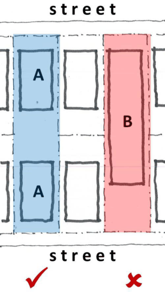
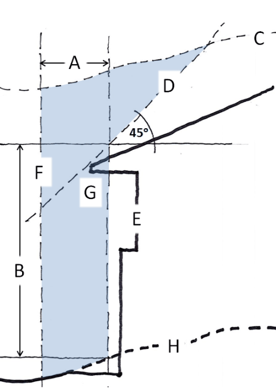

#### B3.2 Building envelope

The building envelope is a three dimensional space within which a building is to be located. The maximum floor space permitted within the building envelope is determined by the floor space ratio (FSR) in Woollahra LEP 2014. All development must comply with the applicable FSR control. However, the floorplate control applies to development other than dwelling houses, semi-detached dwellings and dual occupancies in the R2 Low Density Residential Zone.

#### Where the building envelope controls apply

Development in the R2 Low Density Residential Zone and development for dwelling houses, semi-detached dwellings and dual occupancies in the R3 medium Density Residential zone

The building envelope (as shown in Figure 1) is established by applying the following controls: front, side and rear setbacks; maximum wall height of 7.2m; inclined plane of 45° taken from the maximum wall height; and maximum building height set by Woollahra LEP 2014.

All elements of the building (including decks, balconies, entry porches, verandahs, porte-cocheres, undercrofts and the like) are to be contained within the building envelope. There is an allowance for eaves outside the building envelope as long as the protrusion is below the inclined plane (where one applies). Note: Additional controls apply to development on a battle-axe lot (refer Section B3.9).

FIGURE 1 Building envelope

> [Picture on page 9: a picture, saved as a picture (images/chapter-b3-general-development-controls-page-9-21.gif, 150 dpi).]

#### Development in the R3 Medium Density Residential Zone

In the R3 Medium Density Residential Zone (or development other than dwelling houses, semi-detached and dual occupancies) the building envelope is established by applying the following controls: front, side and rear setbacks; maximum building height set by Woollahra LEP 2014.

The wall height and inclined plane and floorplate controls do not apply.

#### Front setback

Front setbacks establish the position of buildings in relation to the street boundary. They create the spatial proportions of the street and can contribute to the streetscape character by providing consistency.

Buildings and plantings on private land form essential parts of the streetscape. Front setbacks should be used to enhance the setting for the building, providing landscaped areas and access to the building.

> [Picture on page 11: a picture, saved as a picture (images/chapter-b3-general-development-controls-page-11-8.gif, 150 dpi).]

#### A

#### FIGURE 2

Front setback measurement Example

A = Front setback measured at 90° to the

front boundary

| B3.2 Building envelope 3.2.2 Front setback |  |
|---|---|
| Objectives | Controls |
| O1 To reinforce the existing streetscape and character of the location. O2 To provide consistent front setbacks in each street. O3 To provide for landscaped area and deep soil planting forward of the building. | C1 The front setback of the building envelope is determined by averaging the three most typical setbacks of the four closest residential buildings that face the same side of the street (refer to Figure 3). Note: The setback is determined by the distance between the primary street boundary and the outside face of the front building wall, or any protruding balcony deck or the like (excluding car parking structures). Note: The front setback is the horizontal distance between the building envelope and the primary street boundary, measured at 90° from the boundary (refer to Figure 2). Note: On corner lots, the shortest frontage to a street is typically where the front setback applies. Note: These controls do not apply to battle-axe lots (refer to Section B3.9). |
| O4 To ensure that buildings are well articulated and positively contribute to the streetscape. | C2 The building has a maximum unarticulated width of 6m to the street frontage. |

#### FIGURE 3

Setbacks of the four closest residential buildings are determined by the distance between the primary street boundary and the outside face of the front building wall, or any protruding balcony deck or the like (excluding car parking structures).

> [Picture on page 13: a picture, saved as a picture (images/chapter-b3-general-development-controls-page-13-5.gif, 150 dpi).]

> [Picture on page 13: a picture, saved as a picture (images/chapter-b3-general-development-controls-page-13-6.gif, 150 dpi).]

#### Example 1

Setback for Lot C =

(setback of A+B+E)

divided by 3 Note: The setback at

Lot D is the least

typical and is not

included in the

calculation.

#### Example 2

Setback for Lot E =

(setback of B+C+D)

divided by 3 Note: The setback at

Lot G is not included

as this lot does not

share the same

primary street

frontage. A is not included as

it is the least typical.

#### Side setbacks

The side setback control seeks to ensure that the distance of a building from its side boundaries protects the amenity of both the neighbours and the proposed development.

The minimum side setback requirement varies according to the lot width and building type.

| B3.2 Building envelope 3.2.3 Side setbacks |  |
|---|---|
| Objectives Controls |  |
| O1 To avoid an unreasonable sense of enclosure and to facilitate an appropriate separation between buildings. O2 To ensure the side elevation of buildings are well articulated. O3 To protect the acoustic and visual privacy of residents on neighbouring properties. O4 To facilitate solar access to habitable windows of neighbouring properties. O5 To facilitate views between buildings. O6 To provide opportunities for screen planting. O7 To allow external access between the front and rear of the site. | C1 The minimum side setback for dwelling houses, semi-detached dwellings and dual occupancies is determined by the table in Figure 5A. C2 The minimum side setback for residential flat buildings, manor houses, multi dwelling housing, multi dwelling housing (terraces) and attached dwellings is determined by the table in Figure 5B. C3 The minimum side setback for seniors housing in the R2 Low Density Residential zone is determined by the table in Figure 5A. C4 The minimum side setback for any other land use not addressed in controls C1 to C3 above is determined by the table in Figure 5B. Note: The side setback is the horizontal distance between the side property boundary and the building envelope, measured at 90° from the boundary at the front setback, as shown in Figure 4. Note: For controls C2, C3 and C4 setbacks include any basement piling or similar structured forms C5 The building has a maximum unarticulated wall length of 12m to the side elevation. Note: A reduced side setback may be considered where zero or significantly reduced setbacks are characteristic of the immediate streetscape. These streets may be specifically identified in Chapter |

> [Picture on page 15: a picture, saved as a picture (images/chapter-b3-general-development-controls-page-15-1.gif, 150 dpi).]
> [Picture text on page 15 is stored in the PDF without readable letters (no character map), so it could not be copied; see the original PDF.]
> Words printed on the picture (title and legend, copied from the PDF):
> following variations apply:
> of semi-detached dwellings and
> attached dwellings.
> For attached dwellings—a zero

B3.2 Building envelope  3.2.3 Side setbacks

#### Objectives

#### Controls

B1 Residential Precincts or Chapter B2 Neighbourhood HCAs.

C5 Notwithstanding C1 to C3 above, the

O8 To recognise built form characteristics

For a semi-detached dwelling—a zero setback applies at the common boundary between the pair of semi-detached dwellings.

setback applies at the common boundary between each dwelling within the development.

> [Picture on page 15: a picture, saved as a picture (images/chapter-b3-general-development-controls-page-15-16.gif, 150 dpi).]

#### FIGURE 4

Side setback measurement, B depends on A

> [Picture on page 15: a picture, saved as a picture (images/chapter-b3-general-development-controls-page-15-19.gif, 150 dpi).]

#### FIGURE 5A

Side setback table for dwelling houses, semi-detached dwellings and dual occupancies.

Table also applies to seniors housing in the R2 Low Density Residential zone.

| A. Site width measured along front setback line in metres | B. Side setback in metres |
|---|---|
| < 9.0 | 0.9 |
| 9.0 - < 11.0 | 1.1 |
| 11.0 - < 13.0 | 1.3 |
| 13.0 - < 15.0 | 1.5 |
| 15.0 - < 17.0 | 1.9 |
| 17.0 - < 19.0 | 2.3 |
| 19.0 - < 21.0 | 2.7 |
| 21.0 - < 23.0 | 3.1 |
| 23.0 - < 25.0 | 3.4 |
| 25.0 - < 30.0 | 3.75 |
| 30 + | 4.5 |

#### FIGURE 5B

Side setback table for Residential flat buildings, manor houses, multi dwelling housing, multi

dwelling housing (terraces) and attached dwellings, and any other land use not addressed in

controls C1 to C2 of Section 3.2.3 Side setbacks

| A. Site width measured along front setback line in metres | B. Side setback in metres |
|---|---|
| <18.0 | 1.5 |
| 18.0 - < 21.0 | 2.0 |
| 21.0 - < 28.0 | 2.5 |
| 28.0 - < 35.0 | 3.0 |
| 35.0 + | 3.5 |

#### Rear setback

The rear setback control seeks to ensure that the distance of a building from its rear boundary provides amenity to both the neighbouring sites and the proposed development. The building (including decks, balconies, entry porches, verandahs, porte-cocheres, undercrofts and the like) must not be located within the rear setback.

In particular, the rear setback provides useable land for private open space and landscaping, which significantly contributes to amenity for the occupants.

The rear setback is the horizontal distance between the building and the rear property boundary.

| B3.2 Building envelope 3.2.4 Rear setback |  |
|---|---|
| Objectives | Controls |
| O1 To provide private open space and | C1 The minimum rear setback control is 25% of the average of the two side boundary dimensions, measured perpendicular to the rear boundary (see Figure 6). The building must not encroach on the minimum rear setback. C2 If 'end to end' amalgamation occurs, the building envelope will be determined as if they were separate lots (refer to Figure 7). |
| landscaped areas at the rear of buildings. |  |
| O2 To provide acoustic and visual privacy to |  |
| adjoining and adjacent buildings. |  |
| O3 To avoid an unreasonable sense |  |
| of enclosure. |  |
| O4 To provide separation between buildings |  |
| to facilitate solar access to private open |  |
| space. |  |
| O5 To protect vegetation of landscape value |  |
| and provide for landscaped area and deep |  |
| soil planting. |  |
| O6 To contribute to a consolidated open |  |
| space network with adjoining properties |  |
| to improve natural drainage and support |  |
| local habitat. |  |

#### FIGURE 6

Formula for determining the rear

setback A = Side boundary 1 B = Side boundary 2 C = Rear setback

#### C = (A + B) / 2 X 25%

#### FIGURE 7

Setbacks for end to end

amalgamation When lots are amalgamated end to

end, as illustrated in A and B, the

rear setback requirement remains

as if it were two lots, as illustrated

in A. Not as illustrated in B.

> [Picture on page 18: a picture, saved as a picture (images/chapter-b3-general-development-controls-page-18-16.gif, 150 dpi).]

> [Picture on page 18: a picture, saved as a picture (images/chapter-b3-general-development-controls-page-18-17.gif, 150 dpi).]

#### Wall height and inclined plane

The wall height control only applies to: development on land in the R2 Low Density Residential Zone; and dwelling houses, semi-detached dwellings and dual occupancies in the R3 Medium Density Residential zone. A wall height of 7.2m (accommodating two storeys) and an inclined plane of 45° applies to the front, side and rear elevations. These controls respond to the typical pitched roof house form, but also potentially accommodate three storey flat roof housing forms with a reduced top storey.

| B3.2 Building envelope 3.2.5 Wall height and inclined plane |  |
|---|---|
| Objectives | Controls |
| O1 To limit the bulk, scale and visual impact C1 On land zoned R2 Low Density Residential of buildings as viewed from the street and for a dwelling house, semi-detached and from neighbouring properties. dwelling or dual occupancy in the R3 Medium Density Residential zone: O2 To limit overshadowing of neighbouring properties across side boundaries. the wall height is 7.2m above existing ground level; and O3 To limit overshadowing to south facing an inclined plane is taken from a rear yards. point 7.2m above existing ground O4 To provide acoustic and visual privacy to level at each of the setbacks adjoining and adjacent buildings. (the inclined plane is at 45 degrees from horizontal); and O5 To facilitate views between buildings. roof eaves may protrude into the setback if below the inclined plane. Refer to Figure 8. C2 A variation to the wall height of 7.2m may be considered where the slope of the site within the building envelope is greater than 15 degrees. The variation will only be considered to walls located nearest to the downslope section of the building envelope, i.e. the section with the lowest existing ground level. |  |

B3.2 Building envelope  3.2.5 Wall height and inclined plane

#### Objectives

> [Picture on page 20: a picture, saved as a picture (images/chapter-b3-general-development-controls-page-20-3.gif, 150 dpi).]

#### Controls

A request for a variation must demonstrate that the increased wall height is consistent with the objectives of this section of the DCP, consistent with the objectives for development within the zone in which the development is proposed to be carried out, and there are sufficient environmental planning grounds to justify the variation. Note: The statutory building height control in the Woollahra LEP 2014 applies.

#### FIGURE 8

Section view of the building envelope

with the setbacks and inclined plane A = Side setback B = 7.2m maximum wall height C = Maximum building height: 9.5m

above existing ground level D = Inclined plane: 45degrees to

horizontal E = Potential built form F = Site boundary G = Roof eaves may protrude into the setback if below the inclined plane H = Existing ground level
