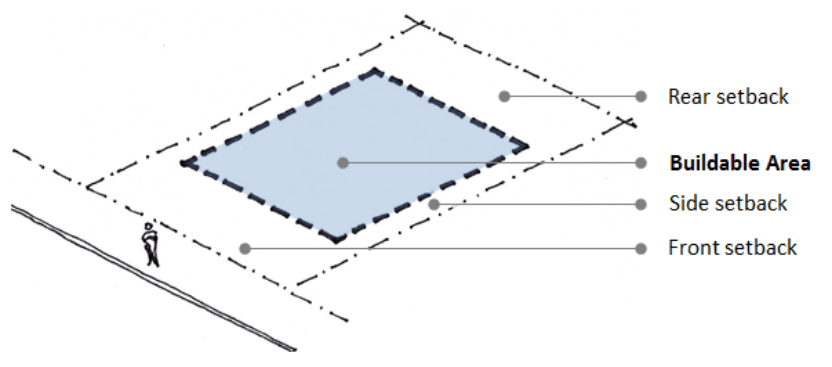
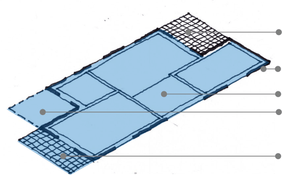
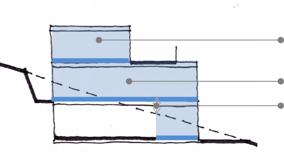
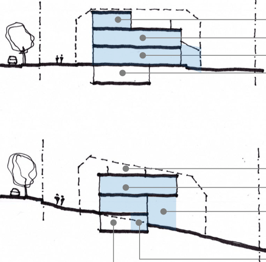
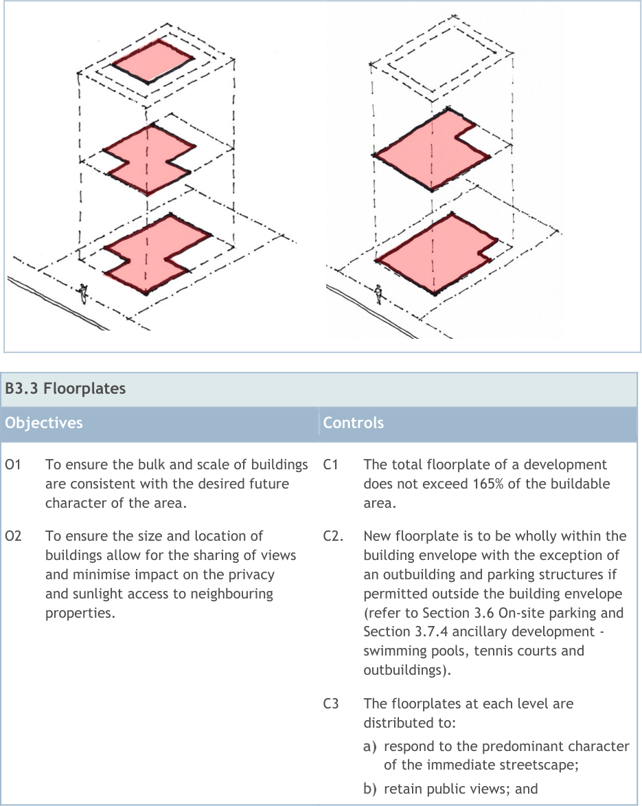

#### B3.3 Floorplate

The floorplate control only applies to: development other than dwelling houses, semi-detached dwellings, secondary dwellings and dual occupancies on land in the R2 Low Density Residential Zone.

#### Floorplate determines amount of development

The development potential for a site is determined by the total floorplate.  This is calculated as a percentage of the buildable area.

The buildable area is the area of the site that is identified once the front, rear and side setbacks have been established (refer to Figure 9).

The maximum amount of development permitted on the site is determined by multiplying the buildable area by a factor of 1.65 (165%).  This is the maximum permitted total floorplate.

For example if the buildable area is 150m2 the maxiumum floorplate yield is: 150m2 x 1.65 = 247.5m2

The floorplate is measured at each level.  A level is defined as the space between a floor and a level above. If any part of a level is above 1m above exist ground level that area of the level is counted as floorplate (refer to Figures 10 and 11).

The total floorplate may be distributed over multiple levels, but must be wholly contained within the building envelope.

FIGURE 9 Buildable area

> [Picture on page 21: a picture, saved as a picture (images/chapter-b3-general-development-controls-page-21-20.gif, 150 dpi).]

#### Measuring floorplate

Floorplates are measured to include: the area within the external face of the external walls measured at each level, and the external floorplate which includes covered decks, covered balconies, entry porches, verandahs, porte-cocheres, under crofts and the like  (refer to Figures 10 and 11). but excludes: uncovered external areas, such as terraces, decks and balconies, and levels below 1m above existing ground level (refer Figure 11) eaves.

FIGURE 10 Measuring floorplate (aerial view)

> [Picture on page 22: a picture, saved as a picture (images/chapter-b3-general-development-controls-page-22-11.gif, 150 dpi).]

Uncovered deck

External wall

Void Entry porch

Covered verandah

The shaded areas are included in the total floorplate

FIGURE 11 Measuring floorplate (section view) The following examples illustrate elements of the built form that are included in the

calculation of the floorplate:

> [Picture on page 23: a picture, saved as a picture (images/chapter-b3-general-development-controls-page-23-4.gif, 150 dpi).]

> [Picture on page 23: a picture, saved as a picture (images/chapter-b3-general-development-controls-page-23-5.gif, 150 dpi).]

Floorplate

Floorplate

Where the level is more than 1.0m above the existing ground level, that level is included in the total floorplate

Floorplate

Floorplate

Floorplate

Basement (excluded)

Roof terrace (excluded)

Floorplate

Floorplate

Level 1m above existing ground level

Basement (excluded)

#### Applying the floorplate to development

The proposed development must be located within the building envelope. The area of the floorplates is calculated at each level of the building.  The total area of all floorplates must not be more than 165% of the buildable area. FIGURE 12 The same floorplate distributed differently within the same building envelope

> [Picture on page 24: a picture, saved as a picture (images/chapter-b3-general-development-controls-page-24-6.gif, 150 dpi).]

> Words printed on the picture (title and legend, copied from the PDF):
> of the immediate streetscape;
> retain public views; and
