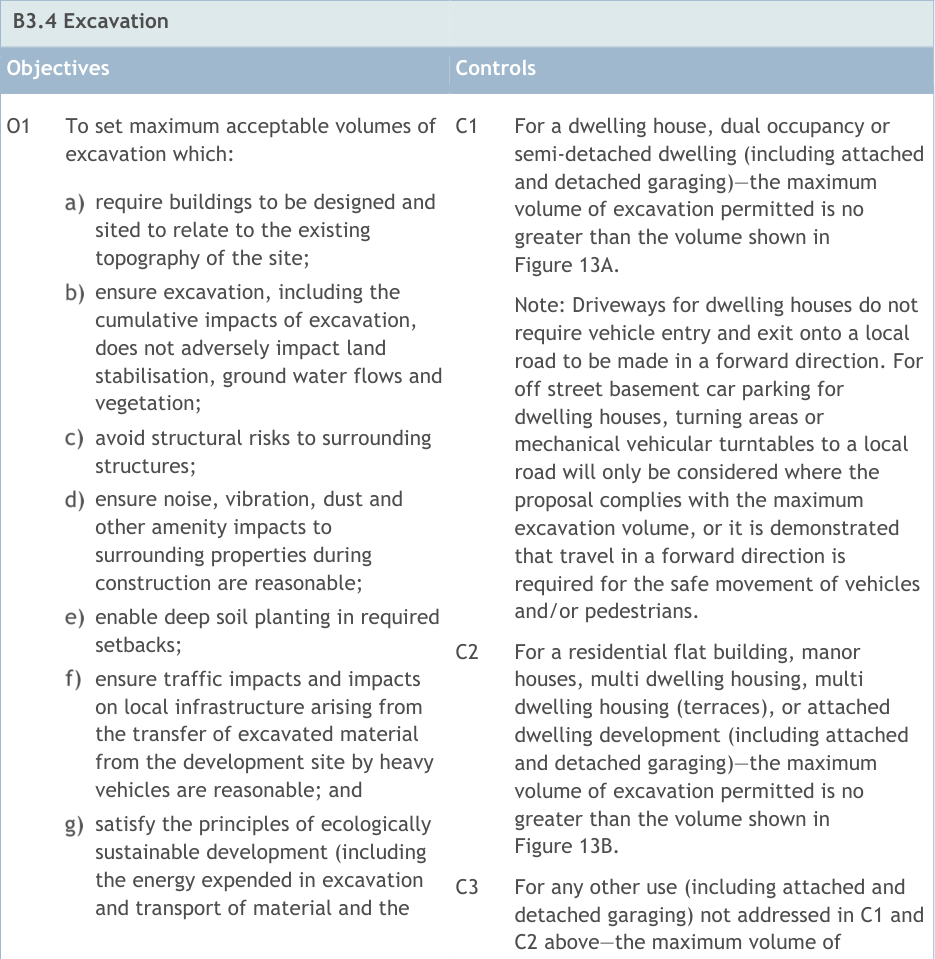

#### B3.4 Excavation

Excavation is an accepted part of development in the Woollahra Municipality where the topography varies. Excavation allows buildings on the sloping sites to be designed to step down and sit into the hillside, and it also enables cars and storage to be accommodated on site in an unobtrusive manner.

However, there are significant environmental impacts associated with extensive excavation, as well as external impacts, such as amenity impacts to adjoining properties during the excavation process.

Council has determined that the volume excavated from a given site should be limited to that which might reasonably be required for car parking and domestic storage requirements, and to allow the building to respond to the site topography in an appropriate manner.

Note: also refer to Chapter E2 Stormwater, Flood and Geotechnical Risk Management, including section E2.2.10 Groundwater (hydrogeology) and geotechnical impacts.

> [Picture on page 26: a picture, saved as a picture (images/chapter-b3-general-development-controls-page-26-12.gif, 150 dpi).]
> Words printed on the picture (title and legend, copied from the PDF):
> excavation which:
> ensure excavation, including the
> structures;
> other amenity impacts to
> surrounding properties during
> construction are reasonable;
> setbacks;

Figure 13A.

Figure 13B.
