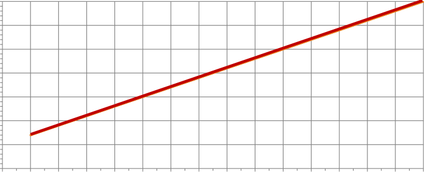
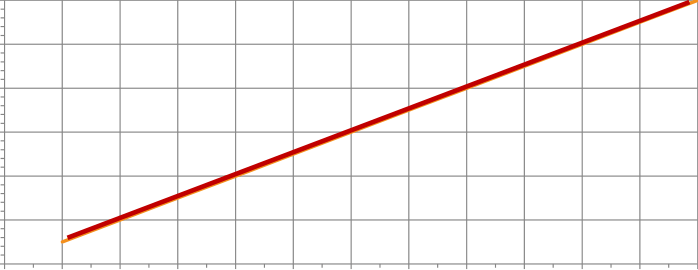
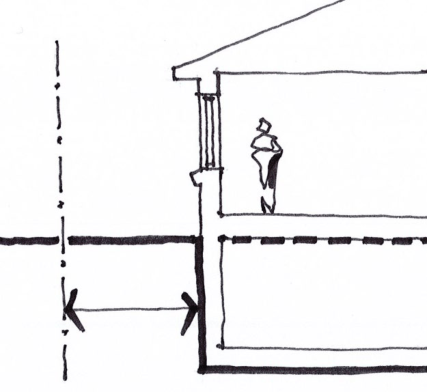
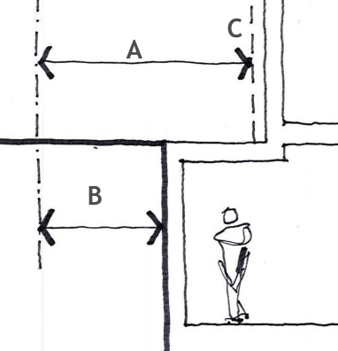

#### B3.4 Excavation Objectives

#### Controls

O1 To set maximum acceptable volumes of

require buildings to be designed and sited to relate to the existing topography of the site;

C1 For a dwelling house, dual occupancy or semi-detached dwelling (including attached and detached garaging)—the maximum volume of excavation permitted is no greater than the volume shown in

cumulative impacts of excavation, does not adversely impact land stabilisation, ground water flows and vegetation; avoid structural risks to surrounding

ensure noise, vibration, dust and

Note: Driveways for dwelling houses do not require vehicle entry and exit onto a local road to be made in a forward direction. For off street basement car parking for dwelling houses, turning areas or mechanical vehicular turntables to a local road will only be considered where the proposal complies with the maximum excavation volume, or it is demonstrated that travel in a forward direction is required for the safe movement of vehicles and/or pedestrians.

enable deep soil planting in required

ensure traffic impacts and impacts on local infrastructure arising from the transfer of excavated material from the development site by heavy vehicles are reasonable; and satisfy the principles of ecologically

C2 For a residential flat building, manor houses, multi dwelling housing, multi dwelling housing (terraces), or attached dwelling development (including attached and detached garaging)—the maximum volume of excavation permitted is no greater than the volume shown in

sustainable development (including the energy expended in excavation and transport of material and the

C3 For any other use (including attached and detached garaging) not addressed in C1 and

C2 above—the maximum volume of

| B3.4 Excavation |  |
|---|---|
| Objectives | Controls |
| relative energy intensity of subterranean areas in dwellings). | excavation permitted is no greater than the volume shown in Figure 13B. C4 Notwithstanding C2 above, a variation to the volume shown in Figure 13B will be considered for residential flat buildings, however the maximum volume of excavation permitted will only be the amount needed to accommodate: car parking to comply with the maximum rates in Part E1 of this DCP and any reasonable access thereto, if the maximum car parking rates are required by the Council; and storage at a rate of 8m³ (cubic metres) per dwelling. C5 Notwithstanding C3 above, a variation to the volume shown in Figure 13B will be considered for seniors housing, however the maximum volume of additional excavation permitted will only be the amount needed to accommodate: a) car parking to comply with the maximum rates in Part E1 of this DCP or the minimum rate in the Housing SEPP, whichever is the greater, and any reasonable access thereto; b) storage at a rate of 8m³ (cubic metres) per dwelling; and c) servicing equipment located in the basement, but only if there is no servicing equipment located on the roof to which the additional height concessions under sections 84(2)(c)(ii) and 108(2)(a)&(b) of the Housing SEPP have been applied. C6 The volume controls in C1 and C2 above do not apply to backyard swimming pools and tennis courts located outside the building envelope. (Note: Separate controls apply which limit excavation, refer to Section 3.7.4 Ancillary development – swimming pools, tennis courts and outbuildings). |

| B3.4 Excavation |  |
|---|---|
| Objectives | Controls C7 Basement walls and any piling (or similar structural elements) must be no closer to the boundary than permitted by the setback controls (refer to Figure 14). C8 Notwithstanding C7, basement walls and any piling (or similar structural elements) for residential flat buildings, manor houses, multi dwellings housing, multi dwelling housing (terraces) and attached dwellings must be no closer to the boundary than 1.5m (see Figure 15). C9 Excavation in relation to an existing attached dwelling, semi-detached dwelling, or attached dual occupancy is not to occur under: common party walls; footings to common party wall; freestanding boundary walls; footings to freestanding boundary walls. C10 Excavation below 2m or within 1.5m of the boundary must be accompanied by a geotechnical and hydrogeological report and a structural report demonstrating that the works will not have any adverse effect on surrounding structures. Note: Council may identify other circumstances where these reports are required. All reports must be prepared in accordance with Council’s guidelines. As a condition of a development consent, Council will require the preparation and submission of a dilapidation report for properties neighbouring the development and the use of vibration monitoring devices during construction, unless the applicant is able to demonstrate that these are not required. |

#### FIGURE 13A

Maximum volume of excavation for the site of:

- a dwelling house

- dual occupancy development

- a semi-detached dwelling

> [Picture on page 29: a picture, saved as a picture (images/chapter-b3-general-development-controls-page-29-3.gif, 150 dpi).]

350

300

250

200

150

100

50

#### Permitted excavation m³

0 0 100 200 300 400 500 600 700 800 900 1,000 1,100 1,200 1,300 1,400 1,500

#### Site area m²

#### FIGURE 13B

Maximum volume of excavation for the site of:

- a residential flat building

- manor houses

- multi dwelling housing

- multi dwelling housing (terraces)

- attached dwellings

- any other land use not addressed in controls C1 to C2 of Section B3.4 Excavation

> [Picture on page 30: a picture, saved as a picture (images/chapter-b3-general-development-controls-page-30-9.gif, 150 dpi).]

3,000

2,500

2,000

1,500

1,000

500

#### Permitted excavation m³

0

0 250

500 750 1,000 1,250 1,500 1,750

#### Site area m²

2,000 2,250 2,500 2,750 3,000

#### FIGURE 14

For a dwelling house, dual occupancy

development and semi-detached dwellings

basement walls and any piling (or similar

structural elements) can be no closer to the

boundary than the required setback (refer to

Figure 5).

> [Picture on page 31: a picture, saved as a picture (images/chapter-b3-general-development-controls-page-31-8.gif, 150 dpi).]

> [Picture on page 31: a picture, saved as a picture (images/chapter-b3-general-development-controls-page-31-9.gif, 150 dpi).]

### C

### A

### B

#### FIGURE 15

For a residential flat building, manor houses, multi dwelling housing, multi dwelling housing (terraces), attached dwellings and any other land use not addressed in controls C1 to C2 of Section

B3.4 Excavation, basement walls and any piling (or similar structural elements) can be no closer to the boundary than 1.5m. A- Refer Figure 6 B- Minimum excavation setback 1.5m C- Building envelope
