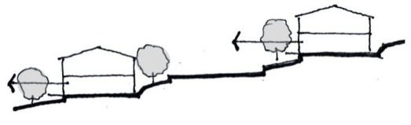
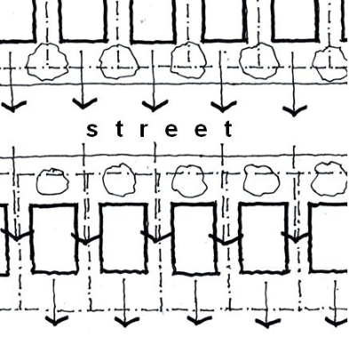
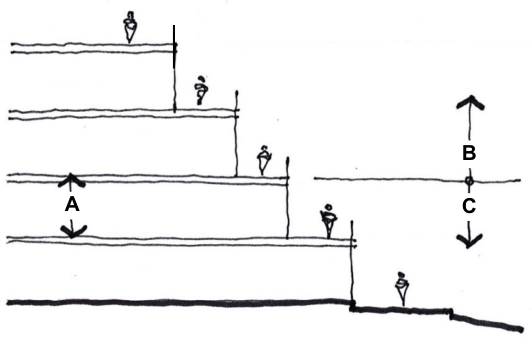
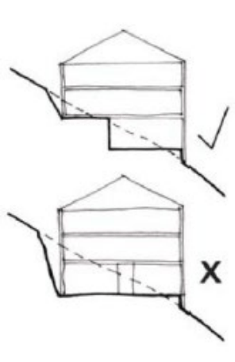

#### B3.5 Built form and context

#### Streetscape and local character

A quality streetscape provides good public amenity and contributes to the character and identity of the locality. As character can vary from street to street, it is important that development recognises predominant streetscape qualities, such as building form to ensure a cohesive streetscape character.

| B3.5 Built form and context 3.5.1 Streetscape character |  |
|---|---|
| Objectives | Controls |
| O1 To ensure that the built form is C1 The building is consistent with the desired compatible with the streetscape future character of the area set out in the and the desired future character precinct controls in Parts B1 and B2 of of the area. this DCP. O2 To ensure that development is of high Note: Chapters B1 and B2 in this part of the visual quality and enhances the street. DCP define the desired future character for each precinct or HCA, and identify special O3 To ensure that development contributes streetscape character, heritage and key towards reducing the urban heat island elements within each precinct. effect by encouraging urban greening and retaining, protecting and enhancing C2 For seniors housing development, the tree canopy cover. building/s are modulated to reference the scale and rhythm of existing buildings in O4 To maintain the evolution of residential the streetscape. building styles through the introduction of well-designed contemporary C3 Development retains vegetation of buildings. landscape value. C4 Development steps down sloping sites and follows the topography of the land. C5 Development minimises disturbance and adverse impacts on existing canopy trees which are to be retained. C6 External building materials and colours do not detract from the streetscape. Bright or obtrusive colour schemes are avoided. C7 Roof forms and roof structures (including roof terraces, lifts, lift overruns, stairwells, access hatches, and other like structures) are well-designed, contribute positively to the streetscape, and are well-integrated with the architecture of the building. |  |

| B3.5 Built form and context 3.5.1 Streetscape character |  |
|---|---|
| Objectives | Controls |
| C8 The use of reflective materials is minimal (including windows, access hatches, skylights and balustrades). |  |
| O5 To ensure that roof forms are C9 In heritage conservation areas or where consistent with the existing the existing immediate streetscape is predominant roof forms in the street predominantly characterised by pitched and minimise impacts to neighbouring roof forms, new development incorporates properties. pitched roof forms. C10 Roof materials are non-reflective and do not cause excessive glare to adjacent properties. |  |
| O6 To ensure buildings improve the safety C11 The building addresses the street and of the public domain. provides opportunities for casual surveillance. At least one habitable room window overlooks the street. |  |

#### Overshadowing

Building bulk should be distributed to minimise overshadowing to neighbouring properties.

Development is to be sited and designed to maximise midwinter solar access to neighbouring properties, having regard to slope, views and existing vegetation.

| B3.5 Built form and context 3.5.2 Overshadowing |  |
|---|---|
| Objectives | Controls |
| O1 To minimise overshadowing to C1 The development is designed so that: neighbouring properties. a) sunlight is provided to at least 50% (or 35m2 with a minimum dimension of 2.5m, whichever is the lesser) of the main ground level private open space of adjacent properties for a minimum of 2 hours between 9am and 3pm on 21 June. Where existing overshadowing is greater than this, sunlight is not further reduced; and b) north facing windows to upper level habitable rooms of adjacent dwellings receive at least 3 hours of sun between 9am and 3pm on 21 June over a portion of their surface. C2 Lot orientation may make C1 above difficult to achieve so a reduced amount of solar access may be considered, provided the proposed building complies with all setback controls. Note: For land adjoining open space also refer to Section 3.10.1. |  |

#### Public and private views

Views are a special element of Woollahra's unique character. The sloping topography, leafy setting and harbour frontage combine to offer dramatic bushland and water views which contribute to the amenity of both private dwellings and the public domain.

In addition, the municipality's frontage to Sydney Harbour places responsibilities upon the Woollahra community, to ensure development maintains the scenic beauty of the foreshore and headland areas when viewed from the water and from the land.

#### Public views

Public views from streets, footpaths, parks and other public areas are among Woollahra's most prized assets and are key elements of the municipality's identity.

These views may take the form of discrete views between buildings and vegetation, more open views across the harbour and local landscape from public parks, or more defined vistas along streets terminating at Sydney Harbour or local landmarks. Important views and vistas are identified on the precinct maps in Chapters B1 and B2 in this part of the DCP.

The preservation and, wherever possible, enhancement of public views helps to maintain legibility within Woollahra by allowing people to see and interpret the surrounding landscape and landmark features. Public views also allow Woollahra's scenic beauty and special character to be appreciated.

#### Private views

View sharing concerns the equitable distribution of views between properties. The view sharing controls in this DCP seek to strike a balance between accommodating new development while providing, where practical, reasonable access to views from surrounding properties.

Development should be designed to reflect the view sharing principles in Tenacity Consulting v Warringah Council [2004] NSWLEC 140.

| B3.5 Built form and context 3.5.3 Public and private views |  |
|---|---|
| Objectives | Controls |
| O1 To protect and enhance existing views C1 Development is sited and designed so that and vistas from the public domain. the following public views are maintained or enhanced: O2 To provide additional views and vistas from streets and other public spaces significant views and vistas identified where opportunities arise. in the precinct maps in this Chapter B1 Residential Precincts and Chapter B2 Neighbourhood HCAs of this DCP; and |  |

| B3.5 Built form and context 3.5.3 Public and private views |  |
|---|---|
| Objectives | Controls |
| views from other public open space areas, particularly from ridgelines to Sydney Harbour and the Sydney CBD skyline. C2 Vistas along streets are preserved or enhanced through sensitive development location and form. C3 Development on the low side of the street preserves district, iconic and harbour views from the street by: a) providing substantial breaks between buildings, front fences, car parking and other structures; and b) incorporating fences with transparent or open end panels at each side boundary to provide for views. C4 Roof forms on the low side of streets are designed to allow public views and add interest to the scenic outlook. Flat expansive roofs with vents, air conditioning units, plant equipment (including lifts and lift overruns) and similar structures are inappropriate. |  |
| O3 To encourage view sharing as a means of C5 Development is sited and designed to ensuring equitable access to views from enable a sharing of views with private property. surrounding private properties, particularly from the habitable rooms (refer to Figures 16 and 17). C6 Development steps down the hillside on a sloping site. C7 The design of the roof form (including roof terraces, lifts, lift overruns, stairwells, access hatches, screens, and other like structures) provides for view sharing. |  |

| B3.5 Built form and context 3.5.3 Public and private views |  |
|---|---|
| Objectives | Controls |
| C8 Roof terraces are uncovered to provide for view sharing. All elements on roof terraces are to comply with the maximum building height control. Note: Access to roofs should not comprise visually prominent stand-alone structures such as lifts or large stairways, particularly on flat roofs. |  |
| O4 To ensure that views are not C9 The location and species of new tree unreasonably compromised by planting frames and preserves public and landscaping. private views. Planting must not be used to moderately, severely or devastatingly block views in accordance with the Tenacity Land and Environment Court Principle. C10 In sloping areas, the location of new tree planting frames and preserves public views. This may be achieved: on the high side of streets— by concentrating new tree planting at the front of buildings within the side setbacks; and on the low side of streets—by concentrating new tree planting at the front of buildings outside the side setbacks (refer to Figure 17). |  |

#### FIGURE 16

View sharing

#### FIGURE 17

Where to locate vegetation to

accommodate view paths

> [Picture on page 38: a picture, saved as a picture (images/chapter-b3-general-development-controls-page-38-6.gif, 150 dpi).]

> [Picture on page 38: a picture, saved as a picture (images/chapter-b3-general-development-controls-page-38-7.gif, 150 dpi).]

#### Acoustic and visual privacy

Privacy refers to both acoustic and visual privacy. The privacy needs of residents and neighbours should influence all stages of design, from the location of buildings and the placement of windows and private open space through to the selection of materials and construction techniques.

This section contains objectives and controls for acoustic and visual privacy for buildings that have the potential to impact on adjoining and adjacent residential development.

It is important to note however, that privacy issues are an inherent component of urban living. In many cases some degree of mutual overlooking and/or noise from property to property is unavoidable.

#### Acoustic privacy

The level of acoustic privacy depends upon the location of habitable rooms relative to noise sources such as habitable rooms, decks, terraces, driveways, air conditioning units, swimming pool pumps and major roads.

Dwellings are designed to ensure adequate acoustic separation and privacy to the occupants of all dwellings. This may be achieved by:

ensuring that bedrooms of one dwelling do not share walls with the habitable rooms (excluding bedrooms) or parking areas of the adjacent dwelling; locating bedroom windows at least 3m from streets, shared driveways and parking areas of other dwellings; and separating bedrooms, by way of barriers or distance, from on-site noise sources such as active recreation areas, car parking area, vehicle accessways and service equipment areas.

#### Visual privacy

The visual privacy controls apply to habitable rooms.  This includes rooms such as a bedroom, living room, lounge room, kitchen, dining room and the like. Maintaining visual privacy within and from these types of habitable rooms is most important, as these are the common living areas in a dwelling.  The controls also address the private open spaces of dwellings.

The controls establish a hierarchical framework for addressing privacy and overlooking. In this hierarchy glazed fixed windows and windows with high sills are the least preferred option and should only be considered in limited circumstances when all other options have been exhausted.

Note: Under the BCA, habitable rooms exclude a bathroom, laundry hallway, lobby, and other like spaces of a specialised nature occupied neither frequently nor for extended periods. Nothing in this section restricts a person from replacing a window with another window, where the replacement window is in the same location and of the same or a smaller size.

| B3.5 Built form and context 3.5.4 Acoustic and visual privacy |  |
|---|---|
| Objectives | Controls |
| O1 To ensure adequate acoustic privacy C1 Dwellings are designed to ensure adequate for occupants and neighbours. acoustic separation and privacy to the occupants of all dwellings. C2 Dwellings located close to high noise sources, such as a busy road or railway line are to: be designed to locate habitable rooms and private open space away from the noise source; and include sound attenuation measures, such as acoustic glazing and insulation. Note: Shared walls and floors between dwellings must be designed in accordance with the sound transmission and insulation criteria of the Building Code of Australia. C3 Electrical, mechanical, hydraulic and air conditioning equipment is housed so that it does not create an ‘offensive noise’ as defined in the Protection of the Environment Operations Act 1997 either within or at the boundaries of any property at any time of the day. |  |
| O2 To ensure adequate visual privacy for C4 New windows in habitable rooms are occupants and neighbours while designed to prevent a direct sightline to balancing the need to provide for the habitable room windows or private open reasonable levels of environmental space of an adjacent dwelling within 9m. amenity, including access to sunlight This may be achieved by options including, and ventilation, and good but not limited to (in order of preference): architectural outcomes. a) Window location—primary windows to habitable rooms are located and designed to provide an outlook to the front and rear setbacks, not the side boundaries. b) Layout and separation—offsetting windows from the windows/private open spaces of the adjoining dwelling to limit views between the windows/private open space. c) Architectural design solutions and devices—redirecting and limiting sightlines using deep sills with planter |  |

| B3.5 Built form and context 3.5.4 Acoustic and visual privacy |  |
|---|---|
| Objectives | Controls |
| boxes, fixed horizontal or vertical louvres, or other screening devices set off the windows internally or externally. d) Glazed opening windows—using windows with translucent glazing to a height of 1.5m above floor level and fitted with a winder mechanism to control the maximum angle of the opening to limit views. e) Glazed fixed windows or high sills—using fixed windows with translucent glazing in any part of the window below 1.5m above floor level, or window sill heights of 1.5m above floor level. Note: Applicants may be required to demonstrate how privacy impacts are resolved by way of view line diagrams, photographs and other suitable means. C5 Windows to bathrooms and toilet areas have translucent glazing where these have a direct view to, and from, habitable rooms and private open space on adjoining and adjacent properties. C6 Architectural design solutions and screening devices referred to in C4 (c) above are integrated with the overall design and contribute to the architectural merit of the building, having particular regard to: aesthetics of the building including impacts on visual bulk; compliance with minimum boundary setback controls; appearance from neighbouring properties; and views from adjoining or adjacent properties. |  |

| B3.5 Built form and context 3.5.4 Acoustic and visual privacy |  |
|---|---|
| Objectives | Controls |
| O3 To minimise the impacts of private C7 Private open spaces and the trafficable area open space. of roof terraces (at or below the second storey) (refer to Figure 18) are to be suitably located and screened to prevent direct views to neighbouring: a) habitable rooms (including bedrooms) within 9m; and b) private open space within 9m. Note: Private open space includes an area external to a building including land, terrace, balcony or deck. C8 For a dwelling house, dual occupancy, semi- detached dwelling, or attached dwelling— the acceptability of any elevated balcony, deck, or terrace will depend on the extent of its impact, its reasonableness and its necessity. Note: Refer to Super Studio vs Waverley Council, (2004) NSWLEC 91 C9 Windows and balconies of an upper-level dwelling are designed to prevent overlooking of the private open space of a dwelling below within the same development. C10 The trafficable area of a roof terrace (above the second storey) (refer to Figure 18) is setback so that there is no direct line of sight, from that part of the building where the terrace or deck is, to: neighbouring private open space within 12m; or windows of habitable rooms in neighbouring dwellings within 12m. |  |

| B3.5 Built form and context 3.5.4 Acoustic and visual privacy |  |
|---|---|
| Objectives | Controls |
| C11 Lighting installations on a roof terrace or upper level deck are: contained within the roof terrace area and located at a low level; or appropriately shaded and fixed in a position so light is projected downwards onto the floor surface of the terrace. Note: Lighting of roof terraces must be designed in compliance with Australian Standards 4282-1997 Control of obtrusive effects of outdoor lighting. |  |
| O4 To ensure that where roof terraces C12 For a roof terrace within the roof a building: are inserted into roofs, they do not no part of the roof terrace or associated impact on the roof profile. structures, such as a balustrade, projects beyond the roof profile; and the roof terrace and opening within the roof are clearly subservient in form and size when compared with the roof plane in which they are located. Note: Screening to roof terraces will only be considered where the screening is consistent with the streetscape and will have no impact on views or overshadowing of neighbouring properties. |  |

> [Picture on page 44: a picture, saved as a picture (images/chapter-b3-general-development-controls-page-44-1.gif, 150 dpi).]
> Words printed on the picture (title and legend, copied from the PDF):
> A
> B
> C

#### Internal amenity

#### FIGURE 18

Application of the visual privacy

controls to roof terraces A - Second storey B - Refer to B3.5.4 C10 C - Refer to B3.5.4 C7

Solar and daylight access and natural ventilation are important for providing pleasant and healthy indoor environments for people to live. This is particularly important for designing comfortable habitable rooms and other areas that are occupied for extended periods.

Provision of natural light and ventilation reduces the reliance on artificial lighting, heating, air-conditioning and mechanical ventilation. This improves energy efficiency and residential amenity.

Note: Habitable rooms exclude bathrooms, corridors, hallways, stairways, lobbies, and other like spaces of a specialised nature occupied neither frequently nor for extended periods.

| B3.5 Built form and context 3.5.5 Internal amenity |  |
|---|---|
| Objectives | Controls |
| O1 To encourage high levels of internal C1 All habitable rooms in a dwelling must amenity through the provision of direct have at least one external wall primarily natural light and direct natural above the existing ground level which ventilation. provides an unobstructed window opening, O2 To encourage buildings that are designed to maximise natural light provision in C2 All habitable rooms and sanitary habitable rooms. compartments in a dwelling must have direct natural light and direct natural ventilation, C3 The area of unobstructed window openings should be equal to at least 20% of the room floor area for habitable rooms, |  |

B3.5 Built form and context  3.5.5 Internal amenity

> [Picture on page 45: a picture, saved as a picture (images/chapter-b3-general-development-controls-page-45-2.gif, 150 dpi).]

#### Objectives

#### Controls

C4 Light wells must not be the primary air source for habitable rooms, and

C5 Any room of a dwelling either partially or fully below existing ground level (excluding basement parking and storage areas) is limited to a maximum room depth of 2 X the ceiling height.

#### FIGURE 18A

Dwellings should be designed to locate

rooms primarily above existing ground level

to maximise the provision of natural light

from unobstructed window openings.
