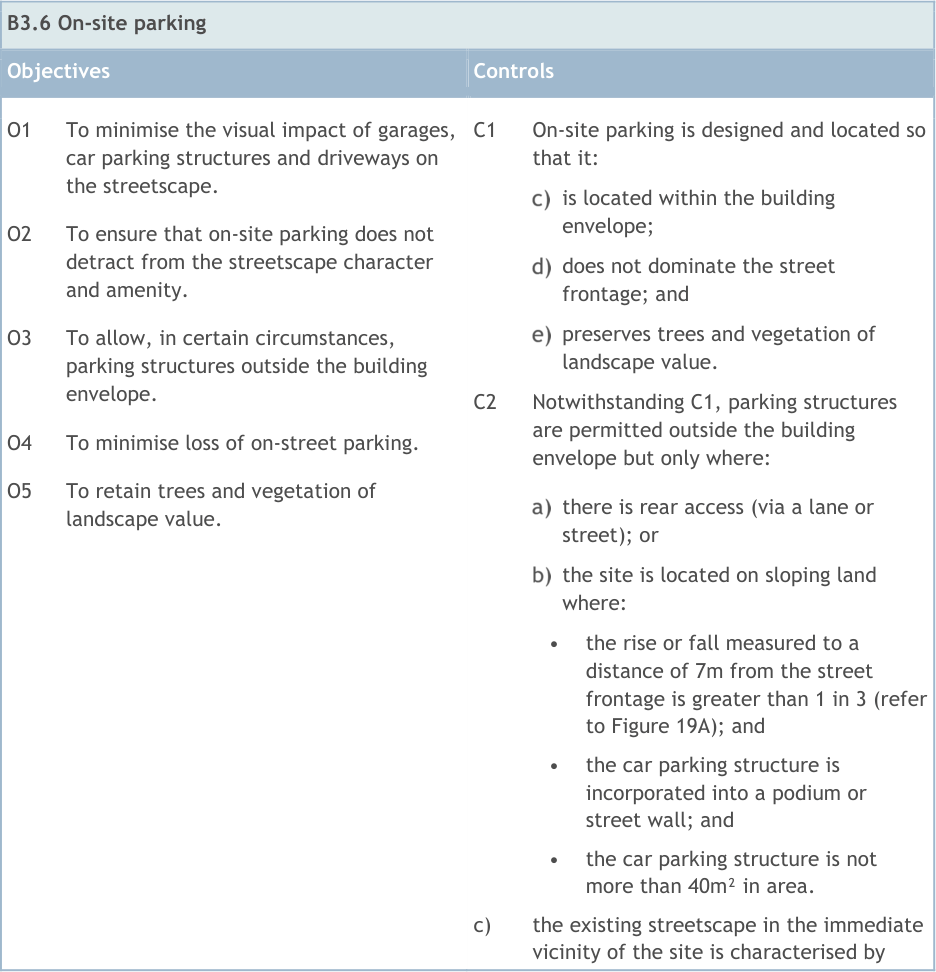

#### B3.6 On-site parking

On-site parking, including garages, carport, hardstand areas and driveways, must be carefully designed to not detract from the appearance of the development and the streetscape.

In particular, on-site parking should not dominate the street frontage, and driveway openings should be limited to protect pedestrian safety and to preserve streetscape amenity such as trees and on-street parking. On-site parking should also be designed to limit the extent of impervious surfaces and excavation and to allow landscaped area in the front setback.

Note: The number of on-site parking spaces for a development is set out in Part E, Chapter E1 Parking and Access.

> [Picture on page 46: a picture, saved as a picture (images/chapter-b3-general-development-controls-page-46-10.gif, 150 dpi).]
> Words printed on the picture (title and legend, copied from the PDF):
> that it:
> envelope;
> frontage; and
> landscape value.
> landscape value.
> street); or
> where:
