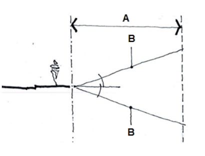
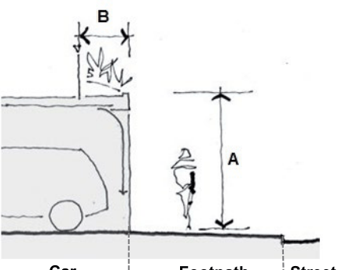

#### B3.6 On-site parking Objectives

#### Controls

C1 On-site parking is designed and located so

O1 To minimise the visual impact of garages, car parking structures and driveways on the streetscape.

is located within the building

does not dominate the street

O2 To ensure that on-site parking does not detract from the streetscape character and amenity.

preserves trees and vegetation of

O3 To allow, in certain circumstances, parking structures outside the building envelope.

O4 To minimise loss of on-street parking.

C2 Notwithstanding C1, parking structures are permitted outside the building envelope but only where:

there is rear access (via a lane or

O5 To retain trees and vegetation of

the site is located on sloping land

• the rise or fall measured to a distance of 7m from the street frontage is greater than 1 in 3 (refer to Figure 19A); and

• the car parking structure is incorporated into a podium or street wall; and

• the car parking structure is not more than 40m² in area.

c) the existing streetscape in the immediate vicinity of the site is characterised by

| B3.6 On-site parking |  |
|---|---|
| Objectives | Controls |
| parking structures forward of the building line and • For separate structures, the roof form, materials and detailing complement the principal building • Garage doors are designed to complement the building design and any important character elements within the street. C3 Parking structures outside the building envelope are only permitted when: a) minimum deep soil landscaped area and private open space requirements are met, as set out in Section 3.7.1 Landscaped areas and private open space; and b) solar, access and privacy requirements within the site, and to the neighbouring properties, are met as set out in Section 3.5.2 Overshadowing and Section 3.5.4 C4 For car parking structures facing the street frontage— the maximum car parking structures width is no greater than 40% of the site frontage width or 6m, whichever is the lesser. C5 Where possible on-site parking is to be accessed from the rear. The width of parking structures can occupy 75% of the rear frontage or 6m (whichever is the lesser). The site area of the parking structure can be no greater than 40m2 and the height a maximum of 3.6m. C6 Development involving three or more dwellings provides basement parking. |  |

| B3.6 On-site parking |  |
|---|---|
| Objectives | Controls |
| O6 To facilitate on-site parking on steeply C7 For car parking structures located in the sloping sites. front setback, the maximum height of the structure is 2.7m above the footpath O7 To ensure that on-site parking is designed level. If the existing height of the and integrated with the principal building retaining/street wall or the two adjoining on the site. car parking structures is higher than O8 To ensure that on-site parking does not 2.7m, that greater height may be detract from the streetscape character permitted (refer to Figure 19B). and amenity. C8 For car parking structures on the high side of the street—balustrading to trafficable areas on top of the structure is setback at least 1m from the front boundary, and is of an open or transparent form (refer to Figure 19B). |  |
| O9 To minimise the visual and environmental C9 The width of driveways is minimised. impacts of driveways and other hard Generally the width is no more than the stand areas associated with car parking. minimum width required to comply with the relevant Australian Standards (see Section E1). C10 Only one driveway entrance is provided. For example, development involving more than one dwelling shares the driveway access. C11 Where soil and drainage conditions allow, semi-porous surfaces are used for uncovered car parking and driveway areas to facilitate on-site stormwater infiltration and reduce limit the visual impact of hard-surface areas. |  |

#### FIGURE 19A

Car parking structures in front setback On sites where the gradient measured to a distance of 7m (A) from the street frontage is

greater than 1 in 3 (B), Council may permit car parking structures forward of the building line

if incorporated into a podium/street wall.

> [Picture on page 49: a picture, saved as a picture (images/chapter-b3-general-development-controls-page-49-6.gif, 150 dpi).]

#### FIGURE 19B

Car parking structures at front boundary A = The car parking structure’s height at the front boundary is to be no more than 2.7m above the pavement B = Any balustrading on the car parking structure is to be set back 1m

> [Picture on page 49: a picture, saved as a picture (images/chapter-b3-general-development-controls-page-49-12.gif, 150 dpi).]

#### Footpath Street

#### Car

parking structure
