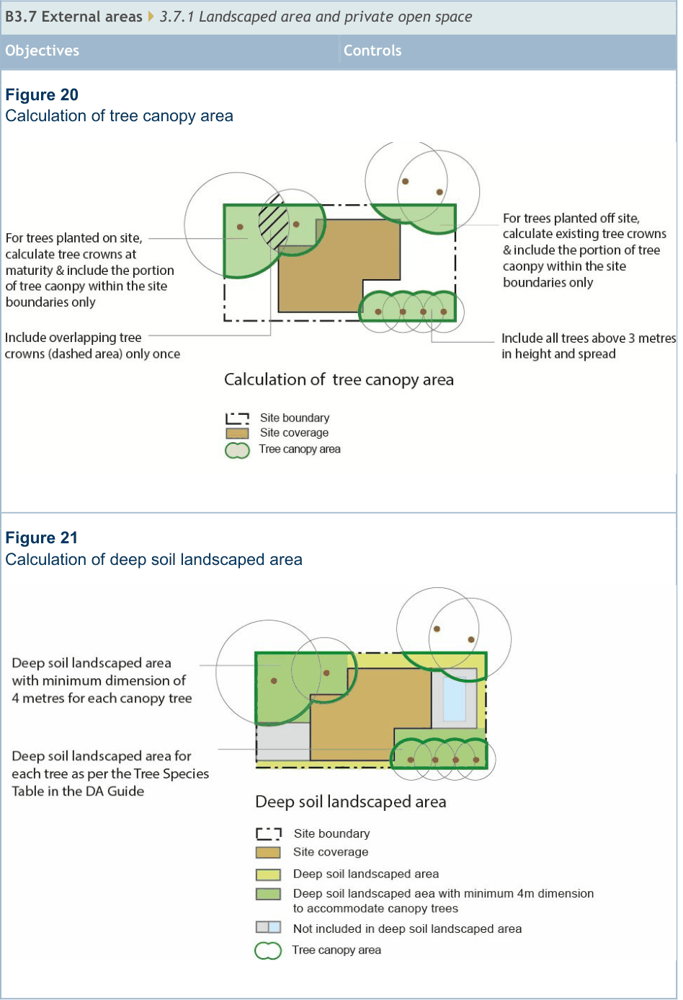
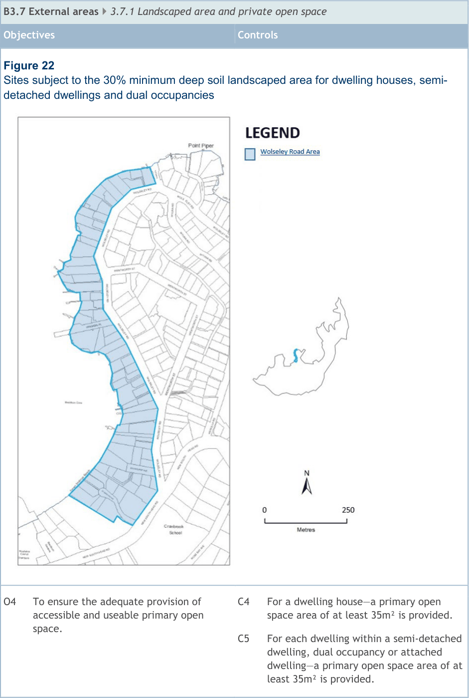
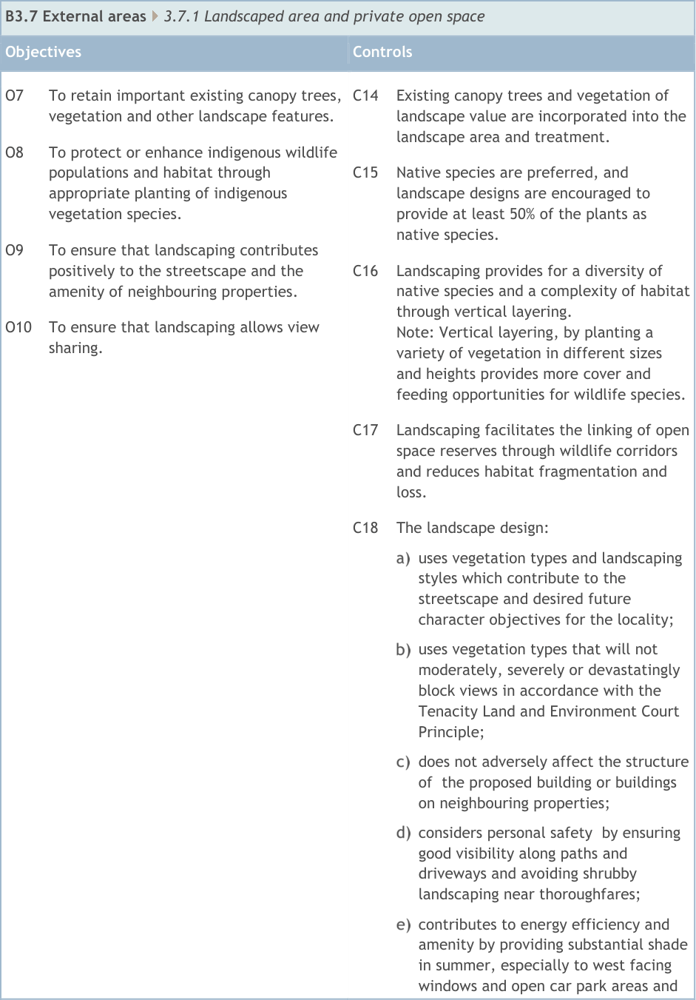
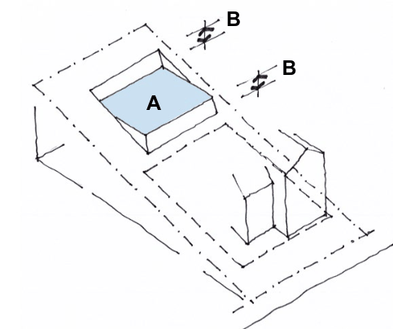
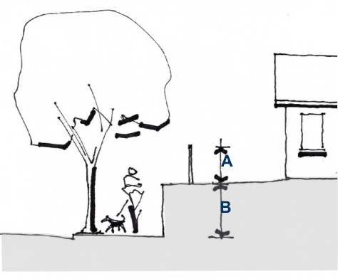
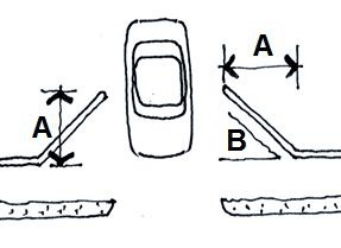
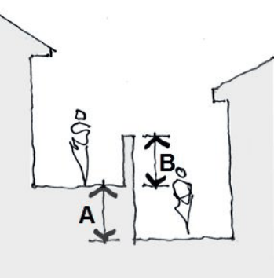
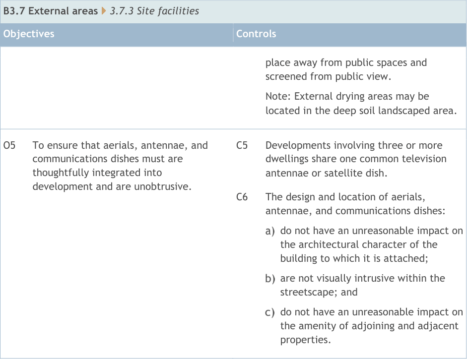
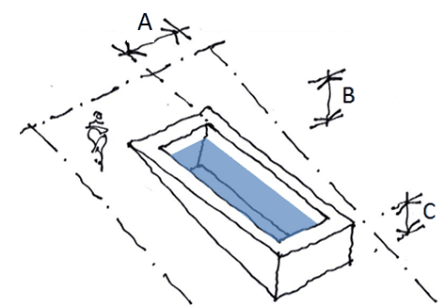
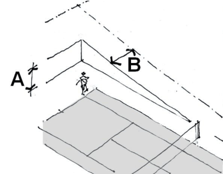

#### B3.7 External areas

#### Landscaped areas and private open space

Open space and landscaping play important roles in the preservation of wildlife habitat, the establishment of community identity, the provision of recreation opportunities and stormwater management.

#### Urban greening and tree canopy

Urban heat island effect is localised warming caused by a lack of vegetation and large areas of impervious surfaces like roads, car parks and buildings.

Higher air pollution, reduced night-time cooling, and increased temperatures are outcomes of urban heat island effect that can adversely affect human health.

Urban greening is the integration of vegetation into development to decrease the urban heat island effect, improve microclimates and enhance mental and physical wellbeing.

Urban greening reduces local temperatures by encouraging evaporation from the soil and plants into the urban environment.

Trees and in particular canopy trees, are critical in mitigating localised warming and provide a number of environmental, social and economic benefits. Benefits include filtering air and water pollutants, slowing and storing stormwater runoff, providing shade and shelter, supporting biodiversity and improving amenity.

Trees also create a sense of place and are fundamental to our leafy streetscapes and the desired future character of our residential precincts. Enhancing tree canopy cover is an important component in mitigating climate change and resilience for sustainable, liveable neighbourhoods.

For the purposes of calculating tree canopy area on a site, the following definitions apply: A tree crown is the total amount of foliage supported by the branches of an individual tree.

Tree canopy area is the part of the site covered by the combined lateral spread of tree crowns of all trees above 3 metres in height and spread (Refer Figure 20).

Existing overhanging tree canopy from the street or neighbouring site/s can be included in the calculation of tree canopy area on the subject site.

A canopy tree is a tree that attains a minimum height of 8 metres and minimum crown diameter of 8 metres at maturity, and is planted in a deep soil landscaped area with a minimum dimension of 4 metres (Refer Figure 21 for calculation of deep soil landscaped area).

Selection of trees must take into consideration the impact on amenity and views on the subject site and neighbouring site/s. Trees selected should be capable of achieving the applicable tree canopy area for the site within 5-10 years of completion of the development.

DA Guide: A range of tree species with their individual deep soil area requirements is listed in the DA Guide.

#### Private open space

Private open space contributes towards the amenity of individual dwellings and should be clearly delineated from public and communal areas. Private open space may be provided at or above ground level. Above ground open space may comprise balconies or rooftop areas.

#### Communal open space

Communal open space comprises shared open space available for use by all residents of a housing development. Communal open space may include landscaped areas, swimming pools or tennis courts and is typically controlled by a body corporate.

#### Landscaping

Landscaped area is defined in Woollahra LEP 2014 to mean “a part of a site used for growing plants, grasses and trees, but does not include any building, structure or hard paved area”.

Deep soil landscaped area is the part of a site that contains landscaped area which has no above ground, ground level or subterranean development.

Landscaped areas within developments may comprise both communal and private open space areas. Landscape treatment helps to determine the amenity of individual dwellings, define private and public areas, reinforce or screen views and define streetscape character.

The amount and composition of landscaped area also plays an important role in stormwater management, the energy efficiency of developments and access to sunlight. Existing trees and vegetation may support significant indigenous wildlife populations and habitat.

| B3.7 External areas 3.7.1 Landscaped area and private open space |  |
|---|---|
| Objectives | Controls |
| O1 To ensure that the areas outside the These controls apply to development in the R2 building contribute to the desired future and R3 residential zones that alter the existing character of the location. building footprint and/or building envelope and/or impacts upon existing landscapes (refer O2 To provide sufficient deep soil landscaped DA Guide) area to encourage urban greening and maintain and enhance tree canopy cover C1 Tree canopy area is at least: which in turn contributes positively to the a) 35% of the site area for dwelling existing and desired future character of houses, dual occupancies, semi- the locality. detached development and attached O3 To provide for on-site stormwater dwellings, with the exception of the absorption. Wolseley Road area, or b) 30% of the site area for residential development other than dwelling houses, dual occupancies, semi- detached development and attached dwellings, or |  |

| B3.7 External areas 3.7.1 Landscaped area and private open space |  |
|---|---|
| Objectives | Controls |
| c) 25% of the site area for all residential development in the Wolseley Road area (Figure 22) And at least half of the total tree canopy area on the site is contributed by canopy tree/s. Refer Figure 20 for the calculation of tree canopy area. Council may consider a variation to this control where: a) Council is satisfied that a canopy tree will have a moderate, severe or devastating impact on views when assessed in accordance with the Tenacity Land and Environment Court Planning Principle. (Note: This control will prevail over view sharing objectives and controls where view impacts are negligible or minor when assessed in accordance with the Tenacity Land and Environment Court Planning Principle). b) The applicant has demonstrated that the deep soil landscaped area on the subject site is unable to achieve the minimum tree canopy area from canopy trees due to the site conditions such as geology, topography, configuration or built form. (Note: The applicant must satisfy Council that a skilful design has been considered to achieve the development potential and amenity and reduce the impact on deep soil landscaped area). C2 35% of the site area is deep soil landscaped area with the exception of the Wolseley Road area (Figure 22) where 30% of the site area is deep soil landscaped area. Refer Figure 21 for the calculation of deep soil landscaped area. C3 At least 40% of the front setback comprises deep soil landscaped area. |  |

> [Picture on page 53: a picture, saved as a picture (images/chapter-b3-general-development-controls-page-53-1.gif, 150 dpi).]
> [Picture text on page 53 is stored in the PDF without readable letters (no character map), so it could not be copied; see the original PDF.]
> Words printed on the picture (title and legend, copied from the PDF):
> Calculation of tree canopy area
> Calculation of deep soil landscaped area

Figure 20

Figure 21

B3.7 External areas  3.7.1 Landscaped area and private open space

#### Objectives

#### Controls

> [Picture on page 54: a picture, saved as a picture (images/chapter-b3-general-development-controls-page-54-1.gif, 150 dpi).]
> [Picture text on page 54 is stored in the PDF without readable letters (no character map), so it could not be copied; see the original PDF.]
> Words printed on the picture (title and legend, copied from the PDF):
> Sites subject to the 30% minimum deep soil landscaped area for dwelling houses, semi-
> detached dwellings and dual occupancies

Figure 22

B3.7 External areas  3.7.1 Landscaped area and private open space

#### Objectives

#### Controls

O4 To ensure the adequate provision of accessible and useable primary open space.

C4 For a dwelling house—a primary open space area of at least 35m² is provided.

C5 For each dwelling within a semi-detached dwelling, dual occupancy or attached dwelling—a primary open space area of at least 35m² is provided.

| B3.7 External areas 3.7.1 Landscaped area and private open space |  |
|---|---|
| Objectives | Controls |
| C6 The primary open space area in C4 and C5 above has a gradient of no more than 1 in 10 (refer to Figure 23). C7 Excavation or fill is permitted to achieve the required level area of primary open space up to 1.2m from existing ground level (refer to Figure 23). C8 Part of the primary open space area is directly accessible from a habitable room |  |
| O5 To ensure that dwellings in residential flat C9 For residential flat building, manor buildings, manor houses, multi dwelling houses, multi dwelling housing or multi housing or multi dwelling housing dwelling housing (terraces) —each (terraces) are provided with adequate dwelling is provided with private open private open space that enhances the space which has a minimum area of 8m² amenity of the dwellings. and minimum dimensions of 2m x 2m. For dwellings above ground level, this may be in the form of a balcony, verandah or uncovered roof terrace and the like. |  |
| O6 To ensure that private open space areas C10 Development takes advantage of are well-designed. opportunities to provide north facing private open space to achieve comfortable year round use. C11 Private open space is clearly defined for private use through planting, fencing or landscape features. C12 The location of private open space: takes advantage of the outlook and natural features of the site; reduces the adverse privacy and overshadowing impacts; and addresses surveillance and privacy where private open space abuts public space. C13 A roof terrace and associated structures will only be considered where the size, location and design of the terrace meets the requirements in Section 3.5.4 Acoustic and visual privacy. |  |

> [Picture on page 56: a picture, saved as a picture (images/chapter-b3-general-development-controls-page-56-1.gif, 150 dpi).]
> [Picture text on page 56 is stored in the PDF without readable letters (no character map), so it could not be copied; see the original PDF.]
> Words printed on the picture (title and legend, copied from the PDF):
> populations and habitat through
> appropriate planting of indigenous
> vegetation species.
> sharing.
> C18 The landscape design:

B3.7 External areas  3.7.1 Landscaped area and private open space

#### Objectives

#### Controls

O7 To retain important existing canopy trees, vegetation and other landscape features.

C14 Existing canopy trees and vegetation of landscape value are incorporated into the landscape area and treatment.

O8 To protect or enhance indigenous wildlife

C15 Native species are preferred, and landscape designs are encouraged to provide at least 50% of the plants as native species.

O9 To ensure that landscaping contributes positively to the streetscape and the amenity of neighbouring properties.

O10 To ensure that landscaping allows view

C16 Landscaping provides for a diversity of native species and a complexity of habitat through vertical layering. Note: Vertical layering, by planting a variety of vegetation in different sizes and heights provides more cover and feeding opportunities for wildlife species.

C17 Landscaping facilitates the linking of open space reserves through wildlife corridors and reduces habitat fragmentation and loss.

uses vegetation types and landscaping styles which contribute to the streetscape and desired future character objectives for the locality; uses vegetation types that will not moderately, severely or devastatingly block views in accordance with the Tenacity Land and Environment Court Principle; does not adversely affect the structure of  the proposed building or buildings on neighbouring properties; considers personal safety  by ensuring good visibility along paths and driveways and avoiding shrubby landscaping near thoroughfares; contributes to energy efficiency and amenity by providing substantial shade in summer, especially to west facing windows and open car park areas and

| B3.7 External areas 3.7.1 Landscaped area and private open space |  |
|---|---|
| Objectives | Controls |
| admitting winter sunlight to outdoor and living areas and other habitable rooms; improves privacy between dwellings; minimises risk of damage to overhead power lines and other services; and provides adequate sight lines for vehicles and pedestrians, especially near street corners and intersections. |  |
| Note: Deep soil landscaped area means: the area of the site that contains landscaped area which has no above ground, ground level or subterranean development. Note: Canopy tree means: A tree that attains a minimum height of 8 metres and minimum crown diameter of 8 metres at maturity, and is planted in a deep soil landscaped area with a minimum dimension of 4 metres. |  |

> [Picture on page 57: a picture, saved as a picture (images/chapter-b3-general-development-controls-page-57-2.gif, 150 dpi).]

#### B

#### FIGURE 23

Provision of level area of primary open

space

#### B

#### A

A = Minimum area 35m², maximum

gradient 1:10 B = Primary open space is to be no more than 1.2m above or below existing ground level

#### Fences

Fences and walls play major roles in determining the appearance of developments and their contribution towards the streetscape. Carefully designed fences and walls help to integrate developments into the existing streetscape. However, when poorly designed they can unduly dominate the streetscape and reduce opportunities for neighbourhood surveillance and social interaction.

This DCP seeks to recognise both the importance of fences and walls to the privacy and security enjoyed by individual properties and the potential of fences and walls to contribute to creating or enhancing attractive streetscapes.

| B3.7 External areas 3.7.2 Fences |  |
|---|---|
| Objectives | Controls |
| O1 To ensure fences and walls improve C1 Fencing is designed and located to protect amenity for existing and new residents the inhabitants of the property, and allows and contribute positively to streetscape for casual surveillance from the building to and adjacent buildings. the street. O2 To ensure that fences and walls are not C2 The arrangement of built form, fences, visually intrusive in the streetscape and landscaping and other features clearly to enhance pedestrian safety. defines any public, common, and private space. O3 To ensure that fences and walls do not unreasonably restrict views and vistas C3 Front fences and walls assist in defining from streets and other public spaces. building entrances. O4 To ensure that development creates C4 The height of front fences does not exceed: well defined areas of public and 1.2m if solid; or private space. 1.5m if 50% transparent or open; unless otherwise specified in the precinct controls in Chapters B1 and B2 of this part of the DCP. Note: Chapters B1 and B2 define the desired future character for each precinct, and identify any special heritage, streetscape character and key elements within each precinct. C5 Fences and gates on the low side of the street adjacent to each side boundary incorporate transparent or open panels to preserve district, iconic and harbour views from the street. |  |

| B3.7 External areas 3.7.2 Fences |  |
|---|---|
| Objectives | Controls |
| C6 On the high side of streets where there is an increase in ground level in excess of 1.2m on the property side of the street alignment— the height of front fences and walls may increase to 1.2m from the level of the high side (refer to Figure 24). C7 Gates do not encroach over the street alignment when opening or closing. C8 Where a vehicular entrance is proposed in conjunction with a fence of height greater than 1.2m—a 45° splay or its equivalent is provided either side (as applicable) of the entrance to ensure driver and pedestrian vision. The splay is to have minimum dimensions of 2m x 2m (refer to Figure 25). |  |
| O5 To ensure boundary fences between C9 The rear and side fences: sites provide visual privacy without are located behind the building front affecting the amenity of those sites in setback; and terms of views and sunlight. do not exceed 1.8m on level sites, or 1.8m as measured from the low side where there is a difference in level either side of the boundary. C10 Where there is a difference in ground level in excess of 1.2m either side of the boundary—the height of fences and walls may increase to 1.2m from the level of the high side (refer to Figure 26). |  |
| O6 To ensure fences and walls are C11 For sloping streets—the height of fences and sympathetic to the topography. walls may be averaged and fences and walls may be regularly stepped. |  |

B3.7 External areas  3.7.2 Fences

#### Objectives

O7 To protect and retain fences and walls that are important character elements for the precinct.

O8 To ensure materials used in fences and walls are a high quality and in keeping with the existing streetscape character and character of the building.

#### Controls

> [Picture on page 60: a picture, saved as a picture (images/chapter-b3-general-development-controls-page-60-11.gif, 150 dpi).]
> Words printed on the picture (title and legend, copied from the PDF):
> A
> B

C12 Remnant sandstone and garden walls are retained and adequately maintained.

C13 Existing retaining walls that are important character elements in the street or precinct are retained.

C14 Existing fences, particularly those constructed from sandstone, that are significant or represent important character elements in the street or precinct are retained.

C15 The design and materials of front fences and walls are compatible with those fences and walls that contribute positively to the streetscape, (and the heritage context in the case of heritage conservation areas), and satisfy the desired future character and precinct controls in Chapters B1 and B2 of this DCP.

C16 Fences and walls made from corrugated iron, barbed wire, and the like are not permitted.

#### FIGURE 24

Front fences on the high side of

streets

A = 1.2m maximum

B = Increase in ground level greater than 1.2m

#### FIGURE 25

Splays for driveway entrances where

fence height exceeds 1.2m A = 2m minimum

B = 45° splay

#### FIGURE 26

Side and rear boundary fences where

levels change between properties A = Increase in ground level greater than 1.2m

B = 1.2 maximum

> [Picture on page 61: a picture, saved as a picture (images/chapter-b3-general-development-controls-page-61-12.gif, 150 dpi).]

> [Picture on page 61: a picture, saved as a picture (images/chapter-b3-general-development-controls-page-61-13.gif, 150 dpi).]

#### Site facilities

Site facilities include those facilities or services that support and, or, maintain the operations of a building. All forms of development include site facilities. These include, but are not limited to:

• On-site services including storage, garbage areas, mail boxes, clothes drying areas, vent stacks, and telecommunications infrastructure

• Mechanical plant rooms and equipment and other building services such as pump rooms, lift overruns, air-conditioning units and condensers, heating, mechanical ventilation systems, ventilation duct outlets, including any pipes and conduits

• Essential services and infrastructure such as electricity substations, fire hydrant and booster installations.

Some site facilities can be visually intrusive and have an adverse impact on the amenity of the streetscape and adjoining neighbours. It is important that the location, size and design of site facilities is considered and planned for during the design phase of any proposed development so the facilities can be thoughtfully integrated into the built form and landscaping, and potential impacts addressed.

Development applications are to be accompanied by dimensioned plans, drawn to scale, showing proposed locations and arrangements for site facilities including, where applicable:

• mechanical plant rooms and lift-overruns

• enclosures and/or cabinets for fire hydrants, booster valve assembly installations, sprinkler valves and associated hydraulic equipment

• an electricity substation.

The need to modify an existing consent to provide for a site facility should be avoided, and is an approach not supported by Council. Section 4.55 modification applications will need to demonstrate compliance with the DCP including requirements for setbacks, deep soil landscaped area, and tree retention etc. Council will not permit site facilities on public land.

| B3.7 External areas 3.7.3 Site facilities |  |
|---|---|
| Objectives | Controls |
| O1 To ensure that mail boxes are suitably C1 Lockable mail boxes are provided close to located and designed. the street and are integrated with front fences or building entries. |  |
| O2 To provide adequate storage facilities C2 Lockable storage space of at least 8m³ in residential development. per dwelling is provided. |  |
| O3 To encourage the use of natural resources C3 Development that includes a residential to dry clothes. component provides opportunity for at least one external clothes drying area. O4 To ensure external clothes drying areas are suitably located. C4 External clothes drying areas have access to sunlight, and are located in a secure |  |

> [Picture on page 63: a picture, saved as a picture (images/chapter-b3-general-development-controls-page-63-1.gif, 150 dpi).]
> [Picture text on page 63 is stored in the PDF without readable letters (no character map), so it could not be copied; see the original PDF.]
> Words printed on the picture (title and legend, copied from the PDF):
> communications dishes must are
> thoughtfully integrated into
> development and are unobtrusive.
> antennae, and communications dishes:
> streetscape; and

B3.7 External areas  3.7.3 Site facilities

#### Objectives

O5 To ensure that aerials, antennae, and

#### Controls

place away from public spaces and screened from public view. Note: External drying areas may be located in the deep soil landscaped area.

C5 Developments involving three or more dwellings share one common television antennae or satellite dish.

C6 The design and location of aerials,

do not have an unreasonable impact on the architectural character of the building to which it is attached; are not visually intrusive within the

do not have an unreasonable impact on the amenity of adjoining and adjacent properties.

| B3.7 External areas 3.7.3 Site facilities |  |
|---|---|
| Objectives | Controls |
| O6 To ensure that mechanical plant C7 Mechanical plant equipment (including lift equipment including lift overruns, air- overruns and air conditioners) must be conditioning units and external located internally within the principal condensers, do not have adverse building in a suitably designed plant room streetscape or amenity impacts. or the like. O7 To discourage the provision of mechanical C8 Mechanical plant equipment (including lift plant equipment on the roofs of buildings overruns and air conditioners) must be to minimise clutter and visual impacts wholly contained within the permissible created by intrusive site facilities. building envelope and must not be located externally or on the roof unless O8 To minimise visual and acoustic impacts Council is satisfied that it: on adjoining properties cannot be reasonably located elsewhere; and is thoughtfully located, sized, enclosed, concealed and integrated into the building design (including when viewed from above) and roof form so it: i. is not visible from the streetscape or public domain; ii. is consistent with the overall building design, roof form and materials; iii. is visually discreet and unobtrusive when viewed from adjoining properties; and iv. minimises acoustic impacts to adjoining properties. Note: Noise emissions from mechanical plant equipment must not exceed the background noise levels when measured at the boundary of the development site. The provisions of the Protection of the Environment Operations Act 1997 apply. |  |

| B3.7 External areas 3.7.3 Site facilities |  |
|---|---|
| Objectives | Controls |
| C9 Screening will only be considered where the screening is suitably located, integrated with the building design and materials and will have no impact on views or result in overshadowing of adjoining properties. Note: Screening alone may not be an acceptable solution for ensuring that mechanical plant equipment is not visible from the streetscape or the public domain. |  |
| O9 To protect the air quality and C10 New fireplaces burn non-solid fuels, residential amenity. e.g. gas or electricity. |  |
| O10 To ensure that development incorporates C11 Refer to Part E of the DCP, Chapter E5 adequate garbage and recycling collection Waste Management. areas. |  |
| O11 To ensure that site services are C12 Site services are suitably integrated with accessible, functional and do not have a the development including the landscape negative impact on the streetscape. design and are not visually intrusive within the streetscape. C13 Hydraulic fire services such as fire hydrants and booster installations are concealed. These services are to be: enclosed with doors if located in the building façade, or housed in a cabinet or enclosure if located external to the building. The location, design, colour and material of the doors, cabinet or enclosure are visually unobtrusive and suitably integrated with the development, including fencing and landscaping. |  |

| B3.7 External areas 3.7.3 Site facilities |  |
|---|---|
| Objectives | Controls |
| O12 To ensure that an electricity substation is C14 The substation is to be suitably located, not visible from the street, or any other screened and/or concealed. Council’s adjoining public place. preference is for a chamber substation. O13 To ensure that any screening or enclosure C15 Any screening or enclosure to conceal the to conceal the substation does not detract substation is to be visually unobtrusive from the streetscape character or design and suitably integrated with the quality of the development. development, including the fencing and landscape design. |  |
| O14 To protect the amenity of adjoining C16 The substation is to be located away from residential dwellings from substations. neighbouring properties or sufficiently screened from neighbouring properties. |  |
| O15 To ensure that vegetation does not C17 The location and design of the electricity interfere with the functioning of the substation must be considered and substation. integrated with the landscaping of the proposed development, and must ensure that: a) Vegetation does not overhang or encroach within the substation site. b) The substation is installed outside of the mature growth root zone of any trees to be retained, or proposed to planted, to prevent roots damage to underground cables. |  |
| O16 To minimise the impact of other types of C18 The design and location of all other electricity infrastructure in the aboveground utility infrastructure (such streetscape. as electrical pillars etc.) should minimise visual clutter within the streetscape and provide for a continuous accessible path of travel, where practical to ensure safe and equitable pedestrian circulation for people of all abilities. (Where this provision and Ausgrid’s requirements cannot both be satisfied, the applicant is to develop in consultation with Council and Ausgrid a solution that meets the acceptance of both consent authorities.) |  |

| B3.7 External areas 3.7.3 Site facilities |  |
|---|---|
| Objectives | Controls |
| Notes: • At the DA stage the applicant should demonstrate that they have engaged with Ausgrid and have a network capacity assessment undertaken for the proposed development. • Where a substation is required, the substation should be identified on the DA plans and addressed in the SEPP 65 Design Verification Statement (also see Apartment Design Guide Objective 3C-2 Amenity of the public domain is retained and enhanced). • The DCP requirements apply in addition to the Ausgrid Network Standards, such as NS113 Site selection and construction design requirements for chamber substations. Separate Ausgrid approval for the substation will be required. • A dedicated access way/easement through the site to the substation will also need to be provided in accordance with the requirements of Ausgrid and Council. |  |

#### Ancillary development – swimming pools, tennis, basketball and sports

#### courts and outbuildings

#### Swimming pools

A swimming pool is an impermeable structure capable of holding water to a depth greater than 300mm for swimming or other recreation purposes, but does not include a spa pool.

| B3.7 External areas 3.7.4 Ancillary development – swimming pools |  |
|---|---|
| Objectives | Controls |
| O1 To provide for recreational opportunities C1 The swimming pool does not occupy the for swimming without compromising the deep soil landscaped area. amenity of the neighbouring properties. C2 Excavation beyond the controls in O2 To limit excavation. Section B3.4 is permitted to accommodate a backyard swimming pool, where the pool O3 To retain trees and vegetation of is outside the building envelope. landscape value. Note: This concession does not apply to a swimming pool in a basement area. C3 The swimming pool (measured from the water edge) is at least 1.8m from property boundaries. C4 The swimming pool surrounds are no more than 1.2m above or below the existing ground level. C5 The swimming pool is no deeper than 2m from the pool surround level (refer to Figure 27). C6 The location and design of the swimming pool and associated works do not adversely impact on prescribed trees (refer to Chapter E3 Tree Management). |  |

#### FIGURE 27

Provision of private swimming pools A is a minimum of 1.8m B = pool depth is a maximum of 2m C is to be a maximum of 1.2m

> [Picture on page 69: a picture, saved as a picture (images/chapter-b3-general-development-controls-page-69-6.gif, 150 dpi).]

#### Tennis, basketball and sports courts

Tennis courts, basketball courts and other sports courts typically comprise of a hard court surface and other associated structures such as a net, hoop, and lighting. When constructed or installed in the private open space of a residential dwelling, the court is often a modified size and fenced to contain balls on the court during play.

Private outdoor recreation and exercise contributes to a healthy lifestyle and the enjoyment of residents. However, noise generated from people playing on sports courts in a residential area can sometimes impact on the acoustic privacy of adjoining neighbours. The associated fencing and outdoor lighting can also have detrimental amenity impacts.

When a tennis court, basketball court, or other sports court is proposed, it is important that the size, location and design of the court considers potential amenity impacts, and the excavation, tree and deep soil landscaping objectives are met.

| B3.7 External areas 3.7.4 Ancillary development – tennis, basketball and sports courts |  |
|---|---|
| Objectives | Controls |
| O1 To provide recreational opportunities for C1 The court level is a maximum of 1.2m playing tennis, basketball or other sports above or below the existing ground level without compromising the amenity of (refer to Figure 28). adjoining and adjacent properties, or the desired future character or streetscape. C2 The court is: O2 To limit excavation. a) located at the rear of the site; and b) at least 1.5m from property O3 To retain trees and vegetation of boundaries (refer to example at Figure landscape value, deep soil landscaped 28). area, and private open space areas. C3 The court playing surface is made from a O4 To ensure that adequate provision has material that minimises light reflection. been made for the disposal of stormwater. C4 The height, location and materials of court fencing, netting or other forms of |  |

|  | ball containment does not unreasonably |
|---|---|
|  | compromise: |
|  | a) sharing of views from surrounding |
|  | properties; or |
|  | b) solar access to neighbouring |
|  | properties; or |
|  | c) outlook from surrounding properties. |
| C5 | Fencing, netting or other forms of ball containment must comprise of a material which is a recessive colour. |
| C6 | Where court lighting is proposed, the lighting must not unreasonably impact on the amenity of adjoining or adjacent properties. The lighting must be designed to comply with AS/NZS 4282: Control of the obtrusive effects of outdoor lighting. No private tennis, basketball, or sports court lighting must operate between 9.00pm and 7.00am and lights must, by automatic timer, switch off at the 9.00pm curfew. |
| C7 | The location of the court and associated works does not adversely impact on prescribed trees (refer to Chapter E3 Tree Management). |
| C8 | The court must not reduce the deep soil landscaped area, and the private open space areas below the minimum required for development, as specified in Section 3.7.1 Landscaped areas and private open space. |
| C9 | Surface water or runoff is disposed of by a drainage system that is connected to the main stormwater drainage system (refer to Chapter E2 Stormwater and Flood Risk Management). |

#### FIGURE 28

Provision of private tennis, basketball and

sports courts on residential sites A is to be a maximum of 1.2m B is to be a minimum of 1.5m

> [Picture on page 71: a picture, saved as a picture (images/chapter-b3-general-development-controls-page-71-6.gif, 150 dpi).]

#### Outbuildings

Although development outside the building envelope is generally not permitted, small outbuildings such as a cabana, cubby house, fernery, garden shed, gazebo, greenhouse or the like, may be located within the rear the setback.

| B3.7 External areas 3.7.4 Ancillary development – outbuildings |  |
|---|---|
| Objectives | Controls |
| O1 To ensure that outbuildings do not C1 The outbuilding is located within the unreasonably compromise the amenity of building envelope or the rear setback. the occupants or the neighbouring properties. C2 Maximum height of the outbuilding is 3.6m and the outbuilding is to be sited a minimum of 1.5m from the side and rear boundaries. |  |
| O2 To ensure that the required deep soil C3 The outbuilding, if located outside the landscaped area and level area of private building envelope, does not reduce the open space are achieved. deep soil landscaped area and the private open space areas below the minimum required for development, as specified in Section 3.7.1 Landscaped areas and private open space. |  |
| Notes: • Outbuilding means any of the following: cabana, cubby house, fernery, garden shed, gazebo or greenhouse, carport that is detached from a dwelling house, garage that is detached from a dwelling house, |  |

•

rainwater tank (above ground) that is detached from a dwelling house, shade structure that is detached from a dwelling house, shed.

Controls for outbuildings which comprise parking structures are contained in Section B3.6.
