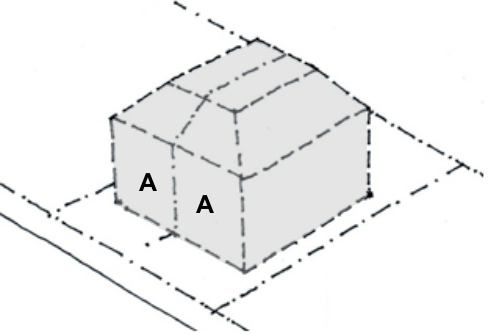

#### B3.8 Additional controls for development other than dwelling houses

This section includes additional controls for the following types of development: secondary dwellings; semi-detached dwellings; dual occupancies; attached dwellings; residential flat buildings; manor houses; multi-dwelling housing; multi dwelling housing (terraces); Inter-War flat buildings; and post-1950s residential towers. These controls apply in addition to the controls in Sections B3.2-B3.7.

#### Minimum lot width

The minimum lot width, as measured from the street frontage, is the minimum required to accommodate development on a site.

The controls below apply to detached dual occupancies, attached dwellings, residential flat buildings, manor houses, multi dwelling housing and multi dwelling housing (terraces) recognising that these forms of development require a minimum width to ensure that each dwelling in the development can be designed to provide reasonable amenity having regard to issues such as privacy, building separation, open space and to achieve planned residential density in certain zones consistent with the desired future character of the neighbourhood.

| B3.8 Additional controls 3.8.1 Minimum lot width |  |
|---|---|
| Objectives | Controls |
| O1 To ensure that sites have a C1 The parent lot has a minimum width at the street minimum width to provide front alignment as follows: sufficient space between detached dual occupancy—21m; buildings to allow satisfactory amenity for occupants and attached dwellings—24m; neighbouring properties and for residential flat building, manor houses, multi effective landscaping and dwelling housing or multi dwelling housing pedestrian access. (terraces) containing three dwellings—15m; and O2 To ensure that lot widths residential flat building, multi dwelling facilitate a built form with a bulk housing, multi dwelling housing or multi and scale that is consistent with dwelling housing (terraces) or containing four the desired future character of or more dwellings—21m. the area. Notes: O3 To ensure there is adequate No minimum lot width applies to a dwelling width for efficient on-site car house, semi-detached dwelling or attached parking. dual occupancy. O4 To ensure that excavation can be The parent lot refers to the development adequately set back from site before any subdivision (if relevant). boundaries and to prevent These controls do not apply to battle-axe excessive excavation. lots (refer to Section B3.9). O5 To encourage consolidation of allotments in appropriate locations to enable the development of a diversity of dwelling types. |  |

#### Secondary dwellings

Under Woollahra LEP 2014, secondary dwelling means a self-contained dwelling that:

a) is established in conjunction with another dwelling (the principal dwelling);

b) is on the same lot of land as the principal dwelling; and

c) is located within, or is attached to, or is separate from, the principal dwelling.

Clause 5.4 of Woollahra LEP 2014 sets the maximum size of a secondary dwelling, being 60m², or not more than 5% of the total floor area of the principal dwelling.

| B3.8 Additional controls for development other than dwelling houses 3.8.2 Secondary dwellings |  |
|---|---|
| Objectives | Controls |
| O1 To ensure that amenity is provided to C1 The secondary dwelling is located within the occupants of the principal dwelling, the building envelope. secondary dwelling and to neighbouring Note: Only a secondary dwelling approved properties. under the State Environmental Planning Policy (Housing) 2021 may be located outside the building envelope. C2 Both the principal and secondary dwellings have direct access to private open space. |  |

#### Semi-detached dwellings

Under Woollahra LEP 2014, a semi-detached dwelling means a dwelling that is on its own lot of land and is attached to only one other dwelling (refer to Figure 29).

This section includes controls relating to: new semi-detached dwelling development; and alterations and additions to existing semi-detached dwellings.

> [Picture on page 76: a picture, saved as a picture (images/chapter-b3-general-development-controls-page-76-7.gif, 150 dpi).]

#### FIGURE 29

Semi-detached dwellings A = Semi-detached dwellings

#### A

#### A
