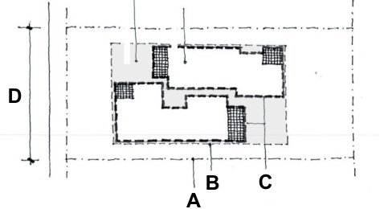
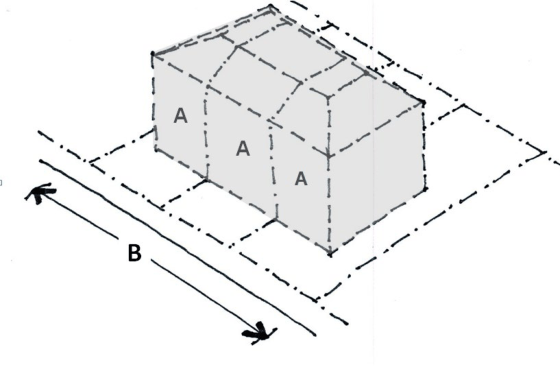

#### B3.8 Additional controls for development other than dwelling houses

#### 3.8.3 Semi-detached dwellings

#### Objectives

#### Controls

C10 Roof design does not adversely impact on the adjoining semi-detached dwelling or create stormwater spillover.

C11 External colour schemes and materials are sympathetic to the character of the original building and the other semi-detached dwelling.

#### Dual occupancy

A dual occupancy means two dwellings on one lot of land (refer to Figure 30).

Under Woollahra LEP 2014, dual occupancies are defined as: dual occupancy (attached) means two dwellings on one lot of land that are attached to each other, but does not include a secondary dwelling. dual occupancy (detached) means two detached dwellings on one lot of land, but does not include a secondary dwelling. Clause 4.1A of Woollahra LEP 2014 sets the minimum lot size of dual occupancies.

> [Picture on page 79: a picture, saved as a picture (images/chapter-b3-general-development-controls-page-79-9.gif, 150 dpi).]

#### FIGURE 30

Example layout of detached dual

occupancy within the building

envelope

#### D

A = Lot boundary B = Building envelope

#### C

#### B

C = Extent of building

#### A

D = 21m minimum frontage

| B3.8 Additional controls for development other than dwelling houses 3.8.4 Dual occupancy |  |
|---|---|
| Objectives | Controls |
| O1 To ensure that the development C1 Both dwellings in the development presents as an integrated design. complement each other in terms of style, design, materials, roof form and colour scheme. |  |
| O2 To ensure useable and well located C2 Private open space areas are not located areas of private open space. within the front setback area. C3 Each dwelling has direct access to its own private open space area. C4 Private open space areas are not overlooked by the other dual occupancy dwelling in the development. |  |

O3 To ensure that on-site parking does not detract from the streetscape character and amenity.

C5 Both dual occupancies share a common driveway cross-over.  Separate cross overs may be considered on corner lots, where the access is from separate streets.

O4 To minimise loss of on-street parking.

#### Attached dwellings

Under Woollahra LEP 2014, attached dwelling means a building containing three or more dwellings, where:

a) each dwelling is attached to another dwelling by a common wall;

b) each of the dwellings is on its own lot of land; and

c) none of the dwellings are located above any part of another dwelling. Refer to Figure 31.

> [Picture on page 80: a picture, saved as a picture (images/chapter-b3-general-development-controls-page-80-16.gif, 150 dpi).]

#### FIGURE 31

Attached dwellings A = Attached dwellings B = 24m minimum frontage

| B3.8 Additional controls for development other than dwelling houses 3.8.5 Attached dwellings |  |
|---|---|
| Objectives | Controls |
| O1 To ensure that the development presents C1 All dwellings in the development as an integrated design. complement each other in terms of style, design, materials, roof form and colour scheme. |  |
| O2 To ensure that on-site parking does not C2 If basement parking is not provided, at detract from the streetscape character grade parking is located at the rear. and amenity. |  |

Parking structures addressing the street are not encouraged.

Residential flat buildings, manor houses, multi dwelling housing and

#### multi dwelling

#### housing (terraces)

Woollahra LEP 2014 defines the following types of residential accommodation: residential flat building means a building containing three or more dwellings, but does not include an attached dwelling or multi dwelling housing. manor houses as defined in State Environmental Planning Policy (Exempt and Complying Development Codes) 2008. multi dwelling housing means three or more dwellings (whether attached or detached) on one lot of land, each with access at ground level, but does not include a residential flat building.

multi dwelling housing (terraces) as defined in Woollahra LEP 2014.

In addition to the DCP controls, the NSW Government’s State Environmental Planning Policy No. 65

- Design Quality of Residential Apartment Development (SEPP 65) is also a mandatory consideration for all applications for residential flat buildings and multi dwelling housing that is three or more storeys and contains four or more self-contained dwellings.

SEPP 65 contains principles for good design and provides guidance for evaluating the merit of design solutions, and is supported by the Apartment Design Guide. The guide contains detailed information about how development proposals can achieve the design quality principles in the SEPP, addressing matters such as building separation and building configuration.

Where SEPP 65 applies, the development application must be accompanied by a design verification from a qualified designer, confirming that: he or she designed, or directed the design, of the development; and the design quality principles set out in SEPP 65 are achieved for the development.
