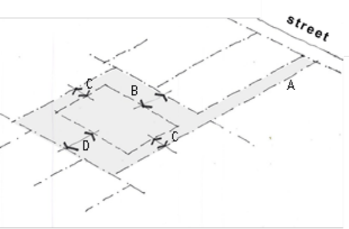
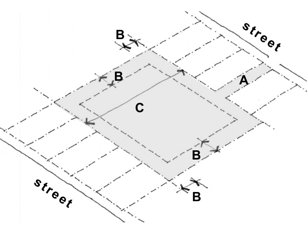

#### B3.9 Additional controls for development on a battle-axe lot

A battle-axe lot is a lot that is connected to a road by an access handle.  It does not have a street frontage, and directly adjoins other properties at all boundaries.

The controls below recognise that development on battle-axe lots needs to particularly consider the amenity of both the occupants and the neighbouring properties, having regard to privacy, solar access, open space and the like.

Note, under Woollahra LEP 2014 the maximum height for development on a battle-axe lot is 9.5m.

> [Picture on page 95: a picture, saved as a picture (images/chapter-b3-general-development-controls-page-95-8.gif, 150 dpi).]

> [Picture on page 95: a picture, saved as a picture (images/chapter-b3-general-development-controls-page-95-9.gif, 150 dpi).]

#### FIGURE 32

Low density residential

development (dwelling

houses and dual

occupancies) A = Access handle B = Primary frontage setback 6m from boundary C = Side setback 1.5m D = Rear setback 6m

#### FIGURE 33

#### B

#### B

#### A

R3 zone and development

(other than a dwelling

house, semi-detached

dwelling or dual occupancy)

must be on a site with a

minimum area of 950m²

#### C

A = Access handle

#### B

B = 6m setback required to

each boundary C = Minimum site

dimension

#### B

| B3.9 Additional controls for development on a battle-axe lot |  |
|---|---|
| Objectives | Controls |
| O1 To ensure that the battle-axe lot is of a C1 For development (other than a dwelling size that can provide for the amenity of house, semi-detached dwelling or dual occupants and neighbouring properties. occupancy) in the R3 Medium Density Residential Zone—the minimum lot size is 950m2. C2 The lot, excluding the access handle, has minimum dimension in any direction, as follows: for a detached dual occupancy—21m for development involving three or more dwellings—24m. Note: The access handle of a battle-axe lot is included in calculating the lot size. |  |
| O2 To ensure adequate building separation to C3 The setback controls in Figure 32 apply to provide for the amenity of occupants and development in the R2 Low Density neighbouring properties. Residential Zone, and any dwelling house or dual occupancy in the R3 Medium Density Residential Zone. Note: The primary frontage is the boundary closest to the access handle leading to the street. C4 For development in the R3 Medium Density Residential Zone (other than a dwelling house or dual occupancy) a 6m setback applies to all boundaries (refer to Figure 33). A reduced setback may be considered where there is no unreasonable impact on the amenity of neighbouring properties having regard to privacy, solar access, sense of enclosure and view sharing. |  |

| B3.9 Additional controls for development on a battle-axe lot |  |
|---|---|
| Objectives | Controls |
| C5 Notwithstanding C3, a setback of 12m applies to: land at 327, 327C, 327D, 337, and 337A, Edgecliff Road (being Lot 4 DP 320118, Lot 1 DP 566991, Lot X DP 101456, Lot C DP 323192, and Lot 12 DP 851270,) and 14, 20, and 22 Roslyndale Avenue (being Lot 101 DP 738428, Lot 6 DP 9477 and Lot 7 DP 9477) along the eastern most boundary that directly adjoins R2 zoned land; and land at 345 Edgecliff Road (Lot E DP 331031) along the southern most boundary that directly adjoins R2 zoned land. Note: The 6m setback applies to all other boundaries. |  |

| B3.9 Additional controls for development on a battle-axe lot |  |
|---|---|
| Objectives | Controls |
| O3 To ensure that development does not C6 Primary living areas, such as a living unreasonably affect neighbouring room, lounge room, kitchen and dining properties in terms of privacy and sense room, are located on the ground floor. of enclosure. Habitable rooms other than bedrooms, on the upper floors will only be considered where there is: no unreasonable impact on the privacy of neighbouring properties; and no overlooking into the private open space areas of neighbouring properties. C7 In the R2 zone, where habitable rooms other than bedrooms are located on the upper floor, the windows to these rooms are setback at least 4.5m from any boundary. C8 Balconies, decks and the like, on the upper floors will only be considered where there is: no unreasonable impact on the privacy of neighbouring properties; and no overlooking into the private open space areas of neighbouring properties. |  |
