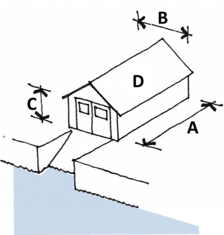

#### B3.10 Additional controls for development in sensitive locations

#### 3.10.1 Development on land adjoining public open space

#### Objectives

#### Controls

O4 To ensure that development does not have an adverse impact on the ecology of adjoining parks, reserves or other public open space areas.

C6 A gate or the like, providing direct access from a private property to the public park or reserve opens inward toward the private property and does not encroach on public land.

O5 To ensure that development adjoining open space provides for a continuation and support of native vegetation and habitat areas.

O6 To ensure that development does not impact on the environmental processes of the public land, such as soil erosion, siltation, and the like.

C7 For new plantings, 90% of the plants in the landscape design are native species. However, where the land adjoins bushland to which Chapter 2 (Vegetation in Non-Rural Areas), of the State Environmental Planning Policy (Biodiversity and Conservation) 2021 applies, 100% of the plants are locally occurring native species.

C8 Landscaping provides a diversity of native species and a complexity of habitat through vertical layering. Note: Refer to the DA Guide for suggested vegetation species.

#### Harbour foreshore development

Sydney Harbour is an outstanding natural and public asset of national significance with unique environmental qualities that are world renowned. Woollahra Council has a shared responsibility with the State government and other councils with harbour foreshore land to ensure its protection for existing and future generations.

Chapter 6 Water Catchment of the State Environmental Planning Policy (Biodiversity and Conservation) 2021 (Biodiversity and Conservation SEPP) provides clear planning framework and better environmental outcomes for Sydney Harbour. The Biodiversity and Conservation SEPP applies not only to the waterways and foreshores of the harbour, but to the wider hydrological catchment.

The provisions in this part of the DCP supplement the Biodiversity and Conservation SEPP, and particularly address scenic and environmental protection issues.  These DCP provisions apply to: land that has a boundary to the Sydney Harbour foreshore; land adjoining the Sydney Harbour foreshore which is zoned C1 National Parks and Nature Reserves or RE1 Public Recreation; and any land visible from Sydney Harbour.

#### Scenic protection

The appearance of development when viewed from Sydney Harbour is an important consideration for development.

Scenic protection is not just relevant to land immediately adjacent to the foreshore, but applies to development on any land that is visible from Sydney Harbour.  This is because building form, scale, materials and vegetation cover of development located along the slopes and ridgelines visible from the harbour are also important in contributing to, and protecting, the harbour's scenic qualities.

#### Ecological communities and protection of the natural foreshore

The harbour foreshore supports a vast array of flora and fauna communities.  It is important to minimise the impact of development to preserve natural ecosystems and protect the natural foreshore character.

#### FIGURE 34

Design considerations for boat sheds A  = Maximum length 5m B  = Maximum width 3.7m C  = Maximum wall height 2.5m D = Minimum roof pitch 30°

| B3.10 Additional controls for development in sensitive locations 3.10.2 Harbour foreshore development |  |
|---|---|
| Objectives | Controls |
| O1 To protect the scenic quality of the C1 Development as viewed from Sydney Harbour natural landscape and built follows the natural topography and maintains environment, particularly as viewed or enhances vegetation cover. from Sydney Harbour. C2 Roofs are below the tree canopy and maintain the prominence of the treed skyline. C3 Development as viewed from Sydney Harbour, is designed and constructed to blend with the natural landscape setting and the existing built environment through the use of materials, colours, wall articulation, building form and landscaping. Glass elevations and excessive use of windows resulting in reflectivity and glare are avoided. C4 Pergolas, boatsheds, other outbuildings and structures are designed and constructed to complement the overall appearance of the development. Such structures are no more than one storey in height. C5 Swimming pools and spa pools are not elevated more than 1.2m above ground level and complement the character of the harbour and foreshore. C6 Swimming pool and spa pool walls are suitably treated to complement the natural foreshore, |  |

> [Picture on page 102: a picture, saved as a picture (images/chapter-b3-general-development-controls-page-102-8.gif, 150 dpi).]

| B3.10 Additional controls for development in sensitive locations 3.10.2 Harbour foreshore development |  |
|---|---|
| Objectives | Controls |
| and where visible, are sandstone clad and incorporate suitable screen landscaping. C7 The boatshed is designed to directly relate to the water, with openings and access facing the water. C8 Boatsheds are used solely for the storage and/or maintenance of boats. C9 Boatsheds have maximum plan dimension of 6m x 3.7m. Boatsheds are sited so that the minimum dimension fronts the harbour (refer to Figure 34). C10 Boatsheds incorporate gable pitched roofs with a minimum pitch of 30°. The use of roofs as sundecks, patios or the like is not permitted (refer to Figure 34). C11 Boatsheds are single storey and have a maximum wall height of 2.5m (refer to Figure 34). C12 Boatsheds are constructed of stone or timber. Excessive use of glazing is avoided. C13 Jetties are constructed of hardwood, are of minimum size and are designed to be as unobtrusive as possible. The sharing of jetties between properties is encouraged and, where possible, jetties are constructed on common boundaries to limit the proliferation of structures along the foreshore. |  |

| B3.10 Additional controls for development in sensitive locations 3.10.2 Harbour foreshore development |  |
|---|---|
| Objectives | Controls |
| O2 To minimise impacts on natural coastal processes, including sea level rises and flooding. | C14 Boundary fences are not permitted within 8m of the mean high water mark. C15 Within the foreshore area: fences are not more than 1.5m in height above the existing ground level, and are constructed of open weave materials (such as wire or lattice to enable vines, creepers or hedges) to provide natural cover; boundary planting is not higher than 1.5m when fully mature; and hard surfaces and artificial surfaces, such as paving, are minimised and generally limited to swimming pool surrounds or modest walkways between the residential building and foreshore structures, such as swimming pools or boat ramps. Note: Foreshore area means the land in foreshore area 12 and 30 in Woollahra LEP 2014. |
| O3 To protect natural habitats and minimise disturbance on ecological communities. | C16 Development on foreshore properties maintains or reduces current levels of site stormwater or sediment run-off entering the harbour. C17 Development is not located within seagrass communities and avoids shading of seagrass communities. C18 Development and construction does not disturb seabed contaminants. C19 The existing tree canopy is maintained or enhanced. |

| B3.10 Additional controls for development in sensitive locations 3.10.2 Harbour foreshore development |  |
|---|---|
| Objectives | Controls |
| O4 To reinforce the natural character of the foreshore and limit disturbance to the natural land and water interface. | C20 Development on foreshore properties does not significantly alter the topography and preserves natural foreshore features including cliffs, rock outcrops, rock shelfs and beaches. C21 Seawalls or retaining walls are not permitted in areas where the foreshore is in its natural state. C22 Where seawalls or retaining walls are permitted, these are: constructed of coarse, rock-faced stone or with stone facing (preferably sandstone); no more than 1m above the mean high water mark; and be designed and built to improve the environmental value of seawalls and seawall-lined foreshores (refer to Environmentally Friendly Seawalls: A Guide to Improving the Environmental Value of Seawalls and Seawall-lined Foreshores in Estuaries, published by the Department of Environment and Climate Change NSW on behalf of Sydney Metropolitan Catchment Management Authority). C23 Slipways and stairs are designed and constructed to closely conform to the character of the natural foreshore. |
