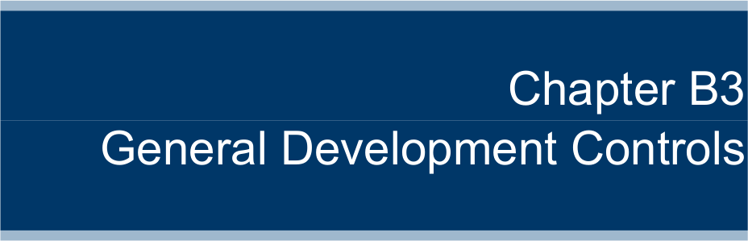

# Woollahra Development Control Plan 2015 - Chapter B3 General Development Controls

> This chapter is split into 20 section file(s), one per numbered heading, in the order they appear in the PDF.

Source PDF: [chapter-b3-general-development.pdf](chapter-b3-general-development.pdf)

> [Picture on page 1: a picture, saved as a picture (images/chapter-b3-general-development-controls-page-1-1.gif, 150 dpi).]

### Chapter B3

### General Development Controls

### Part B  General Residential

### CHAPTER B3 APPROVED ON 10 APRIL 2017 AND COMMENCED ON 19 APRIL 2017

### Last amended on 2 December 2024

<!-- sections -->
## Sections

1. [B3 General Development Controls](01-b3-general-development-controls.md)
2. [B3.1 Introduction](02-b3-1-introduction.md)
3. [11 Neighbourhood HCAs](03-11-neighbourhood-hcas.md)
4. [B3.2 Building envelope](04-b3-2-building-envelope.md)
5. [B3.3 Floorplate](05-b3-3-floorplate.md)
6. [B3.3 Floorplates Objectives](06-b3-3-floorplates-objectives.md)
7. [B3.4 Excavation](07-b3-4-excavation.md)
8. [B3.4 Excavation Objectives](08-b3-4-excavation-objectives.md)
9. [B3.5 Built form and context](09-b3-5-built-form-and-context.md)
10. [B3.6 On-site parking](10-b3-6-on-site-parking.md)
11. [B3.6 On-site parking Objectives](11-b3-6-on-site-parking-objectives.md)
12. [B3.7 External areas](12-b3-7-external-areas.md)
13. [B3.8 Additional controls for development other than dwelling houses](13-b3-8-additional-controls-for-development.md)
14. [3.8.3 Semi-detached dwellings](14-3-8-3-semi-detached-dwellings.md)
15. [3.8.3 Semi-detached dwellings](15-3-8-3-semi-detached-dwellings.md)
16. [B3.8 Additional controls for development other than dwelling houses](16-b3-8-additional-controls-for-development.md)
17. [3.8.8 Post-1950s residential towers](17-3-8-8-post-1950s-residential-towers.md)
18. [B3.9 Additional controls for development on a battle-axe lot](18-b3-9-additional-controls-for-development-on-a.md)
19. [B3.10 Additional controls for development in sensitive locations](19-b3-10-additional-controls-for-development-in.md)
20. [3.10.1 Development on land adjoining public open space](20-3-10-1-development-on-land-adjoining-public.md)
