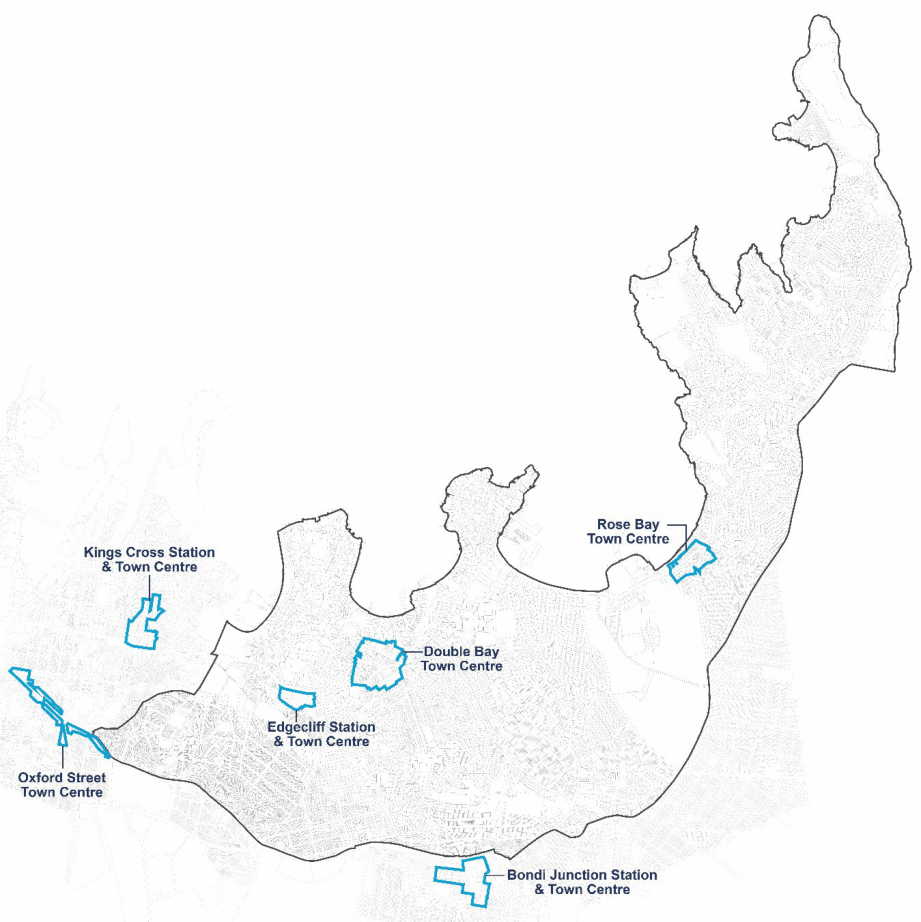

#### B4.1 Introduction

#### B4.1.1 Background

This chapter of the Woollahra DCP 2015 addresses housing in accessible areas. This comprises dual occupancies, multi-dwelling housing, multi-dwelling housing (terraces) and residential flat buildings, within 800m walking distance of specified town centres.

This chapter expands upon the existing Woollahra DCP 2015 provisions for residential development and heritage conservation areas. It establishes specific objectives and controls to housing in accessible areas having regard to the site and its context, and includes provisions for streetscape presentation, building design, heritage conservation, amenity, dwelling mix, and car parking.

#### B4.1.2 Land where this chapter applies

For the purposes of this chapter, ‘accessible areas’ refer to land located within close proximity to a railway station, or town centre. This definition applies to land within 800m walking distance of specified town centres zoned E1 Local Centre, E2 Commercial Centre or MU1 Mixed Use, identified in Figure 1 below. These are:

a. Edgecliff Station and Town Centre;

b. Double Bay Town Centre;

c. Darlinghurst and Paddington Town Centre (Oxford Street Town Centre);

d. Bondi Junction Station and Town Centre;

e. Rose Bay Town Centre (New South Head Road); and

f. Kings Cross Station and Town Centre.

This chapter only applies to land zoned R2 Low Density Residential or R3 Medium Density Residential.

Note: The policy does not apply to land that is a heritage item or on which a heritage item is located.

> [Picture on page 5: a picture, saved as a picture (images/chapter-b4-housing-in-accessible-areas-page-5-1.gif, 150 dpi).]

#### FIGURE 1  Town Centres

#### B4.1.3 Development to which this chapter applies

This chapter applies to dual occupancies, multi-dwelling housing, multi-dwelling housing (terraces), residential flat buildings, and shop top housing within 800m walking distance of specified town centres.

Note: The objectives and controls for residential flat buildings contained within this part of the DCP support the design quality principles of State Environmental Planning Policy (Housing) 2021 (the Housing SEPP) and the Apartment Design Guide (ADG).

For development where the ADG under the Housing SEPP applies and where there are provisions in the Woollahra DCP 2015 that are in conflict with the matters specified in Clause 149 of the Housing SEPP, the ADG prevails.

#### B4.1.4 Objectives

The objectives of this chapter:

O1 To ensure that the scale, bulk and design of new housing in accessible areas has regard to nearby development.

O2 To ensure housing in accessible areas does not unreasonably compromise the amenity of nearby residential uses and public open space.

O3 To ensure housing in accessible areas sensitively responds to the significant values of places with heritage significance.

O4 To ensure housing in accessible areas provides a diversity of dwelling sizes.

O5 To ensure housing in accessible areas minimises traffic and parking impacts.

#### B4.1.5 Relationship to other parts of the DCP

This chapter is to be read in conjunction with other relevant parts of the DCP, including:

Part B: Chapter B3 General Development Controls; and

Part E: General Controls for All Development – this part contains chapters on Parking and Access, Stormwater and Flood Risk Management, Tree Management, Contaminated Land, Waste Management, Sustainability, Signage and Adaptable Housing.

In the event of any inconsistency between this chapter and the other chapters, this chapter prevails, with the exception of Chapter G8- 252-254 New South Head Road, Double Bay and Chapter G9 – 488-492 Old South Head Road and 30 Albemarle Avenue, Rose Bay.
