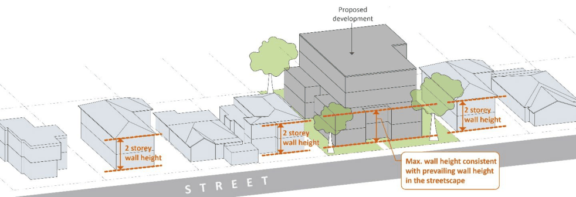
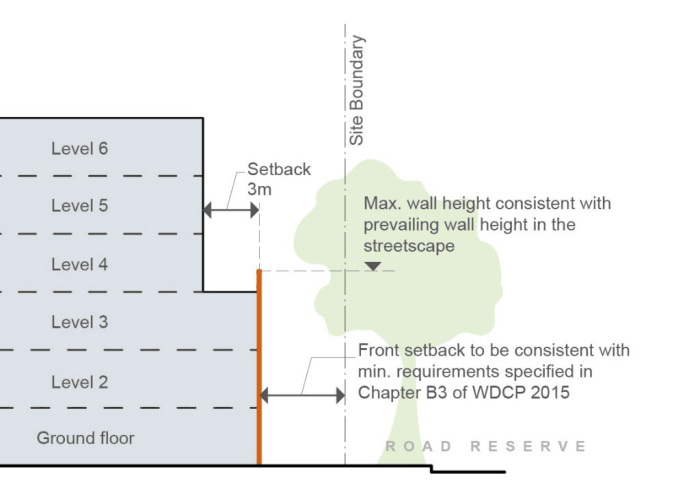

#### B4.2 Development Controls

#### B4.2.1 Built form and articulation

#### Objectives

O1 Provide a strong streetscape definition through street walls and upper-level setbacks, that allows direct sunlight to streets and reduces the apparent scale of taller buildings.

O2 To support the residential amenity of both new development and neighbouring properties by ensuring visual and acoustic privacy, natural ventilation, reasonable access to views, sunlight and daylight access, and outlook.

O3 To provide sufficiently sized areas for communal open spaces, deep soil zones and landscaping at the rear of buildings.

O4 Ensure development in heritage conservation areas relates to the existing neighbourhood character in terms of street wall height and subdivision patterns.

O5 To provide well-articulated built form that reduces the visual bulk and scale of buildings and positively contributes to the streetscape.

O6 To minimise visual intrusion from new development.

#### Controls

C1 For new development, the maximum wall height at the street elevation is to be:

a) For sites in heritage conservation areas – 7.2m above the existing ground level or consistent with the streetscape, whichever is lesser.

b) For all other areas - prevailing wall height in the streetscape (Refer to Figure 2).

“Wall height” means the greatest distance measured vertically from the topmost point on an external wall of a building, other than a gable wall or the wall of a dormer window, to the existing ground level immediately below that point.

“Prevailing wall height” refers to the wall height in storeys of adjoining and nearby buildings. A minimum of three lots either side of the subject site and six lots directly across the street must be utilised to determine the prevailing wall height.

C2 Development above the wall height along the street frontage should be setback by a minimum of 3m (Refer to Figure 3).

C3 The requirements in C1 and C2 may be varied for additional storeys to existing residential flat buildings in a heritage conservation area, where the new development should generally replicate the footprint of existing storeys, with the existing roof form replicated atop the new storeys.

C4 Side setbacks for residential flat buildings should be provided in accordance with the building separation requirements in Chapter 4 of the Housing SEPP and the ADG:

Up to four storeys (approximately 12m):

• 12m between habitable rooms/balconies

• 9m between habitable and non-habitable rooms

• 6m between non-habitable rooms

Five to eight storeys (approximately 25m):

• 18m between habitable rooms/balconies

• 12m between habitable and non-habitable rooms

• 9m between non-habitable rooms

When applying separation to buildings on adjoining sites, apply half the minimum separation distance measured to the boundary. This distributes the building separation equally between sites.

C5 The minimum rear setback control is 25% of the average of the two side boundary dimensions, measured perpendicular to the rear boundary.

Note: The building (including decks, balconies, entry porches, verandahs, porte-cocheres, undercrofts and the like) must not be located within the rear setback.

C6 Variations to the setback requirements in C4 and C5 may be permitted in a heritage conservation area, subject to sufficient justification against the objectives of this section.

C7 Buildings must have a maximum unarticulated width of 6m to the street frontage and a maximum unarticulated wall length of 12m to side elevations.

C8 New development must be designed to display horizontal and vertical articulation through the use of:

• significant recesses or projections.

• deep balconies.

• elements of a finer scale than the main structural framing including the eaves and overhangs.

• vertical elements such as blade walls or fins.

> [Picture on page 8: a picture, saved as a picture (images/chapter-b4-housing-in-accessible-areas-page-8-27.gif, 150 dpi).]

#### Figure 2 Maximum wall height requirements

> [Picture on page 9: a picture, saved as a picture (images/chapter-b4-housing-in-accessible-areas-page-9-1.gif, 150 dpi).]

#### Figure 3 Upper-level setback requirements

#### B4.2.2 Environmental impacts

#### Objectives

O1 To minimise overshadowing of parks and the public domain.

O2 To ensure the siting and design of a building provides a high level of visual and acoustic privacy for residents and neighbours in dwellings and private open space.

#### Controls

C1 New development must not cause any additional overshadowing to public parks and reserves, including beaches and harbour foreshore areas, between the hours of 10am and 2pm on 21 June.

C2 The trafficable area of a roof terrace is setback so that there is no direct line of sight, from that part of the building where the terrace or deck is, to:

a) neighbouring private open space within 12m; or

b) windows of habitable rooms in neighbouring dwellings within 12m.

#### B4.2.3 Heritage conservation

#### Objectives

O1 To ensure that sites, buildings and landscape features that contribute to the significance of a heritage conservation area are retained.

O2 To ensure that alterations and additions are sympathetic to the original building and the predominant streetscape character contributing to the heritage conservation area’s significance.

O3 To ensure that development does not have a negative impact on the significance of nearby heritage items.

#### Controls

C1 New built form should be modulated, through changes in height and/or use of setbacks, to provide a sympathetic transition to nearby heritage items or contributory buildings in a heritage conservation area.

C2 Additions and alterations to a contributory building in a heritage conservation area must be designed to respect the original architectural qualities of the building such as principal building form, façade articulation, fenestration pattern, parapet profile and detail, materials and colours.

C3 Additions and alterations to a building in a heritage conservation area must be sympathetic to the prevailing architectural character of the streetscape, including in form, materials, colours and fenestration.

Note: Sympathetic development does not require new development to be designed as a copy or replica of other buildings in the area, but rather draw inspiration from and complement the character of the heritage conservation area.

C4 In heritage conservation areas, where a finer grain built form arising from the existing subdivision pattern is present and lot consolidation is proposed, these elements are to be interpreted in the architectural treatment of the facades, e.g. through building layout, composition, modulation and vertical articulation.

C5 Retention of only the facades of contributory buildings located in a heritage conservation area is not acceptable.

C6 Demolition of contributory buildings, structures and landscape features (including significant trees) is not supported. Demolition will only be considered where it can be satisfactorily demonstrated that:

a) the structural integrity of the building has been assessed by an appropriately qualified

and experienced structural engineer, and

b) the retention and stabilisation of the building or structure is unfeasible and/or

unreasonable; and

c) all alternatives to demolition have been considered with reasons provided why the

alternatives are not acceptable, noting that poor condition due to a lack of maintenance and neglect does not itself amount to structural deficiency; and

d) the replacement building is compatible with the identified significance and character

of the streetscape and the heritage conservation area as a whole.

In its determination of an application to demolish a contributory building in a heritage conservation area, Council will give consideration to any relevant Planning Principles established by the Land and Environment Court.

C7   Additional storeys to a contributory building in a heritage conservation area should be discernible as new work. New design elements, including materials, must be distinct from but sympathetic to the original fabric.

#### B4.2.4 Apartment mix

#### Objectives

O1 To encourage a range of dwelling sizes within housing in accessible areas.

O2 To provide a mix of dwellings to cater for the needs of the existing and future resident population, and to encourage a diverse population.

#### Controls

C1 Development for the purposes of residential flat building with six or more dwellings are to achieve the apartment mix outlined in Table 1.

Table 1 Apartment mix

| Apartment type | Maximum |
|---|---|
| Studio apartment | 20% |
| 1 bedroom | 30% |
| 2 bedrooms | 50% |
| 3 or more bedrooms | 20% |

#### B4.2.5 Car parking

#### Objectives

O1 To minimise resident and visitor parking in locations that are identified as having good accessibility to public transport.

O2 To minimise vehicular traffic generated by development

O3 To provide a rate of parking that encourages the use of public transport.

O4 To reduce the reliance on private vehicles and the corresponding traffic impact on the road network

O5 To manage transport demand in a sustainable manner.

O6 To minimise risks and impacts relating to excavation, subterranean buildings and dewatering works

#### Controls

C1 On-site car parking in heritage conservation areas may only be permitted or required when the specified controls in Part C, chapters C1 (Paddington Heritage Conservation Area) and

C2 (Woollahra Heritage Conservation Area), and Part B, chapter B2 (Neighbourhood Heritage Conservation Areas) are satisfactorily met.

C2 For the avoidance of doubt, the provision of car parking and parking structures are not required. If the applicant elects to provide car parking, Table 2 below sets out the maximum number of spaces that can be included in the development.

Table 2 Residential uses maximum car parking spaces for land within 800m walking distance of Edgecliff Station and Town Centre, Double Bay Town Centre, Oxford Street Town Centre, Kings Cross Station and Town Centre, Bondi Junction Station and Town Centre, and Rose Bay Town Centre (New South Head Road).

| Land use | Maximum parking spaces |  |
|---|---|---|
| Multi-dwelling housing, multi-dwelling housing (terraces) and residential flat buildings |  |  |
| Number of bedrooms per dwelling | Within 400m | Between 400m to 800m |
| Studio apartment 0.2 space 0.3 space |  |  |
| 1 bedroom 0.4 space 0.6 space |  |  |
| 2 bedrooms 0.6 space 0.9 space |  |  |
| 3 or more bedrooms 1 space 1.2 spaces |  |  |
| Visitors 0.1 space 0.15 space |  |  |

C3 If private use car parking is provided under C2, a minimum of one on-site car share space per 20 dwellings is to be provided for any residential development.

In calculating the total number of car parking spaces required for a development, the total should never be rounded up, even if the fraction of the total calculation is equal or more than half (0.5 of a space).

Development subject to this chapter and located within 800m of the following town centres will not be eligible to apply to Council’s Resident Parking Permit Scheme:

a. Edgecliff Station and Town Centre;

b. Double Bay Town Centre;

c. Oxford Street Town Centre;

d. Bondi Junction Station and Town Centre;

e. Rose Bay Town Centre (New South Head Road); and

f. Kings Cross Station and Town Centre.
