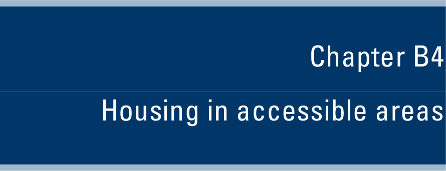

# Woollahra Development Control Plan 2015 - Chapter B4 Housing in accessible areas

> This chapter is split into 3 section file(s), one per numbered heading, in the order they appear in the PDF.

Source PDF: [chapter-b4-housing-in-accessible-areas_2.pdf](chapter-b4-housing-in-accessible-areas_2.pdf)

> [Picture on page 1: a picture, saved as a picture (images/chapter-b4-housing-in-accessible-areas-page-1-1.gif, 150 dpi).]

### Chapter B4

### Housing in accessible areas

### Part B  General Residential

### CHAPTER B4 APPROVED ON 23 FEBRUARY 2026 AND COMMENCED ON 24 FEBRUARY 2026

<!-- sections -->
## Sections

1. [B4 Housing in accessible areas](01-b4-housing-in-accessible-areas.md)
2. [B4.1 Introduction](02-b4-1-introduction.md)
3. [B4.2 Development Controls](03-b4-2-development-controls.md)
