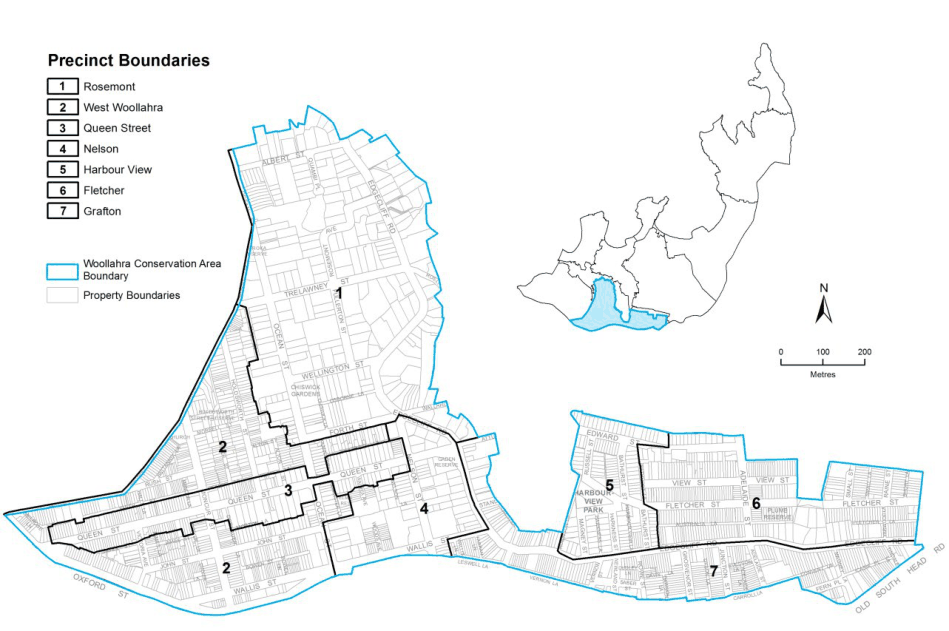
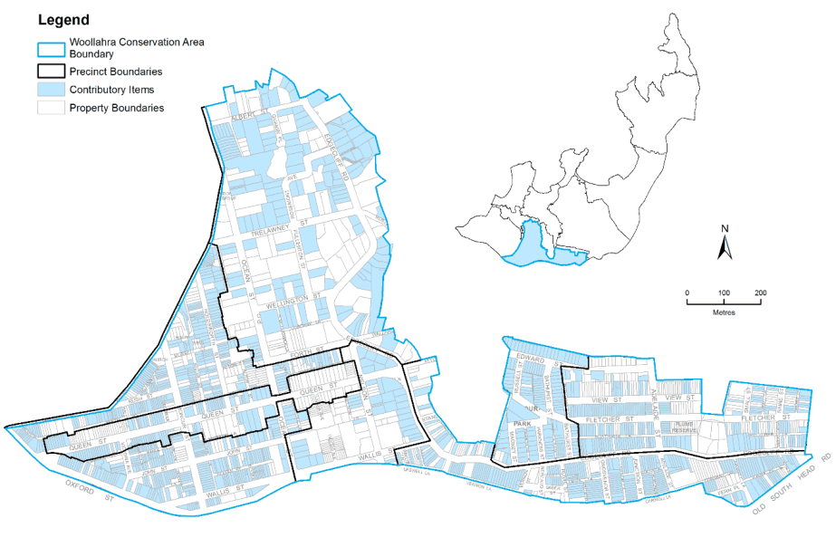

#### C2.1 Introduction

#### C2.1.1 Background

The Woollahra Heritage Conservation Area (Woollahra HCA) is a place of outstanding local heritage significance. The special character of the Woollahra HCA derives from its unique historic background and the expression of this background in its interrelationship of buildings, their settings, landscaping and open spaces, topography and land uses.

The significance of the Woollahra HCA derives not just from the heritage items listed in Woollahra Local Environmental Plan 2014 (Woollahra LEP 2014) but also from its large collection of contributory items and elements. Contributory items are listed in Section C2.7 and shown in Map 2.

#### C2.1.2  Land to which this chapter applies

This chapter applies to the Woollahra Heritage Conservation Area, which is shown in Map 1. MAP 1  Land to which this chapter applies

> [Picture on page 5: a picture, saved as a picture (images/chapter-c2-woollahra-heritage-conservation-area-page-5-14.gif, 150 dpi).]

MAP 2  Contributory items

> [Picture on page 6: a picture, saved as a picture (images/chapter-c2-woollahra-heritage-conservation-area-page-6-2.gif, 150 dpi).]

#### C2.1.3 Development to which this chapter applies

This chapter applies to development that requires development consent under Woollahra LEP 2014.

#### C2.1.4 Objectives

The objectives are:

O1 To facilitate the implementation of the objectives and provisions relating to heritage conservation contained in Woollahra LEP 2014.

O2 To acknowledge and conserve the heritage significance of the Woollahra HCA, including the character of individual precincts.

O3 To encourage the retention and conservation of contributory items.

O4 To encourage appropriate development of contributory items.

O5 To provide controls to protect the identified heritage values and significant character of the Woollahra HCA.

O6 To encourage contemporary design that responds appropriately to that character of the Woollahra HCA.

O7 To enable appropriate and expert consideration of proposed development to be made by applicants and the Council.

O8 To encourage and promote public awareness, appreciation and knowledge of heritage conservation.

O9 To enhance amenity and heritage values within the Woollahra HCA.

#### C2.1.5 Relationship to other parts of the DCP

This chapter is to be read in conjunction with the other parts of the DCP that are relevant to the development proposal, including: Part B: Chapter B3 General Development Controls, but only if the proposal is for a dual occupancy development (refer to Section B3.8 Additional controls for development other than dwelling houses). Part E: General Controls for All Development – this part contains chapters on Parking and Access, Stormwater and Flood Risk Management, Tree Management, Contaminated Land, Waste Management, Sustainability, Signage and Adaptable Housing. Part F: Land Use Specific Controls – this part contains chapters on Child Care Centres, Educational Establishments, Licensed Premises and Telecommunications.

#### C2.1.6 Definitions

The definitions below define words and expressions for the purpose of this chapter. These definitions apply in addition to the definitions in Part A Chapter A3 of the DCP, the EP&A Act and Woollahra LEP  2014.

ancillary development

a building or structure, other than a dwelling house, dual occupancy, semi-detached dwelling, mixed development, attached housing, multi-dwelling housing, residential flat building or other housing type, but including sheds, pool houses, detached garages, gazebos, separate laundries, pagodas, swimming pools and pergolas.

breezeway

an unenclosed passage or void between the side boundary and rear wing.

gable ended roof for the purpose of Section 2.5.8 Parking and garages, is a roof with a

gable end facing the street or lane. the original front building section and main roof, which contains the main rooms (see diagram).

principal building form

transverse gable roof for the purpose of Section 2.5.8 Parking and garages, is a roof with

gable ends, where the ridge is parallel to the rear boundary.

#### C2.1.7 How to use this chapter

#### Steps to be considered for all development

#### Step 1  Understanding the context

Read Section C2.2 including the significance and desired future character of the Woollahra HCA. Identify the precinct where the subject site is located (refer to Map 1). Read about the precinct characteristics in Section C2.3 Precincts.

#### Step 2 Understanding your site

Identify whether the building or site is a heritage item as identified in Woollahra LEP 2014. Identify whether the building or site is a contributory item (refer to Map 2 and Section C2.7 Schedule of contributory items). Consider the history and relationship of the site and surrounding sites, having particular regard to contributory items in the street.

#### Step 3 Addressing the objectives and controls

Each section must be read and the relevant objectives and controls applied: Section C2.3 Precincts: Identifies the significant characteristics and objectives for each of the precincts, also contains precinct specific controls for Queen, Nelson and Fletcher Streets. Section C2.4 Building type controls: There are 12 building types, each with specific objectives and controls. Section C2.5 General controls for all development: Applies to all development including contributory items. Section C2.6 Public domain: Applies to land owned and/or managed by Council or other public authorities.
