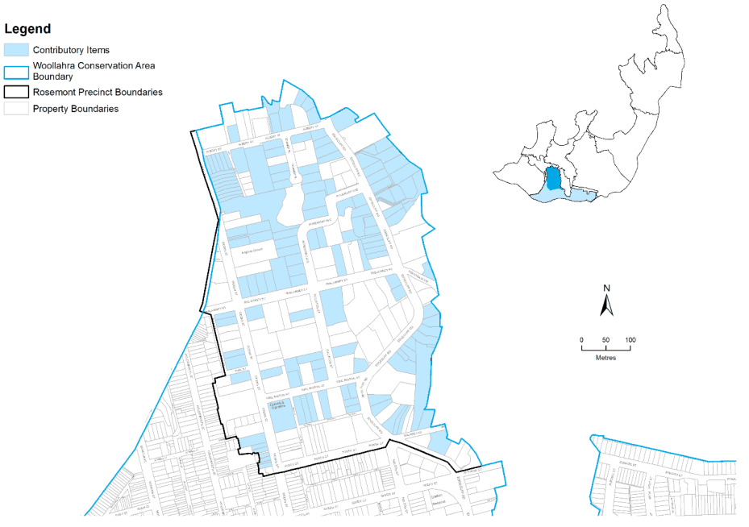
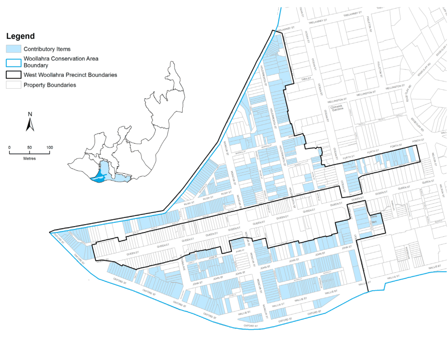
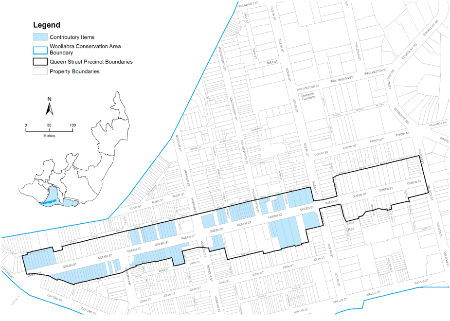
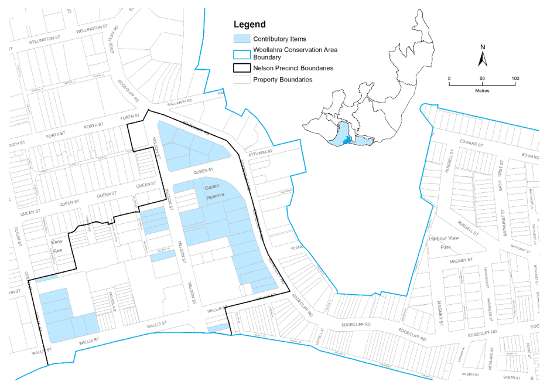
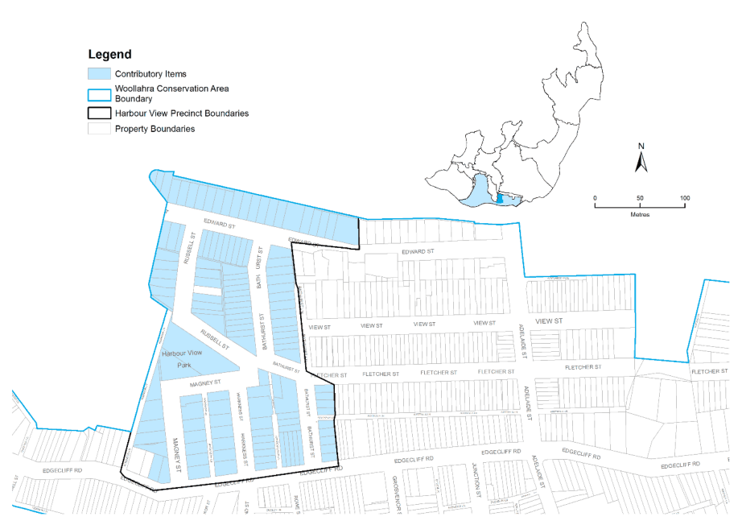
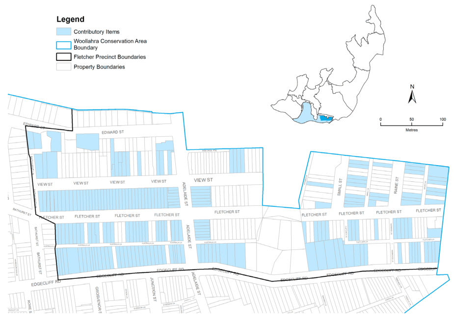
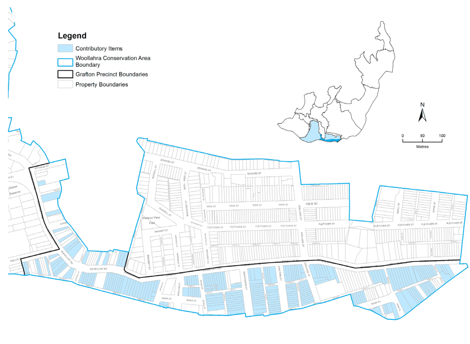

#### C2.3 Precincts

This section identifies the significant characteristics and objectives for each of the precincts. Controls for the precincts of Queen Street, Nelson and Fletcher are also provided. These controls take precedence over the general controls for development in Section C2.5.

The Woollahra HCA is divided into seven precincts reflecting the varied development patterns that resulted from the large and unusual leasehold landholding of the area known as the Point Piper Estate.  The identified precincts have different settlement patterns that demonstrate the distinguishing character elements that contribute to the overall significance of the Woollahra HCA.

The mid Victorian development of the West Woollahra precinct attracted working class people whilst the affluent owners built large residences in extensive grounds with harbour views in the Rosemont precinct. The areas between the Queen Street and Nelson precincts developed as a diverse mix of residences and shops as the gaps closed. The suburban boom of the 1880s in Woollahra continued the slow development trend with piecemeal development by local builders in the east, the Grafton and Fletcher precincts. Only the Harbour View precinct, the rapid work of a single builder, demonstrates an individual housing style.

The significant natural and built character elements to be retained for each of the precincts are detailed in this section.

#### C2.3.1 Rosemont Precinct

MAP 3  Rosemont Precinct – contributory items

> [Picture on page 17: a picture, saved as a picture (images/chapter-c2-woollahra-heritage-conservation-area-page-17-3.gif, 150 dpi).]

#### Significant characteristics

A subdivision pattern developed from former estates made up by large, sometimes irregularly shaped, lots that respond to the hilly topography and Edgecliff Road. Remnant substantial houses orientated towards the harbour views. Landscape features of the large early estates such as ‘Rosemont’ in Rosemont Avenue, the terraces and sandstone retaining walls from ‘Eynesbury’ in Albert Street, the Kauri Pine from the grounds of ‘Quiraing’ at 2 Trelawney Street and the later subdivision of Quambi and ‘Hillside’. Streetscapes of mature street trees, including the avenue of plane trees on Rosemont Avenue and the figs and plane trees on Edgecliff Road and Ocean Street. Substantial sandstone retaining walls respond to the steep topography. The combination of substantial Victorian houses within landscaped ground, located beside large Victorian or Federation terraces or semi-detached houses and Inter-War period houses and residential flat buildings.  Gardens often contain mature trees such as pines, planes and

figs. Front fences and gates are designed in association with, and to complement, the buildings behind.

The variety of its residential architecture, which includes: − detached and semi-detached Victorian houses with external masonry walls of unpainted sandstone or painted stucco, often with decorative painted cement render mouldings. Roofs are steeply pitched and were generally originally clad in slate. Windows are vertically proportioned painted timber double-hung sashes. Porches or verandahs often had cast iron filigree detailing; − detached and semi-detached Federation houses usually in the Queen Anne style. Walls were originally unpainted brickwork. Open verandahs have turned and fretted timber

work. Roofs are steeply pitched with tall chimneys and clad with slate or Marseilles pattern terracotta roof tiles. Windows are casements or double hung sashes with multi-paned tops lights; − Inter-War houses in an eclectic variety of styles typical of the period, including Spanish Mission, Mediterranean, Georgian Revival and Old English, usually with painted stucco walls and Roman, Spanish or Marseilles pattern tiles. The houses sometimes combine detailing from a number of these styles; and − Inter-War flat buildings usually in face brick with terracotta tiled roofs. The styles of the flat buildings often demonstrate the influence of the Inter-War domestic styles for detached houses. Skyscraper Gothic styled apartments are also present. Garages and carports that are generally located within the property at some distance from the front boundary or accessible from a side street. Substantial Victorian and Federation institutional and public buildings including the former Woollahra Council Chambers [Goethe Institute], Woollahra Public School and  Fire Station, All Saints Anglican Church, St Columba Uniting Church, Little Sisters Convent and Wolper Hospital. Chiswick Gardens, a municipal garden established in 1938.

#### Objectives

O1 To conserve the curtilages of the former estates and their landscaped garden settings, including outbuildings and fences.

O2 To conserve the institutional public buildings and mature street trees.

O3 To encourage contemporary infill development to respond appropriately to the Victorian, Federation and Inter-War housing which dominate the precinct.

O4 To encourage alterations and additions to existing buildings which retain and enhance the character of the building and the streetscape.

#### C2.3.2 West Woollahra Precinct

MAP 4  West Woollahra Precinct – contributory items

> [Picture on page 19: a picture, saved as a picture (images/chapter-c2-woollahra-heritage-conservation-area-page-19-3.gif, 150 dpi).]

#### Significant characteristics

Its subdivision grid pattern of primary streets with secondary service lanes dating from the 1850s. The grids are generally rectangular, but are angled at their junctions with Jersey Road and Oxford Street. The retention of most of its original consistently narrow lots which run perpendicular to street frontages. A strong pedestrian character reflected in the narrow streets and interconnecting lanes. A varied scale of consistently Victorian character generated by its mix of small to medium-sized Victorian houses and different building types, some of which have new uses as shops: − individual single storey houses that are detached, attached or in small single storey terrace groups. Some of these are very narrow with no setback from the street, while others have front verandahs and gardens;

− variously sized groups of two and three storey semi-detached and terrace houses. Generally, these houses are built with front verandahs and small front gardens, but some smaller examples are built to the front boundary with a cast iron palisade fence to the verandah at the boundary; − the sandstone and brick villa houses set back from the street boundary at the western end of Jersey Road. These are the largest single houses in the precinct and are surrounded by mature gardens, some with significant trees; and − shallow lots with small houses facing rear lanes such as Bowden Street and James Street, which are the smallest in the area. These cottages are often of stone or painted timber construction and are rare within the Woollahra HCA. A restricted palette of building materials and forms, typically: − external walls of painted stucco, sandstone or face brick. Many of the face brick houses in the precinct are the result of the inappropriate removal of an original painted stucco finish. The several painted timber-clad cottages are now rare in the conservation area; and − steeply pitched roofs which were originally clad in slate, corrugated iron or possibly timber shingles. Some terrace houses and cottages were designed with attic spaces and dormer windows. Its front fences, typically cast iron palisade fences set on sandstone or rendered brick bases. Some houses, depending on their style, size or age, have timber picket fences or sandstone boundary walls. Original front fences usually allowed views through to the house, but many have been replaced by high masonry walls which have a negative impact on the streetscape. Its street tree plantings, particularly the plane trees in Victoria Avenue, Wallis Street, Ocean Street and the western end of John Street. Culturally significant landscape elements located at the rear lanes, including paling fencing, pedestrian gates, Victorian brick toilets and backyard plantings. Garages and carports located in rear lanes rather than along street frontages. The few garages facing primary streets are generally intrusive. Its mid Victorian corner shops, many now converted to residences, and the small retail precincts in Ocean and Moncur Streets and late Victorian hotels. Remnant light industrial buildings converted for retail use (though some, such as the garage workshops in Oxford Street, remain). A former Inter-War garage in Wallis Street is a rare example in the Woollahra HCA of a garage with residential flats above. The significant church in Jersey Road now converted to housing. A synagogue in Oxford Street.

#### Objectives

O1 To ensure the conservation of the culturally significant landscape elements and street tree plantings.

O2 To conserve the strong pedestrian character of the precinct as reflected in the narrow streets and inter-connecting lanes.

O3 To encourage rear lane access for parking.

O4 To encourage new development, including infill to complement the predominantly Victorian character of the precinct.

O5 To ensure the preservation of original front fences.

O6     To retain and conserve contributory items.

#### C2.3.3 Queen Street Precinct

MAP 5  Queen Street Precinct – contributory items

> [Picture on page 22: a picture, saved as a picture (images/chapter-c2-woollahra-heritage-conservation-area-page-22-3.gif, 150 dpi).]

#### Significant characteristics

"An informal ‘town centre’ focused around the intersection of Moncur and Queen Street which contains the Woollahra Hotel and former Woollahra Post Office." A cohesive main street character that is a combination of significant retail and residential buildings. These buildings generally retain their original features and are from various historic periods, but predominantly Victorian and Edwardian, with some Inter-War buildings. Its significant retail buildings including: − groups of shops, sometimes in pairs, forming continuous but diverse street facades from the late Victorian and Edwardian periods. Victorian buildings usually have parapet forms and painted stucco finishes, decorated with painted mouldings. Edwardian and Inter-War buildings generally have face brick, although some have been painted; − individually designed two- or three storey retail buildings with housing above from the late Victorian period; and − many retail buildings include original shopfronts or shopfronts which retain significant elements such as inset entrances, ‘picture’ windows, timber or brass framing, decorative tiles and glass. Some interiors are relatively intact.

Its significant residential buildings including: − single, two or three storey terrace houses in small groups or in runs of more than four, typically with small front gardens; − groups of small mid Victorian cottages and large late Victorian and Federation houses, some of which are attached, often set back from their boundaries with substantial gardens; − Queen Street Group: set between Nelson Street and Ocean Street, this is a highly intact group of mid to late Victorian houses in varying sizes and styles including Victorian Gothic revival, Italianate and Victorian filigree. They have a restricted palette of materials: walls of stone or painted and rendered brick with roofs of slate; and − small groups of three storey Inter-War flat buildings in face brickwork with decorative panels. Its ‘landmark' public buildings, including the former Masonic Lodge and ES&A Bank premises. Although the uses of some buildings have changed, their building fabric is still able to demonstrate their original functions. Its distinct division into two sections reflecting the different stages of development on either side of Moncur Street.

> [Picture text on page 23 is stored in the PDF without readable letters (no character map), so it could not be copied; see the original PDF.]

The western section has: a topography that slopes gently down from Oxford Street to Moncur Street; retail and commercial buildings on both sides of the street, concentrated on the north with larger public and private buildings interspersed; and narrow, generally regularly sized, lots containing terraces and shops of two or three storeys. Shops are generally built to the front boundary, while houses are generally set back behind a small front garden and fence. The eastern section has: a relatively level topography; substantial street trees which provide a canopy over the street; a variety of lot sizes with smaller lots generally on the northern side of the street; shops generally built to the front boundary on the southern side of the street; houses on the northern side of the street are generally built close to the front boundary and have small front gardens. On the southern side, some houses are set back from the street boundary within large gardens; and Inter-War flat buildings near Ocean Street.

#### Objectives

O1 To improve and conserve the existing built form and cohesive main street character of Queen Street.

O2 To conserve the layout and size of existing front gardens due to their streetscape significance and contribution to the HCA.

#### Controls

Refer to the building type controls for retail buildings contained in Section 2.4.6 which

C1 apply to the Queen Street precinct.

When development is proposed to an existing building with an intrusive shopfront or fence,

C2 the intrusive elements must be replaced as part of the development. The replacements must match the proportions, heights and material type of the original but must be detailed in a contemporary manner.

No new structures, other than a reconstructed fence, are permitted in the front gardens of

C3 any dwelling.

#### C2.3.4 Nelson Precinct

MAP 6  Nelson Precinct – contributory items

> [Picture on page 25: a picture, saved as a picture (images/chapter-c2-woollahra-heritage-conservation-area-page-25-3.gif, 150 dpi).]

#### Significant characteristics

A relatively level topography with a steep drop to Edgecliff Road allowing many residential and institutional buildings along the ridgeline to gain views across the valley and Cooper Park to the east. The wide streets and groups of mature street trees, including figs, plane trees and eucalypts which are rare as street trees in the Woollahra HCA. The historic tramway lines that are reflected in the road alignments at the junction of Queen Street with Edgecliff Road and the curtilage of Gaden Reserve. The remnant landscape features of the early houses, such as the gateposts of ‘Heathfield’, the terraces and retaining walls between Nelson Street and Edgecliff Road and the landmark

Norfolk Island pine and fig trees associated with ‘Brougham’ in Nelson Street and ‘Heathfield' (originally in Wallis Street). The remnant mid Victorian residences in the precinct, ‘Apheta’, ‘Brougham’, ’Glenhead’, ‘Larissa’ and ‘Waimea’, some of which have been adaptively re-used and developed as institutional housing. Rare examples of Victorian planning which contrast with the linear Victorian planning common elsewhere in the conservation area: − The Grove, a small precinct linked to Queen Street by a leafy landscaped pedestrian way, with two storey houses facing Queen Street and four Victorian Gothic Revival styled cottages at the rear; and − Woods and Waimea Avenues in which groups of terrace houses are arranged with a sense of entry and a focus on the original house on the site.

Significant Victorian housing including the following groups: − Waimea Avenue: two groups of six single storey Gothic revival styled brick terraces that are now painted. They have repetitive roof forms that were originally clad in slate, chimneys and scalloped timber barges. The front elevations have either bay windows or small verandahs; − Woods Avenue Group: two groups of six single storey Gothic revival brick terrace houses with either bay window fronts or small verandahs. Each has a steeply pitched roof that was originally slate with timber fretwork barge boards to the gables facing the street. There is also a group of four two storey terraces with Flemish gables, which are rare in the Woollahra HCA; and − Nelson Street: a group of seven Victorian Italianate terraces.

Inter-War buildings located on the terraced gardens of early houses in Nelson Street and in Edgecliff Road which are predominantly Inter-War flat buildings characterised by: − hipped terracotta-tiled roofs or flat roofs, face-brick walls, often banded in contrasting colours with decorative detailing influenced by the eclectic styles of Inter-War housing. Brick front fences styled to match the building, or sandstone paving and garden beds contemporary with the flat building.

Contributory items including: − Temple Emanuel, set back from Ocean Street behind a leafy forecourt. A landmark Inter-War brick building, it is decorated with symbolic patterns and a cast stone panel with religious motifs in low relief on the front elevation. The adjacent Neuweg Chapel has details influenced by the original synagogue.

#### Objectives

O1 To ensure the conservation of the landscape garden settings of the substantial houses and former estates.

O2 To protect the heritage values of the early significant houses.

O3 To preserve the public domain amenity in Waimea and Woods Avenue.

O4 To preserve the heritage values of the dwellings in Waimea and Woods Avenue.

#### Controls

C1 Remnant landscape features from the early significant housing estates including the mature trees, terraced gardens and front fences are to be retained.

C2 Council may require a conservation management plan (CMP) to be prepared and adopted by Council prior to development of contributory items and their existing curtilages. The CMP must identify master planning options for sympathetic additional development that will not adversely affect the significance of the property or the precinct.

C3 The existing public views of the principal forms and settings of the terrace groups in Waimea and Woods Avenue are to remain unaltered.

C4 Additions to the dwellings in Waimea and Woods Avenue must not be visible from the public domain and must maintain the significance of the group.

#### C2.3.5 Harbour View Precinct

MAP 7  Harbour View Precinct – contributory items

> [Picture on page 28: a picture, saved as a picture (images/chapter-c2-woollahra-heritage-conservation-area-page-28-3.gif, 150 dpi).]

#### Significant characteristics

A steep topography where the designs of the houses were not altered substantially to suit the levels, resulting in repetitive stepping of the pitched roof forms in Bathurst and Edward Streets. Where necessary, sites were terraced and the houses built high above the street on level sites contained by sandstone retaining walls. Narrow openings in these walls provide access to stairs leading up to front doors. Houses that represent the distinctive transitional architectural style of local builder Edward Knox Harkness, who combined elements of Victorian Gothic revival and Federation detailing in dwellings that were built in small cohesive groups. A variety of forms of detached, semi-detached and single storey terrace houses that, through their restrictive palette of materials and distinctive decorative detailing, create a very consistent architectural group. The decorative details were applied to the range of house forms in a variety of combinations to achieve interest in the streetscape. The detached and semi-detached houses often contain projecting front rooms with gables facing the street. The terrace houses sometimes include small projecting bays to their front facades.

Houses that incorporate the following elements: − steeply pitched roofs clad in terracotta Marseilles tiles, slate or a combination of the two materials. Chimneys are tall with terracotta pots; − face brickwork, now often painted, decorated with a combination of Victorian Gothic inspired timber fretwork and stucco moulded details; − timber posts, ornamental brackets and, often cast iron filigree, valances and front verandahs or porches with small roof bays or gables; and − vertically proportioned windows, with double hung painted timber sashes being most common. The streetscapes with their high aesthetic values enhanced by the central tree plantings in Magney, Harkness, Russell and Edward Streets. The centrally located ‘Harbour View Park’ that is an integral part of the Harbour View Estate development and retains structures from the initial period of development.

#### Objectives

O1 To ensure that future development maintains the high quality and aesthetic value of the streetscapes in the precinct.

O2 To ensure development, including infill, complements the predominantly Victorian Gothic Revival and Federation character of the precinct.

O3 To ensure that the repetitive rhythmic roofscape of dwellings is not broken by additional development that is visible from the public domain.

#### C2.3.6 Fletcher Precinct

MAP 8  Fletcher Precinct – contributory items

> [Picture on page 30: a picture, saved as a picture (images/chapter-c2-woollahra-heritage-conservation-area-page-30-3.gif, 150 dpi).]

#### Significant characteristics

Topographically, a plateau above Cooper Park that slopes slightly to the precinct’s western boundary at Bathurst Street. The wide streets and elevated position allow the penetration of sunlight to private and public space. An original Victorian rectangular grid street layout, with rear access lanes and rows of long narrow lots which run perpendicular to street frontages. The grid is separated by the site of

the former Fletcher Foundry. The grid ends abruptly at its border with Cooper Park from which winding pathways drop dramatically to the gully: − short streets run north - south from Fletcher Street to the boundary of Cooper Park, with houses in these streets addressing the street not the park; − no rear lane occurs between Fletcher and View Streets. Instead the lots run from one street to the other resulting in groups of houses facing Fletcher Street sitting beside the rear boundaries of houses facing View Street; and − street corners are often defined by the side elevations of houses, the result of the subdivision pattern. Typically, these long, painted masonry elevations have few windows. Instances of divided streets, with the upper level running on an exposed sandstone bedrock shelf or above a sandstone retaining wall which results in some: − sections of footpath raised above the street; − houses set above the street on level terraces retained by sandstone or brick walls, with a narrow opening allowing access up to the front door; and − culturally significant sandstone kerbs and gutters. Views to Cooper Park that can be gained from the pedestrian Adelaide Parade, and from Adelaide, Raine and Short Streets. Fletcher and View Streets provide long vistas across to Victorian villas and early pine trees in Edgecliff Road as well as to Sydney Harbour beyond. The eastern and western sections of the precinct, divided by Reddam House and Holy Cross College Primary School, which occupy part of the original site of Fletcher’s Foundry. The western streetscapes of Fletcher Street and View Street are characterised by: − single storey Victorian and Federation houses, some combined in consistent groups of detached, semi-detached or terrace houses with occasional two storey Victorian dwellings; − cohesive rows of Victorian and Federation terrace houses in Adelaide Street; − houses on the northern edge, in Adelaide Parade and some in View Street are oriented to face the view rather than the street; − recent intrusive developments in Fletcher and View Streets, have included garages to the main street frontage, or rear additions of inconsistent architectural style, orientated to the view and the northern aspect; and − the eastern end of the precinct retains individual single storey cottages, terrace like forms and small groups of two storey terrace houses. Small single storey timber and stone cottages from the Victorian and Edwardian periods are rare in the Woollahra HCA. The southern boundary of the precinct formed by Edgecliff Road and characterised by single storey and two storey Victorian and Federation housing, some in semi-detached pairs or small groups, and a group of commercial buildings near Grosvenor Street. This section also includes several Inter-War flat buildings. The precinct’s contributory items that vary in architectural style, type, height and scale. This variety demonstrates the gradual nature of the phases of development in the precinct during the late Victorian, Federation and the Inter-War periods. A limited palette of dwelling materials and details including:

− dwellings with dark dry-pressed face brick walls and a combination of moulded detail and timber fretwork, or painted stucco with moulded Italianate details, cast iron filigree fringes and valances. Some combine Victorian and Federation detailing in transitional style representative of the turn of the 20th century; − a small number of houses, now rare within the precinct, with sandstone walls or clad with painted timber weatherboards; − roofs that are generally steeply pitched and clad with slate, terracotta tile or corrugated iron roofs, depending on architectural style and period of construction; and − Inter-War flat buildings with terracotta tiled roofs and face brick, usually without decorative brickwork panelling. Original low front fences that allow views through small gardens to the dwellings and that are either: − cast iron palisades on sandstone or rendered brick bases, or timber picket fences to the Victorian and Edwardian dwellings; or − low masonry fences to Inter-War period flat buildings. Retail buildings including remnant corner shops typical of a Victorian subdivision and now converted to form residences. Along Edgecliff Road, some Victorian houses have been altered to form shops and commercial premises. Some Federation and Inter-War buildings were specially designed for the purpose. Contributory items including the synagogue in Fletcher Street, Seventh Day Adventist Church and the Holy Cross School in Edgecliff Road.

#### Objectives

O1 To ensure the preservation of public and private views of Cooper Park.

O2 To ensure the preservation of cast iron palisade fences on sandstone bases that characterise Victorian and Edwardian houses.

O3 To ensure the retention and conservation of contributory items.

O4 To ensure development, including infill, is to complement the predominantly Victorian and Federation single storey, semi-detached and terrace houses that characterise the precinct.

O5 To encourage low front fences consistent with the architectural style and period of the building.

#### Additional objectives and controls—houses with rear access to a primary street

Objectives

O1 To ensure that rear parking does not dominate the street frontage for sites with rear access to a primary street.

O2 To ensure that rear alterations and additions to houses with a rear frontage to a primary street do not dominate the streetscape.

Controls

C1 Where the rear of a property faces a primary street (such as between Adelaide Parade and View Street and Fletcher and View Streets) a single car parking space is permitted at the rear of the property only if:

a)  a cross over exists;

b) the rear of the dwelling is at least 10m from the rear boundary;

c) the property is at least 5.2m wide;

d) the fence and portal to the car parking space are designed in accordance with the criteria for a single carport in Section 2.5.8, with a single pedestrian gate;

e) a pedestrian gate is adjacent to a minimum 0.5m wide deep soil landscaped area at the street front; and

f) the vehicular gate must be at least 80% transparent.

C2 Where the rear of a property faces a primary street (such as between Adelaide Parade and View Street and Fletcher and View Streets) development at the rear of the dwelling is to:

a) be clearly secondary in form to the principal form of the contributory items, or adjacent contributory items;

b) be 300mm below the ridge of the principal roof form to a single storey dwelling or less than the height of the principal eaves line if the principal form is a two storey dwelling;

c) be limited to the rear setback consistent with the group of contributory items to which it belongs or if an individual property, respectful of the consistent pattern of rear development in the vicinity;

d) be limited to the front setback of adjacent dwellings that face the other street front, to maintain the side setbacks consistent with the contributory group to which it belongs or, if an individual property, is to respect the consistent pattern of rear development in the vicinity;

e) to maintain storey heights consistent with the original rear forms adjacent; and

f) to have a parapet roof form if the rear roof forms of the adjoining dwellings in the group to which it belongs are inconsistent in form.

C3 Where no rear access lane exists and the rear of the dwelling is orientated to a street (such as Adelaide Parade, and Fletcher and View Streets) garages to the rear of lots are permitted only if:

a) the rear of the dwelling is located at least 10m from a street front;

b) the width of the property is at least 12m;

c) the garage is clearly secondary in form to the main house so that adjacent houses fronting the street remain the dominant forms;

d) a maximum of two separated car parking spaces or garages without lofts are permitted if the fence and portals to the car parking spaces are: − are integrated visually with the street wall

− leave 50% of the width of the street frontage available for pedestrian access − allow for landscaping to be viewed above the wall in accordance with the criteria for a double carport in Section 2.5.8 with a single pedestrian gate.

#### C2.3.7 Grafton Precinct

MAP 9  Grafton Precinct – contributory items

> [Picture on page 35: a picture, saved as a picture (images/chapter-c2-woollahra-heritage-conservation-area-page-35-3.gif, 150 dpi).]

#### Significant characteristics

The strong definition of its boundaries by the historic Grafton Estate at Edgecliff Road and the dominant form of Syd Einfeld Drive to the south. The Victorian street pattern grid of the original Grafton Estate subdivision remains with long, narrow lots laid out on an axis perpendicular to Edgecliff Road. This contrasts with the eastern end of the precinct which shows the later subdivision of the former Adelaide Brewery site. The topography slopes from south to north, creating streetscapes with repetitive stepped roof forms. The combination of residential, retail and commercial uses in buildings originally designed only for residential use near the Bondi Junction shopping centre gives the Grafton precinct a more urban character than most of the Woollahra HCA.

Its residential architecture, which is dominated by a variety of housing types from the late Victorian and Edwardian periods, with some Inter-War housing includes: − single storey houses with small front verandah and a variety of roof forms including hipped, gabled or skillion roofs behind parapeted front elevations; − often in small groups, two storey terrace houses set behind palisade fences with verandahs and small  gardens; − three storey terrace houses, which are rare within the precinct; − Inter-War flat buildings.

The gradual and erratic nature of development within the Grafton Estate is illustrated by the differing architectural forms, styles and scale of the houses and the variety of groupings within the precinct.

The restricted palette of construction materials and details, which are generally identifiable as Victorian, Federation, or Inter-War flat buildings:

#### Victorian

Masonry walls with painted stucco, vertically proportioned timber double-hung windows, molded cement render detailing, decorative cast iron filigree to balconies and verandahs with steeply pitched slate roofs. Painted timber weatherboards and vertically proportioned timber double-hung or casement windows. Timber and cast iron filigree detailing to verandahs and balconies and steeply pitched corrugated iron roofs.

#### Federation

Unpainted dark face brick walls, painted vertically proportioned timber double or casement windows and timber fretwork decoration to verandah roofs. Roofs are hipped or gabled forms with terracotta Marseilles tiles.

#### Inter-War flat buildings

Walls are face brickwork with patterned or polychrome details and stepped parapets influenced by Art Deco architecture. Altered buildings have painted rendered walls, terracotta tiled roofs and double hung painted timber sash windows. Typical cast iron palisade fences set on sandstone or rendered brick bases. Some houses, depending on their style, have timber picket or brick fences. Residential flat buildings in the Grafton Precinct are generally built to the street alignment or are set behind sandstone walls which retain narrow garden beds.

The retail centre along Edgecliff Road, including corner shops from the Victorian period and commercial buildings from the Inter-War period. The significant public buildings including the Holy Cross Catholic Church, Reddam House School, formerly Holy Cross College, and the synagogue and Jewish community centres in Saber Street.

#### Objectives

O1 To ensure the retention and conservation of the significant public buildings.

O2 To ensure new development, including infill, complements the predominantly late Victorian Edwardian and Inter-War character of the precinct.

O3 To ensure original palisade front fences on sandstone bases are preserved.
