#### C2.4 Building type controls

> [Picture text on page 38 is stored in the PDF without readable letters (no character map), so it could not be copied; see the original PDF.]

To protect the heritage significance of the Woollahra HCA it is important to retain and conserve the many building types that represent the significant phases of the suburb’s historical development.

The applicant is to identify which of the building types listed below are relevant to the proposal, and comply with the objectives and controls for that building type.  Where development involves an existing building, more than one building type control may apply.

#### Building types

The building types in this section are:

#### 2.4.1 Single storey residential buildings

#### 2.4.2 Multi-storey dwelling houses

#### 2.4.3 Semi-detached dwellings

2.4.4 Terrace style housing (defined in Woollahra LEP 2014 as either semi-detached or attached houses)

#### 2.4.5 Inter-War flat buildings

#### 2.4.6 Retail and commercial buildings

#### 2.4.7 Corner shops

2.4.8 Adaptive re-use of a non-commercial building for business purposes

#### 2.4.9 Adaptive re-use of commercial and industrial buildings

2.4.10 Places of public worship, educational establishments and public buildings

#### 2.4.11 Pubs

#### 2.4.12 Infill development

Most of the buildings in the Woollahra Heritage Conservation Area are identified as contributory items.  A contributory item is any item that makes a contribution to the conservation area. This includes a heritage item listed in Schedule 5 of Woollahra LEP 2014 or a contributory item identified in Section C2.7 and shown in Map 2.

A contemporary design may be suitable for a contributory item where existing fabric is intrusive or of low significance. Sympathetic contemporary design may be permitted at the rear, provided: the proposal will achieve a cohesive relationship between new and existing fabric; and the designer can demonstrate that the proposal is consistent with the character of the site, the streetscape and the precinct in which it is contained.

#### C2.4.1 Single storey residential buildings

Single storey residential buildings include stone, brick and weatherboard cottages and semi-detached cottages and terrace style housing. The small timber and stone cottages are significant because of their rarity and their historical association with the evolution of Woollahra particularly in the mid Victorian period. Most single storey housing is built close to their side boundaries, which limits potential additions to the rear of the building or within the roof space. Many are built to the street front whilst others have a small front garden and low masonry or picket fence.

Refer also to Section 2.4.3 for semi-detached dwellings and Section 2.4.4 for terraces.

#### Objectives

O1 To preserve the single storey presentation of existing single storey residential buildings.

O2 To ensure that additions to single storey buildings do not compromise or dominate the single storey setting of the principal building form.

O3 To retain the early timber, brick and sandstone cottages, including original room layouts and roof forms of the principal building form.

#### Controls

C1 Upper floor additions to the principal building forms of single storey housing will be permitted only where the upper floor can be contained wholly within the existing roof space without change to the roof pitch or eaves height. Dormer windows may be incorporated in the rear roof plane provided they comply with the controls in Section 2.5.5.

C2 Rear additions to single storey housing should not dominate the principal building form. The addition should have an appropriate traditional roof form that relates to the principal building form and must not exceed a height 300mm below the ridge level of the principal building.

C3 Where additions are proposed to single storey housing, pavilion-type forms are preferred. This is unless the building belongs to a significant group and such a form would have an adverse impact on the group. The linking structure should be located below the principal eaves line, and should use lightweight construction to differentiate the new work from the original.

C4 Boundary to boundary extensions are permitted on the ground floor level only if:

a) the proposal would not adversely affect the privacy, ventilation, light or amenity of the adjoining property; and

b) the proposal would not disrupt an existing significant pattern of a group of buildings.

C5 Double storey additions at the rear of single storey housing are not to be visually disruptive to their setting. The two storey section should be linked by a lightweight link structure located below the eaves line of the principal building form.

Additions to contributory items must not compromise or dominate the principal building

C6 form of the building.

Upper storey additions that increase the building height of contributory items along the

C7 street frontage will not be permitted. This applies whether or not a single storey building adjoins, or is located between, contributory items of greater height.

Alterations and additions to contributory items are not to match a building that is excessive

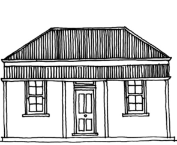

> [Picture on page 40: a picture, saved as a picture (images/chapter-c2-woollahra-heritage-conservation-area-page-40-9.gif, 150 dpi).]

C8 in terms of its bulk, height, scale or incompatible design.

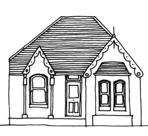

> [Picture on page 40: a picture, saved as a picture (images/chapter-c2-woollahra-heritage-conservation-area-page-40-12.gif, 150 dpi).]

FIGURE 1  Typical single storey housing

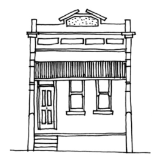

> [Picture on page 40: a picture, saved as a picture (images/chapter-c2-woollahra-heritage-conservation-area-page-40-14.gif, 150 dpi).]

FIGURE 2  Design suggestions for rear additions to single storey housing

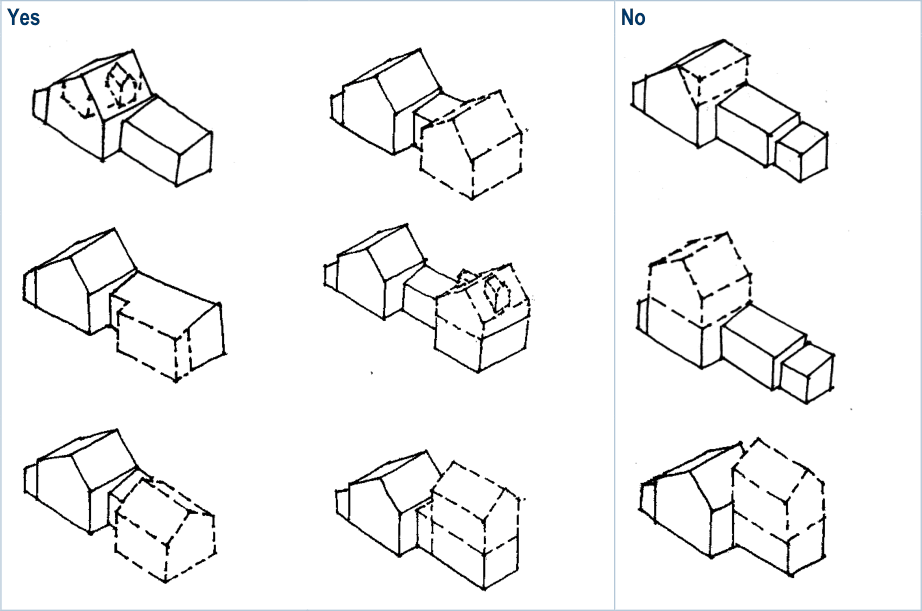

> [Picture on page 40: a picture, saved as a picture (images/chapter-c2-woollahra-heritage-conservation-area-page-40-16.gif, 150 dpi).]
> Words printed on the picture (title and legend, copied from the PDF):
> Yes
> No

FIGURE 3  Single storey housing – principal building form shown hatched

#### C2.4.2 Multi-storey dwelling houses

The freestanding multi-storey dwelling houses vary from small timber, stone or brick dwellings often with terrace like forms, to larger villas and houses set within landscaped gardens. They include Victorian middle class villas, large Victorian mansions built on the original estates of the gentry and the later Inter-War houses built on subsequent subdivisions.

A garden setting is usually associated with freestanding dwellings, with a fence to match the style of the dwelling. There may also be culturally significant outbuildings or landscape elements from previous estates.

#### Objectives

O1 To ensure that additions to multi-storey dwelling houses do not compromise or dominate the original main front section of the house, and are suited to the architectural style of the building.

O2 To retain the curtilage, setting and principal building form, including original layouts and roof forms of the principal building form.

#### Controls

C1 Where additions are proposed to multi-storey dwelling houses, an increase in the number of storeys will be permitted only where the upper storey can be wholly contained within the existing roof volume of the principal building form. Appropriately styled dormers may be permitted in the rear roof plane of the principal building form if not visible from the public domain.

C2 Additional storeys may be permitted to the rear wing if an appropriate traditional roof form can be located below the gutter line of the principal building form. Additions must

not dominate the original principal building form of the house and should retain the breezeway.

FIGURE 4  Typical free standing multi-storey terrace dwelling houses

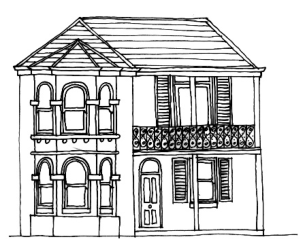

> [Picture on page 42: a picture, saved as a picture (images/chapter-c2-woollahra-heritage-conservation-area-page-42-4.gif, 150 dpi).]

FIGURE 5  Design suggestions for rear additions to multi-storey dwelling houses

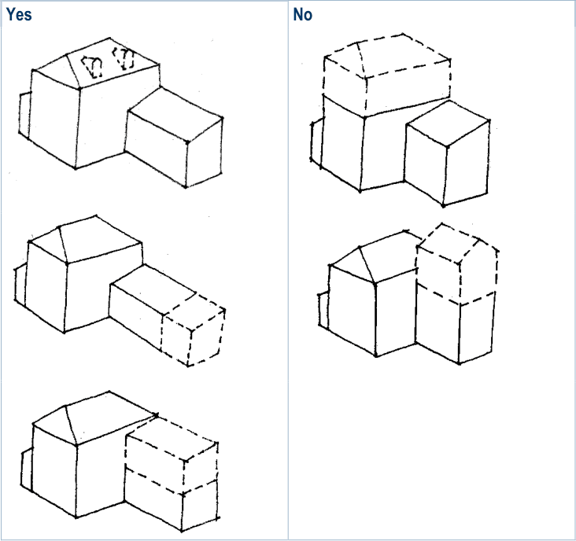

> [Picture on page 42: a picture, saved as a picture (images/chapter-c2-woollahra-heritage-conservation-area-page-42-6.gif, 150 dpi).]
> Words printed on the picture (title and legend, copied from the PDF):
> Yes
> No

FIGURE 6  Multi-storey dwelling houses. Principal building form shown hatched.

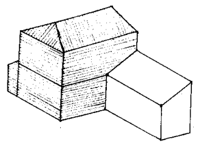

> [Picture on page 43: a picture, saved as a picture (images/chapter-c2-woollahra-heritage-conservation-area-page-43-2.gif, 150 dpi).]

#### C2.4.3 Semi-detached dwellings

Semi-detached dwellings are usually single storey cottages built in brick with hipped or gabled roof forms and a skillion roofed wing at the rear. Rare stone and timber examples exist with simple gabled roof forms. Semi-detached dwellings are usually designed as a symmetrical pair but some asymmetrical pairs exist with a dominant roof form. These types of houses usually have a small front garden behind a picket fence or low masonry wall.  Section 2.4.1 also applies to single storey semi-detached dwellings.

#### Objectives

O1 To ensure that the original symmetrical characteristics of pairs of semi-detached dwellings are retained and enhanced.

O2 To retain the curtilage, setting and principal building form, including original layouts and roof forms of the principal building form.

O3 To ensure that additions are of a scale that does not dominate or compromise the principal building form.

O4 To ensure that additions are of a scale that is compatible with the other pair in the semi-detached dwelling.

#### Controls

C1 Alterations and additions to one house of a semi-detached pair must not compromise the uniformity and geometry of the principal or street front elevation. Alterations and additions must not dominate the other house in the pair, particularly when the other house is unaltered.

C2 Two storey additions to the rear of a single storey wing of a semi-detached pair must be linked to the principal building form by a lightweight structure. The addition must not exceed a height 300mm below the ridgeline of the principal building form of the building.

It is preferred that rear additions to single storey semi-detached dwellings include the first

C3 floor partly within the roof volume.

Additions to the rear of multi-storey semi-detached dwellings are to be limited in height to

C4 the gutter line of the principal building form.

Additions must not dominate the original principal building form of the building and should

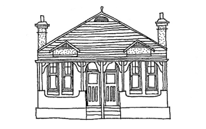

> [Picture on page 44: a picture, saved as a picture (images/chapter-c2-woollahra-heritage-conservation-area-page-44-8.gif, 150 dpi).]

C5 retain the breezeway.

FIGURE 7  Semi-detached dwelling types

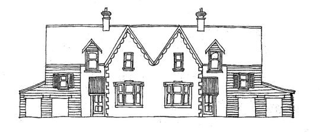

> [Picture on page 44: a picture, saved as a picture (images/chapter-c2-woollahra-heritage-conservation-area-page-44-12.gif, 150 dpi).]

FIGURE 8  Design suggestions for rear additions to semi-detached dwellings

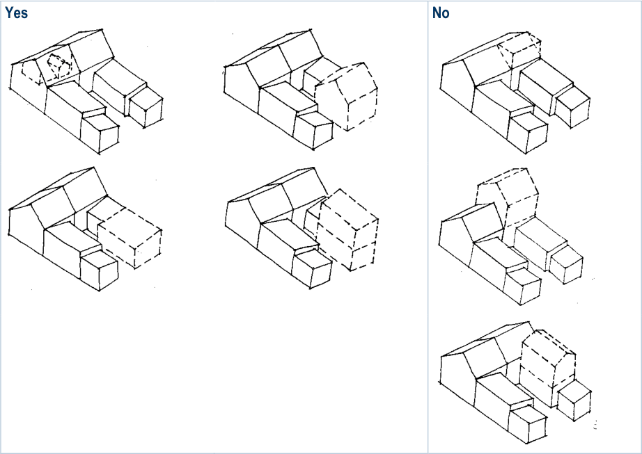

> [Picture on page 44: a picture, saved as a picture (images/chapter-c2-woollahra-heritage-conservation-area-page-44-14.gif, 150 dpi).]
> Words printed on the picture (title and legend, copied from the PDF):
> Yes
> No

FIGURE 9  Semi-detached dwelling. Principal building form shown hatched.

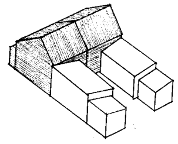

> [Picture on page 45: a picture, saved as a picture (images/chapter-c2-woollahra-heritage-conservation-area-page-45-2.gif, 150 dpi).]

#### C2.4.4 Terrace style housing

Terrace housing in the Woollahra HCA is typically two storeys high, with a small front garden behind a palisade fence and a path leading to a ground floor front verandah and panelled front

door.  A pair of French doors at the first floor lead to an open front verandah with decorative balustrade details.  A rear wing with a skillion roof of one or two storeys is common. Additional basement levels occur.

This housing was traditionally built in uniform rows; occasionally containing distinct subgroups or individual buildings within groups.

A Victorian terrace usually has painted stucco walls with a gable form roof segmented by party walls or a skillion form with a parapet to the street front. The front verandah has filigree cast iron decorative details and a separate verandah roof. Federation terraces have tuck-pointed face brickwork at the street front and turned timber fretwork and balustrades, occasionally with masonry detail.

#### Objectives

O1 To ensure that additions to the rear of terrace buildings do not compromise or dominate the principal building form.

O2 To retain the curtilage, setting and principal building form, including original layouts and roof forms of the principal building form.

O3 To ensure that the original shared characteristics of a group of terrace houses are retained and enhanced.

O4 To retain the shared distinctive characteristic of groups of buildings, including rear alignment and breezeway pattern.

O5 To ensure that traditional side elevations, forms and alignments in corner terrace buildings are retained.

#### Controls

C1 Alterations and additions to terrace houses must be consistent with the height, alignment, form, scale, breezeway pattern and architectural character of the group.

C2 Additions to terrace houses must retain the profiles of original party walls and parapets.

C3 Original side elevations of terraces, including side entrance doors, windows and other details are to be retained.

C4 Minor alterations to the sides of terraces may be permitted if they do not significantly impact on the principal building form and the patterns of openings.

C5 Additions to a terrace must not extend beyond the established rear building setback at any level of the group or row.

C6 The overall length of any addition must be less than the length of the principal building form and must appear secondary to the principal building form.

C7 The height of an additional storey to the rear of a single storey terrace must be 300mm below the ridgeline of the principal roof form. The linking structure should be located below the principal eaves line, and should use lightweight construction to differentiate the new work from the original.

C8 The height of an addition to the rear of a double or triple storey terrace must be below the gutter line of the principal building form of the terrace.

C9 Where an unaltered group of terrace houses contains single storey skillion rear forms, additions will not be permitted.

C10  Boundary to boundary extensions are permitted on the ground floor level only, but only if:

c) the proposal would not adversely affect the privacy, ventilation, light or amenity of the adjoining property; and

d) the proposal would not disrupt an existing significant pattern of a group of buildings.

C11  The roof of an extension or the new roof of an existing component of a terrace must be a skillion or gable form appropriate to the building type.

C12  Additions to a terrace must retain traditional solid-to-void ratios on elevations visible from the public domain and must not incorporate large expanses of glass on the upper levels.

FIGURE 10  Typical terrace house types

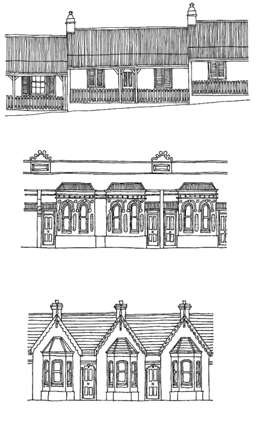

> [Picture on page 48: a picture, saved as a picture (images/chapter-c2-woollahra-heritage-conservation-area-page-48-2.gif, 150 dpi).]

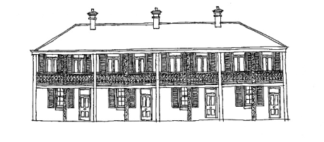

> [Picture on page 48: a picture, saved as a picture (images/chapter-c2-woollahra-heritage-conservation-area-page-48-3.gif, 150 dpi).]

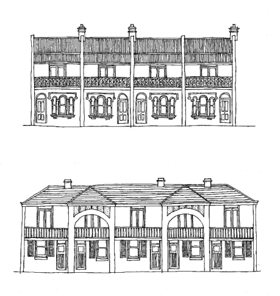

> [Picture on page 48: a picture, saved as a picture (images/chapter-c2-woollahra-heritage-conservation-area-page-48-4.gif, 150 dpi).]

FIGURE 11  Design suggestions for rear additions to terrace houses

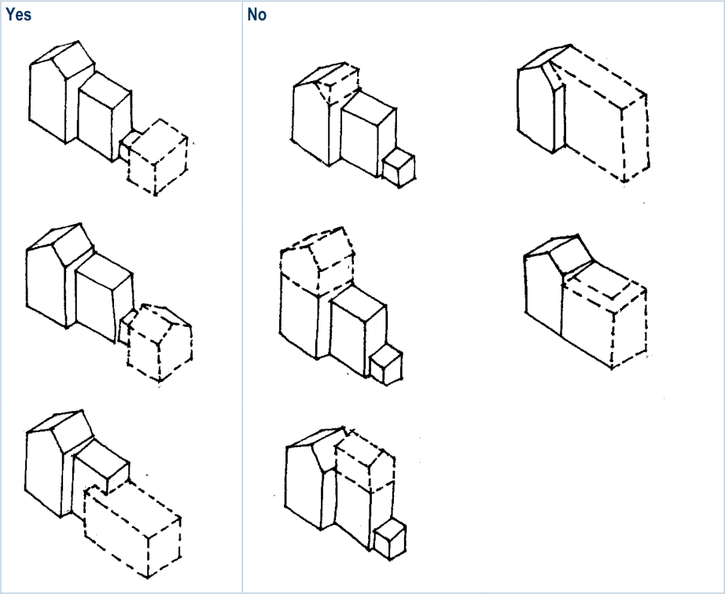

> [Picture on page 49: a picture, saved as a picture (images/chapter-c2-woollahra-heritage-conservation-area-page-49-2.gif, 150 dpi).]
> Words printed on the picture (title and legend, copied from the PDF):
> Yes
> No

FIGURE 12  Terrace house. Principal building form shown hatched.

#### C2.4.5 Inter-War flat buildings

The Inter-War flat buildings in the Woollahra HCA are usually three storeys high and demonstrate the influence of the Inter-War housing styles found within the Woollahra HCA. These residential flat buildings were usually built in face brickwork with contrasting decorative panels or in textured render in the Georgian Revival, Mediterranean, Spanish Mission or Old English style. Some excellent multi-storey examples of the skyscraper Gothic style within landscaped settings also exist.

There is generally little potential for additions and alterations to Inter-War flat buildings as changes usually have a negative impact on the overall character of the buildings and their settings.

Inter-War flat buildings make a contribution to the conservation area as they illustrate the evolution of Sydney's living accommodation from the single house to the acceptance of multi-unit living during the Inter-War period.

#### Objectives

O1 To conserve and maintain Inter-War flat buildings in Woollahra.

O2 To ensure that the significant characteristics of Inter-War flat buildings contributing to the character of the area are retained and protected.

O3 To conserve the principal street elevations and the character of the Inter-War flat buildings.

O4 To ensure that the character of original roofscapes, including key elements such as chimneys, is maintained.

O5 To ensure that alterations and additions to the roofs are discreet and do not detract from the original character, proportions or key elements.

O6 To conserve the established garden settings, including significant elements and features.

O7 To ensure that parking does not detract from the character of the streetscape.

O8 To ensure that external materials, details and finishes respect and complement the original building.

O9 To ensure that works to balconies and verandahs to rear or side elevations do not detract from the character and form of Inter-War flat buildings.

O10 To ensure that fences, gates and mailboxes are consistent with the character of Inter-War flat buildings.

O11 To ensure that internal additions, alterations and repairs retain and respect internal common areas and significant internal character elements.

O12 To ensure that the installation and maintenance of security devices does not detract from the character and form of Inter-War flat buildings.

O13 To ensure that fire safety and access upgrading works are discreet and retain and respect the original and significant building fabric.

O14 To ensure that ancillary development does not detract from the style and character of Inter-War flat buildings and their settings.

O15 To promote restoration and reconstruction works to restore significance.

#### Controls

C1 Significant and/or original forms, details, fabrics, materials or finishes of the principal building elevations are to be restored or reconstructed.

C2 Changes to the significant forms, details, materials or finishes of the principal building elevations are sympathetic to the style and period of the building.

C3 Alterations and additions do not impact on the overall form and character of the building, and are not visually prominent from the public domain.

C4 Additions are limited to undercroft areas, roof spaces and the provision of balconies.

C5 Alterations and additions are no higher than the existing roof level, and generally retain the original roof form of the building.

C6 External windows and doors are repaired or replaced to match the style, materials and finishes of the original building.

C7 Existing original fanlights and other openings are retained and sealed from behind, if necessary.

C8 Original leadlight, glass blocks, etched and patterned glazing are retained and conserved.

C9 Existing original external and internal doors and door hardware are retained and upgraded rather than replaced.

C10 New additional security elements are in character with the building. Security bars are:

a) fitted internally;

b) respect the existing glazing patterns; and

c) painted in a dark recessive colour.

C11 Original verandahs and balconies to the principal elevation of the building are not enclosed, glazed, or otherwise altered, except to reinstate original detailing.

C12 New verandahs and balconies are allowed to the rear or side elevations only if they:

a) respect the character of the existing building; and

b) are sympathetically integrated with the character and form of the building.

C13 Alterations to improve accessibility (including lifts, ramps and stairs) are sympathetically integrated with the original building and retain the original character and design of the building and landscape areas.

C14 Materials are similar in type and finish to those on the original building or sympathetically integrate with the fabric of the building.

C15 Original face brickwork, terracotta or decorative concrete panels must not be painted, rendered or coated.

C16 Dormer windows or skylights are not visually prominent from the public domain or the principal elevations of the building. Skylights are flush with the roof surface.

C17 Original chimneys and their details are retained.

C18 Privacy screens are discreet and do not impact on the overall character of the building.

C19 Protruding shade structures, including awnings and canopies, are not located on the principal building elevations.

C20 The roof maintains traditional roofing materials of the area, such as glazed terracotta tiles. Any replacement or repair matches the original roofing in type, profile, colour and materials. Concrete roofing tiles and corrugated metal roofing are not appropriate.

C21 Internal common areas and significant character elements are retained. This includes: entry doors, foyer areas and fittings, mailboxes, noticeboards, staircases, balustrades, wall details, light fittings, internal doors and the like.

C22 New lifts are designed and located so that the addition:

a) is located outside the principal building form, if practical; and

b) does not require significant alterations to existing common areas.

C23 Unsympathetic additions and modifications to the building, and its grounds, are to be removed and replaced with sympathetic works, or reinstatement of original forms and matching fabric.

C24 Services upgrading and fire safety works must minimise adverse visual impact and damage to original building fabric.

C25 Alarm bell boxes and the like, are not attached to the principal building elevations.

C26 New or upgraded services are discreetly and sensitively located to minimise visual impact. They are located within existing ducts, behind cornices or bulkheads or within external lightwells that are not visually prominent. Wiring or other services are housed in concealed conduits.

C27 Original timber staircases are retained and smoke isolated, if necessary.

C28 Where the height of the original stair balustrades is to be modified — the modification is discreet and sympathetically integrated with the existing stair balustrade.

C29 Stair treads applied to existing stairs are discreet.

C30 Emergency and exit lighting is incorporated into existing original light fittings, where practical.

C31 Smoke and/or thermal detectors are discreetly located and do not impact on decorative plaster cornices and ceilings.

C32 Car parking and garage structures are located at the rear, with access from the rear lane or side driveway.

C33 Original fencing, gates and mailboxes are retained and conserved.

C34 New ancillary development:

a) is smaller in scale than the principal building;

b) is not located between the principal building and the street front, and generally located at the rear behind the principal building;

c) is constructed in a style, form, materials and finishes that complement the principal building;

d) is single storey with a maximum clear internal height of 2.4m; and

e) is sympathetic in scale and style to traditional forms of ancillary structures.

C35 Characteristic front gardens, and their elements, are retained with minimal alteration.

C36 Structures erected in the front garden do not significantly reduce or compromise the l andscaped area or key elements and features.

C37 New fences and gates to the front building alignment must complement the streetscape and the existing building.

C38 Mailboxes are discreetly located and do not impact on the character of the building.

FIGURE 13  Typical Inter-War flat building

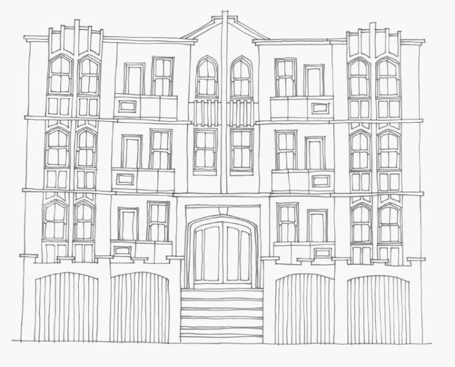

> [Picture on page 54: a picture, saved as a picture (images/chapter-c2-woollahra-heritage-conservation-area-page-54-2.gif, 150 dpi).]

#### C2.4.6 Retail and commercial buildings

Queen Street is the primary commercial precinct in the Woollahra HCA with two and three storey buildings having shops at street level and residential above. They are typically from the Victorian or Edwardian periods with some Inter-War shops and contemporary buildings. Commercial buildings are stylistically diverse and include original shopfronts from the three main periods. Other shops are grouped on Ocean Street between Forth and Queen Streets in mid to late Victorian buildings, including some rare timber buildings. Federation period shops are grouped on Edgecliff Road, near Grafton Street. Small groups of shops are spread throughout the area.

#### Objectives

O1 To ensure that new development within business zone reinforces the ‘main street’ character.

O2 To ensure that the original characteristics of the retail buildings identified as contributory items are retained and enhanced, even when they have subsequently been converted for other uses.

O3 To retain good representative examples of significant architectural styles, including original shopfronts.

#### Controls

C1 Retail and commercial buildings are to:

a) be a traditional form with shops at ground level and housing or commercial spaces above;

b) be built to the street alignment and to side boundaries at all levels, unless the predominant character is otherwise;

c) be no higher than adjoining significant retail buildings. If no retail buildings adjoins, they are to be no higher than the predominant height of adjacent contributory items; and

d) have facades modulated into vertical proportioned bays and openings that respect the scale, proportion and architectural character of adjacent significant retail buildings.

C2 Below the awning level of retail buildings, new work is to be consistent with the style and character of the building and the streetscape.

C3 Except for the purposes of restoration or reconstruction, the removal or alteration of original shopfronts or elements of original shopfronts that are examples of significant architectural styles in the historical development of Woollahra are not permitted.

C4 Where non-contributory or intrusive fabric exists in significant shopfront locations, it may be replaced by a modern shopfront if the design is consistent with historical context in terms of materials, proportions, details, colour and signage.

C5 Contemporary designs for shopfronts must relate to the building type, streetscape and precinct. The designs should use appropriate materials and must incorporate traditional features such as the division of frontages, and the configuration of windows with stall boards and doors.

C6 Reconstruction of original shopfronts may be appropriate in instances where a shopfront forms part of a significant group or where sufficient evidence exists to show the original shopfront design.

C7 Shopfronts must not be amalgamated. Where properties are amalgamated, the original building elements and shopfronts must be conserved.

C8 Modification and adaptive re-use of retail buildings must retain the original characteristics of the building type, its architectural style and context.

#### C2.4.7 Corner shops

Corner shops are typically from the Victorian period, one or two storey high with a residence at the rear of the shop and located at cross streets and T-junctions. Often they are built to the boundary with a side shop window, an angled entry façade and a recessed entry door. Many

corner shop buildings remain but have changed in use reflecting the evolution of the suburb. Timber shop fronts are rare.

#### Objectives

To ensure that the original characteristics of corner shops are retained and enhanced.

O1

#### Controls

Upper storey additions to single storey corner shop buildings are not permitted.

C1

Original forms, details, materials and finishes to corner shop buildings are to be retained

C2 when these buildings are converted for new uses.

Rear additions may be permitted if they do not compromise the form or scale of the

C3 principal building form. The retail buildings controls in Section 2.4.6 also apply.

FIGURE 14  Traditional shopfront elements

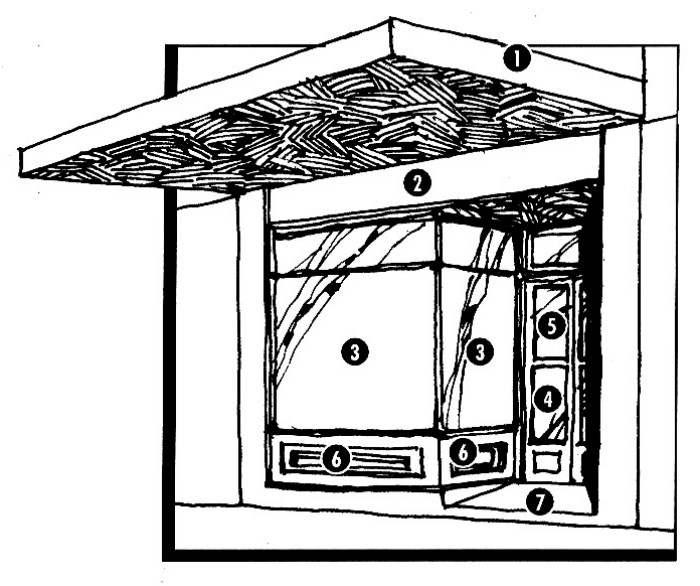

> [Picture on page 56: a picture, saved as a picture (images/chapter-c2-woollahra-heritage-conservation-area-page-56-16.gif, 150 dpi).]

1 Awning 2 Hamper

3 Glazed display

window 4 Recessed entry

area 5 French doors

6 Stallboard 7 Tiled floor

#### C2.4.8 Adaptive re-use of a non-commercial building for business purposes

Continuing development of the area has increased pressure to convert for business use buildings originally designed for residential purposes.

#### Objectives

O1 To encourage the appropriate design of alterations to contributory items originally designed for a non-commercial function when these buildings are converted for business use.

O2 To retain original shopfront, elevations and details of contributory items.

#### Controls

C1 To allow for easy interpretation of the original use, adaptive re-use of contributory items originally designed for non-commercial use must retain significant interior features of the principal rooms of the original building.

C2 Alterations to original windows to create display windows may be permitted if the original joinery characteristics are retained, the opening widths are not increased, and the symmetry of the street front elevation remains unaltered. Etched glass may be permitted within the windows.

#### C2.4.9 Adaptive re-use of commercial and industrial buildings

Mostly built in the Edwardian and Inter-War periods, industrial buildings include garages, workshops, services stations and light industry factories. They are usually large volume single storey buildings constructed in brick with sheet metal roof forms. These buildings are becoming

rare and, although scattered throughout the area, are concentrated near Oxford Street and the eastern end of the Woollahra HCA.

#### Objectives

To retain the original forms, details, materials and finishes of the commercial and

O1 industrial buildings listed in this chapter as contributory items, even when they have been converted for other uses.

#### Controls

Adaptive re-use of contributory items originally designed for commercial or industrial use

C1 must retain significant interior features of the principal rooms of the original building to allow easy interpretation of the original use.

#### C2.4.10 Places of public worship, educational establishments and public buildings

The area’s churches and schools are among the most identifiable landmarks. The schools include the Woollahra Public School and the former Holy Cross College in Edgecliff Road, now Reddam College.

Churches of various denominations including the synagogues are representative works of prominent architects from the Victorian, Federation and Inter-War periods. The public buildings include the former Council Chambers, the embassies and the post office and bank buildings.

#### Objectives

O1 To ensure that any new work is carried out with due regard to the significance of the building and its setting.

#### Controls

C1 Council may require a conservation management plan to be prepared and adopted by Council prior to work being undertaken to a significant religious, institutional or public building.

#### C2.4.11 Pubs

Most pubs in Woollahra are substantial buildings ranging in height from two to four storeys. They date from the 1840s through to the 1940s, and are prominent place markers often located on corner sites.

The pubs have an imposing presence with distinctive parapet profiles, modulated facades, window and door openings and ornate architectural detailing. Building materials include stone, brick, stucco, timber, glazed tiles and terracotta. The pubs display a diverse range of architectural styles including Victorian, Federation and Inter-war buildings. The Centennial Hotel and the Phoenix Hotel display the characteristics of the Victorian periods, while the Woollahra Hotel and the Light Brigade Hotel represent the Inter-war period. The pubs usually exhibit their façade details but few retain original interior details.

Pubs owe their survival to their ability to offer the latest in comfort, service and amenities, consistent with the demands of their customers. To meet these situations and to also comply with legislative requirements relating to matters such as trading hours and public amenity, alterations and additions to pubs occur from time to time.  Despite the fact that pubs are prone to physical change, a number of Woollahra pubs remain close to their original configuration, appearance and use.

#### Objectives

O1 To conserve the diversity of pubs and their significant internal and external details associated with all periods of construction.

O2 To retain original names of pubs as part of the historical and social significance of the Woollahra HCA.

O3 To retain residential accommodation within pubs

O4 To facilitate the continued role and presence of pubs in the Woollahra HCA.

#### Controls

#### Internal

C1 Significant interior features are to be retained.

C2 Missing significant internal elements, details and finishes should be restored or reconstructed. These include:

a) decorative ceilings;

b) tiles;

c) joinery, including stairways;

d) fittings, including light fittings; and

e) traditional signs and advertising.

C3 Original room configurations must remain discernible. Where new openings are proposed, interpretation of original wall positions and room proportions should be provided.

#### External

C4 Original elevations must be retained and conserved.

C5 Face brick and tiles are not to be painted over, rendered or retiled.

C6 Significant external features are to be retained. Where appropriate, missing elements, details and finishes should be restored or reconstructed. These include:

a) pressed metal ceilings to awnings;

b) awnings and balconies;

c) wall tiles; and

d) traditional signage.

C7 The restoration of missing detail or reversal of unsympathetic work to street front elevations is required when work is undertaken to the principal elevations.

C8 The original name of a pub must be retained and displayed appropriately in signage.

C9 Traditional hotel signage and product advertising, such as painted glass panels advertising beer brands, should be retained, protected and displayed.

C10 The prominence of parapets and roof lines must be retained.

C11 The original massing and scale, pattern and modulation of facades and the proportions of openings must be retained.

#### C2.4.12 Infill development

The term ‘infill’ refers to new development within an existing urban context. Infill development provides the chance for the continuing enrichment of the area by adding new built form which is an expression of contemporary life.

Replication of historical architectural styles is not necessarily advocated by Council. A contemporary design approach which respects the historic context and achieves a cohesive relationship between the existing and new urban fabric is required.

As the opportunities for infill development are rare, the design for such sites are required to demonstrate an appropriate response to context and an approach which enhances the character of the Woollahra HCA and its cultural significance.

If constructing a new building, only the building type control for infill development applies, regardless of the type of building being constructed.

Note:

For infill development, applicants are required to provide a detailed site and context analysis.

A draft site and context analysis is to be submitted to Council for comment as part of a predevelopment application meeting between Council representatives and the applicant.

The following information is to be submitted for comment prior to the lodgement of the development application: the applicant’s preferred infill design proposal; a statement outlining the proposed measures to minimise the adverse impact of the infill development on neighbouring lands, including the public domain; the philosophy of how the design elements relate to the proposal’s context in terms of built form, materials and character; and statement of heritage impact.

#### Objectives

O1 To encourage development on infill sites which reflects contemporary values and employs contemporary design while providing an appropriate response to the historical context of Woollahra HCA.

O2 To ensure that new development on infill sites is designed and located to achieve a cohesive relationship between new and existing urban fabric and which retains and enhances the cultural significance of the area.

O3 To ensure that infill development respects the scale and setting of adjacent contributory items.

#### Controls

C1 Refer to the general controls in Section C2.5. These general controls apply to infill development.

C2 If development is for a dual occupancy, the additional controls for dual occupancies in Part B, Chapter B3 General Development Controls of this DCP also apply (refer to Section

B3.8 Additional controls for development other than dwelling houses) .

Character

C3 Infill development must:

a) maintain the significant features and qualities that combine to represent the character of the neighbourhood and area; and

b) make a positive contribution to the character of the neighbourhood and area.
