#### C2.5 General controls for all development

> [Picture text on page 64 is stored in the PDF without readable letters (no character map), so it could not be copied; see the original PDF.]

The general controls apply to all development including infill or replacement development (also referred to as new development), and alterations and additions to existing buildings including contributory items.

The matters addressed in this section are:

#### 2.5.1 Building height, form and character

#### 2.5.2 Conservation of contributory items

#### 2.5.3 Conservation of contributory groups

#### 2.5.4 Materials, finishes and colours

#### 2.5.5 Roofs, skylights and chimneys

#### 2.5.6 Open space and landscaping

#### 2.5.7 Fences, gates and retaining walls

#### 2.5.8 Parking and garages

#### 2.5.9 Security

#### 2.5.10 Excavation

#### 2.5.11 Subdivision and site amalgamation

#### 2.5.12 Acoustic and visual privacy

#### 2.5.13 Site facilities and aerial devices

The controls in this section are to be read in conjunction with the controls in: Section C2.3 Precincts (where relevant); and Section C2.4 Building type controls.

In the event of an inconsistency with the controls in this section, the controls in Sections C2.3 and C2.4 take precedence.

Note: Included in this section are diagrams and tables to assist applicants to design in accordance with the objectives and controls of this chapter. These diagrams and tables are not intended to be exhaustive and other design options may be appropriate if they satisfy the objectives and controls.

With new development and alterations and additions to non-contributory items, there is greater scope for design flexibility provided the proposed work does not detract from the significance or character of the streetscape or the Woollahra HCA generally. The siting and alignment of buildings are important characteristics of the streetscapes of Woollahra. In most streetscapes there is a consistent pattern of similar setbacks from the street and from side boundaries.

#### C2.5.1 Building height, form and character

The height, bulk and scale of new development and additions to existing buildings have the potential to adversely affect the amenity of private and public lands.

The controls are designed to ensure that the scale and bulk of new buildings and additions to existing buildings are compatible with: site conditions; the desired future character of the Woollahra HCA as outlined in Section 2.2.5; the significant characteristics of precincts described in Section C2.3, in particular the characteristics of nearby contributory items.

#### Objectives

O1 To ensure that the established historical pattern of development is continued in terms of siting, levels and front, side and rear building setbacks.

O2 To locate buildings to ensure good aspect and orientation of indoor and outdoor living areas and the retention of existing trees.

O3 To retain the patterns of height, bulk and scale distinctive to individual streetscapes and precincts.

O4 To protect the privacy and amenity of adjoining or adjacent residential uses.

O5 To encourage the retention or creation of useful open space at the rear of sites.

O6 To protect and encourage views and vistas from public places, and encourage view sharing from private properties.

O7 To minimise overshadowing of private and public open spaces.

#### Controls

Building location

C1 Where there are uniform levels or setbacks within the streetscape, infill development and additions to existing buildings are to be consistent with the levels and setbacks of the adjoining buildings.

C2 Where front building setbacks vary:

a) if there is a dominant pattern adjoining, development is to align with that pattern. Where the pattern is stepped, development is to provide an appropriate transitional front setback between adjoining properties;

b) if there is no predominant pattern, development is to align with the existing adjoining development which is the most compatible in scale with the proposed development. Alternatively development can be setback between the properties on either side;

c) if development occurs on a corner site, it is to be built up to the street alignments to define the corner. Exceptions are when this interferes with views to or from the public domain or is inconsistent with the streetscape or precinct or inhibits the visibility of and for pedestrians and vehicles.

FIGURE 15  Calculating front setbacks

Setback to be a transition between pairs of adjoining contributory items or non- contributory items (shaded)

C3 Where buildings are orientated to face the street, development is to adopt this orientation.

C4 Where adjoining buildings have been aligned to face a view rather than the street, development is to adopt this orientation.

C5 The minimum landscaped area requirements and open space requirements outlined in Section 2.5.6 must be met.

C6 The rear setback should not extend beyond the established rear building setback and must allow sufficient space for a useable private open space area and landscaped area.

Building height and form

C7 The height, bulk, scale, dominant roof forms, ridge line and building envelope of development must be consistent with those of contributory items in the streetscape that are a similar building type. The bulk of buildings should be distributed to minimise overshadowing of adjoining properties. In circumstances where the infill site adjoins a prominent building or a building of excessive height or intrusive design, conformity is not appropriate.

C8 The character of development is to be consistent with the character of nearby contributory items and of the streetscape. Solid to void ratios of elevations are to be similar to those of nearby contributory items.

C9 Storey heights must conform to those of adjacent contributory items. Three storeys may be permitted if the predominant contributory items in the streetscape are three storeys or more.

C10  Development is not to obstruct views or vistas from the public domain:

a) along streets;

b) towards the harbour, city or local landscape; and

c) across the Woollahra HCA to landmark buildings, trees or skylines.

C11  Development must not unreasonably obstruct existing principal views from the habitable rooms, balconies and private open space of neighbouring dwellings.

C12 If development is in the form of a dual occupancy, the additional controls for dual occupancies in Part B, Chapter B3 General Development Controls of this DCP also apply (refer to Section B3.8 Additional controls for development other than dwelling houses) .

Solar access and ventilation

C13  Sunlight is provided to at least 50% (or 35m² with minimum dimensions 2.5m, whichever is smaller) of the main ground level private open space of adjacent properties for a minimum of two hours between 9am and 3pm on 21 June. Where existing overshadowing is greater than this, sunlight is not further reduced.

C14 Windows to north facing habitable rooms receive at least 3 hours of sun between 9am and 3pm on 21 June over a portion of their surface.

C15 For residential flat buildings containing four or more dwellings:

a) not more than 25% of all dwellings should be single aspect;

b) single aspect dwellings should be limited in depth to 8m from a window;

c) the back of a kitchen should be no more than 8m from a window; and

d) the width of cross-over or cross-through dwellings over 15m deep should be 4m or greater to avoid deep, narrow dwelling layouts.

#### C2.5.2 Conservation of contributory items

#### Objectives

O1 To retain the original built form characteristics of contributory items.

O2 To ensure that contributory items, their outbuildings and their curtilages and settings are retained.

O3 To retain the original building elements of contributory items and, where original elements are missing, to encourage their reinstatement.

O4 To ensure that alterations and additions to contributory items incorporate building elements that are compatible with traditional built forms and do not adversely affect the heritage significance of the building or its surroundings.

O5 To ensure alterations or additions to a contributory item are designed:

a) to be consistent with the original architectural style, form, massing, details, materials and finishes of the item; and

b) not to have an adverse impact on the curtilage and setting of the item.

O6 To ensure that the various heights and setbacks of contributory items within the streetscape are retained.

#### Contributory items – additional built form controls

General

C1 Contributory items are to be retained and conserved, that is:

a) their significant fabric is to be retained;

b) original principal building forms, including roof pitch, eaves height and chimneys, are to be retained;

c) except to allow for restoration or reconstruction, no alterations or additions are to be made to the original elevations, details, materials or finishes of the principal building form;

d) original verandahs and balconies are not to be infilled or enclosed; and

e) original room layouts of the principal building forms are to be retained.

C2 When proposing works to the principal building form, original external elevations roof, curtilage or setting of contributory items:

a) missing or damaged original forms, details, materials and finishes are to be restored or reconstructed. Reconstruction is to be based on research rather than conjecture; and

b) inappropriate or intrusive forms, details, materials and finishes are to be removed.

Internal modifications

C3 Partial demolition of internal cross walls to the principal building form will only be permitted where:

a) the original room layouts are able to be interpreted;

b) the main rear wall to the principal building form remains;

c) the structural integrity of the building and its adjoining buildings are not compromised; and

d) there is no increase in light levels at the front windows when viewed from the public domain.

C4 Decorative coffered ceilings to the rooms located within the principal roof form are not to be removed to incorporate an additional storey within the existing roof form.

#### C2.5.3 Conservation of contributory groups

Where a building belongs to a group of similar items, it is important that alterations and additions do not compromise the character of the group as a whole. The original consistency of the street

front elevation should be retained and conserved, and so should that of side and rear elevations where these are visible from the street or other public places.

#### Objectives

O1 To ensure that the distinctive shared characteristics of significant groups of buildings are retained and enhanced.

O2 To ensure that alterations and additions within a significant group conform to the shared characteristics of the group and do not compromise its integrity.

#### Controls

C1 The distinctive original shared characteristics of a significant group of buildings are to be retained, including:

a) existing patterns of principal roof forms within unaltered groups of  contributory items;

b) secondary or rear forms, which must not be raised or altered if the rear forms are part of a group of similar roof forms.

C2 Where a building is one of a group of similar attached contributory items, the design of additions must:

a) not compromise or dominate the group as a whole;

b) be consistent with the form and pattern of original roof forms of the adjoining contributory items;

c) be consistent with the form, symmetry, breezeway pattern and rhythm of the original rear wings of the group as a whole and must not visually disturb the cohesiveness of the group; and

d) elevations should have solid to void ratios that are consistent with the group.

C3 Intact or largely intact side elevations of buildings in significant group items joined by party walls are to be retained in their original configuration where these are visible from the public domain. Minor alterations to parts of these side elevations may be permitted if they do not impact significantly on the original architectural form of the elevation or the pattern or proportion of openings.

C4 Where works are proposed to individual buildings within a significant group, missing or damaged original forms, details, materials and finishes are to be restored or reconstructed to reinstate the original shared characteristics of the group as a whole, particularly where visible from the public domain. Exceptions may be allowed where the original forms, details, materials or finishes of the entire group have previously been changed and reinstatement of the original would disturb the cohesiveness of the group.

C5 Where buildings in a significant group share the same original external finish all buildings within the group must have a similar finish.

#### C2.5.4 Materials, finishes and colours

Buildings in the Woollahra HCA have been constructed in a variety of external materials, finishes and colours characteristic of particular architectural styles, building types and periods of construction.

The use of modern materials and finishes may be appropriate for new development, alterations and additions provided it does not compromise a cohesive relationship between new and existing urban fabric.

Table 1 following lists materials and finishes suitable for infill development and alterations and additions. It also lists materials and finishes that are intrusive elements, whether by their nature or if used in inappropriate situations.

The great variety in form and detail of roofs, windows, shutters and external doors in the Woollahra HCA makes a significant contribution to the architectural complexity of the area as a whole.

The styles of these important building components are strongly related to the architectural style and period of construction of the buildings to which they belong. Late 19th century and early 20th century windows were usually rectangular in shape and vertically proportioned.  Where a larger opening was desired, windows were set in groups.  Many buildings obtain visual interest from verandahs and balconies, which create a strong pattern of light and shade by their projection, covering roof and detail decoration.

#### Objectives

O1 To achieve external materials, finishes and colour schemes appropriate to the context.

#### Controls

C1 Materials, finishes, textures and colours must be appropriate to the building type and style. They must be similar to, but should not copy, the characteristic materials, finishes, textures and colours of the contributory items within the streetscape. Contemporary materials may be used where their proportions, detailing and quantities are consistent with the existing and desired future character of the precinct.  New development must minimise its visual impact on the surroundings.

C2 External detailing, colour and finishes must minimise the apparent bulk of new development.

Significant Items - original materials, finishes and colours

#### Objectives

O2 To retain and conserve original external finishes and colour schemes to buildings within the Woollahra HCA.

O3 To encourage finishes and colour schemes of additions to contributory items to be appropriate to the building type, architectural style and construction period.

#### Controls

C3 Surviving original external finishes and colour schemes of street front elevations, secondary elevations and building components of contributory items are to be retained and conserved.

C4 Any works must not damage or remove the original materials of a contributory item or place within the Woollahra HCA.  Unpainted brickwork, sandstone, terracotta, glazed or tessellated tiling are not to be painted, rendered, bagged or otherwise re-finished in a manner inappropriate to the architectural style of the building.

C5 External finishes to additions to contributory items must complement the architectural style of the existing building.

C6 External colour schemes of contributory items should have hue and tonal relationships similar to those of traditional colour schemes, although it is not necessary that they be finished in a ‘heritage’ colour scheme.

Contributory items - windows, shutters and doors

C7 Original windows, shutters and external doors to contributory items must not be removed except to allow for their conservation and maintenance.

C8 Where replacement windows, shutters and external doors are proposed original openings should be utilised.  Materials and details are to match the original where this is known; otherwise it should be appropriate to architectural style, building type and construction period.

C9 External shutters are not to be added to original windows and doors of contributory items unless they were features of the original design of the building.

C10  Windows, shutters and external doors to additions to contributory items are to be designed with contemporary detailing and materials appropriate to the architectural style of the existing building and the proportions of its openings.  The height of a new window must be greater than 1.4 times the width and less than twice the width.

FIGURE 16  Some common examples of front doors are shown. All are panelled doors with stiles and rails. Type A and B are four panel doors, while Type C is a high-waisted Edwardian door.

#### Type A – Mid Victorian Type B – Late Victorian Type C – Edwardian Door types

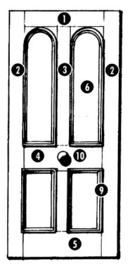

> [Picture on page 73: a picture, saved as a picture (images/chapter-c2-woollahra-heritage-conservation-area-page-73-4.gif, 150 dpi).]

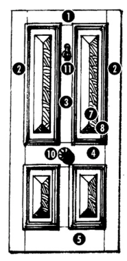

> [Picture on page 73: a picture, saved as a picture (images/chapter-c2-woollahra-heritage-conservation-area-page-73-5.gif, 150 dpi).]

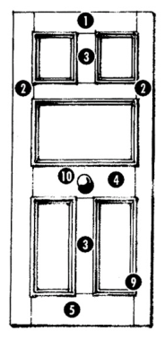

> [Picture on page 73: a picture, saved as a picture (images/chapter-c2-woollahra-heritage-conservation-area-page-73-6.gif, 150 dpi).]

1 Top rail 2 Stile 3 Muntin 4 Mid rail 5 Bottom rail 6 Sunken field panel 7 Raised field panel

8 Bolection mould 9 Lamb’s tongue

mould 10 Knob 11 Knocker

Contributory items - Verandahs and balconies

C11  Original verandahs and balconies are not to be altered except for the reinstatement of original details and the reversal of unsympathetic alterations.

C12  Where evidence shows that they have previously existed on street front elevations, verandahs and balconies may be reinstated using traditional materials and details.

C13  The addition of balconies to the roofs of contributory items will not be permitted except where Juliette balconies may be permitted by C20 in Section 2.5.5.

C14  The step down from the main roof to the verandah roof must be retained or reinstated where a new or replacement or reinstatement of a verandah on the street front elevation is proposed.

FIGURE 17  Typical Victorian terrace verandah elements

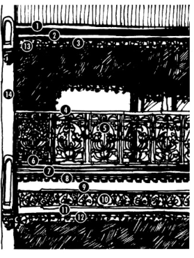

> [Picture on page 73: a picture, saved as a picture (images/chapter-c2-woollahra-heritage-conservation-area-page-73-30.gif, 150 dpi).]

1 Ogee gutter

8 Dentils

2 Timber mouldings 3 Cast iron lace frieze

9 Stop-chamfered verandah

beam 10 Cast iron frieze panel 11 Stop-chamfered frieze

4 Hand rail 5 Cast iron lace balustrade

panel

12 Cast iron lace frieze

6 Balcony timber floor 7 Bead moulding

13 Cast iron bracket 14 Fin wall

TABLE 1  Design controls external finishes

| ROOFS |  |
|---|---|
| Traditional materials | Preferred replacements |
| Victorian Welsh or South Australian slate. Slate or slate-like cladding Late Victorian houses occasionally incorporating ornamental patterns had traditional ornamental where these existed originally. patterns. Corrugated galvanised steel or zinc coated corrugated steel may be appropriate in some cases. |  |
| Corrugated iron in shorter, Corrugated galvanised steel or zinc narrower sheets than are standard coated corrugated steel with today. traditional details and fixings. |  |
| Federation Slate with terracotta ridge capping Slate with terracotta detailing to and decorative detailing. match existing. Corrugated galvanised steel or zinc coated corrugated steel. |  |
| Unglazed terracotta roof tiles in Unglazed terracotta roof tiles in Marseilles pattern, often with Marseilles pattern to match ridge cappings and decorative existing. detailing. |  |
| Corrugated iron. Corrugated galvanised steel or zinc coated corrugated steel. |  |
| Inter-War Terracotta tiles of Marseilles, Terracotta tiles or shingles to Roman or Spanish pattern, match existing or appropriate to depending on architectural style. the style of the building if original Coloured or glazed. Terracotta tiles have been removed. shingle tiles. |  |
| Roofing material controls |  |
| New roofs to Traditional roofing materials outlined above appropriate to the style of additions to thebuilding. contributory Matching original materials to the original part of the building may be the items most appropriate. Infill Metal roofing visible from the public domain is to be traditional corrugated development profile. Natural metallic finish or a pre-coloured mid or dark grey metal sheeting is preferred. |  |

> [Picture text on page 74 is stored in the PDF without readable letters (no character map), so it could not be copied; see the original PDF.]

> [Picture text on page 75 is stored in the PDF without readable letters (no character map), so it could not be copied; see the original PDF.]

| ROOFS |  |  |
|---|---|---|
| Intrusive | Concrete roof tiles. Metal roofing sheets brightly coloured, white or ivory, or colours in light tones. Metal sheeting with tray profiles. Roof tiles on Victorian buildings. |  |
| WALLS |  |  |
|  | Traditional materials | Preferred replacements |
| Victorian | Sandstone blocks for walls or as a base course to brick walls. Brickwork, usually rendered, often with ashlar coursings. Corrugated galvanised iron. | Conservation of sandstone required. Replacement brickwork with materials having matching finishes. Corrugated zinc coated corrugated steel with traditional details and fixings. |
| Victorian and | Timber weatherboards. | Timber weatherboards. |
| Federation | Zinc coated corrugated steel or ripple iron and weatherboards on sides of dormers and outbuildings. | Corrugated zinc coated corrugated steel with traditional details and fixings. |
| Federation | Face brickwork with tuck pointing on principal facades, often with sandstone, terracotta or contrasting brick details. Brickwork rendered with stucco decorations or areas of rough cast render. | Dry pressed bricks with appropriate pointing of joints and conservation of contrasting materials. Rendered brickwork. |
| Inter-War | Face brick, often textured and with contrasting panels. | Conservation preferred, or replacement bricks with appropriate pointing of joints. |

> [Picture text on page 76 is stored in the PDF without readable letters (no character map), so it could not be copied; see the original PDF.]

| WALLS |
|---|
| Walling material controls |
| New walls to Rendered brickwork or blockwork, with or without scribed ashlar coursing additions to where appropriate. existing Timber weatherboards. buildings Dark coloured dry-pressed brick with a smooth face. Infill development Fibrous cement sheeting with a rendered and painted finish – for rear additions. |
| Intrusive Circular pattern render (mock Spanish) or rough textured render (unless to match an original finish to the building). Inappropriately textured or modern colour brickwork. Textured fibrous cement sheeting simulating weatherboard textures. Reflective wall cladding. |

| WINDOWS |  |
|---|---|
| Traditional materials | Preferred replacements |
| Victorian Timber framed, double hung sash Timber frames of a matching type windows, plain or multi-paned. and configuration. Plain glass, traditional patterns or Coloured and patterned glass may coloured glass. be appropriate for replacement windows at the front of buildings, otherwise glazing to be plain. |  |
| Federation Timber framed, double hung sash Match original window materials or casement windows, often with and configuration. multi-paned coloured glass in part. Coloured and patterned glass may be appropriate for replacement windows generally at the front of buildings, otherwise glazing to be plain. Metal frames to ground floor shops and commercial premises where appropriate. |  |

> [Picture text on page 77 is stored in the PDF without readable letters (no character map), so it could not be copied; see the original PDF.]

| WINDOWS |
|---|
| Inter-War Timber framed, usually double Match original window materials hung sashes often in combination and configuration. with fixed panels. Metal frames to ground floor shops Steel framed, usually casements, and commercial premises where often in combination with fixed appropriate. panels. Leadlight glass common. |
| Window material controls |
| Alterations to Window frames in the traditional material of the original type, but of contributory contemporary design which respect the architectural style of the building. items A single new window located in a wall which otherwise only has original windows, should be detailed similarly to the original windows, but with plain glass. Alterations are proposed to the rear of a building and the rear elevation has already been substantially altered, windows of contemporary design may be acceptable and even preferable, using similar proportions appropriate to the original building type. Metal frames for ground floor shops and commercial premises where appropriate. |
| Intrusive Timber windows in metal frames not reflecting traditional proportions other than at rear ground levels, shops and commercial premises. Glass block infill where glass blocks were not an original component of the building. Bubble glass. Tinted or reflective glass. Aluminium windows other than rear ground floor and shops to commercial premises where appropriate. Window walls. Replica copies in aluminium of traditional balustrade patterns used as security screens on windows. |

| SHUTTERS |  |
|---|---|
| Traditional materials | Preferred replacements |

> [Picture text on page 78 is stored in the PDF without readable letters (no character map), so it could not be copied; see the original PDF.]

| SHUTTERS |
|---|
| Victorian Timber louvres. Match original materials and Expanding concertina style metal configuration. shutters to shopfronts. |
| Federation Timber louvres. Match original materials and Expanding concertina style metal configuration. shutters to shopfronts. |
| Inter-War Timber louvres with motifs to Match original materials and match the architectural style. configuration. |
| Shutter material controls |
| New shutters Replacement shutters should be of materials and details similar to the to original shutters, but should be identifiable on close inspection as new contributory work. items Dark hued traditional concertina security shutters on the inside of shop windows and externally to doors. |
| Intrusive Roller shutters to windows or doors to residential buildings, retail and commercial premises internally or externally mounted. |

| DOORS |  |
|---|---|
| Traditional materials | Preferred replacements |
| Victorian Principal doors: timber solid core, Match original materials, panelled with timber, etched or proportions and configuration. frosted glass. Secondary doors ledged and braced. |  |
| Federation Timber panelled doors with small Match original materials, coloured glass or lead lights. proportions and configuration. |  |
| Inter-War Timber solid core doors with metal Match original materials, decorative features or with glazed proportions and configuration. panels, often with leadlights. |  |
| Door material controls |  |

> [Picture text on page 79 is stored in the PDF without readable letters (no character map), so it could not be copied; see the original PDF.]

| New doors to | Joinery shop solid core framed and panelled timber doors detailed |
|---|---|
| original | similarly to original doors, but identifiable on close inspection as new |
| openings to | work. |
| contributory items | Solid core timber framed doors, glazed timber framed doors, glazed steel frame in appropriate locations, depending on architectural style. |
| Alterations to | New door or doors to a wall which otherwise only includes original doors, |
| contributory | should be detailed similarly to the original doors, and be of the same |
| items | material. Alterations to the rear of a building where the rear elevation has already been substantially altered, doors of contemporary design may be acceptable and even preferable, using similar materials and proportions. Plain glass should be used. |
| Additions to | Timber or steel framed doors of contemporary design which respect the |
| contributory | architectural style of the building, the materials to be consistent with the |
| items | style of the building. Aluminium or metal framed doors to ground floor shops and commercial premises only where appropriate. Plain glass should be used. |
| Intrusive | Fully glazed doors, or enlarged doors to the street front elevations of contributory items where these were not original to the building. Roller shutter doors to residential buildings, retail and commercial premises. Anodised aluminium security doors, particularly with decorative panels. |

| VERANDAHS |  |
|---|---|
| Traditional materials | Preferred replacements |

> [Picture text on page 80 is stored in the PDF without readable letters (no character map), so it could not be copied; see the original PDF.]

| VERANDAHS |
|---|
| Victorian Floors of stone flagging, marble, Match original material type, unglazed multi-coloured proportions and configuration. tessellated tiles. Timber for floors and timber framing for the underside of verandah roofs. Slate, timber and sandstone edging. Cast iron posts of a flat profile or circular in section, cast iron friezes, balustrades and brackets. Corrugated iron or slate roof, separated from the main roof form. |
| Federation Timber filigree timber post, Match original material type, flooring and timber filigree proportions and configuration. balustrades and fretwork. Corrugated iron, slate, shingled or metal or terracotta tiles to roof. |
| Inter-War Usually a loggia rather than a Match original material type, verandah. Often semi enclosed proportions and configuration. with stone flagging, tiles or terrazzo flooring. |
| Verandah material controls |
| New verandahs Traditional materials for reconstruction. or Materials similar to traditional materials for infill but with simplified reconstruction detailing. |
| Intrusive Infilling of open wall with glazing or solid panels. Glazing behind balustrades. Pebble-crete, modern concrete, large scale modern tiles for original building types. Perspex or similar type material roofs. Glass roofs to street facades. |

> [Picture text on page 81 is stored in the PDF without readable letters (no character map), so it could not be copied; see the original PDF.]

| BALCONIES |  |
|---|---|
| Traditional materials | Preferred replacements |
| Victorian Cast iron friezes and balustrade Match original material type, panels with iron or timber proportions and configuration. handrails. |  |
| Federation Timber balustrades and brackets. Match original material type, proportions and configuration. |  |
| Inter-War Open balconies with concrete Match original material type, floors, often with tessellated tiles proportions and configuration. and decorative wrought iron balustrades. |  |
| Balcony material controls |  |
| New balconies Traditional materials for reconstruction on original building types or with to contributory modern material equivalents. items Infill Masonry, timber or metal balustrades. development |  |
| Intrusive Smooth, textured or profiled face brick and exposed cement blocks. Corrugated and other profiled metal sheeting. Wire fencing. Fibrous cement sheeting. |  |

> [Picture text on page 82 is stored in the PDF without readable letters (no character map), so it could not be copied; see the original PDF.]

| FENCES |  |
|---|---|
| Traditional materials | Preferred replacements |
| Victorian Occasionally rendered masonry Match original material type, with inscribed ashlar coursing. height, proportions and Timber post, rail and paling. configuration. Iron palisade, sometimes on Iron palisades to be cast to match sandstone bases. if reconstructing from known details. Timber pickets. Timber pickets to have simple acute angled tops rather than imitation pickets. |  |
| Federation Brick, often with dwarf walls and Match original material type, pillars with decorative wrought height, proportions and iron panels or decorative timber configuration or replace with palings. similar material with simplified contemporary details. |  |
| Inter-War Brick, usually with contrasting Match original material type, panels or brickwork or wrought height, proportions and iron to match the style of the configuration. building. |  |
| Fence material controls |  |
| New fences to Traditional material type and transparency but with simplified contributory contemporary details to suit building style, height and context such as items and infill vertical steel pickets with tapered tops for palisade fencing. development Contemporary interpretation of traditional metal decorative details but not aluminium versions. |  |
| Intrusive Smooth, textured or profiled face brick and exposed cement blocks. Full height solid brick fences. Materials and forms that are inappropriate to the style of the building. Aluminium versions of palisade pickets or wrought iron details. |  |

#### C2.5.5 Roofs, skylights and chimneys

Roof forms and details in the Woollahra HCA vary widely according to building type and architectural style and this variety of forms makes an important contribution to the aesthetically significant visual complexity of the area as a whole.

#### Objectives

O1 To ensure new roofs and alterations to roofs fit in with the character, physical context and historical background of the streetscape, precinct and HCA as a whole.

#### Controls

C1 Where new development adjoins a contributory item, roof forms and cladding are to be consistent with those of the contributory item.

C2 No rear roof plane is to incorporate more than 25% transparent material including skylights and dormers.

#### Skylights

C3 Skylights to the front or side of a building are not to be located where they would be visible from the public domain.

C4 Skylights must have a low profile and must be flush with the roof surface. They should be predominantly of glass, with simple, unobtrusive detailing. The frame colour must match the surrounding roof colour.

#### Contributory items - roofs and chimneys

C5 The original forms, materials, finishes and details to the roofs and chimneys of contributory items are not to be removed, except to allow for their conservation and maintenance. Additions at the rear are to retain all existing chimneys.

C6 When original roofing materials to contributory items are deteriorated, they are to be replaced by the same or similar materials and details. Gutters and downpipes are to be of traditional profiles and materials.

C7 When a building has been re-roofed with inappropriate materials and the roofing is to be replaced, cladding and details are to be the same or similar to original materials appropriate to the architectural style, building type and construction period of the building, except where changing the roofing material would have an adverse impact on a significant group as a whole.

C8 Additions to contributory items are to have traditional roof forms clad in traditional materials appropriate to the style of the building.

FIGURE 18  Traditional roof elements

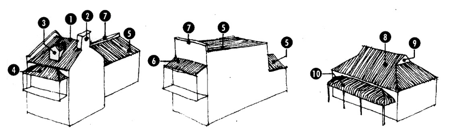

> [Picture on page 84: a picture, saved as a picture (images/chapter-c2-woollahra-heritage-conservation-area-page-84-2.gif, 150 dpi).]

1 Gable roof

6 Skillion balcony roof

2 Chimney stack 7 Parapet 3 Dormer

8 Hipped roof

4 Hipped balcony roof 9 Gablet 5 Skillion roof

10 Bullnosed verandah roof

FIGURE 19  Typical chimney stack

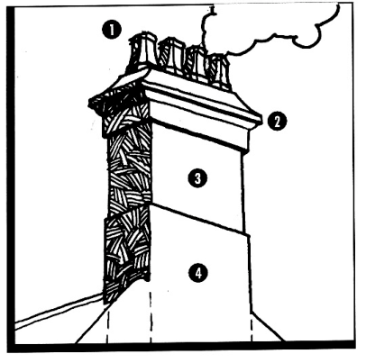

> [Picture on page 84: a picture, saved as a picture (images/chapter-c2-woollahra-heritage-conservation-area-page-84-12.gif, 150 dpi).]

1 Chimney pot 2 Coped and moulded cornice 3 Shaft 4 Stump

#### Contributory Items - dormers

C9 Dormer windows will not be permitted to street front elevations of contributory items or to the parts of side elevations visible from the public domain. Exceptions may be made if physical or documentary evidence shows that a dormer or dormers existed in these locations as part of the original design of the building.

C10  A dormer or dormers may be inserted into the rear roof plane of a contributory item or to the roof of an additional pavilion form if this would have negligible impact on the heritage significance of the building or, where appropriate, of the significant group.

C11  Where new dormer windows are permitted to contributory items or their additions, the design, proportions and materials must be based on traditional models. They must be appropriate to the architectural style, building type and construction period of the building as well as the historical background and physical context of the precinct.

Dormers to Victorian period cottages, semi-detached dwellings and terraces

C12  A single dormer must not exceed one third of the width of the roof or 1500mm, whichever is less.

C13 More than one dormer window may be located within the rear slope of the main roof of a contributory item if the width of the roof is greater than 6m. This is subject to consideration of the impact on the heritage significance of the item and, where appropriate, of the significant group.

C14  The height of a dormer window, excluding its pediment, is to be 1.4 times its width. The top of the dormer window, including its ridge and pediment, must be lower than the main roof ridge by at least 300mm.

C15  The pediment of a dormer window must be infilled with timber weatherboards. Depending on the building's architectural style and context, the cheeks of dormer windows may be covered in timber weatherboards or in corrugated steel sheeting of traditional profile. The eaves should be of negligible or minimal depth. Dormer windows, where permitted on street front elevations, are to be traditional timber double-hung sashes or casements.

Dormers to Federation period cottages, semi-detached dwellings and terraces

C16  Dormers to Federation period contributory items should be appropriate to the architectural style. Horizontally proportioned dormers with casement windows are permitted with ‘eyelid’ or hipped roof forms, the top of which must be located at least 600mm below the main roof ridge line. Horizontally proportioned dormers are limited to 2.2m in width and the window area to a maximum height of 1m, or an overall height of 2.2m dependant on the type.

C17  Gabled dormers with casement windows may be permitted up to an overall width of 1.5m and a maximum height of 2.2m. The gable form should match the principal roof form and its top must be located at least 300mm below the principal ridgeline. More than one dormer may be permitted if the roof is wider than 6m.

Modified dormers

C18 A dormer window to a contributory item may incorporate doors provided:

a) it is not visible from the public domain;

b) there would be no impact on the heritage significance of the adjacent buildings;

c) there would be no adverse impact on the amenity of adjoining properties; and

d) the traditional dormer form remains visible in a traditional location within the roof, with inward opening casement-styled doors with transoms at the traditional sill height of a dormer window, and a balustrade located in the same plane as the door frame, allowing a person to stand at, but not beyond the door opening.

Contemporary styled dormers

C19 A contemporary styled dormer may be permitted to the rear roof plane of an individual building where:

a) it would not be visible from the public domain;

b) there would be no impact on the heritage significance of the adjacent buildings; and

c) traditional forms that relate to the architectural style of the building are preferred.

C20 A Juliette balcony, limited in area by a maximum width of 1.5m and depth of 800mm, may be incorporated with a contemporary styled dormer if there is no adverse impact on the amenity of adjoining properties or on the heritage significance of the adjacent buildings.

FIGURE 20  Typical Victorian dormer windows

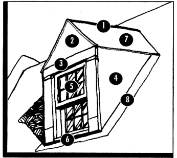

> [Picture on page 86: a picture, saved as a picture (images/chapter-c2-woollahra-heritage-conservation-area-page-86-15.gif, 150 dpi).]

1 Dormer roof

2 Pediment 3 Lintel 4 Pilaster 5 Double hung window 6 Sill 7 Cheek

8 Flashings

FIGURE 21  Typical dormers to Federation period cottages, semi-detached dwelling and terraces.

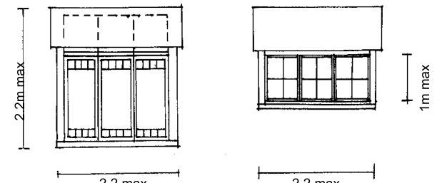

> [Picture on page 86: a picture, saved as a picture (images/chapter-c2-woollahra-heritage-conservation-area-page-86-25.gif, 150 dpi).]
> Words printed on the picture (title and legend, copied from the PDF):
> 1m max
> 2.2m max

2.2m max

1.5m max

2.2 max

2.2 max

#### C2.5.6 Open space and landscaping

Open space and landscaping play important roles in the preservation of habitat, the establishment of community identity, the provision of recreation opportunities and stormwater management, as well as the amenity of individual dwellings.

Integrated landscape design can enhance the appearance, amenity and energy efficiency of housing.

Landscaping appropriate to building type and period of construction will contribute to the character of the Woollahra HCA.

#### Objectives

O1 To ensure that adequate provision is made for accessible and useable private open space.

O2 To retain important existing mature trees, vegetation and other landscape features.

O3 To ensure the provision of permeable and semi-permeable areas of open space to assist with stormwater management.

O4 To ensure that swimming pools, spa pools and tennis courts are located where they are not visible from the public domain.

O5 To ensure that private open space areas, plantings, swimming pools, spa pools and tennis courts are designed to minimise adverse impacts on the heritage significance of the area, services infrastructure, the fabric of buildings and the amenity of neighbours.

#### Controls

Private open space and deep soil landscaped areas

C1 Development is to be sited to:

a) include sufficient area for deep soil planting;

b) have no adverse impact on established tree or vegetation patterns associated with particular building types, streetscapes or precincts; and

c) suitably setback from any prescribed tree so that the development does not impact on the health of the tree.

> [Picture text on page 88 is stored in the PDF without readable letters (no character map), so it could not be copied; see the original PDF.]

C2 Deep soil landscaped area requirements for dwelling houses, semi-detached dwellings, attached and detached dual occupancies and attached houses are summarised below:

TABLE 2  Minimum deep soil landscaped areas by precinct

| Precinct | Minimum deep soil landscaped areas required |
|---|---|
| Rosemont Lots > 350m² = 25% of site area |  |
| West Woollahra Minimum of 15% of site area for lots of 350m2 – 500m2 Minimum of 20% of site area for lots over 500m2 |  |
| Queen Street Minimum of 15% of site area for lots of 350m2 – 500m2 Minimum of 20% of site area for lots over 500m2 |  |
| Nelson Street For a significant house on an area of at least 350m2 — minimum of 25% of the site area For housing in the Waimea or Woods Avenue groups— minimum of 8% of the site area For an Inter-War flat building—a minimum of 15% of the site area |  |
| Harbour View Minimum of 12% of site area for lots of 225m2 – 350m2 Minimum of 20% of site area for lots over 350m2 |  |
| Fletcher Minimum of 15% of site area for lots of 350m2 – 500m2 Minimum of 20% of site area for lots over 500m2 |  |
| Grafton Minimum of 15% of site area for lots of 350m2 – 500m2 Minimum of 20% of site area for allotments over 500m2 |  |

C3 In addition to the above, the following deep soil landscaped area requirements apply to small lots: TABLE 3  Minimum deep soil landscaped areas for small lots

| Allotment size | Minimum deep soil landscaped area required |
|---|---|
| Less than 130m2 5m2 |  |
| At least 130m2 and less than 225m2 8% of site area |  |
| At least 225m2 and less than 350m2 15% of site area* |  |

\* Except for Harbour View Precinct

C4 The minimum private open space area requirements are: TABLE 4  Minimum private open space

| Minimum private open Residential type Allotment size space required |  |
|---|---|
| Dwelling houses, semi-detached dwellings, dual occupancies and attached dwellings. | Less 130m2 10% of site area Principal rear area to have a minimum dimension of 10m2 More than 130m2 and 16% of site area less than 225m2 Principal rear area to have minimum dimension of 12m2 More than 225m2 Minimum of 35m² Principal rear area to have minimum dimension of 16m2 |

Note:  For the principal rear area, only those areas that can accommodate a 3m diameter circle may be calculated principal rear area.

C5 Residential flat buildings, manor houses, multi dwelling housing and multi dwelling housing (terraces) are to be provided with private open space, unbuilt upon areas and deep soil landscaped areas in accordance with the following table: TABLE 5  Minimum private open space and deep soil landscaped area requirements for

residential flat buildings, manor houses, multi dwelling housing and multi dwelling housing (terraces)

| Residential type | Minimum private open space required | Minimum unbuilt upon area | Minimum deep soil landscaped area required |
|---|---|---|---|
| Residential flat buildings, N/A 40% of site area 20% of site area manor houses, multi dwelling housing and multi dwelling housing (terraces) |  |  |  |
| Inter-War flat building N/A 40% of site area 15% of site area |  |  |  |
| Each dwelling within a Minimum area N/A N/A residential flat building in of 8m2 the form of a courtyard, Minimum balcony, verandah or roof dimension of terrace 2m x 2m |  |  |  |

C6 For mixed use buildings, the deep soil landscaped area must comprise at least 10% of the site area.

C7 In a mixed use development, each dwelling is provided with a private open space area of at least 8m² with a minimum dimension of 2m x2m.  Private open space for dwellings can be in the form of a courtyard, balcony or verandah.

C8 Part of the private open space must be directly accessible from the main living area and capable of serving as an extension of the dwelling for relaxation, dining, entertainment, recreation or children's play.

C9 Stairways and ramps may be used to provide access to outdoor living space on sloping sites. The raising of open space areas to provide level access from a building will not be permitted if there would be an adverse impact on adjoining properties or the heritage significance of the property.

C10 Materials and colours of paving visible from the public domain are to be appropriate to the character of the streetscape and the architectural style and materials of existing buildings on the site.

Trees and vegetation

C11 Mature trees on private land are to be retained in place and incorporated into any proposed landscape treatment.

C12 Trees and other vegetation are to be of species and size at maturity that will not have an adverse impact on building fabric, significant elements, infrastructure, power lines or other services.

C13  For infill development, trees are to be selected and located to contribute to energy efficiency and amenity by providing substantial shade in summer, especially to west-facing windows, and by admitting sunlight to indoor and outdoor living areas in winter.

C14  Where significant trees are to be removed the tree should (subject to site constraints) be replaced with the same species or a species of appropriate size at maturity.

C15 Landscaping on private land must ensure the retention of adequate sight lines for pedestrians and vehicles, especially at street corners.

Contributory items - landscape elements

The original garden designs and plant selections of contributory items varied according to their building type and period of construction. The remaining traditional planting schemes, early plants and trees make an important contribution to the character and significance of the HCA.

#### Objectives

O6 To retain the significant trees and landscape elements of contributory items.

07 To encourage landscaping to be appropriate to building type and period of construction and to contribute to the character of the Woollahra HCA.

#### Controls

C16 Remnant elements of the settings of contributory items including, but not limited to, gardens, mature trees, archaeological deposits, original front fences, pathways and contributory landscape elements are to be retained, whether or not they are located on the same site as the item.

C17  Trees listed as heritage items and significant cultural plantings (whether identified as contributory items or not) on private land are to be retained in place and incorporated into any proposed landscape treatment.

C18  Original and early built landscape elements of the yards and gardens of contributory items (including terraces, steps, pathways, front and side fences and outbuildings) are to be retained in place.

C19  Where new landscaping is proposed to the private open space of contributory items, landscaping styles and plant species must be appropriate to building type and construction period.

C20  When it is visible from the public domain, landscaping to the private open space of contributory items is to be set at the original garden level or at existing ground level.

C21  New landscaping must not include species that screen the principal elevation of a contributory item.

C22  Contributory and characteristic street front gardens are to be retained.

FIGURE 22  Remnant built landscape elements may be fences from previous buildings

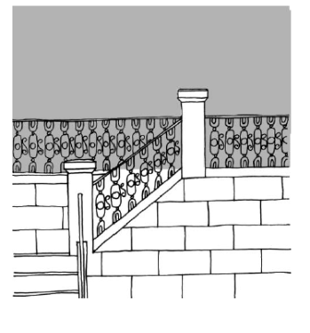

> [Picture on page 91: a picture, saved as a picture (images/chapter-c2-woollahra-heritage-conservation-area-page-91-21.gif, 150 dpi).]

Swimming pools and spa pools

C23 Swimming pools and spa pools will not be permitted in the front garden or forward of the front building alignment.

C24  For corner allotments or where the property has two street frontages, the location of swimming pools and spa pools is not to be in the primary frontage.

C25  Swimming pools and spa pools will not be permitted in the rear of properties if:

a) construction of the pool would result in the removal of a tree that is subject to a tree preservation order; and

b) the deep soil landscaped area requirement cannot be met.

C26  Where prescribed trees are retained, structures are setbacks so they do not impact on the health of the tree.

C27  Swimming pools must not cause damage to the fabric of adjoining properties or adversely impact on the amenity of the occupiers of adjoining properties through noise from pool equipment, flood lighting or discharge of backwash.

C28  The outer edge of the excavation, piling and all sub-surface walls is not less than 1.5m from a boundary.

C29 Swimming pools are only permitted where the coping will be flush with or not higher than 300mm above the existing ground level and no portion of the pool’s casing is visible from the public domain or an adjacent contributory item.

C30  Structures and associated plant and equipment satisfy the design, construction and operation requirements set out in the Council’s standard conditions for:

a) swimming pools and spa pools, including requirements for drainage of waste water, filtration equipment, fencing, and containment of water from overflow and splashing;

b) compliance with the Building Code of Australia;

c) identification of levels and heights to Australian Height Datum; and

d) structural adequacy.

Tennis courts

C31  The location of tennis courts is to be at the rear of properties.

C32  For corner allotments or where the property has two street frontages, the location of tennis court is not to be in the primary frontage.

C33  The court playing surface is of a material that minimises light reflection.

C34 The height and location of court fencing is to enable:

a) sharing of views from surrounding residences; and

b) provision of sunlight to adjoining properties.

C35 Fencing material is to be a recessive colour.

C36 Fences are to be setback a minimum of 1.5m from boundaries.

C37 Safety fencing is provided to satisfy the requirements set out in the Council's standard conditions for swimming pools where the court is designed as a water detention basin with a depth of 300mm of more.

#### C2.5.7 Fences, gates and retaining walls

Carefully designed fences and walls help to integrate developments into the existing streetscape. When poorly designed, however, they have the potential to unduly dominate the streetscape and reduce opportunities for neighbourhood surveillance and social interaction. Tall blank brick fences facing the street are particularly unsympathetic, as they separate the house from the public domain and have an adverse impact on the streetscape, the precinct and the Woollahra HCA as a whole.

#### Objectives

O1 To ensure the removal, and prevent the construction, of non-original, intrusive tall masonry fences on street alignments.

O2 To ensure fences, walls and gates contribute positively to the streetscape and improve safety and amenity for residents.

#### Controls

C1 Fences and gates of non-contributory items and infill development are to be of contemporary design appropriate to the architectural style of the building. Materials should demonstrate an appropriate response to the physical context and historical background of the streetscape and precinct.

C2 Where street trees occur, new or replacement fences must incorporate root barriers at the street front boundary.

C3 The height of a front fence is not to exceed 1.5m.

C4 The height of a side or rear fence is not to exceed 1.8m. Where there is a difference in level from one side of the boundary to the other, the 1.8m limit is measured from the low

side. Where there is a difference in ground levels at the boundary greater than 1.2m, the height of the fence must not exceed 1.2m measured from the high side.

C5 On sloping sites, the height of fences and walls may be averaged. Fences and walls may be regularly stepped down the slope.

C6 New fences and gates to non-contributory items and infill development are to be at least 50% open to enable outlook from the building to the street.

C7 New masonry front fences will be permitted only where they were originally associated with the architectural style or building type and construction period of the building on the site.

C8 On corner sites, new front fences, gates and side fences in front of the building alignment are to be at least 50% open to ensure good visibility for pedestrians and traffic.

C9 When opening, new gates must not encroach over the footpath and the street carriageway.

#### Contributory items – original fences, gates and retaining walls

The material and design of the front fences in the Woollahra HCA vary widely according to architectural style, building type and construction period. Original front fences or replacement fences of appropriate materials and design will complement and enhance the character of a building, while inappropriate fences will diminish the appearance of a house and streetscape.

#### Objectives

O3 To retain and conserve original fences, gates and retaining walls of contributory items.

O4 To retain and conserve original sandstone retaining walls that are characteristic of the precincts within the Woollahra HCA.

#### Controls

C10 The configuration, forms, materials, finishes and details of original fences, gates and retaining walls of contributory items are to be retained in place. They are not to be altered except to allow for their maintenance or conservation, even if the building with which they were originally associated has been demolished.

C11  The configuration, finishes and details of all original sandstone retaining walls that are located at the street front boundaries are to be retained and conserved.

C12  Breeching an original sandstone or brick wall or fence to incorporate an opening for parking is not permitted.

C13 Sheet metal fencing, exposed concrete block fencing and aluminium versions of iron palisade fences are not permitted.

FIGURE 23  Typical original fencing types

#### PICKET FENCE

Early Colonial and Edwardian buildings are

associated with timber picket fences. Picket designs

varied from Colonial times through to Edwardian

times from small rounded tops, to scalloped, spear-

ended and flat tops.

#### BRICK FENCE

Inter-War houses and blocks of flats often have brick

fences with iron detailing in a style to match the

building behind.

#### BRICK AND TIMBER FENCE

1 Iron palisade bar 2 Iron spearhead top 3 Top rail 4 Coped masonry

plinth 5 Masonry pier 6 Iron gate

#### PALISADE FENCE

Detailing of iron palisade fences varied

from Colonial to early 20th century times.

#### SANDSTONE RETAINING WALL

Many houses of the federation and

Inter-War periods had sandstone front

fences or retaining walls.

Brick fenced with painted timber decorative detailing more common during the federation period.

C14  New front fences, gates and associated elements of contributory items are to be of form, height, details, materials, finishes and quality appropriate to the architectural style, building type and construction period of the existing building on the site and to the precinct.

New fences and gates to side, rear street or lane alignments of contributory items are to

C15 be of a traditional design, height and form and should be consistent with the following table.

TABLE 6  Dimensions for fences and gates

| Setting | Scale | Massing/form | Materials |
|---|---|---|---|
| Fences Rear fences must Rear fence Timber palings be constructed on maximum solid preferred the rear boundary height 1.8m Bagged or 0.6m high rendered transparent fence brickwork may be may be permitted permitted if on top of solid appropriate to section the context. Sheet metal fencing is not permitted |  |  |  |
| Laneway Conserve original Maximum gate Minimum 150mm Ledged and gates gates, including height 2.2m freestanding braced timber hardware. posts/ reveals or gates Maximum gate set into fencing Construct gates width 1.2m Timber painted on rear boundary bi-fold gates Double gates 2.4m Roller shutter only permitted Minimum with masonry pedestrian gates surrounds width 900mm Gates are to open within property at all times |  |  |  |
| Street Gates to align Maximum gate Gates to open Materials and gates with walls or height 2.1m into the property design of street palisade fences at all times gates should Maximum gate relate to fence Open parking bays width 1.2m Metal or cast iron type or context are not permitted posts where Double gates within street appropriate Gates are to open max. width 2.4m front locations. should to tie in within property at Pedestrian gates with adjoining all times 900mm fencing Timber posts where appropriate should tie into the adjoining picket fence |  |  |  |

> [Picture text on page 96 is stored in the PDF without readable letters (no character map), so it could not be copied; see the original PDF.]

#### C2.5.8 Parking and garages

Garages built to street alignments intrude inappropriately on streetscapes. The provision of new driveway crossovers often results in the removal of street trees, a reduction in the number of on-street parking spaces and the loss of sections of early stone kerbing.

The inclusion of car parking spaces, carports and garages has resulted in a reduction of landscaped area and useable open space in the front and rear gardens of many properties in the Woollahra HCA. The consequent reduction in the number of trees and the amount of permeable ground surface increases the pressure on surface stormwater drainage systems.

Council’s on-site parking requirements aim to satisfy the parking demand likely to be generated by development while discouraging unnecessary car use. These requirements also aim to reduce site excavation resulting from the provision of excessive amounts of on-site parking. Encouraging walking, cycling and public transport and limiting unnecessary car use helps to improve local amenity, minimise pollution and preserve non-renewable energy resources.

Parking areas, garages and driveways must be designed carefully so that they do not detract from the appearance of the development and the surrounding streetscape.

Additional floor space is occasionally being sought through the provision of a loft structure over a garage or studio. Due to potential streetscape and landscape impacts, a loft structure is not appropriate for garages or studios fronting a street and may be unacceptable for garages or studios on the rear boundaries with access to a laneway. In preparing the loft controls, consideration was given to suitable locations where a loft structure would be appropriate. It was concluded that if the proposals meet particular criteria, loft structures for laneway garages and studios would be acceptable in only three areas in the Woollahra HCA, being Sisters Lane and both the West Woollahra and Grafton Precincts.

#### Objectives

O1 To protect the amenity of the property, neighbouring properties and public open space in terms of visual and acoustic privacy and sunlight access.

O2 To ensure that residential buildings, rather than vehicle access and parking structures, remain the dominant elements in the streetscape.

O3 To ensure that on-site vehicle parking is not provided at the expense of soft landscaped area and useable open space.

O4 To maintain and enhance the character of laneways where unsympathetic earlier development, such as high brick walls and full width garages, has eroded the quality of these urban spaces.

O5 To allow safe and convenient vehicle access and to minimise vehicle and pedestrian conflict.

O6 To only allow loft structures over a garage or studio which is located on the rear boundary of a property within Sisters Lane, or in the West Woollahra or Grafton Precinct.

O7 To limit the height of garage or studio structures in order to minimise impact on the character of the Woollahra HCA.

O8 To ensure loft structures over garages or studios are designed to sympathetically integrate with the character of laneways.

O9 To retain and conserve the original coach house and stable structures from the Victorian and Federation periods, and original detached garage buildings of Inter-War houses and flat buildings.

#### Controls

C1 Provision of on-site parking areas, parking structures and servicing areas such as loading facilities will not be a general requirement of Council and may not be permitted in certain circumstances. On-site parking may not be required, or may not be permitted, where it does not comply with controls in this part, or where:

a) the parking of a vehicle may have a detrimental impact on the amenity of an adjoining property, the health or form of a significant tree, the character of a streetscape or laneway or the significance or architectural character of a building on the site or on an adjacent site;

b) extensive areas of excavation are required;

c) a driveway cannot comply with a maximum gradient of 25% with adequate transitions at the top and bottom in accordance with AS 2890.1(2004);

d) vehicle entries and exits may have a detrimental impact on pedestrian or traffic movements or  Council or service authority infrastructure; and

e) inadequate sight distances may result in unsafe vehicle movement to or from the site.

C2 All parking is to be provided behind the front outer wall of the building.

C3 No additional vehicle crossovers will be permitted off street frontages.

C4 No parking is permitted under the principal building form of a dwelling.

C5 No garages are to be introduced into original retaining walls built to the street alignment.

C6 In street front situations, even where a crossover exists, double and multiple garages will not be permitted.

C7 Where crossovers exist on street frontages and there is a minimum side setback of 3m, a car space, carport or garage may be located to the side of a building. This is provided it is set back behind the front alignment of the building or, if freestanding, behind the main ridgeline of the building. The form and materials should complement those of the principal building. An appropriate contemporary design is permitted and must not be an imitation of an historic design.

C8 If a property has an accessible rear lane, any vehicular access is to be from the rear. Where rear lane parking is permitted and the property is wider than 4.25m, proposals must provide a visual connection between the private and public domain by the inclusion of a pedestrian gate or fencing panel with a minimum width of 900mm and maximum height of 1.8m. Planting along the rear boundary should be incorporated where possible. Garage doors and sections of solid wall should be of minimal width. Garage doors must open into the property.

C9 On rear lane frontages, elements which create excessive isolation between the public and the private domain, such as high blank walls and excessively wide garage doors, are not acceptable.

C10  No rear lane vehicle access is permitted to a site if the lot width is less than 3.2m and the distance from the rear of the building (proposed) to the rear boundary is less than 10m.

C11  If the lane width is less than 5m, rear lane vehicular access is permitted only if there is a minimum garage entry width of 3.2m and it can be demonstrated to Council that turning circles are in compliance with Australian Standard 2890.1 – 2004 (Figure 2.2 and the B85 design template).

C12  Laneway garages with roof gardens will be permitted only on steeply sloping properties where the floor level of the roof terrace is no higher than the ground floor level of the building and the terrace is non-trafficable except for garden maintenance.

C13  Garage structures are to be single storey only (for exceptions see control C14)

C14  A loft structure over a laneway garage or studio will be permitted only in Sisters Lane and in the West Woollahra or Grafton precincts, and then only if:

a) the structure does not adjoin an existing single storey habitable building on another site where that building is also positioned on a laneway frontage. Note: a garage or carport is not a habitable building;

b) the design of the structure protects the amenity of the property, neighbouring properties and public open space in terms of visual and acoustic privacy and sunlight access;

c) the site dimensions are a minimum of 30m long and 4.25m wide;

d) the maximum width of the loft and single garage or studio is 4.5m;

e) the structure does not require the garage footprint to be extended so that the controls in Section 2.5.6 Open Space and Landscaping cannot be satisfied. Where there is an existing non-compliance with these controls, the existing private open space and deep soil landscaped area is not further reduced;

f) all access to the loft is provided internally;

g) there are no balconies, decks or other similar cantilevered structures;

h) habitable room windows within the loft with a direct sightline to those in the existing building on the site and neighbouring buildings have a separation distance of at least 9m;

i) a window or a dormer window in a transverse roof, is a centrally located single double hung sash style or inward opening casement window of traditional proportions;

j) there are no dormer windows in a gable-ended roof;

k) there are no windows in the gable end of a transverse gable roof;

l) skylights, if proposed, are limited to a maximum of two per roof plane, and provided: − they comply with C4 in Section 2.5.5 Roofs, skylights and chimneys; − each skylight does not exceed an area greater than 1.5m²; − roof planes do not have more than 25% transparent metal; and

m) the proposal complies with the controls for laneway garages  with lofts in Table 7.

C15  Loft structures will not be permitted:

a) over garages or studios  in the street front zone;

b) if the subject property is part of an original row of houses, comprising an unaltered group, and the proposal demonstrates an adverse impact on the group;

c) if the rear of the property is oriented towards the north between NNE and NNW (true north); and

d) over a multiple space garage other than a side by side double garage, in which case a transverse gable form is used.

C16  Suitable door types for new garages are, in order of preference, bi-fold panelled doors, panel-lift doors, vertical steel gates and roller shutter doors. Roller shutter doors without a surrounding masonry structure are not permitted.

> [Picture text on page 101 is stored in the PDF without readable letters (no character map), so it could not be copied; see the original PDF.]

TABLE 7  Design controls for parking, garages and carports – all dimensions in millimetres

| Setting | Scale | Massing/form | Materials |
|---|---|---|---|
| LANEWAY GARAGES – parapet or gable roof form Preserve original Maximum door height Minimum 350 wide Rendered and painted toilets adjacent to 2200 side pillars to gable brick laneway boundaries in forms Minimum single door Corrugated steel West Woollahra width 2400 Maximum 470 pillars roofing of traditional precinct to flat roof forms or profile. Maximum single door Build on rear offset gables. A solid width 3300 except Timber or metal bi- boundary to void ratio 1:1 is double garages where fold doors, panel-lift preferred Minimise ramp up to each maximum door doors or roller garage width is 3000 Flat roof possible if shutters are not a corner site permitted Do not dominate Maximum single existing cottages to garage width 4240 Pitched roof Roller shutter residential lanes preferable to match permissible only if set Maximum eaves/ appropriate within a masonry Provide an acceptable parapet height 2700 traditional roof pitch surround interface between private property and Single garage doors Paint finish to all the laneway. with maximum 470 doors (dark colour pillars between recommended) additional doors (max. 2 doors) Double garages are permissible only with a parapet form unless they are permitted by the next subsection: laneway garages with lofts with transverse gables. |  |  |  |

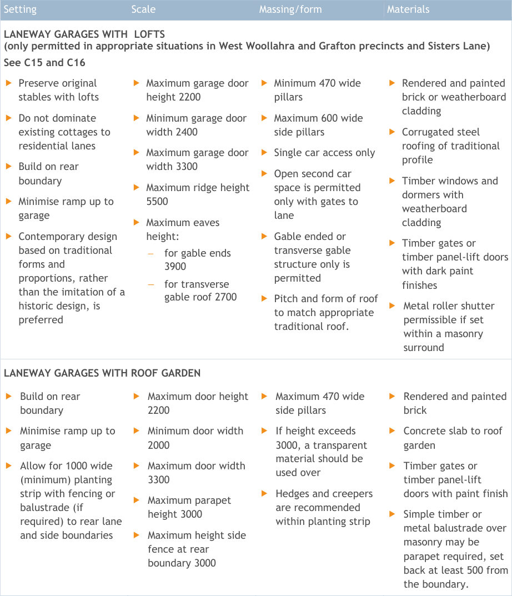

> [Picture on page 102: a map, saved as a picture (images/chapter-c2-woollahra-heritage-conservation-area-page-102-1.gif, 150 dpi); the street names and other small labels are on the picture.]
> [Picture text on page 102 is stored in the PDF without readable letters (no character map), so it could not be copied; see the original PDF.]
> Words printed on the picture (title and legend, copied from the PDF):
> LANEWAY GARAGES WITH  LOFTS
> (only permitted in appropriate situations in West Woollahra and Grafton precincts and Sisters Lane)
> See C15 and C16
> Preserve original Maximum garage door Minimum 470 wide Rendered and painted
> stables with lofts height 2200
> brick or weatherboard
> Do not dominate Minimum garage door Maximum 600 wide
> existing cottages to
> Maximum garage door Single car access only
> roofing of traditional
> Build on rear
> Open second car
> Timber windows and
> Maximum ridge height
> Minimise ramp up to
> space is permitted
> only with gates to
> Gable ended or
> Timber gates or
> − for gable ends
> structure only is
> − for transverse
> timber panel-lift doors
> with dark paint
> gable roof 2700 Pitch and form of roof
> Metal roller shutter
> based on traditional
> than the imitation of a
> historic design, is
> to match appropriate
> permissible if set
> within a masonry
> LANEWAY GARAGES WITH ROOF GARDEN
> Build on rear
> Maximum door height Maximum 470 wide Rendered and painted
> Minimise ramp up to Minimum door width If height exceeds Concrete slab to roof
> Timber gates or
> Allow for 1000 wide Maximum door width
> 3000, a transparent
> material should be
> doors with paint finish
> Hedges and creepers
> Simple timber or
> within planting strip
> strip with fencing or
> required) to rear lane
> and side boundaries Maximum height side
> fence at rear
> metal balustrade over
> masonry may be
> parapet required, set
> back at least 500 from

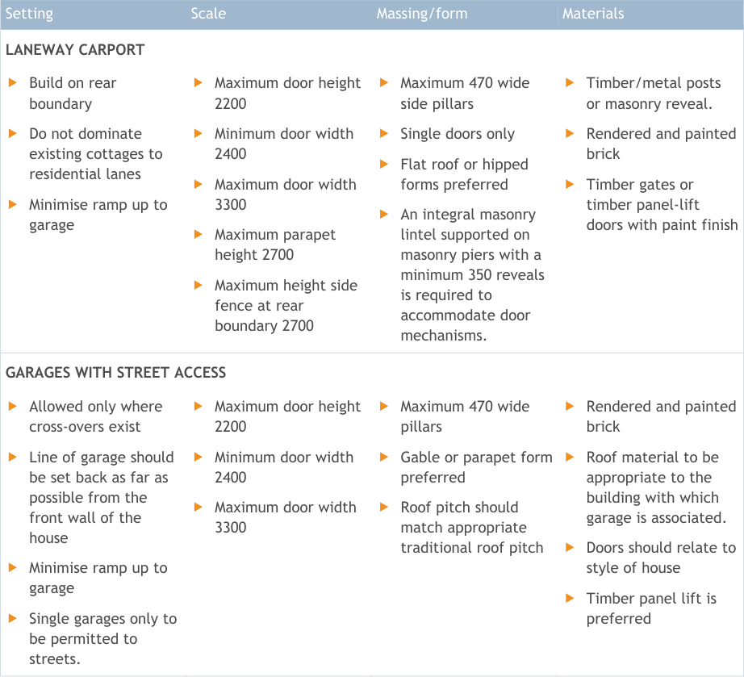

> [Picture on page 103: a map, saved as a picture (images/chapter-c2-woollahra-heritage-conservation-area-page-103-1.gif, 150 dpi); the street names and other small labels are on the picture.]
> [Picture text on page 103 is stored in the PDF without readable letters (no character map), so it could not be copied; see the original PDF.]
> Words printed on the picture (title and legend, copied from the PDF):
> Build on rear
> Maximum door height Maximum 470 wide Timber/metal posts
> or masonry reveal.
> Do not dominate Minimum door width Single doors only Rendered and painted
> Flat roof or hipped
> existing cottages to
> Maximum door width
> Timber gates or
> Minimise ramp up to
> An integral masonry
> doors with paint finish
> Maximum height side
> fence at rear
> lintel supported on
> masonry piers with a
> minimum 350 reveals
> is required to
> GARAGES WITH STREET ACCESS
> Allowed only where Maximum door height Maximum 470 wide Rendered and painted
> cross-overs exist 2200
> Line of garage should Minimum door width Gable or parapet form Roof material to be
> Maximum door width Roof pitch should
> appropriate to the
> building with which
> garage is associated.
> be set back as far as
> possible from the
> front wall of the
> traditional roof pitch Doors should relate to
> style of house
> Minimise ramp up to
> Timber panel lift is
> Single garages only to
> be permitted to

FIGURE 24  Garage maximum dimensions

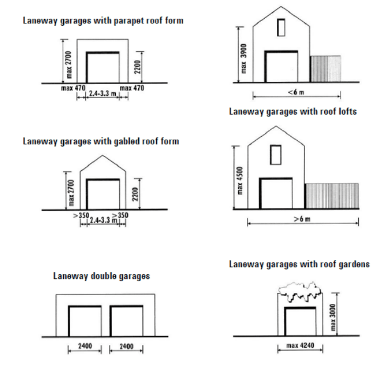

> [Picture on page 104: a picture, saved as a picture (images/chapter-c2-woollahra-heritage-conservation-area-page-104-2.gif, 150 dpi).]

FIGURE 25  Gable ended loft structure example (including maximum dimensions)

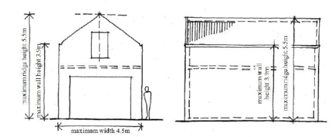

> [Picture on page 104: a picture, saved as a picture (images/chapter-c2-woollahra-heritage-conservation-area-page-104-4.gif, 150 dpi).]

A gable ended roof is defined as: a roof with a gable end facing the street or lane.

FIGURE 26 Transverse gable  loft structure example

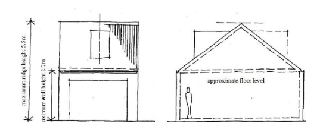

> [Picture on page 104: a picture, saved as a picture (images/chapter-c2-woollahra-heritage-conservation-area-page-104-9.gif, 150 dpi).]

A transverse gable roof is defined as: a roof with gable ends, where the ridge is parallel to the rear boundary.

#### Contributory items - Original garages

While large houses may have had stables or coach houses, garages and carports and on-site parking areas for motor vehicles were not elements incorporated into Victorian or Federation buildings and their sites. The garage emerged as a building type only with the introduction of the motor vehicle just before World War 1.

#### Objectives

O10  To retain and conserve the original coach house and stable structures from the Victorian and Federation periods.

O11 To retain and conserve the original detached garage buildings of the Inter-War houses and flat buildings.

#### Controls

C17  Original garages, coach houses, stables and outbuildings must be retained and conserved.

C18 Original doors to garages that are contemporary with the construction of a contributory item are to be contained and conserved where possible. Where new doors must be added to early garage structures, they are to be appropriate in colour, materials and detail to the original garage building and the contributory item with which it is associated.

#### C2.5.9 Security

Obtrusive security devices, such as external metal grilles and roller shutters, detract from the appearance of individual buildings and the Woollahra HCA as a whole.

#### Objectives

O1 To discourage the addition of window and door grilles and to encourage the use of alternative security measures.

O2 Where there is no alternative to the installation of window grilles, to ensure that they are designed and painted to be unobtrusive and do not contain decorative pseudo-period detail.

#### Controls

C1 Where additional security is required for buildings, it is to be provided by the least obtrusive method, such as mortice deadlocks, window locks, alarm systems or internal security grilles. External shutters may also be appropriate if shutters were original to the building. External security grilles to windows and doors are discouraged within the Woollahra HCA.

C2 Where there is no alternative, the installation of external security bars are permitted provided grilles consist of simple unembellished rectangular bars in a vertical pattern or a pattern that reflects the configuration of the glazing bars of the window or door frame. Clear plastic security film may be attached to the internal face of glazing.

C3 Roller shutters will not be permitted to windows or doors within the Woollahra HCA.

#### C2.5.10 Excavation

Excavation and below ground construction can impact on original footings and walls and natural ground water flows, resulting in potential damage to buildings. The following objectives and controls have been developed to preserve the structural integrity of buildings and to limit groundwater impacts to adjoining and adjacent properties.

#### Objectives

O1 To ensure the structural integrity and stability of individual buildings, the terrace of buildings of which they are a part, and neighbouring properties.

O2 To protect the original fabric of the buildings significant to the area both during and after excavation.

O3 To ensure that objectives O1 and O2 are achieved by limiting the circumstances where excavation may occur.

O4 To limit the impact of excavation on the natural landform and vegetation.

O5 To relate development to the existing topography and existing ground levels.

O6 To avoid potential damage to all buildings and structures during and after excavation.

O7 To ensure that any new floor levels resulting from excavation and development do not compromise external heritage features of the building or those of its neighbours.

O8 To ensure that habitable rooms created by excavation are supplied with adequate natural light and ventilation in order to meet sustainable building principles.

O9 To maintain natural subsurface ground water flows.

O10  To recognise the protection necessary for potential archaeological objects.

#### Controls

C1 Where the existing ground slopes and adjoining properties have basement levels, a basement level may be permitted in development but must not be used as a garage at the street front.

C2 The building footprint is designed to minimise cut and fill on sloping sites and to encourage good quality internal environments.

C3 Excavation is not to occur forward of the front façade in the street front zone.

C4 Sub-surface walls are no closer to the boundary than permitted by the setback controls (refer to Figure 28).

C5 Notwithstanding C4, for excavation in relation to an existing attached dwelling, semi-detached dwelling, or attached dual occupancy—excavation is not to occur under common walls, footings to common party walls, freestanding boundary walls, or footings to freestanding boundary walls.

C6 Excavation below 2m and/or within 1.5m of the boundary is accompanied by a geotechnical report and a structural report to demonstrate that the works will not have any adverse effect on the neighbouring structures. Note: Council may identify other circumstances where these reports are required.  All reports must be prepared in accordance with Council’s guidelines. Council may also require the preparation and submission of a pre-commencement dilapidation report for properties neighbouring the development.

Excavation for garage structures

C7 Boundary to boundary excavation may be permitted for garage structures on rear laneways if:

a) the structure complies with Section 2.5.8 Parking and garages;

b) the structure does not adjoin the principal building form or secondary wing of a building constructed on the common boundary of an adjoining site; and

c) no original footings on adjoining sites will be disturbed.

Excavation for other structures beyond the principal building form or secondary wing

C8 Excavation may be permitted for structures such as pools, spas, or other permissible development if:

a) for properties less than 6m in width — the outer edge of excavation is setback from side boundaries by at least 900mm;

b) for properties 6m or more in width — the outer edge of excavation is setback from side boundaries by at least 1.5m;

c) the lowest habitable room, if any, of the proposed development has at least one external wall fully above the existing ground level;

d) no original footings on an adjoining property will be disturbed; and

e) a geotechnical report ensures that works will not have any adverse effect on the neighbouring structures. The report must be prepared in accordance with Council’s guidelines.

FIGURE 28

Sub-surface walls can be no closer to the

boundary than the required setback

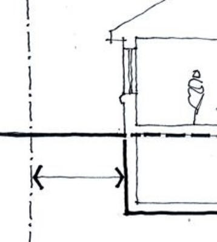

> [Picture on page 109: a picture, saved as a picture (images/chapter-c2-woollahra-heritage-conservation-area-page-109-4.gif, 150 dpi).]

#### C2.5.11 Subdivision and site amalgamation

The Woollahra HCA has a complex and varied subdivision pattern which demonstrates the different historical stages of its development and contributes to the area’s aesthetically significant visual complexity.

Woollahra LEP 2014 sets the minimum lot size for subdividing land.  These DCP controls seek to ensure that future subdivision and site amalgamation responds appropriately to the historical pattern of subdivision.

#### Objectives

O1 To retain the historically based subdivision patterns of the Woollahra HCA.

O2 To ensure that subdivisions or site amalgamations will not lead to adverse impacts on the curtilages or settings of contributory items.

O3     To ensure that subdivision or amalgamation of sites provides an appropriate response to the historical character of the heritage conservation area and the relevant aspects of its historical pattern of development.

#### Controls

C1 Subdivision of an existing lot to create a new lot, or to amalgamate a number of lots, must be of a size which reflects the characteristics of historically relevant lots adjoining and in the vicinity of the site.

C2 Where lots are amalgamated, the demolition of contributory items on the original lots will not be permitted.

C3 Public lanes and public pedestrian passageways are not to be amalgamated with private land.

#### C2.5.12 Acoustic and visual privacy

Levels of acoustic and visual privacy are major determinants of the ability of residents and their neighbours to enjoy living in their homes.

The privacy needs of residents and neighbours should be considered at all stages of design, including the location of new buildings or alterations and additions, the placement of windows and the selection of materials and construction techniques.

Visual privacy can be achieved by layout that prevents overlooking or by incorporating screening and separation.

The required level of acoustic isolation depends upon the location of habitable rooms relative to noise sources such as air conditioning units, swimming pool pumps and major roads. Construction details need to be carefully considered to maximise acoustic privacy both within and between buildings.

#### Objectives

O1 To ensure an adequate degree of acoustic and visual privacy in building design.

O2 To minimise the impact of new development, which includes alterations and additions to existing buildings, on the acoustic and visual privacy of existing development on neighbouring land.

#### Controls

C1 Bedrooms of one dwelling are not to share walls with living rooms or garages of another dwelling.

C2 Bedroom windows are to be located at least 3m from streets, shared driveways and parking areas of other dwellings.

C3 In sensitive locations, such as on busy roads or where commercial, retail or other non-residential buildings are close to residential properties, an acoustic report prepared by a suitably qualified and experienced professional may be required by the Council as part of the site and context analysis process.

C4 Sound attenuation measures such as acoustic glazing and insulation are to be provided for new development close to high-noise sources such as busy roads and the Eastern Suburbs railway line. The design in these circumstances is to be certified by a qualified Acoustic Engineer.

C5 Electrical, mechanical, hydraulic and air conditioning equipment is to be housed so that it does not create an 'offensive noise' as defined in the Protection of the Environment Operations Act 1997, either within or at the boundaries of any property at any time of the day.

C6 Windows, balconies, screening devices and landscaping must be located to minimise direct overlooking of the main living areas and private open spaces of neighbouring properties.

C7 Windows to bathrooms, toilets, laundries and storage rooms must be fitted with obscure glazing if they allow direct views to or from main living areas and private open spaces of neighbouring properties.

C8 Rear and side balconies must not impact on the privacy of the building's occupants and on the occupants of neighbouring properties. This may require the use of privacy screens, which should be designed with regard to the architectural style of the building.

C9 Habitable room windows with a direct sightline to another dwelling’s habitable room windows within 9m must:

a) be offset by a distance sufficient to restrict views into the other window; or

b) have sill heights of 1.5m above floor level; or

c) have fixed obscure glazing in any part of the window less than 1.5m above floor level.

C10  Direct overlooking of the main living areas or private open space of an existing dwelling from windows, balconies, stairs, landings, terraces and decks or other private, communal or public areas within a development is to be obscured or screened. No screening is required where:

a) windows are in bathrooms, toilets, laundries, storage rooms or other non-habitable rooms and have obscure glazing or a sill height of 1.5m or more above floor level; or

b) windows are in habitable rooms and have a sill height or 1.5m or more above floor level or obscure glazing in any part of the window less than 1.5m above floor level.

C11  Screens are to be designed with regard to the architectural style of the building.

C12  Windows and balconies of an upper-level dwelling should be designed to prevent overlooking of the private open space of a lower-level dwelling directly below and within the same development.

C13  Balconies should be designed to provide privacy for occupants of the building when viewed from the street or nearby public space without the balcony detailing conflicting with period detailing.

#### C2.5.13  Site facilities and aerial devices

The roofs of the Woollahra HCA are integral components of its character and heritage significance. The introduction of unsympathetic and uncharacteristic site facilities such as air-conditioning units and condensers and aerial devices can have an adverse impact on the aesthetic significance of individual buildings and precincts and the area as a whole. Fixing these structures onto roofs and chimneys can also damage the original fabric and detail.

The location and design of other site facilities such as fire safety systems, mail boxes, external storage facilities, clothes drying areas and laundry facilities can also have a detrimental impact on the appearance and character of the area and must be carefully considered.

Note: Solar energy systems such as photovoltaic electricity generating systems, solar hot water systems, or solar air heating systems are addressed in Chapter E6, Section 6.3 Solar Energy Systems.

#### Objectives

O1 To retain the character of the original roofscape of the Woollahra HCA.

O2 To protect the original fabric and details of roofs and chimneys.

O3 To ensure that satellite dishes, aerials and similar devices, air-conditioning units, external condensers and other site facilities do not detrimentally impact on the character and significance of individual buildings and the streetscape.

O4 To ensure that adequate provision is made for essential site facilities.

O5 To ensure that the essential site facilities are functional, accessible and are easy to maintain.

O6 To ensure that site facilities are thoughtfully integrated into development and are unobtrusive.

O7 To minimise visual and acoustic impacts on adjoining properties.

#### Controls

C1 Service infrastructure of all infill or replacement development should be located underground.

C2 Satellite dishes, aerials and similar devices:

a) must not be located on any part of the roof or chimney which is visible from the street frontage or the public domain;

b) must not have a detrimental impact on the architectural and heritage character of the building to which they are attached; and

c) are to be suitably located, designed, sized, enclosed, concealed, screened and/or otherwise integrated with the building to be visually discreet and unobtrusive and to minimise impacts on adjoining properties.

C3 Air conditioning units, condensers and other mechanical plant equipment in infill development or substantial additions must be located internally within the building.

C4 Any part of an air conditioning unit, condenser and any other mechanical plant equipment located externally must be located:

a) behind the outer front wall of the building and not be visible from the public domain;

b) less than 1.8m above existing ground level or a basement level or part underground level (but not on a roof); and

c) to minimise noise impacts on adjoining properties.

C5 Air conditioning units, condensers and other mechanical plant equipment must be wholly contained within the permissible building envelope and not be visible from an adjoining property whilst being suitably located, designed, sized, enclosed, concealed, screened and/or otherwise integrated with the building.

C6 External conduits must not exceed 3m in length and must not be visible from the public domain.

C7 Hydraulic fire services such as fire hydrants and booster installations must be concealed. These services are to be:

a) Enclosed with doors if located in the building façade, or

b) Housed in a cabinet or enclosure if located external to the building.

The location, design, colour and material of the doors, cabinet or enclosure must be visually unobtrusive and suitably integrated with the development, including fencing and landscaping.

C8 Television aerials are to be located within the roof area where practicable. If this option is not suitable for reasons such as lack of space or if the area is being used for storage or habitation, the aerial should be located on a secondary rear roof rather than attached to a main chimney.

C9 Site facilities, including mail boxes, external storage facilities, clothes drying areas and laundry facilities are to be unobtrusively integrated into new development. Note: Information relating to specific requirements for garbage and recycling is contained in Part E of this DCP, Chapter E5 Waste Management and Council’s DA Guide.

C10 An electricity substation is to be suitably located, screened and/or concealed so it is not visible from the street, or any other adjoining public place. Council’s preference is for a chamber substation. Any screening or enclosure to conceal the substation is to be visually unobtrusive and suitably integrated with the development, including the fencing and landscape design.

C11 The electricity substation is to be located away from neighbouring properties or sufficiently screened from neighbouring properties.

C12 The location and design of the electricity substation must be considered and integrated with the landscaping of the proposed development, and must ensure that:

a) Vegetation does not overhang or encroach within the substation site.

b) The substation is installed outside of the mature growth root zone of any trees to be retained, or proposed to planted, to prevent roots damage to underground cables.

C13 The design and location of all other aboveground utility infrastructure (such as electrical pillars etc.) should minimise visual clutter within the streetscape and provide for a continuous accessible path of travel, where practical to ensure safe and equitable pedestrian circulation for people of all abilities. (Where this provision and Ausgrid’s requirements cannot both be satisfied, the applicant is to develop in consultation with Council and Ausgrid a solution that meets the acceptance of both consent authorities.)

Notes:

• At the DA stage the applicant should demonstrate that they have engaged with Ausgrid and have a network capacity assessment undertaken for the proposed development.

• Where a substation is required, the substation should be identified on the DA plans and addressed in the SEPP 65 Design Verification Statement (also see Apartment Design Guide Objective 3C-2 Amenity of the public domain is retained and enhanced).

• The DCP requirements for substations apply in addition to the Ausgrid Network Standards, such as NS113 Site selection and construction design requirements for chamber substations. Separate Ausgrid approval for the substation will be required.

• A dedicated access way/easement through the site to the substation will also need to be provided in accordance with the requirements of Ausgrid and Council.
