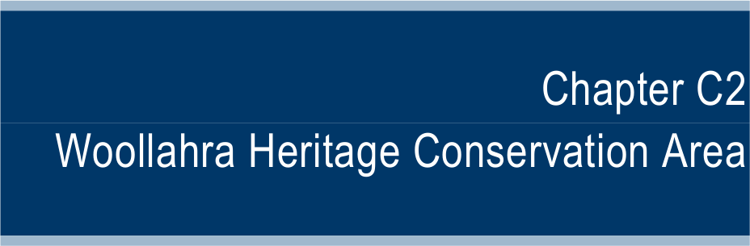

# Woollahra Development Control Plan 2015 - Chapter C2 Woollahra Heritage Conservation Area

> This chapter is split into 8 section file(s), one per numbered heading, in the order they appear in the PDF.

Source PDF: [chapter-c2-woollahra-hca.pdf](https://planfortomorrow.sharepoint.com/sites/Planfortomorrow/Shared%20Documents/00%20NSW-Planning-Resources/dcp/woollahra-development-control-plan-2015/chapter-c2-woollahra-heritage-conservation-area/chapter-c2-woollahra-hca.pdf)

> [Picture on page 1: a picture, saved as a picture (images/chapter-c2-woollahra-heritage-conservation-area-page-1-1.gif, 150 dpi).]

### Chapter C2

### Woollahra Heritage Conservation Area

### Part C  Heritage Conservation Areas

### CHAPTER C2 APPROVED ON 27 APRIL 2015 AND COMMENCED ON 23 MAY 2015

### Last amended on 22 December 2023

<!-- sections -->
## Sections

1. [C2 Woollahra HCA](01-c2-woollahra-hca.md)
2. [C2.1 Introduction](02-c2-1-introduction.md)
3. [C2.2 Understanding the context](03-c2-2-understanding-the-context.md)
4. [C2.3 Precincts](04-c2-3-precincts.md)
5. [C2.4 Building type controls](05-c2-4-building-type-controls.md)
6. [C2.5 General controls for all development](06-c2-5-general-controls-for-all-development.md)
7. [C2.6 Public domain](07-c2-6-public-domain.md)
8. [C2.7 Schedule of contributory items](08-c2-7-schedule-of-contributory-items.md)
