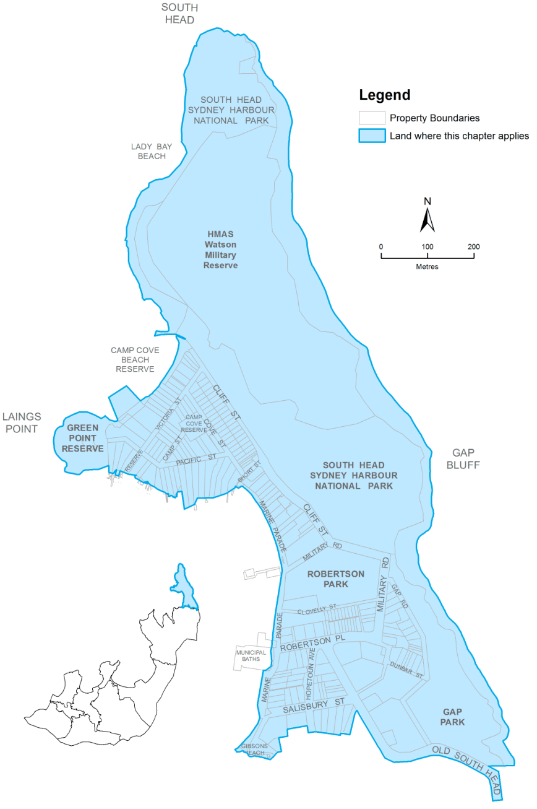

#### C3.1.3 Development to which this chapter applies

This chapter applies to development that requires consent under Woollahra LEP 2014.

Note: Parts of Watsons Bay are under the control of State or Commonwealth authorities and development within these precincts does not require consent from Council.  For those precincts, this chapter provides a set of guidelines for those authorities to consider when preparing any plans of management or undertaking development in the precinct.

MAP 1  Watsons Bay HCA chapter boundary

> [Picture on page 6: a picture, saved as a picture (images/chapter-c3-watsons-bay-heritage-conservation-area-page-6-2.gif, 150 dpi).]
