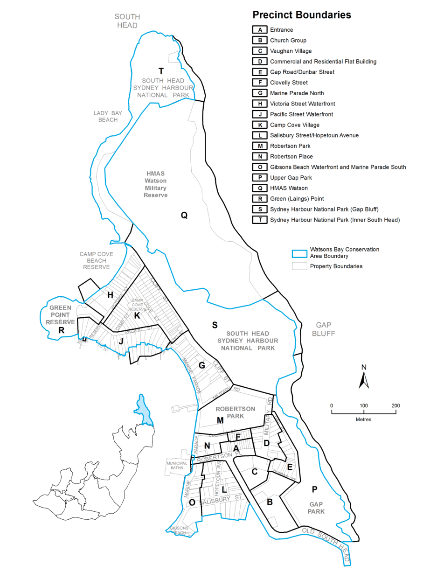
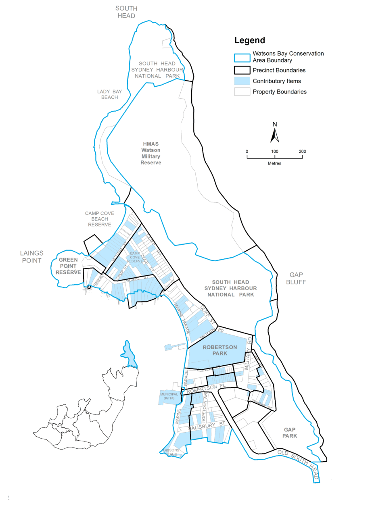

#### C3.1.7 How to use this chapter

The provisions of this chapter are to be used by applicants in the sequence set out below.

TABLE 1  How to use this chapter

#### Steps to be considered for all development

#### Step 1  Understanding the context

Read Section C3.2 including the statement of significance for the Watsons Bay HCA and the key heritage values. Identify the precinct where the subject site is located (refer to Map 2). Read the precinct character statement in Section C3.4.

#### Step 2 Understanding your site

Identify whether the building or site is a heritage item as identified in Woollahra LEP 2014. Identify whether the building or site is a contributory item (refer to Map 3). Consider the history and relationship of the subject site and surrounding sites, having particular regard to heritage items and contributory items in the street.

#### Step 3 Addressing the objectives and controls

For development that requires consent—each section must be read and the relevant objectives and controls applied: Section C3.3 Objectives for development: These objectives apply to the precinct controls and the general development controls. Section C3.4 Precincts: This section contains a character statement and controls for each precinct. Section C3.5 General controls for all development: General controls apply to all development. Section C3.6 Contributory items: Additional built form controls (if the subject site is a heritage item or a contributory item). Section C3.7 Public domain: Applies to land owned and/or managed by Council or other public authorities.

For development on public land that does not require consent—each of the above sections should be read, and the relevant objectives and precinct guidelines used to inform development to ensure appropriate conservation and management of the heritage values in the precinct.

MAP 2  Watsons Bay precinct boundaries

> [Picture on page 9: a picture, saved as a picture (images/chapter-c3-watsons-bay-heritage-conservation-area-page-9-2.gif, 150 dpi).]

MAP 3  Contributory items

> [Picture on page 10: a picture, saved as a picture (images/chapter-c3-watsons-bay-heritage-conservation-area-page-10-2.gif, 150 dpi).]
