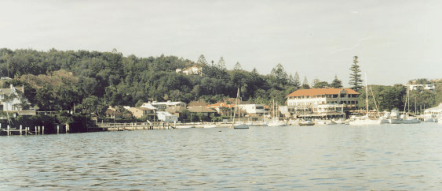
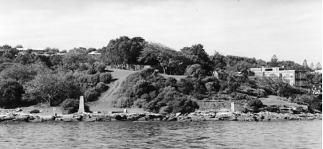
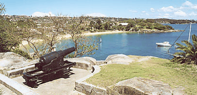
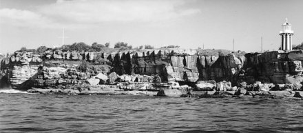
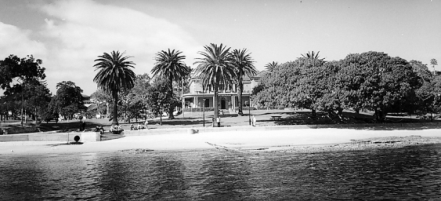

#### C3.2.2 General character description

Watsons Bay is dominated by a rugged coastal landscape that defines the east side of a narrow peninsula at the entrance to Sydney Harbour. Its natural topography includes exposed ridges and cliff faces to the Tasman Sea, which contrast with the protected bays and sheltered beaches on Sydney Harbour.

A subdivision and development pattern has evolved since settlement on the gently sloping western side of the peninsula. The pattern is clearly influenced by the landform, topography and drainage patterns.

The built form retains the character of a low-scaled early 19th and 20th century maritime village, enhanced by natural vegetation and parklands, including the continuous park along the ridge line and cliff tops.

The area offers important views and vistas to the heads, Sydney Harbour, the Sydney CBD and the Tasman Sea. Landmarks within the area, such as church spires and the lighthouse, can be viewed from the Sydney CBD Maritime linkages are visually reinforced by the many maritime structures including wharves, jetties, boat sheds and promenades that remain.

Watsons Bay from the harbour

> [Picture on page 13: a picture, saved as a picture (images/chapter-c3-watsons-bay-heritage-conservation-area-page-13-17.gif, 150 dpi).]

Green (Laings) Point

> [Picture on page 13: a picture, saved as a picture (images/chapter-c3-watsons-bay-heritage-conservation-area-page-13-19.gif, 150 dpi).]

Hornby Lighthouse and sandstone cliffs at South Head Gun emplacement looking over Camp Cove

> [Picture on page 13: a picture, saved as a picture (images/chapter-c3-watsons-bay-heritage-conservation-area-page-13-21.gif, 150 dpi).]

> [Picture on page 13: a picture, saved as a picture (images/chapter-c3-watsons-bay-heritage-conservation-area-page-13-22.gif, 150 dpi).]

Dunbar House and Robertson Place with Robertson Park

> [Picture on page 13: a picture, saved as a picture (images/chapter-c3-watsons-bay-heritage-conservation-area-page-13-24.gif, 150 dpi).]
