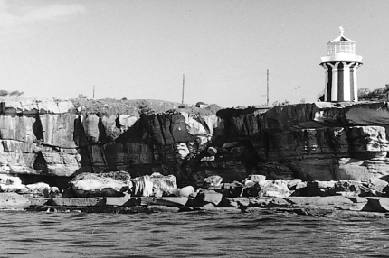
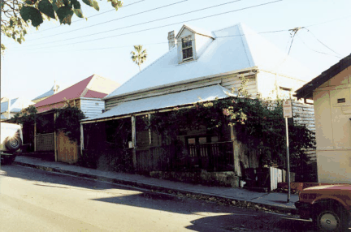

#### C3.2.3 Statement of significance

Watsons Bay is a place of great natural and scenic beauty. It is a rare combination of a dramatic and varied coastal landscape and a village that evolved from the first landing point in Sydney Harbour in 1788, the third permanent settlement in New South Wales from 1790 and a pilot station established in 1792.

It conveys a strong sense of its maritime heritage in its built and landscape features that evidence four key historic themes: The growth of a village: Evident in the subdivision and development pattern that occurred during the 19th century and continued throughout a number of phases. These phases are demonstrated in the range of building types still present in the area, from moderately scaled fisherman’s cottages, more substantial houses and marine villas to Inter-war period housing and community buildings. Navigation:  Evidenced by the key role South Head has played in piloting ships into Sydney. A number of navigation structures, such as the lighthouse, wharves and jetties, have important historic and aesthetic significance. The defence of Sydney at The Heads: Reflected in the 19th century South Head batteries and artillery establishment, complex of fortifications, HMAS Watson and the extent of the untouched landscape typical of defence occupation of the foreshores. Recreation and tourism: Dating from as early as 1803, there has been a strong emphasis on water related tourism facilities, such as hotels, beach promenades and parks. Tourism was further enhanced as a result of the area's association with shipwrecks and by association with important cultural figures such as Christina Stead and Zane Grey. The extensive and varied landscape and village character also contributes to the appeal of Watsons Bay to tourists.

Hornby Lighthouse (1857–1858)

above the cliffs of South Head

> [Picture on page 14: a picture, saved as a picture (images/chapter-c3-watsons-bay-heritage-conservation-area-page-14-26.gif, 150 dpi).]

Timber weatherboard cottages in Cliff Street

> [Picture on page 14: a picture, saved as a picture (images/chapter-c3-watsons-bay-heritage-conservation-area-page-14-28.gif, 150 dpi).]

> [Picture text on page 15 is stored in the PDF without readable letters (no character map), so it could not be copied; see the original PDF.]
