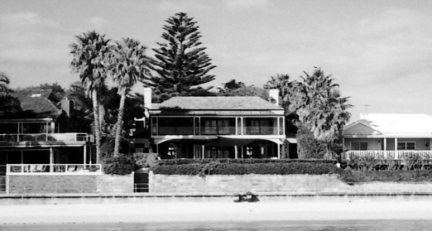
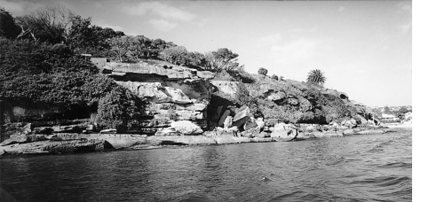
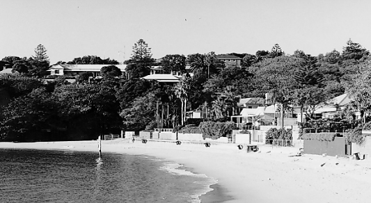
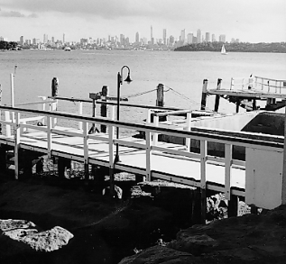
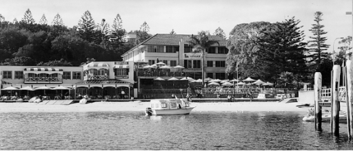
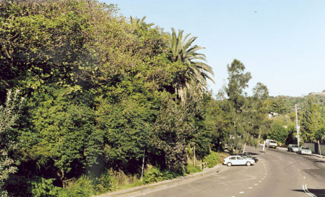
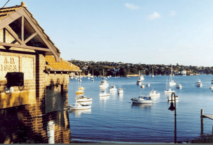
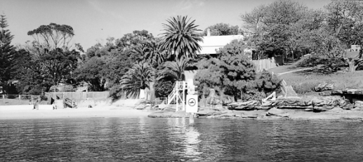
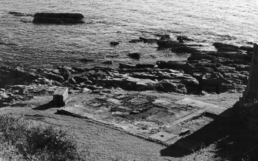

#### C3.2.4 Key heritage values

#### Historic (evolution)

A true Gateway to Sydney: reflected in the area’s modest start as a fishing village and maritime heritage. Role in navigation: pilot station, lighthouses, wharf, jetties and navigational markers. Role in defence: HMAS Watson, coastal defence structures and relics, Water Police, Constable's Cottage, gun emplacements, underwater mine control tunnels and winch house for anti-torpedo and midget submarine boom net at Green (Laings) Point. Evidence of early fishing village and more substantial houses built for master mariners, pilots, lighthouse keepers and city merchants. A later wave of Inter-War housing and associated public buildings and community infrastructure (development/subdivision). Importance as a historical tourist destination and recreation venue: ferry wharf, hotels, tea room, waterfront promenade, cliff walk, parks, The Gap, yacht club and game fishing club. Strong sense of history represented in historic road alignments, built character and monuments such as South Head Road obelisk, Governor Phillip Memorial Site of an early, if not the first, marine biological research station in Australia which reflects the diversity of the aquatic environment. Educational role: Former School of Artillery, Submarine Warfare Systems Centre, former Watsons Bay State School (now scout hall), former site of Catholic Parish School and Convent School.

#### Historic (association)

Reflected in Watsons Bay place names is the area’s association with maritime figures and events such as Lt William Bradley, Robert Watson, Henry Gibson and historic shipwreck, Dunbar. The area has been the inspiration for books and other literature and is associated with authors Christina Stead and Zane Grey. Watsons Bay is associated with leading figures in Sydney’s history. Examples include ‘Clovelly’ residents Hannibal Macarthur and Sir John Robertson, merchant pilot and lighthouse keeper Richard Siddons  and Colonial Architect Mortimer Lewis

More substantial housing in Victoria Street, Camp

Cove

> [Picture on page 15: a picture, saved as a picture (images/chapter-c3-watsons-bay-heritage-conservation-area-page-15-33.gif, 150 dpi).]

Sydney Harbour National Park (Inner South Head)

> [Picture on page 15: a picture, saved as a picture (images/chapter-c3-watsons-bay-heritage-conservation-area-page-15-35.gif, 150 dpi).]

Camp Cove Beach

> [Picture on page 16: a picture, saved as a picture (images/chapter-c3-watsons-bay-heritage-conservation-area-page-16-2.gif, 150 dpi).]

Views across the harbour

> [Picture on page 16: a picture, saved as a picture (images/chapter-c3-watsons-bay-heritage-conservation-area-page-16-4.gif, 150 dpi).]

#### Aesthetic

Scenic beauty. Dramatic and varied landscape: − topography, exposed cliffs, protected bays; − sheltered beaches, tranquil ambience; and − pedestrian quality/amenity. Low-scale built form, subservient to landscape. Collection of small-scale cottages, including important weatherboard groupings. Views and vistas (see Map 4  in Section 3.3.4): − from elevated landform and parks; − across Robertson Park from promenade; − in from harbour; − water glimpses from streets; and − glimpses of landmarks/churches/significant trees. Number of landmark buildings, including Dunbar House and the St Peters Church. Backdrop of vegetation that dominates buildings. Rock shelves and beaches. Natural edges, including coastal vegetation in Sydney Harbour National Park, juxtaposed with built edges. Cultural plantings such as the Moreton Bay figs in Robertson Park as well as the coral trees in Cliff Street.

North end of Marine Parade

> [Picture on page 17: a picture, saved as a picture (images/chapter-c3-watsons-bay-heritage-conservation-area-page-17-2.gif, 150 dpi).]

#### Social

Scenic beauty and low-scale village character valued by the local community and visitors. Importance to Sydneysiders as a tourism and recreational destination. Attention as a place where Sydney residents bring visitors from interstate and overseas to enjoy its character, ambience and sense of history. Availability as a place to view Sydney Harbour, the Tasman Sea and the coast as well as enjoy maritime events such as yacht races, fireworks and arriving ships). Maritime sports clubs, including Vaucluse Yacht Club and Sydney Game Fishing Club. Gathering place for families and friends.  Venues such as the Naval Chapel, St Peters, Star of the Sea, The Gap Bluff Centre and Dunbar House are within walking distance between venues (Naval Chapel, St Peters, Star of the Sea, The Gap Bluff Centre, Dunbar House).

#### Scientific (ability to yield information)

Role in defence: anti-torpedo and midget submarine boom net at Green (Laings) Point. Marine life: biological research, sea grasses. Potential to contain archaeological evidence of its early development. Gap Bluff, site of early radar development by navy.

Cliff Street with Sydney Harbour National Park at left Recreational boating

> [Picture on page 17: a picture, saved as a picture (images/chapter-c3-watsons-bay-heritage-conservation-area-page-17-20.gif, 150 dpi).]

> [Picture on page 17: a picture, saved as a picture (images/chapter-c3-watsons-bay-heritage-conservation-area-page-17-21.gif, 150 dpi).]

Former Marine Biological Research Station at Green (Laings)

Point

> [Picture on page 18: a picture, saved as a picture (images/chapter-c3-watsons-bay-heritage-conservation-area-page-18-3.gif, 150 dpi).]

Archaeological remains

at Green (Laings) Point

> [Picture on page 18: a picture, saved as a picture (images/chapter-c3-watsons-bay-heritage-conservation-area-page-18-6.gif, 150 dpi).]
