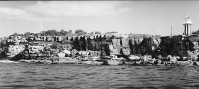
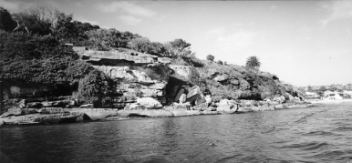
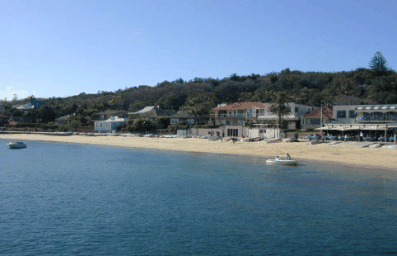
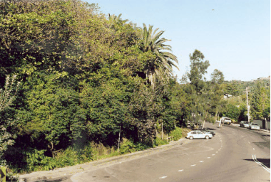

#### C3.3.1 Topography and vegetation

Watsons Bay is dominated by a rugged coastal landscape. Its natural topography includes exposed heath-covered ridges and sheer sandstone cliff faces to the Tasman Sea and harbour mouth, which contrasts with the protected bays and sheltered beaches within Sydney Harbour.

The area retains an extensive backdrop of natural vegetation as well as significant cultural plantings and historic parklands. The extensive and varied landscape also contributes to the attraction of Watsons Bay for tourists.

#### Objectives

O1 To ensure that the landforms of Watsons Bay remain a dominant feature of the landscape.

O2 To ensure that new development respects the existing topography of the conservation area.

O3 To ensure that significant natural and cultural plantings are retained, in both the public and private domains.

O4 To ensure that new development retains significant cultural plantings, minimises the impact on existing vegetation and respects the character of the landscape.

O5 To retain the prominence of the vegetated landscape and the prominence of the treed skyline.

Sandstone cliff faces, South Head

> [Picture on page 21: a picture, saved as a picture (images/chapter-c3-watsons-bay-heritage-conservation-area-page-21-19.gif, 150 dpi).]

Extensive and varied landscape

> [Picture on page 21: a picture, saved as a picture (images/chapter-c3-watsons-bay-heritage-conservation-area-page-21-21.gif, 150 dpi).]

Backdrop of vegetation

> [Picture on page 21: a picture, saved as a picture (images/chapter-c3-watsons-bay-heritage-conservation-area-page-21-23.gif, 150 dpi).]

Significant natural and

cultural plantings within Watsons Bay

> [Picture on page 21: a picture, saved as a picture (images/chapter-c3-watsons-bay-heritage-conservation-area-page-21-26.gif, 150 dpi).]
